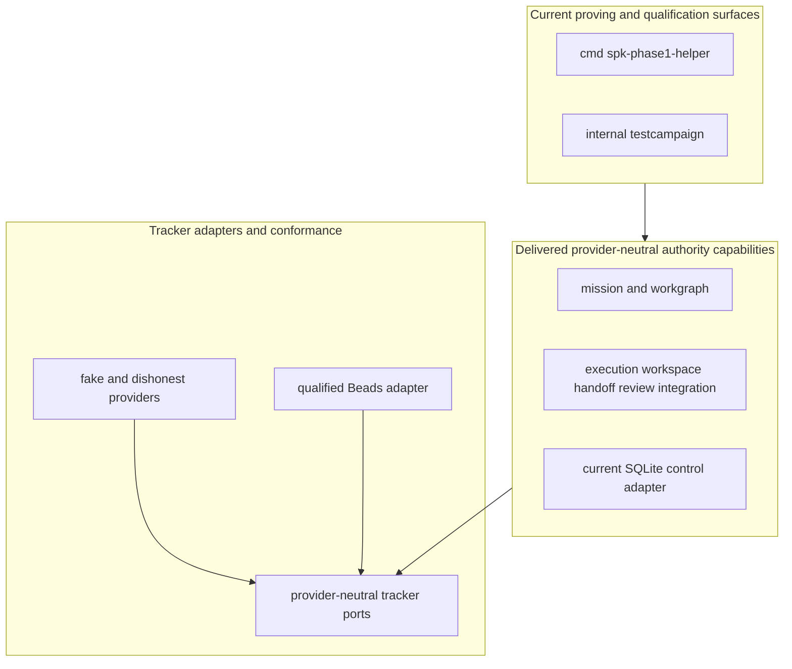
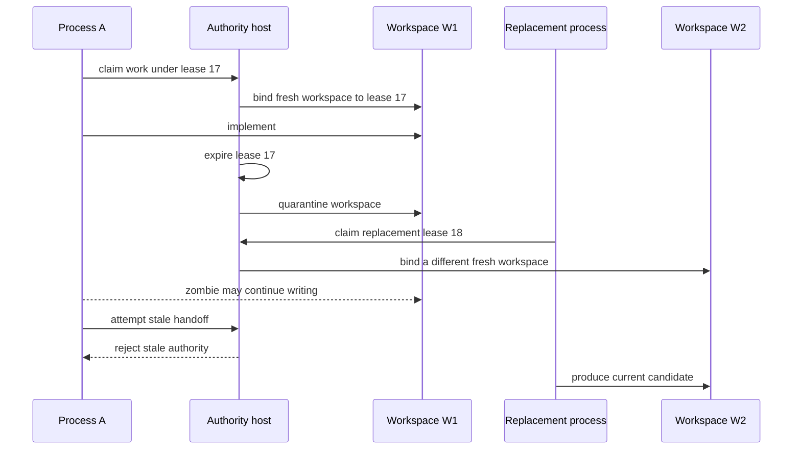

# Spec Kitty Redesign

> A Go-native authority kernel and qualified software-development mission
> method for safe, concurrent, provider-neutral work.

Spec Kitty Redesign preserves the original product's mission discipline,
isolated parallel work, independent review, and controlled integration without
copying the Python package structure. The repository has a substantial,
qualified Phase 1–3 implementation today. It also has a ratified production
architecture whose GapDB host, API 2.0, neutral acceptance engine, and optional
MCP adapter are deliberately described as target work rather than shipped code.

## Status at a glance

| Surface | Delivered and qualified now | Ratified production target |
|---|---|---|
| Authority and concurrency | Phase 1: leases, lease-scoped workspaces, quarantine, stale-authority refusal, ActorID-independent review, and serialized Git integration at the exact evidence boundary | Retain the laws and requalify them on the GapDB production host |
| Work substrate | Phase 2: provider-neutral ports and the exact Beads 1.2.2 JSON adapter tuple | Beads remains the default mutable work/discussion substrate, never mission or execution authority |
| Mission method | Phase 3: specification, plan, provider-neutral decomposition, immutable WorkRevision generations, drift reconciliation, typed `next`, and derived task projection | Compose the complete execution, review, acceptance, integration, progress, and recovery path |
| Control state | SQLite is the observed and qualified Phase 1–3 implementation | GapDB is the only approved production control-state substrate; M2 removes SQLite completely, with no fallback or dual write |
| Application surface | `cmd/spk-phase1-helper` is a proving and diagnostic helper | A production `spec-kitty` host exposes Orchestrator API 2.0 and the normal CLI |
| Acceptance | Repository-specific Go campaigns and candidate-bound evidence | Stack-neutral claims, approved provider bindings, typed evidence envelopes, and a policy gate |
| MCP | Not shipped and not required | Optional, separately packaged MCP `2026-07-28` adapter with Tasks as a projection of native operations |
| Host boundary | The delivered boundary is one machine and one filesystem authority | Same first-release boundary; remote callers use the application API |

“Delivered” above is bounded to the cited source and evidence. “Ratified target”
means an accepted design and governed delivery sequence, not an implementation
claim.

## Five-minute review path

Read these in order to answer what works, what is approved, what remains, and
what happens next:

1. This status table and [Delivered Phase 1–3](#delivered-phase-13).
2. [Production Orchestration Architecture](https://github.com/spec-kitty/spec-kitty-redesign/blob/main/docs/PRODUCTION_ORCHESTRATION_ARCHITECTURE.md)
   and [ADR 0002](https://github.com/spec-kitty/spec-kitty-redesign/blob/main/docs/adr/0002-production-orchestration-architecture.md)
   for the sole normative target.
3. [Orchestrator API 2.0](https://github.com/spec-kitty/spec-kitty-redesign/blob/main/docs/ORCHESTRATOR_API_2_0.md),
   [stack-neutral acceptance](https://github.com/spec-kitty/spec-kitty-redesign/blob/main/docs/STACK_NEUTRAL_ACCEPTANCE.md),
   and the [optional MCP adapter](https://github.com/spec-kitty/spec-kitty-redesign/blob/main/docs/MCP_2026_07_28_ADAPTER.md)
   for specialized proposed contracts.
4. The [production runtime program](https://github.com/spec-kitty/spec-kitty-redesign/blob/main/docs/PRODUCTION_RUNTIME_PROGRAM.md)
   for the M1–M7 dependency graph and stop conditions.
5. [Historical dispositions](https://github.com/spec-kitty/spec-kitty-redesign/blob/main/docs/HISTORICAL_ARCHITECTURE_DISPOSITIONS.md),
   [API 1.3 compatibility](docs/ORCHESTRATOR_API_1_3_PROJECTION.md), and the
   [Python behavior inventory](docs/PYTHON_BEHAVIOR_INVENTORY.md) for provenance.
6. [Build and run the current repository](#build-and-run-the-current-repository)
   and [Evidence](#evidence) for reproducible present-tense claims.
7. [What happens next](#what-happens-next) for M1 admission and its stop rule.

## What makes this port distinct

This is a behavior-preserving re-architecture, not a source-level translation.
The original implementation is behavioral evidence, not a Go package template.

| Concern | Go-native decision | Reason |
|---|---|---|
| Work representation | Provider-neutral tracker ports; Beads is the first qualified adapter | Agents work on the product instead of maintaining Markdown checkboxes |
| Mission semantics | Spec Kitty owns lifecycle and gates | Ticket edits cannot authorize execution or acceptance |
| Identity | Durable `ActorID`; per-execution `ProcessID` | Recovery and independent review need different answers |
| Executable work | Immutable generation-numbered `WorkRevision` | Tracker drift becomes `continue`, `supersede`, `invalidate`, or `fork`, never an in-place contract edit |
| Concurrency | Each lease owns one mutable workspace forever | A replacement cannot inherit an unfenceable stale writer's directory |
| Provider integration | Narrow application-owned ports | Beads, GapDB, Git, qualification providers, and transports cannot leak vocabulary into the kernel |
| Evidence | Candidate-, revision-, and policy-bound records | A successful process or tracker status is not a verdict |

## Authority ownership

The architectural shorthand remains:

```text
Beads       -> what mutable work exists and what humans discuss
Spec Kitty  -> whether work may execute and how it is reviewed and accepted
Git         -> code, commits, trees, and ref outcomes
GapDB       -> target ordered control-state substrate, not product semantics
```


Consequences:

- A Beads assignment is not an execution lease.
- Beads readiness is not permission to run.
- Beads comments are not review verdicts.
- A tracker closure or status is not mission acceptance.
- A database fencing token cannot stop arbitrary POSIX writes.
- A completed implementation is not an approved candidate.
- An approved candidate is not an integrated Git fact.
- GapDB ordering cannot decide whether a transition is legal.

## Delivered Phase 1–3

The completed work is useful in its own right rather than “an incomplete app”:

- **Phase 1 authority proving ground:** real Git repositories and worktrees,
  concurrent claims, lease generations, quarantine and fresh replacement
  workspaces, immutable handoff, actor-level independent review, serialized
  integration, crash recovery, conflicts, and zombie-writer scenarios.
- **Phase 2 Beads integration:** bounded argv-only JSON protocol, exact provider
  identity, canonical project binding, portable and dishonest-provider
  conformance, contention, backup/restore, and attribution-safe refusal.
- **Phase 3 mission method:** governed specify/plan/decompose/finalize flow,
  immutable WorkRevision generations, semantic drift, mixed reconciliation,
  action-scoped governance, pure typed `next`, and non-authoritative task
  projection. Portable and real-Beads two-item scenarios pass at the recorded
  evidence boundary.

Current packages and `cmd/spk-phase1-helper` are proving/composition surfaces.
They are not the production host, API 2.0 server, GapDB runtime, neutral
acceptance engine, or MCP adapter. No command below implies those target
components already exist.

The delivered source keeps its helper/campaign surface outside the authority
kernel and keeps concrete tracker providers behind provider-neutral contracts:



### Lease-scoped workspaces

A fence protects Spec Kitty operations; it cannot fence a shell or editor.
When lease 17 expires, W1 is quarantined and lease 18 receives W2.



Review evaluates an immutable candidate, not a live directory. Phase 1 has no
waiver for actor-level reviewer independence; the historical wording correction
is recorded in [the Phase 1 erratum](docs/PHASE1_ACCEPTANCE_ERRATA.md).

## Approved production direction

The production architecture keeps active projections in memory for speed and
acknowledges authority-changing success only after one atomic durable GapDB
mutation. Storage recovery, Spec Kitty journal/checkpoint restore, new runtime
epoch creation, external reconciliation, and side-effect-free playback are
separate contracts.

The target production flow is:

```text
typed command
  -> validate revision, epoch, generation, lease, candidate, and policy
  -> pure in-memory reduction
  -> durable atomic GapDB event/result/effect-intent batch
  -> publish committed projection
  -> perform and observe external effects through adapters
```

Orchestrator API 2.0 is the proposed process-complete application seam. It
provides closed named commands, revisioned mission progress, legal next actions,
durable native operations, input decisions, cancellation intent, and resumable
watches. API 1.3 is compatibility history and may translate exactly one safe
operation or return a typed upgrade refusal; it is not canonical vocabulary.

Acceptance is stack-neutral. Policy contributes claims; an explicit binding
selects a qualified provider; a typed evidence envelope reports one bounded
observation; the acceptance kernel alone decides the complete proof set.
Repository commands belong inside providers, never in the kernel.

MCP is optional. A future separate `spec-kitty-mcp` module may project API 2.0
native operations as MCP `2026-07-28` Tasks. Task identity, TTL, disconnection,
or cancellation cannot change mission, lease, evidence, or Git authority. The
normal CLI and API remain complete when MCP is absent.

## Build and run the current repository

The module declares Go 1.26. The current checkout contains one buildable command,
`cmd/spk-phase1-helper`. You also need Git. After module download, portable
development and Beads contract proof require neither a Beads binary nor a
hosted service.

```bash
go mod download
make preflight
make beads-contract
```

Build all packages and the current helper into an explicit directory:

```bash
make build BUILD_DIR="$(pwd)/bin"
```

Or install only the current helper into the selected Go binary directory:

```bash
go install ./cmd/spk-phase1-helper
```

The current helper is not named `spec-kitty`. Production `spec-kitty`,
`gapdbd` packaging, API 2.0 serving, and `spec-kitty-mcp` are future M1–M7
outcomes and therefore have no present-tense install commands here.

## Qualified Beads operating contract

The exact qualified tuple is:

```text
Beads executable: 1.2.2
source tag commit: 6c124203e771433a3550c348771a5b5e27fd3c21
JSON envelope:    BD_JSON_ENVELOPE=1
schema_version:   1
integration:      argv-only documented JSON CLI
binary SHA-256:   0c9990691b3b574d4772c0a9fed260769d68af57eb8072ee2a60ff0b619c7bb6
```

Every linked worktree uses one canonical Beads workspace. Provider inspection
is read-only and does not initialize Beads, repair provider state, install hooks,
or edit agent files. The adapter refuses unavailable guarded arbitrary update
and safe arbitrary compensation semantics before mutation.

### Install and inspect the exact provider

The reviewed installer supports Linux/amd64 with Go 1.26.4 and a C compiler.
The destination is absolute, outside the source repository, and narrower than a
top-level system directory.

```bash
tool_root="$(mktemp -d /tmp/spec-kitty-beads-tools.XXXXXX)"
identity_file="$(mktemp /tmp/spec-kitty-beads-identity.XXXXXX.json)"
scripts/install-qualified-beads.sh --dest "$tool_root" > "$identity_file"
jq . "$identity_file"
beads_bin="$(jq -r .executable_path "$identity_file")"
sha256sum -- "$beads_bin"
BD_JSON_ENVELOPE=1 BD_NON_INTERACTIVE=1 "$beads_bin" version --json
```

Use the read-only helper only with absolute paths established by provider
preflight:

```bash
go run ./cmd/spk-phase1-helper tracker inspect-beads \
  --project example-project \
  --executable "$beads_bin" \
  --workspace /absolute/canonical/beads-workspace \
  --database-identity /absolute/existing/database-directory \
  --protocol-schema 1 \
  --mode embedded_serialized \
  --read-only=true \
  --expected-digest 0c9990691b3b574d4772c0a9fed260769d68af57eb8072ee2a60ff0b619c7bb6
```

Initialization is an explicit operator action shown only for a disposable Git
repository:

```bash
disposable="$(mktemp -d /tmp/spec-kitty-beads-disposable.XXXXXX)"
git -C "$disposable" init
(
  cd "$disposable"
  BD_NON_INTERACTIVE=1 "$beads_bin" init \
    --stealth --skip-agents --skip-hooks --non-interactive --prefix skt
)
```

The typed read-only preflight vocabulary is:

```bash
BD_JSON_ENVELOPE=1 BD_NON_INTERACTIVE=1 "$beads_bin" version --json
BD_JSON_ENVELOPE=1 BD_NON_INTERACTIVE=1 "$beads_bin" where --json
BD_JSON_ENVELOPE=1 BD_NON_INTERACTIVE=1 "$beads_bin" dolt show --json
BD_JSON_ENVELOPE=1 BD_NON_INTERACTIVE=1 "$beads_bin" dolt status --json
```

### Export, backup, and real-provider qualification

JSONL interchange is portable interchange, not a complete backup:

```bash
export_file="$(mktemp /tmp/spec-kitty-beads-export.XXXXXX.jsonl)"
BD_JSON_ENVELOPE=1 BD_NON_INTERACTIVE=1 \
  "$beads_bin" export --json > "$export_file"
```

A Dolt-native restorable backup uses an absolute destination and is restored
only into a new disposable workspace after inspection:

```bash
backup_root="$(mktemp -d /tmp/spec-kitty-beads-backup.XXXXXX)"
BD_NON_INTERACTIVE=1 "$beads_bin" backup init "$backup_root"
BD_NON_INTERACTIVE=1 "$beads_bin" backup sync
BD_NON_INTERACTIVE=1 "$beads_bin" backup status
```

The real-provider target requires the exact already-running disposable Dolt
server tuple and an enforced offline namespace:

```bash
BEADS_BIN=/absolute/path/to/verified/bd \
BEADS_INSTALL_RESULT=/absolute/path/to/installer-identity.json \
BEADS_SERVER_ID=dolt-v0.40.5-1bf533220ab0 \
BEADS_SERVER_ENDPOINT=127.0.0.1:3307 \
DOLT_SERVER_HOST=127.0.0.1 \
DOLT_SERVER_PORT=3307 \
OFFLINE_ENFORCED=linux-network-namespace \
make beads-qualification
```

`BEADS_SERVER_ENDPOINT` must equal
`DOLT_SERVER_HOST:DOLT_SERVER_PORT`. Omitting any server variable selects the
unqualified-for-this-record embedded mode. The target does not start or repair
the server and never authorizes initialization in the project workspace.

## Verification

The bounded local ladder is:

```bash
make preflight
make contract
make beads-contract
make mission-contract
make mission-acceptance
make quality
```

Longer campaigns remain explicit:

```bash
make mission-adversarial
make full-campaign
go test -race ./...
go vet ./...
staticcheck ./...
go mod verify
govulncheck ./...
(cd docs/phase2-evidence && sha256sum --check SHA256SUMS)
(cd docs/phase3-evidence && sha256sum --check SHA256SUMS)
git diff --check
```

## Adoption boundary

The architecture decision is settled: GapDB (also written “Gapdb” in older
records) is the target and SQLite is not a production fallback. Adoption is
still evidence-gated because replacing a qualified authority implementation
requires proof rather than confidence.

M1 must qualify a pinned tuple containing the GapDB source revision, `gapdbd`
binary digest, public client version/digest, protocol version, lifecycle policy,
platform/filesystem boundary, evidence digest, and signed human adoption record.
It must reproduce the two-agent zombie/recovery/playback experiment and the 14
GapDB adoption scenarios. Only then may M2 replace every authority capability
and prove SQLite absent from source, module graph, SBOM, binaries, install,
configuration, fallback, and migration paths. There is no dual-write interval.

This is a gated implementation sequence, not uncertainty about the target.
Until M2 passes, SQLite remains only the current Phase 1–3 implementation and
historical evidence boundary.

## What happens next

The next proposed mission is M1, **Qualify the GapDB journal boundary and
resumable authority proof**. Its primary falsification target is simple: a
pinned public `gapdbd` lifecycle must preserve one durable authority history and
produce identical restore/playback digests with zero adapter calls during
playback, even when the stale writer resumes.

Stop the production program if M1 cannot preserve the authority and playback
digest. Do not begin the large M2 replacement and do not silently fall back to
SQLite. The complete dependency graph, exit evidence, rollback rules, and
parallelism are in the production runtime program.

## Evidence

Evidence is source-bound. A later commit containing these files does not inherit
the verdict automatically.

- [Phase 1 evidence index](docs/phase1-evidence/README.md) and
  [ADR 0001](docs/adr/0001-phase1-authority-proving-ground-verdict.md)
- [Phase 2 evidence index](docs/phase2-evidence/README.md),
  [results](docs/phase2-evidence/results.md), and
  [limitations](docs/phase2-evidence/limitations.md)
- [Phase 3 evidence index](docs/phase3-evidence/README.md),
  [results](docs/phase3-evidence/results.md), and
  [limitations](docs/phase3-evidence/limitations.md)
- [Mini review resolution](docs/MINI_REVIEW_RESOLUTION.md)
- [Concurrency scenario catalog](docs/CONCURRENCY_SCENARIOS.md)
- [Technical project plan](docs/TECHNICAL_PROJECT_PLAN.md)

## License

This project is licensed under the [MIT License](LICENSE).
