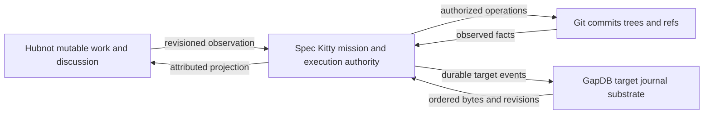
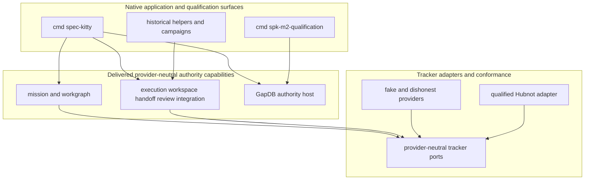
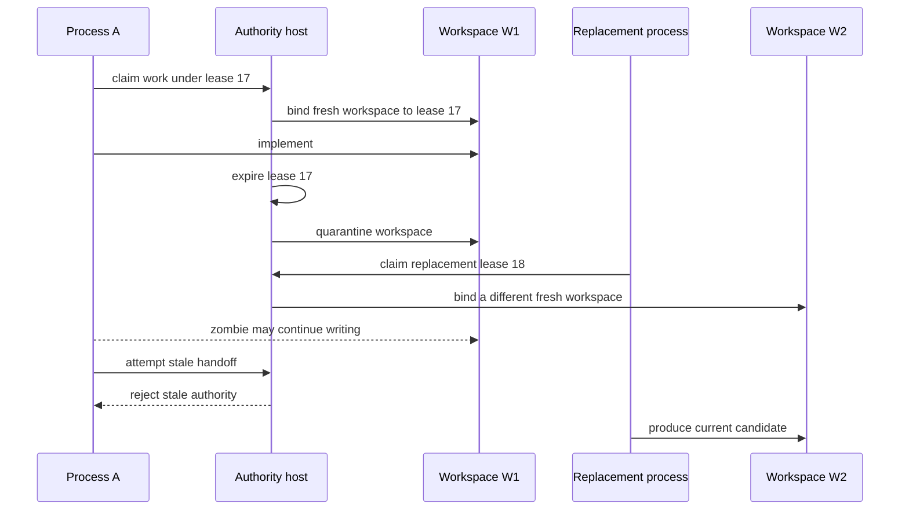

# Spec Kitty Redesign

> A Go-native authority kernel and qualified software-development mission
> method for safe, concurrent, provider-neutral work.

Spec Kitty Redesign preserves the original product's mission discipline,
isolated parallel work, independent review, and controlled integration without
copying the Python package structure. The repository contains the Go-native
GapDB authority host and an executable M2 crown qualifier. Public API, neutral
acceptance, real-agent composition, and optional MCP delivery remain explicit
successor missions and are not inferred from an M2 result.

## Status at a glance

| Surface | Delivered implementation and evidence boundary | Ratified successor target |
|---|---|---|
| Authority and concurrency | The GapDB production host implements leases, lease-scoped workspaces, quarantine, stale-authority refusal, ActorID-independent review, and serialized Git integration; Phase 1 remains the historical source-bound proof | The M2 crown requalifies the complete laws on the sole production store before M3/M4 admission |
| Work substrate | Provider-neutral ports and the source-and-binary-pinned Hubnot public CLI adapter are delivered | M3 composes the admitted provider with the production host; Hubnot remains mutable work/discussion, never mission or execution authority |
| Mission method | Specification, plan, provider-neutral decomposition, immutable WorkRevision generations, drift reconciliation, typed `next`, execution, review, acceptance, integration, progress, and recovery are implemented as native capabilities | M3 adds real-agent/provider composition without changing these authority laws |
| Control state | GapDB is the sole compiled production authority; M2 has no SQLite package, module, fallback, importer, selector, or test driver | The exact M2 crown evidence and independent review passed; human adoption remains a separate decision |
| Application surface | `cmd/spec-kitty` is the native authority command surface; `cmd/spk-m2-qualification` is release tooling and grants no authority | Orchestrator API 2.0 and the complete normal CLI remain M5 |
| Acceptance | Repository-specific Go campaigns and candidate-bound evidence | Stack-neutral claims, approved provider bindings, typed evidence envelopes, and a policy gate |
| MCP | Not shipped and not required | Optional, separately packaged MCP `2026-07-28` adapter with Tasks as a projection of native operations |
| Host boundary | The delivered boundary is one machine and one filesystem authority | Same first-release boundary; remote callers use the application API |

“Delivered” above is bounded to the cited source and evidence. “Ratified target”
means an accepted design and governed delivery sequence, not an implementation
claim.

## Five-minute review path

Read these in order to answer what works, what is approved, what remains, and
what happens next:

1. This status table and [Delivered native runtime](#delivered-native-runtime).
2. [Production Orchestration Architecture](https://github.com/spec-kitty/spec-kitty-redesign/blob/main/docs/PRODUCTION_ORCHESTRATION_ARCHITECTURE.md)
   and [ADR 0002](https://github.com/spec-kitty/spec-kitty-redesign/blob/main/docs/adr/0002-production-orchestration-architecture.md)
   for the sole normative target.
3. [Orchestrator API 2.0](https://github.com/spec-kitty/spec-kitty-redesign/blob/main/docs/ORCHESTRATOR_API_2_0.md),
   [stack-neutral acceptance](https://github.com/spec-kitty/spec-kitty-redesign/blob/main/docs/STACK_NEUTRAL_ACCEPTANCE.md),
   and the [optional MCP adapter](https://github.com/spec-kitty/spec-kitty-redesign/blob/main/docs/MCP_2026_07_28_ADAPTER.md)
   for specialized proposed contracts.
4. The [production runtime program](https://github.com/spec-kitty/spec-kitty-redesign/blob/main/docs/PRODUCTION_RUNTIME_PROGRAM.md)
   for the M1–M7 dependency graph and stop conditions.
5. [Historical dispositions](https://github.com/spec-kitty/spec-kitty-redesign/blob/main/docs/HISTORICAL_ARCHITECTURE_DISPOSITIONS.md),
   [API 1.3 compatibility](docs/ORCHESTRATOR_API_1_3_PROJECTION.md), and the
   [Python behavior inventory](docs/PYTHON_BEHAVIOR_INVENTORY.md) for provenance.
6. [Build and run the current repository](#build-and-run-the-current-repository)
   and [Evidence](#evidence) for reproducible present-tense claims.
7. [What happens next](#what-happens-next) for the M2 adoption boundary and M3/M4 stop rule.

## What makes this port distinct

This is a behavior-preserving re-architecture, not a source-level translation.
The original implementation is behavioral evidence, not a Go package template.

| Concern | Go-native decision | Reason |
|---|---|---|
| Work representation | Provider-neutral tracker ports; Hubnot is the active first-party adapter | Agents work on the product instead of maintaining Markdown checkboxes |
| Mission semantics | Spec Kitty owns lifecycle and gates | Ticket edits cannot authorize execution or acceptance |
| Identity | Durable `ActorID`; per-execution `ProcessID` | Recovery and independent review need different answers |
| Executable work | Immutable generation-numbered `WorkRevision` | Tracker drift becomes `continue`, `supersede`, `invalidate`, or `fork`, never an in-place contract edit |
| Concurrency | Each lease owns one mutable workspace forever | A replacement cannot inherit an unfenceable stale writer's directory |
| Provider integration | Narrow application-owned ports | Hubnot, GapDB, Git, qualification providers, and transports cannot leak vocabulary into the kernel |
| Evidence | Candidate-, revision-, and policy-bound records | A successful process or tracker status is not a verdict |

## Authority ownership

The architectural shorthand remains:

```text
Hubnot       -> what mutable work exists and what humans discuss
Spec Kitty  -> whether work may execute and how it is reviewed and accepted
Git         -> code, commits, trees, and ref outcomes
GapDB       -> target ordered control-state substrate, not product semantics
```



Consequences:

- A Hubnot assignment is not an execution lease.
- Hubnot readiness is not permission to run.
- Hubnot comments are not review verdicts.
- A tracker closure or status is not mission acceptance.
- A database fencing token cannot stop arbitrary POSIX writes.
- A completed implementation is not an approved candidate.
- An approved candidate is not an integrated Git fact.
- GapDB ordering cannot decide whether a transition is legal.

## Delivered native runtime

The repository is a native authority application, not a collection of planned
packages. Its earlier phases established the laws now composed by the GapDB
production host:

- **Phase 1 authority proving ground:** real Git repositories and worktrees,
  concurrent claims, lease generations, quarantine and fresh replacement
  workspaces, immutable handoff, actor-level independent review, serialized
  integration, crash recovery, conflicts, and zombie-writer scenarios.
- **Phase 2 Beads integration:** bounded argv-only JSON protocol, exact provider
  identity, canonical project binding, portable and dishonest-provider
  conformance, contention, backup/restore, and attribution-safe refusal.
- **Phase 3 mission method:** governed specify/plan/decompose/finalize flow,
  immutable WorkRevision generations, semantic drift, mixed reconciliation,
  action-scoped governance, pure typed `next`, and non-authoritative task
  projection. Portable and real-Beads two-item scenarios pass at the recorded
  evidence boundary.

`cmd/spec-kitty` is the production authority command surface. It composes the
GapDB lifecycle, memory projection, mission/workgraph, execution/workspace,
handoff/review, acceptance/integration, external-effect, and progress
capabilities. `cmd/spk-m2-qualification` independently qualifies that runtime;
`cmd/spk-phase1-helper` and historical campaigns remain evidence tools. The
process-complete API 2.0 transport, stack-neutral acceptance providers, and
optional MCP adapter are distinct M4/M5 successors.

The delivered source keeps its helper/campaign surface outside the authority
kernel and keeps concrete tracker providers behind provider-neutral contracts:



### Lease-scoped workspaces

A fence protects Spec Kitty operations; it cannot fence a shell or editor.
When lease 17 expires, W1 is quarantined and lease 18 receives W2.



Review evaluates an immutable candidate, not a live directory. Phase 1 has no
waiver for actor-level reviewer independence; the historical wording correction
is recorded in [the Phase 1 erratum](docs/PHASE1_ACCEPTANCE_ERRATA.md).

## Approved production direction

The production architecture keeps active projections in memory for speed and
acknowledges authority-changing success only after one atomic durable GapDB
mutation. Storage recovery, Spec Kitty journal/checkpoint restore, new runtime
epoch creation, external reconciliation, and side-effect-free playback are
separate contracts.

The target production flow is:

```text
typed command
  -> validate revision, epoch, generation, lease, candidate, and policy
  -> pure in-memory reduction
  -> durable atomic GapDB event/result/effect-intent batch
  -> publish committed projection
  -> perform and observe external effects through adapters
```

Orchestrator API 2.0 is the proposed process-complete application seam. It
provides closed named commands, revisioned mission progress, legal next actions,
durable native operations, input decisions, cancellation intent, and resumable
watches. API 1.3 is compatibility history and may translate exactly one safe
operation or return a typed upgrade refusal; it is not canonical vocabulary.

Acceptance is stack-neutral. Policy contributes claims; an explicit binding
selects a qualified provider; a typed evidence envelope reports one bounded
observation; the acceptance kernel alone decides the complete proof set.
Repository commands belong inside providers, never in the kernel.

MCP is optional. A future separate `spec-kitty-mcp` module may project API 2.0
native operations as MCP `2026-07-28` Tasks. Task identity, TTL, disconnection,
or cancellation cannot change mission, lease, evidence, or Git authority. The
normal CLI and API remain complete when MCP is absent.

## Build and run the current repository

The module declares Go 1.26. The current checkout builds the native
`spec-kitty` authority command, the M2 qualifier, and historical proving
helpers. You also need Git. Portable development and Hubnot contract proof
require neither a Hubnot binary nor a hosted service.

```bash
go mod download
make preflight
make hubnot-contract
```

Build the production and qualification commands into an explicit directory:

```bash
make build BUILD_DIR="$(pwd)/bin"
CGO_ENABLED=0 go build -trimpath -o bin/spec-kitty ./cmd/spec-kitty
CGO_ENABLED=0 go build -trimpath -o bin/spk-m2-qualification ./cmd/spk-m2-qualification
```

Or install the native commands into the selected Go binary directory:

```bash
go install ./cmd/spec-kitty ./cmd/spk-m2-qualification
```

The producer qualifier emits an immutable technical pass with
`review_eligible=true` and `release_ready=false`. A different `ActorID` must
review that exact producer archive; only the outer release finalizer may emit
`release_ready=true`. Neither stage creates human adoption. API 2.0 serving,
stack-neutral acceptance, Team Kitty, real-agent composition, and
`spec-kitty-mcp` remain later program outcomes.

### M2 qualification

The pull-request tier is bounded and does not substitute for the release crown:

```bash
GOTOOLCHAIN=go1.26.7 make m2-short
```

The full run requires both the exact M2 qualification-candidate sidecar and
the frozen adopted WP16 assertion-extension sidecar at distinct absolute
paths. It executes the real two-item mission, closed 15-family census,
fault/concurrency/restart campaigns, restore-deadline and absence mutants,
10,000 query and durable-mutation observations, 30 recoveries, deterministic
CycloneDX generation, and independent manifest verification.

```bash
GOTOOLCHAIN=go1.26.7 make m2-qualification \
  M2_GAPDBD=/absolute/path/to/gapdbd \
  M2_WP16_GAPDBD=/absolute/path/to/frozen-wp16-gapdbd \
  M2_RUN_ID=m2-unique-run \
  M2_EVIDENCE_ROOT=/absolute/private/evidence \
  M2_ACTOR_ID=implementing-agent \
  M2_PROCESS_ID=exact-process-id \
  M2_IMPLEMENTATION_CONTRIBUTORS=codex \
  M2_PROFILE_DOCUMENT="$(pwd)/docs/programs/evidence/m2-producer-profile.json" \
  M2_PROFILE_REVISION=94c8fd94c5e237df5b4e256a595804c6bae685e5a4a57417275c74c0b604a378

GOTOOLCHAIN=go1.26.7 make m2-verify-evidence \
  M2_EVIDENCE=/absolute/private/evidence/m2-unique-run \
  M2_EXPECTED_COMMIT=<trusted-commit> \
  M2_EXPECTED_TREE=<trusted-tree> \
  M2_EXPECTED_MANIFEST_SHA256=<trusted-manifest-digest> \
  M2_EXPECTED_ARCHIVE_SHA256=<trusted-producer-archive-digest>
```

Evidence directories are immutable and source-bound. Failed, incomplete, and
non-admissible attempts are retained under their original RunIDs. A passing
machine run makes one source tree eligible for independent review; it does not
approve, merge, tag, release, or adopt that tree.

After review, `spk-m2-qualification finalize-review` consumes the untouched
producer bundle and a bounded structured review bundle. The reviewer records
their distinct actor/process/profile identity, machine command outputs, and
structured findings. `verify-release` recursively verifies the resulting
outer archive using externally supplied source, manifest, producer-archive,
and release-archive digests. A later documentation commit may project those
identities, but it is not retroactively the source tree that was qualified.

## Hubnot tracker operations

The compiled `spec-kitty tracker` surface uses pinned Hubnot through neutral ports.
Read [Hubnot tracker](docs/HUBNOT_TRACKER.md) for explicit build/install, actor binding,
full work examples, original-operation recovery, limits and qualification scopes.
Use `tracker --help` for all fourteen actions. Tracker-only commands do not start the
mission host. M2 remains release-ready and unadopted; M3 production agent integration
is a separate admission. Old Beads bindings refuse without fallback or dual write.

The [Phase 2 Beads evidence](docs/phase2-evidence/README.md) remains historical and
unchanged; it does not qualify the new provider. Preserve original database/backups
and recovery branches/stashes. This cutover performs no project initialization or
automatic migration.

## Verification

The bounded local ladder is:

```bash
make preflight
make contract
make hubnot-contract
make mission-contract
make mission-acceptance
make quality
```

Longer campaigns remain explicit:

```bash
make mission-adversarial
make full-campaign
go test -race ./...
go vet ./...
staticcheck ./...
go mod verify
govulncheck ./...
(cd docs/phase2-evidence && sha256sum --check SHA256SUMS)
(cd docs/phase3-evidence && sha256sum --check SHA256SUMS)
git diff --check
```

## Adoption boundary

The architecture decision is settled: GapDB (also written “Gapdb” in older
records) is the target and SQLite is not a production fallback. M1 qualified a
pinned GapDB source, `gapdbd` binary, public client/protocol, lifecycle policy,
platform/filesystem boundary, and evidence manifest through the two-agent
zombie/recovery/playback experiment and all 14 external adoption scenarios. The
exact tuple is now accepted by the attributable human
[adoption record](docs/programs/evidence/m1-adoption.json); its complete evidence
tree is retained in the content-addressed
[`m1-gapdb-evidence-v1`](https://github.com/spec-kitty/spec-kitty-redesign/releases/tag/m1-gapdb-evidence-v1)
release.

That decision admitted M2. The repository now contains the GapDB authority
capabilities and closed qualifier for source, module graph, SBOM, binaries,
install, configuration, fallback, and migration absence. The exact M2 candidate
has now completed its clean qualification run, independent review, recursive
release verification, mission acceptance, lane integration, and post-merge
mission review. Its machine verdict is `release_ready=true`. The exact tuple
is now adopted by the separate human [M2 adoption record](docs/programs/evidence/m2-adoption.json).
The frozen release receipt retains its original `adopted=false` qualification
state; [the closeout](docs/programs/evidence/m2-adoption-closeout.md) records the
subsequent decision. There is no dual-write interval.

The release-ready evidence is bound to:

| Identity | Value |
|---|---|
| Source commit | `416138f490ad6d908fc445c12b91440ca66ef18c` |
| Source tree | `2b68ee733305465d5acdfe8680f053b91d867a8d` |
| Run ID | `wp17-qualification-416138f4-cycle2-final23` |
| Manifest SHA-256 | `8d7731992a35b0ace4cdcd816651df302d4459c8af91d1a2c31cf5d3aeb285a0` |
| Producer archive SHA-256 | `250bad6ef3115b154794db61407736133ec0b1f5a5fc61117ec1267e77057fc2` |
| Independent review SHA-256 | `a35f944548bd766887344192f59c36fd6002519d88588e07e3cdc48989510e50` |
| Release archive SHA-256 | `098fa8d3fae6f33e227ce290530fc172f820c961ffd326adb820a26aa44e2414` |

This is a gated implementation sequence, not uncertainty about the target.
The former store remains only an immutable Phase 1–3 evidence boundary; it is
not compiled, selectable, importable, or available as production fallback.

## What happens next

M1 is complete and adopted. M2, **GapDB-Only Production Authority**, is merged,
post-merge reviewed, technically release-ready, and adopted at the exact tuple above. Its falsification target was
deliberately stronger than “the new adapter works”: every authority capability
preserves its behavioral and refusal contract on the M1 event/CAS substrate
while the retired store disappears from every production surface.

The explicit human M2 adoption decision is recorded. M3
(real-agent/Hubnot/Git/workspace composition) and M4 (stack-neutral acceptance)
may now proceed against that exact input, subject to their remaining entry
criteria and their own qualification gates. M5 then delivers the complete
API 2.0 host, followed by Nano Kitty's adapter qualification. Neither a branch,
tag, tracker ticket, nor this README substitutes for source-bound evidence.
Dual write, read fallback, legacy import, and runtime backend selection remain
forbidden.

## Evidence

Evidence is source-bound. A later commit containing these files does not inherit
the verdict automatically.

- [Phase 1 evidence index](docs/phase1-evidence/README.md) and
  [ADR 0001](docs/adr/0001-phase1-authority-proving-ground-verdict.md)
- [Phase 2 evidence index](docs/phase2-evidence/README.md),
  [results](docs/phase2-evidence/results.md), and
  [limitations](docs/phase2-evidence/limitations.md)
- [Phase 3 evidence index](docs/phase3-evidence/README.md),
  [results](docs/phase3-evidence/results.md), and
  [limitations](docs/phase3-evidence/limitations.md)
- [Mini review resolution](docs/MINI_REVIEW_RESOLUTION.md)
- [Concurrency scenario catalog](docs/CONCURRENCY_SCENARIOS.md)
- [Technical project plan](docs/TECHNICAL_PROJECT_PLAN.md)
- [M2 acceptance mapping](docs/programs/evidence/m2-acceptance-matrix.json)
  and [independent review input](docs/programs/evidence/m2-independent-review-input.md)
- [M2 post-merge mission review](kitty-specs/gapdb-only-production-authority-01M1GWDJ/mission-review-report.md)

## License

This project is licensed under the [MIT License](LICENSE).
