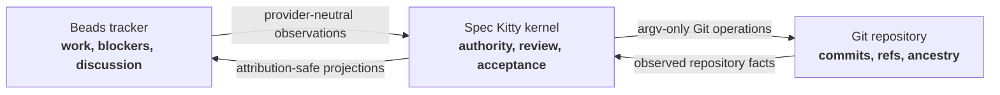
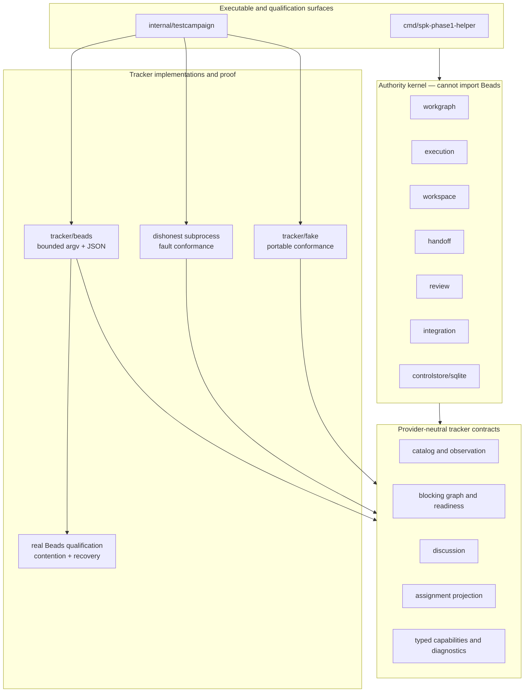
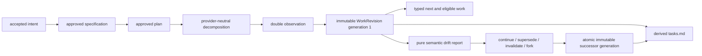

# Spec Kitty Redesign

> A Go-native authority kernel and qualified software-development mission method
> for safe, concurrent, provider-neutral work.

| Project property | Delivered value |
|---|---|
| Maturity | Qualified Phase 3 software-development mission method on the Phase 1 authority kernel and Phase 2 Beads integration |
| Language | Go 1.26.5 application toolchain; the reviewed Beads binary retains its Go 1.26.4 build identity |
| Default tracker | Beads 1.2.2 through a checksum-pinned JSON command protocol |
| Control store | SQLite; Gapdb adoption is a separate evidence and human-approval decision |
| Execution model | Lease-scoped Git worktrees, independent review, serialized target-ref integration |
| License | MIT |

## Abstract

Spec Kitty Redesign is not a source-level translation of the Python application.
It preserves the behaviors that made Spec Kitty valuable—mission governance,
concurrent isolated work, independent review, and safe integration—while choosing
Go-native boundaries for authority, failure, and recovery.

Phase 3 adds a durable software-development mission method over the qualified
kernel and tracker boundary. It takes accepted intent through approved
specification and plan, provider-neutral decomposition, immutable executable
graph generations, explicit drift reconciliation, typed `next`, and derived
projections. Beads supplies a revisioned ticket catalog, dependencies,
discussion, and visible assignment. It does not gain mission authority. The
governing separation remains:

```text
Beads:       what work exists, what blocks it, and what humans discuss
Spec Kitty: whether work may run, where it runs, and how it is accepted
Git:         what actually happened
```

This replaces agent labor spent constructing and reparsing Markdown task lists
with a provider-neutral ticket interface. Mission steps, executable graph
generations, leases, workspace ownership, review verdicts, acceptance, and
integration remain Spec Kitty facts.

## Contents

- [Architectural thesis](#architectural-thesis)
- [What changed relative to Python Spec Kitty](#what-changed-relative-to-python-spec-kitty)
- [Architecture](#architecture)
- [Software-development mission method](#software-development-mission-method)
- [Authority and concurrency](#authority-and-concurrency)
- [Beads compatibility contract](#beads-compatibility-contract)
- [Build and installation](#build-and-installation)
- [Project binding and inspection](#project-binding-and-inspection)
- [Capabilities and authority limits](#capabilities-and-authority-limits)
- [Operations and recovery](#operations-and-recovery)
- [Export and backup](#export-and-backup)
- [Verification](#verification)
- [Delivered boundary](#delivered-boundary)
- [Evidence and design record](#evidence-and-design-record)

## Architectural thesis

Each kind of fact has one owner.



The consequences are deliberate:

- A Beads assignment is not an execution lease.
- Beads readiness is not permission to run.
- Beads comments are not review verdicts.
- A tracker closure or status is not mission acceptance.
- A database fencing token cannot stop an arbitrary POSIX write.
- A completed implementation is not an approved implementation.
- An approved implementation is not an integrated commit.

## What changed relative to Python Spec Kitty

The original implementation is behavioral evidence, not a package template.

| Concern | Inherited tendency | Go-native decision | Why |
|---|---|---|---|
| Port strategy | Reproduce modules and command choreography | Preserve product behavior behind explicit capabilities | Structural parity preserves accidental coupling |
| Work representation | Markdown task lists double as a mutable work database | Provider-neutral tracker ports with Beads as the first qualified adapter | Agents should work on the product, not maintain presentation syntax |
| Mission semantics | Work artifacts and mission state can blur together | Mission authority stays in the kernel | A ticket edit must not authorize execution or acceptance |
| Identity | Agent name can ambiguously mean actor or process | Durable `ActorID`; per-execution `ProcessID` | Recovery and independent review need both answers |
| Plan stability | Work text can drift under a running agent | `WorkRevision` freezes an executable graph generation | Reconciliation becomes explicit: continue, supersede, invalidate, or fork |
| Concurrency | Durable lanes use mutable worktrees | Lane lineage is durable; lease workspaces are disposable | Preserve concurrency while isolating stale writers |
| Provider integration | Copy provider concepts into mission logic | Kernel imports only provider-neutral tracker contracts | Beads stays replaceable and cannot acquire authority by convenience |
| Persistence | Implicit files coordinate processes | SQLite transactions coordinate the single-machine authority kernel | CAS, idempotency, refusal evidence, and crash recovery become explicit |

## Architecture

The kernel and the Beads adapter are intentionally separated by a failing-CI
dependency guard.



Repository guide:

```text
cmd/spk-phase1-helper/       Thin JSON helper composition surface
internal/tracker/            Provider-neutral capabilities and ports
internal/tracker/fake/       Durable portable reference provider
internal/tracker/conformance Shared provider-neutral contract suite
internal/tracker/beads/      Qualified Beads protocol and adapter
internal/testcampaign/       Exact censuses and evidence producers
internal/execution/          Claims, leases, runs, fencing, recovery
internal/workspace/          Lease-scoped workspace lifecycle
internal/handoff/            Immutable candidate evidence
internal/review/             Actor-independent judgments
internal/integration/        Repository/target-ref serialization
internal/controlstore/sqlite Single-machine transactional authority
docs/phase2-evidence/        Published Phase 2 evidence and limitations
docs/phase3-evidence/        Source-bound mission-method qualification
```

## Software-development mission method

The mission method is an authority protocol, not a Markdown workflow. An
approved plan is decomposed through a provider-neutral work-definition port.
Finalization observes the provider twice, validates a complete executable graph,
and atomically publishes immutable generation 1. Later provider changes produce
pure drift evidence. Only explicit per-work reconciliation can publish a
successor generation.



The durable laws are deliberately strict:

- mission state and approved artifacts decide legal advancement;
- tracker status, assignment, comments, and readiness remain non-authoritative;
- every executable graph has a stable generation, canonical digest, complete
  criteria, dependencies, scopes, lanes, and provider attribution;
- current revisions are never edited in place;
- drift is observation-only until an explicit complete reconciliation is
  atomically published;
- handoff, review, and integration consume complete live eligibility facts;
- `next` reads exactly one aggregate snapshot and performs no writes; and
- `tasks.md` can be deleted, corrupted, or replaced without changing authority.

The portable proving helper exposes strict JSON commands for mission creation,
artifact publication/approval, decomposition, finalization, drift,
reconciliation, typed `next`, tracker status projection, and read-model tasks
rendering. It is a composition and qualification surface, not the future polished
end-user CLI.

## Authority and concurrency

### Lease-scoped workspaces

A fencing token can fence kernel operations; it cannot fence an editor, shell,
compiler, or zombie agent writing directly to a directory. A replacement lease
therefore never inherits a mutable workspace.

```mermaid
sequenceDiagram
    participant A as Process A
    participant K as Authority kernel
    participant W1 as Workspace W1
    participant B as Process B
    participant W2 as Workspace W2

    A->>K: claim and receive lease 17
    K->>W1: bind fresh W1 to lease 17
    A->>W1: implement
    Note over A,K: heartbeat stops; process remains alive
    K->>K: expire lease 17
    K->>W1: quarantine W1
    B->>K: replacement receives lease 18
    K->>W2: bind fresh W2 to lease 18
    A-->>W1: zombie resumes writing
    Note over W1,K: W1 cannot become lease 18 workspace
    B->>W2: produce candidate commit
    B->>K: hand off immutable candidate
```

The stale process may change W1, but those bytes have no route to handoff,
approval, or integration under lease 18. Review evaluates a pinned candidate
commit. Its actor must differ from every candidate contributor actor. Integration
then serializes the contested `(RepositoryID, TargetRef)` and re-observes Git.
Phase 1 has no waiver for actor-level review independence; the historical
contract correction is recorded in
[`PHASE1_ACCEPTANCE_ERRATA.md`](docs/PHASE1_ACCEPTANCE_ERRATA.md).

### One-machine control authority

One Spec Kitty control store belongs to one machine and one filesystem authority.
SQLite WAL is not opened across a shared filesystem by several hosts. Remote
clients will use the future Orchestrator API served by the owning host instead of
opening the control database or mutable worktrees directly.

## Beads compatibility contract

The supported tuple is exact:

```text
Beads executable: 1.2.2
source tag commit: 6c124203e771433a3550c348771a5b5e27fd3c21
JSON envelope:    BD_JSON_ENVELOPE=1
schema_version:   1
integration:      argv-only documented JSON CLI
binary SHA-256:   0c9990691b3b574d4772c0a9fed260769d68af57eb8072ee2a60ff0b619c7bb6
```

Beads 1.2.2 has no supported public Go consumer package for this module. Useful
implementation packages are beneath Go `internal/`; importing them is both
forbidden and semantically unsafe. Spec Kitty also does not couple to the Dolt
schema. `internal/tracker/beads` issues only allowlisted argument vectors, sets a
fixed environment, reads bounded structured output, and rejects unsupported
versions or envelope schemas before mutation.

Unknown optional fields in schema 1 are ignored. An unknown envelope schema,
metadata schema, executable version, or binary digest fails closed. Version
ordering is not compatibility: 1.2.2 is a tested recovery release, not a promise
about 1.2.0, 1.2.1, or a future release. Expanding support requires portable,
dishonest, real-provider, contention, export/backup, and authority-invariant
qualification plus a new allowlisted digest.

## Build and installation

### Portable development

Ordinary development needs Go, Git, and downloaded Go modules. It needs no `bd`,
Dolt server, hosted account, or network after dependencies are present.

```bash
go mod download
make preflight
make beads-contract
```

Build all packages and the repository helper into an explicit directory:

```bash
make build BUILD_DIR="$(pwd)/bin"
```

Or install the helper into the selected Go binary directory:

```bash
go install ./cmd/spk-phase1-helper
```

The helper remains a thin composition and diagnostic surface; it is not the
eventual full Spec Kitty CLI.

### Install the checksum-qualified provider

The reviewed installer supports Linux/amd64 with Go 1.26.4 and a C compiler. Its
destination must be absolute, outside the source repository, and narrower than a
top-level system directory.

```bash
tool_root="$(mktemp -d /tmp/spec-kitty-beads-tools.XXXXXX)"
identity_file="$(mktemp /tmp/spec-kitty-beads-identity.XXXXXX.json)"
scripts/install-qualified-beads.sh --dest "$tool_root" > "$identity_file"
jq . "$identity_file"
beads_bin="$(jq -r .executable_path "$identity_file")"
sha256sum -- "$beads_bin"
BD_JSON_ENVELOPE=1 BD_NON_INTERACTIVE=1 "$beads_bin" version --json
```

After a verified target already exists, `--offline` checks and selects it without
downloading. The installer rejects an existing mismatched target rather than
overwriting it.

## Project binding and inspection

A project binding records:

- the absolute, canonical executable and its version/digest;
- protocol schema 1;
- one absolute canonical Beads workspace shared by every linked worktree;
- a derived `ws1:` workspace identity;
- explicit read-only state; and
- either `embedded_serialized` or `server_multiwriter` concurrency.

The canonical Beads workspace is project-scoped. It is not a lease workspace and
must not silently become `<linked-worktree>/.beads`. All linked worktrees pass the
same binding. Inspection rejects a different observed workspace or database as
`workspace_mismatch`; mutations do not repair or switch it.

Provider inspection is read-only. It never initializes Beads, installs hooks, edits
`AGENTS.md`, `CLAUDE.md`, or `.cursorrules`, enables Git automation, repairs
provider state, or chooses a per-worktree database. It observes the exact JSON
preflight only:

```bash
BD_JSON_ENVELOPE=1 BD_NON_INTERACTIVE=1 "$beads_bin" version --json
BD_JSON_ENVELOPE=1 BD_NON_INTERACTIVE=1 "$beads_bin" where --json
BD_JSON_ENVELOPE=1 BD_NON_INTERACTIVE=1 "$beads_bin" dolt show --json
BD_JSON_ENVELOPE=1 BD_NON_INTERACTIVE=1 "$beads_bin" dolt status --json
```

For an existing embedded binding, the helper can return the normalized binding,
capability report, health, and typed diagnostics. Substitute only absolute paths
obtained from the read-only preflight:

```bash
go run ./cmd/spk-phase1-helper tracker inspect-beads \
  --project example-project \
  --executable "$beads_bin" \
  --workspace /absolute/canonical/beads-workspace \
  --database-identity /absolute/existing/database-directory \
  --protocol-schema 1 \
  --mode embedded_serialized \
  --read-only=true \
  --expected-digest 0c9990691b3b574d4772c0a9fed260769d68af57eb8072ee2a60ff0b619c7bb6
```

Initialization is an explicit operator act and is shown only for an obviously
disposable repository. Never run it in this checkout merely to make discovery
succeed.

```bash
disposable="$(mktemp -d /tmp/spec-kitty-beads-disposable.XXXXXX)"
git -C "$disposable" init
(
  cd "$disposable"
  BD_NON_INTERACTIVE=1 "$beads_bin" init \
    --stealth --skip-agents --skip-hooks --non-interactive --prefix skt
)
```

## Capabilities and authority limits

The capability report describes provider guarantees, not overall product
quality. A request stronger than the provider guarantee is refused before
mutation.

The qualified guarded arbitrary update and safe arbitrary compensation levels
are deliberately unsupported, as the matrix makes explicit.

| Capability | Qualified 1.2.2 level | Operational meaning |
|---|---|---|
| Catalog read | `supported` | Decode bounded schema-1 records |
| Catalog create | `supported` | Create with Spec Kitty metadata and operation marker |
| Catalog update | `unguarded` | Arbitrary fields can change, but not under provider-side CAS |
| Blocking graph | `supported` | Add/remove/list blockers; pinned graph remains execution authority |
| Readiness | diagnostic projection | Cross-check provider state; never permission to run |
| Discussion | `observably_idempotent` append | Append and re-observe an operation marker; not a review verdict |
| Assignment | `atomic_claim` where characterized | Visible ownership projection; not a lease |
| Observation revision | `content_derived` | Opaque content digest; neither ordered revision nor CAS token |
| Guarded arbitrary update | `unsupported` | Fails `guarded_update_unsupported` before mutation |
| Safe arbitrary compensation | `unsupported` | Fails `safe_compensation_unsupported`; human state is preserved |
| Embedded concurrency | `adapter_serialized` | Coordinates Spec Kitty processes sharing the binding |
| Server concurrency | `provider_native` | Qualified shared-server multiwriter mode |
| Portable export | `supported` | Bounded JSONL interchange |
| Restorable backup | `supported` | Dolt-native backup, restore, and disposable inspection |

Local serialization is not compare-and-swap against humans or external tools.
Direct `bd` users do not pass through the adapter lock. Before compensating,
Spec Kitty compares the current mapping, operation marker, value, and content
revision. If attribution has changed, it preserves the provider state and records
a reconciliation conflict.

## Operations and recovery

Inspection output includes executable version/digest, protocol schema, canonical
workspace identity, storage/concurrency mode, read-only state, capability levels,
health, stable diagnostic kind, and recovery code. Automation branches only on
those typed fields, never warning prose or human-formatted CLI output.

| Diagnostic | Safe operator response |
|---|---|
| `unavailable` / spawn failure | Repair the absolute binding or install the verified binary; do not substitute an arbitrary PATH executable |
| `version_skew` | Restore 1.2.2 or qualify a new exact version and digest |
| `schema_skew` | Stop before mutation; update protocol contracts and requalify |
| `workspace_mismatch` | Correct the project binding so every worktree resolves the same canonical workspace |
| `lock_contended` | Retry within bounded policy or select a qualified server-multiwriter binding |
| `malformed_protocol` / bounded-output failure | Stop automation, verify the binary tuple, and capture only redacted diagnostics |
| `ambiguous` | Observe mapping, operation marker, current value, and content revision before deciding; never repeat blindly |
| `revision_conflict` | Preserve provider state and reconcile the durable conflict explicitly |
| `attribution_lost` | A human or external writer changed the fact; preserve it and resolve explicitly |
| `guarded_update_unsupported` | Reconcile without mutation or choose a provider with an actual guarded primitive |
| `safe_compensation_unsupported` | Do not emulate safety with read-then-write; leave state intact for operator resolution |

If Beads is unavailable, portable fake conformance and existing Spec Kitty
authority/control data remain usable. Provider-dependent reads or mutations
return typed diagnostics; they do not reconstruct mission state from tickets.

Embedded serialization coordinates Spec Kitty processes only. It cannot fence a
human or external writer. Server mode is accepted only with a pinned logical
server identity, endpoint, allowlisted connection inputs, provider-native
multiwriter behavior, and successful qualification.

## Export and backup

Portable JSONL export is interchange, not full backup and not a restorable copy
of Dolt history:

```bash
export_file="$(mktemp /tmp/spec-kitty-beads-export.XXXXXX.jsonl)"
BD_JSON_ENVELOPE=1 BD_NON_INTERACTIVE=1 \
  "$beads_bin" export --json > "$export_file"
```

A Dolt-native restorable backup uses an absolute destination outside the active
workspace. Sync and inspect it before depending on it:

```bash
backup_root="$(mktemp -d /tmp/spec-kitty-beads-backup.XXXXXX)"
BD_NON_INTERACTIVE=1 "$beads_bin" backup init "$backup_root"
BD_NON_INTERACTIVE=1 "$beads_bin" backup sync
BD_NON_INTERACTIVE=1 "$beads_bin" backup status
```

Qualification verifies restoration in a fresh, empty, disposable workspace and
then inspects recovered catalog, dependencies, criteria metadata, and discussion.
Destructive restore never runs automatically against the project binding. An
operator must inspect the backup, select an empty disposable target, and explicitly
choose restoration. Do not copy a live Dolt database or issue direct Dolt SQL.

## Verification

The portable pull-request ladder is offline after modules are present:

```bash
make preflight
make contract
make beads-contract
make quality
```

The exact Phase 3 profiles are also directly runnable:

```bash
make mission-contract
make mission-acceptance
make mission-adversarial
make full-campaign
```

The local PR-equivalent `quality` campaign qualified in 37.559 seconds. The
exhaustive, process-race, fault, and real-provider work remains scheduled or
manually runnable and is required for a full qualification record.

The exact real-provider target requires the installer identity, verified binary,
a pinned external Dolt server tuple, and an enforced offline network namespace.
The CI workflow in [`.github/workflows/beads-qualification.yml`](.github/workflows/beads-qualification.yml)
provisions the reviewed Dolt binary and starts its disposable server on loopback
inside that namespace. For a local reproduction, first perform that same
provisioning; then, from inside the same disposable namespace and while that
server is listening, invoke the target with the complete tuple:

```bash
BEADS_BIN=/absolute/path/to/verified/bd \
BEADS_INSTALL_RESULT=/absolute/path/to/installer-identity.json \
BEADS_SERVER_ID=dolt-v0.40.5-1bf533220ab0 \
BEADS_SERVER_ENDPOINT=127.0.0.1:3307 \
DOLT_SERVER_HOST=127.0.0.1 \
DOLT_SERVER_PORT=3307 \
OFFLINE_ENFORCED=linux-network-namespace \
make beads-qualification
```

The two absolute paths are placeholders that must be replaced by the verified
installer outputs. `127.0.0.1:3307` is not a generic example endpoint: it is the
exact host/port binding used by the accepted runner, so
`BEADS_SERVER_ENDPOINT` must equal `DOLT_SERVER_HOST:DOLT_SERVER_PORT` for the
same already-running disposable server. All four server variables are required;
omitting any one deliberately selects `embedded_serialized`, which cannot
reproduce the qualified `server_multiwriter` evidence. This command neither
starts nor repairs Dolt and never authorizes initialization in a project
workspace.

Additional closeout gates:

```bash
make full-campaign
go test -race ./...
go vet ./...
staticcheck ./...
go mod verify
govulncheck ./...
go test ./internal/architecture -run 'BeadsDocumentation|Phase2Evidence' -count=10
(cd docs/phase2-evidence && sha256sum --check SHA256SUMS)
git diff --check
```

## Delivered boundary

Phase 3 delivers and qualifies the software-development mission method: approved
artifacts, provider-neutral decomposition, immutable WorkRevision generations,
semantic drift, mixed reconciliation, action-scoped governance, strict typed
`next`, durable SQLite publication, and derived tasks projection. The complete
portable two-item path and its real Beads equivalent both pass.

Phase 3 does not deliver Phase 4 execution dispatch, Phase 5 production
review/integration orchestration, or Phase 6 CLI/API/MCP/Team Kitty surfaces. It
also does not claim alternate production trackers, multi-machine control
authority, hosted performance, or replacement of mission artifacts by tickets.

SQLite remains the qualified control store in this repository. Gapdb has its own
successful MVP evidence, but replacing SQLite is a separate migration/adoption
decision requiring equivalent external-adapter evidence and an explicit signed
human record. Phase 2 neither performs nor implies that adoption.

## Evidence and design record

The current Phase 3 evidence attests qualified source
`b03200f5430e233d001e96ded74b8d4cd88d7158` (tree
`700e73ee278ecf3223269eab5e7b7c7854f83673`) through immutable payload
`f52698bb110824fb4d22a81c9c4b3f6d2708cdc0` (tree
`293cb11c91c4bd328e3043910c832eedcd851881`). The source, payload, and this
documentation attestation are deliberately distinct identities; qualification
does not transfer transitively between them.

- [Phase 3 evidence index](docs/phase3-evidence/README.md)
- [Phase 3 results](docs/phase3-evidence/results.md)
- [Phase 3 limitations](docs/phase3-evidence/limitations.md)
- [Phase 2 evidence index](docs/phase2-evidence/README.md)
- [Phase 2 results](docs/phase2-evidence/results.md)
- [Phase 2 limitations](docs/phase2-evidence/limitations.md)
- [Technical project plan](docs/TECHNICAL_PROJECT_PLAN.md)
- [Python behavior inventory](docs/PYTHON_BEHAVIOR_INVENTORY.md)
- [Concurrency scenarios](docs/CONCURRENCY_SCENARIOS.md)
- [Orchestrator API 1.3 projection](docs/ORCHESTRATOR_API_1_3_PROJECTION.md)
- [Phase 1 evidence index](docs/phase1-evidence/README.md)

The evidence uses two-step provenance. Machine artifacts bind the exact frozen
source commit/tree that ran. The evidence payload is committed afterward, and a
following docs-only attestation names that payload commit and checksums. A later
commit does not inherit qualification merely because this directory still exists.

## License

This project is licensed under the [MIT License](LICENSE).
