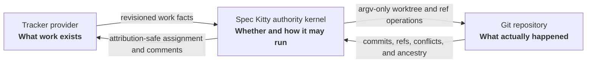
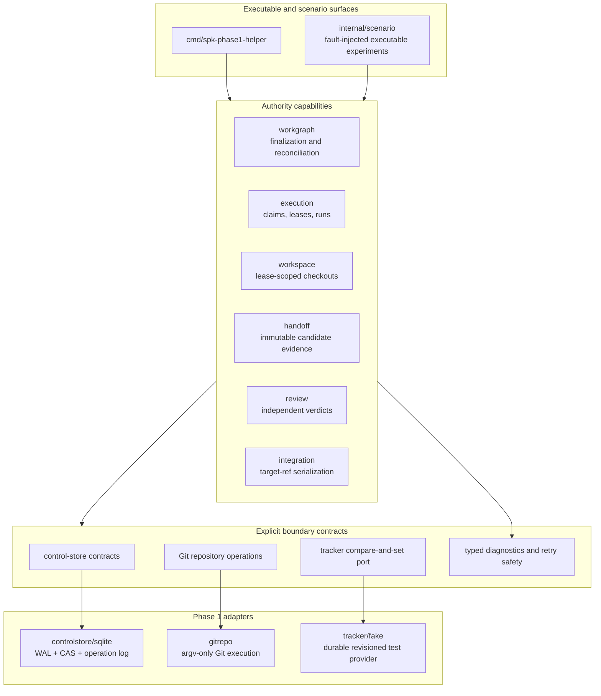
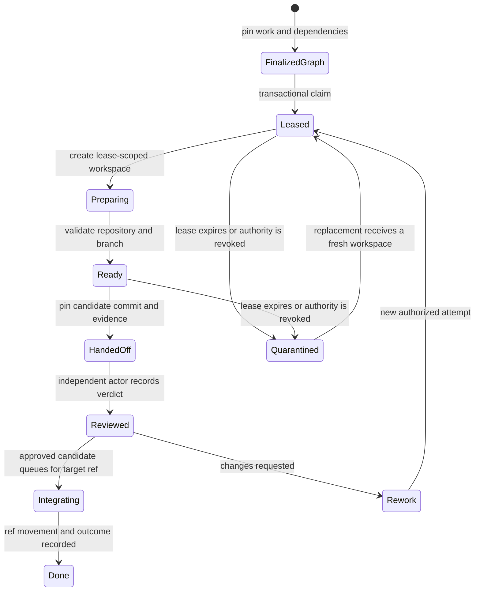
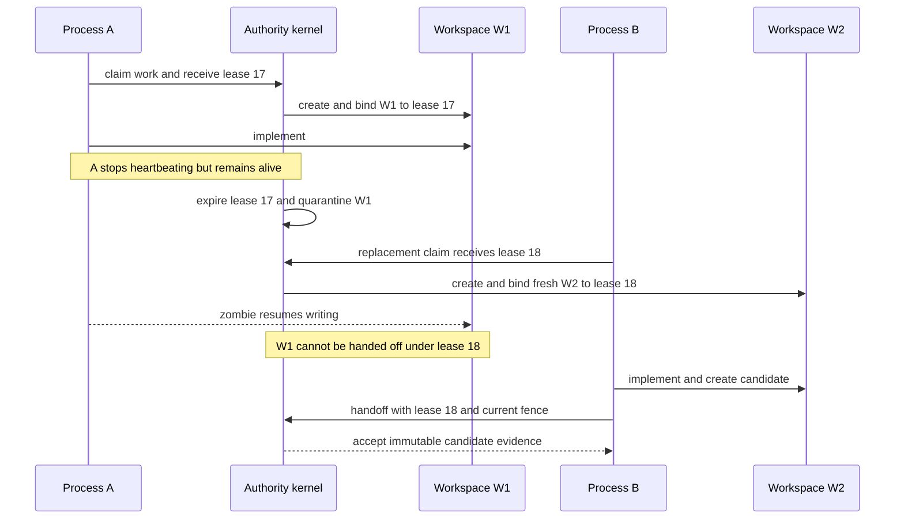
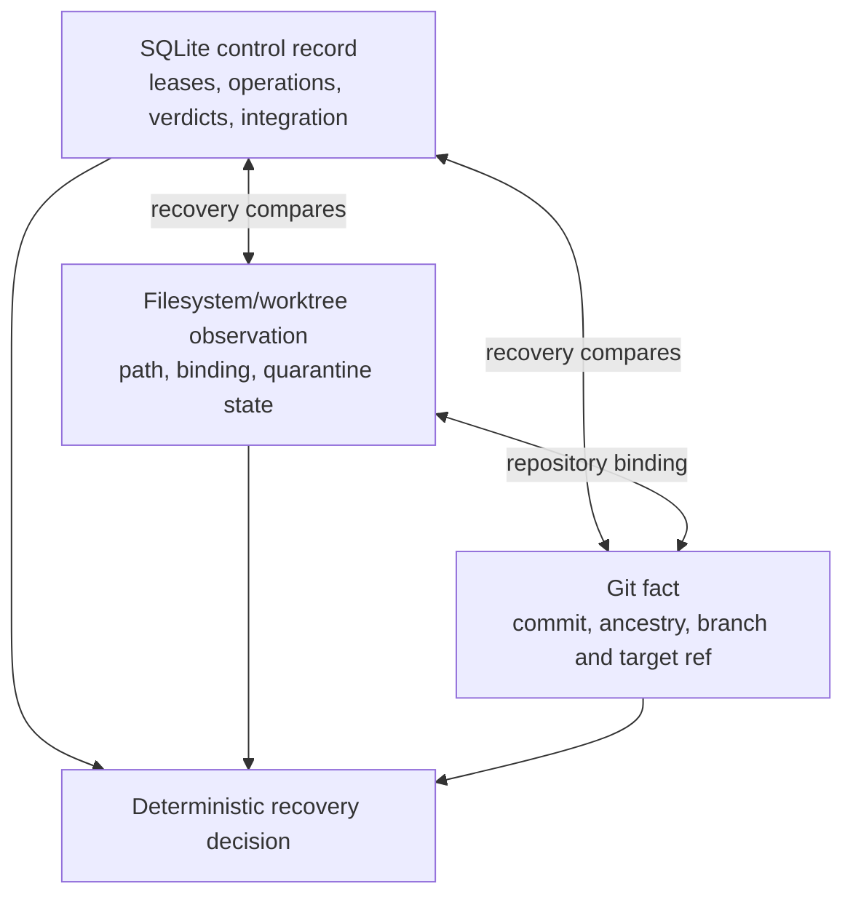

# Spec Kitty Redesign

> A Go-native authority kernel for safe, concurrent, mission-shaped software work.

| Project property | Current value |
|---|---|
| Maturity | Architectural proving ground / Phase 1 reference implementation |
| Language | Go 1.26+ |
| Control store | SQLite, owned by one machine and filesystem authority |
| Execution model | Lease-scoped Git worktrees with independent review and serialized integration |
| License | MIT |

## Abstract

Spec Kitty Redesign asks a narrower and more consequential question than “can the
Python application be translated into Go?” It asks:

> Which behaviors make Spec Kitty valuable, and what is the smallest Go-native
> architecture that can preserve those behaviors under concurrency, failure,
> and recovery?

The answer developed here is an authority kernel organized around explicit
capabilities. A tracker describes **what work exists**. Spec Kitty decides
**whether that work may run, under which authority, and how its result may be
accepted**. Git records **what actually happened**. The implementation preserves
the original system's hard-won mission methodology, isolated concurrent
worktrees, independent review, and serialized integration while deliberately
leaving behind Python package structure, Markdown task-list mechanics, implicit
global state, and provider-specific orchestration semantics.

This repository is not yet a complete replacement for production Spec Kitty. It
is the tested Phase 1 implementation of the most difficult architectural claim:
two agents can work concurrently, a process can die or become stale at any
boundary, and the system can recover without transferring stale filesystem
authority or corrupting Git history.

## Contents

- [The architectural thesis](#the-architectural-thesis)
- [What changed relative to Python Spec Kitty](#what-changed-relative-to-python-spec-kitty)
- [Correctness model](#correctness-model)
- [Architecture](#architecture)
- [Concurrent execution protocol](#concurrent-execution-protocol)
- [Persistence and recovery](#persistence-and-recovery)
- [Tracker boundary](#tracker-boundary)
- [Repository guide](#repository-guide)
- [Build and installation](#build-and-installation)
- [Verification](#verification)
- [Current scope and limitations](#current-scope-and-limitations)
- [Design record and evidence](#design-record-and-evidence)
- [Contributing](#contributing)
- [License](#license)

## The architectural thesis

The redesign assigns each kind of fact to one authoritative subsystem.



This separation is the central product decision:

- A ticket assignment is not an execution lease.
- An agent identity is not a live process identity.
- A lane is not a reusable mutable directory.
- A database row cannot prevent arbitrary POSIX filesystem writes.
- A completed implementation is not an approved implementation.
- An approved implementation is not an integrated commit.
- A tracker, even a sophisticated one, is not the mission authority.

The model is intentionally compatible with different ticket substrates. Beads
is the leading candidate for a first production provider, while GitHub Issues,
Jira, or another revision-capable system can implement the same narrow port.
None of those integrations is implemented in Phase 1, and none is permitted to
own execution authority.

## What changed relative to Python Spec Kitty

The original Python system is treated as behavioral evidence, not as a package
template. The redesign begins with the observed behavior inventory and then
chooses idiomatic Go boundaries that make the underlying laws enforceable.

| Concern | Original or inherited tendency | Go-native decision | Why |
|---|---|---|---|
| Porting strategy | Translate commands, modules, and data shapes | Preserve externally valuable behavior; redesign internal structure | Source parity would preserve accidental complexity and obscure ownership |
| Work representation | Markdown-inspired task lists are both artifact and working interface | A narrow tracker port supplies revisioned work facts | Agents should not spend mission time constructing and repeatedly parsing a presentation format |
| Mission semantics | Mission state and task artifacts are closely coupled | Missions remain Spec Kitty-owned orchestration law | Tickets describe work; they do not determine whether work may execute or be accepted |
| Modularity | Python package boundaries and shared helpers can carry implicit policy | Capability-oriented domain packages with explicit ports and adapters | Dependencies reveal authority instead of hiding it in framework conventions |
| Identity | An agent name can ambiguously mean a person, model, or process | `ActorID` is durable identity; `ProcessID` is one execution | Independent review and recovery require answering both “who?” and “which process?” |
| Executable plan | Mutable task descriptions can drift while work is running | `WorkRevision` freezes one generation of the executable graph | A running agent needs a stable contract; later edits require explicit reconciliation |
| Reconciliation | Drift is detected but can become procedural ambiguity | Reconciliation yields `continue`, `supersede`, `invalidate`, or `fork` | Immutability is useful only when change has defined operational consequences |
| Concurrency | Lanes and worktrees provide effective parallel isolation | Preserve lanes as durable lineage; make workspaces lease-scoped and disposable | The concurrency gain is product behavior; directory reuse is not |
| Stale processes | A fencing token can appear to fence all mutation | Tokens fence control-plane operations; fresh leases receive fresh worktrees | A database cannot stop a zombie editor, shell, compiler, or agent from writing files |
| Handoff | Review may accidentally observe a live mutable checkout | Handoff records an immutable candidate commit and evidence | Review must assess a stable object, not a moving workspace |
| Review | Process separation may be mistaken for reviewer independence | Reviewer actor differs from implementer actor unless policy explicitly permits otherwise | Two processes with the same actor are not independent judgment |
| Integration | Per-mission serialization can miss cross-mission races | Serialize by `(RepositoryID, TargetRef)` and fence with monotonic Git state | The target branch is the contested resource, regardless of mission boundaries |
| Compensation | Recovery can blindly undo an earlier external mutation | Compare revision, value, and operation marker before compensation | Recovery may undo only state still attributable to the failed operation |
| Control persistence | Files and process-local state can become hidden coordinators | SQLite WAL is the local control authority | Transactions, compare-and-swap, idempotency, and recovery become explicit and testable |
| Distribution | A local store may later be opened from several hosts | One control store has one machine/filesystem owner | Remote agents must eventually use the Orchestrator API rather than share SQLite or worktrees |

### What is deliberately preserved

This is not a rejection of the original product. It preserves the parts the
behavioral study identified as Spec Kitty's distinctive strength:

1. Mission-shaped work rather than an unstructured queue of tickets.
2. Parallel implementation in isolated Git worktrees.
3. Durable lane lineage across attempts and recovery.
4. Independent review of immutable implementation evidence.
5. Explicit acceptance rather than self-approval by the implementing run.
6. Serialized, conflict-aware integration into a target ref.
7. Recoverable operations with inspectable authority and provenance.

## Correctness model

The kernel is designed around invariants rather than command choreography.
Identifiers are typed so that conceptually different authorities cannot be
silently substituted for one another.

### Core identities

| Identity | Meaning |
|---|---|
| `ProjectID` / `RepositoryID` | Product and Git repository boundaries |
| `MissionID` | A governed objective and its acceptance context |
| `WorkID` | Logical work across graph generations |
| `WorkRevisionID` | Immutable generation of the executable work graph |
| `LaneID` | Durable lineage for a stream of work |
| `ActorID` | Durable accountable identity |
| `ProcessID` | One concrete execution of an actor |
| `RunID` / `LeaseID` | One authorized attempt and its renewable authority |
| `WorkspaceID` | One mutable checkout bound to one lease |
| `OperationID` | Idempotency and external-attribution boundary |
| `HandoffID` / `ReviewID` | Immutable implementation and judgment records |

### Product laws

For a finalized `(WorkRevisionID, WorkID)`:

1. At most one implementation lease is valid at a time.
2. A lease is renewed by compare-and-swap and carries a monotonic fencing token.
3. A workspace is created for one lease and is never transferred to its
   replacement.
4. Expiration quarantines the old workspace from Spec Kitty's perspective; a
   replacement lease receives a different workspace.
5. A stale token cannot mutate control state, tracker state through the kernel,
   review state, or Git refs through the kernel.
6. A stale process may still write its old directory; those writes have no path
   to acceptance or integration.
7. A handoff pins a candidate commit and evidence. Subsequent review never reads
   mutable implementation files as its source of truth.
8. Review independence is evaluated at the actor boundary, not merely the
   process boundary.
9. Only an approved candidate may enter target-ref integration.
10. Integration authority is exclusive for a repository and target ref, even
    when competing candidates belong to different missions.
11. External compensation is permitted only while the observed external state
    remains demonstrably attributable to the operation being compensated.

These laws turn the filesystem-fencing problem into a tractable isolation
problem. Spec Kitty cannot make POSIX obey a database token, but it can ensure a
stale directory is never promoted into current authority.

## Architecture

The implementation is organized as a set of small capabilities. The arrows in
the following diagram describe conceptual dependence and data flow, not a
promise that every package imports every adjacent package.



### Capability boundaries

- **`workgraph`** finalizes immutable graph generations and defines the explicit
  consequences of later tracker drift.
- **`execution`** owns claims, renewable leases, runs, fencing tokens, and
  idempotent start/recovery behavior.
- **`workspace`** allocates, inspects, quarantines, and safely cleans
  lease-scoped Git worktrees.
- **`handoff`** converts a mutable implementation attempt into an immutable
  candidate commit plus recorded evidence.
- **`review`** records independent, replay-safe judgments over handoffs.
- **`integration`** serializes movement of the real contested resource: the Git
  target ref.
- **`controlstore/sqlite`** persists authority transitions and recovery facts.
- **`gitrepo`** invokes Git with argument vectors, validates repository
  bindings, and treats Git refs and ancestry as facts rather than cached lore.
- **`tracker/fake`** proves that the kernel depends on a deliberately small
  provider contract, not on Beads semantics by accident.
- **`faults`** gives failures a stable kind, operation context, and retry-safety
  classification.

## Concurrent execution protocol

### Nominal lifecycle



### Why a replacement never inherits a workspace

The most important adversarial finding in the design review was that fencing
tokens cannot fence direct filesystem writes. The corrected protocol isolates
the stale writer instead.



The old directory need not become physically unwritable for the invariant to
hold. It becomes **unauthorized and non-transferable**. Inspection and explicit
reconciliation determine whether any useful artifact should later be recovered.

### Review and integration

An implementation run cannot approve itself. By default, the reviewing
`ActorID` must differ from the implementing `ActorID`; starting a second process
under the same actor does not create independent judgment.

After approval, integration is serialized by `(RepositoryID, TargetRef)`, not by
mission. The integration protocol re-reads Git, detects manual branch movement,
uses monotonic repository-side fencing, and records conflicts as durable
outcomes. This prevents two otherwise independent missions from racing the same
branch through separate mission-local locks.

## Persistence and recovery

### SQLite control authority

Phase 1 uses `modernc.org/sqlite`, a pure-Go SQLite implementation. The store
enables WAL mode, foreign keys, a bounded busy timeout, and a small connection
pool. Schema migrations currently cover work graphs, start-run operations,
recovery, handoffs, reviews, integration, and refusal evidence.

SQLite is an intentional **local** boundary:

> One Spec Kitty control store is owned by one machine and one filesystem
> authority.

The database must not be placed on a shared filesystem and opened directly by
agents on several machines. A future remote agent will communicate through the
Orchestrator API hosted by the store's owner. This constraint keeps transaction,
locking, filesystem, and process assumptions explicit rather than pretending a
local database is a distributed coordinator.

### Three mutually checking records



Recovery does not assume that the last command completed merely because it was
attempted. It compares the durable operation record with the observed workspace,
tracker revision, and Git state. Commands use `OperationID` for replay, and
typed diagnostics state whether a caller may retry the same operation, must
start a new operation, requires a decision, or must never retry automatically.

### Attribution-safe compensation

Every external compensation follows one rule:

> Compensation may undo only external state still demonstrably attributable to
> the operation being compensated.

For example, recovery may clear a tracker assignment only if the provider still
reports the expected revision, expected assignee, and operation marker. If a
human or another process has since changed the ticket, recovery refuses to erase
the newer fact.

## Tracker boundary

The provider contract is intentionally less expressive than most issue trackers.
Phase 1 requires only four conceptual operations:

1. Read a work item with its provider revision.
2. Compare-and-set an assignment.
3. Compare-and-add an attributed comment.
4. Compare-before-compensate an external change.

The durable fake tracker supports revisions, operation markers, ambiguity,
unavailability, and injected failures. Contract tests against this deliberately
plain provider defend the kernel against the semantic gravity of any future
default, including Beads.

The tracker may own descriptions, dependencies, acceptance criteria, and human
workflow metadata. It may not mint Spec Kitty leases, choose workspaces, approve
its own implementations, reserve merge slots, mutate Git refs, or redefine
mission state.

## Repository guide

```text
.
├── cmd/spk-phase1-helper/       Phase 1 JSON command/helper executable
├── internal/
│   ├── controlstore/sqlite/     Durable local authority adapter
│   ├── execution/               Claims, leases, runs, and recovery
│   ├── faults/                  Typed diagnostics and retry safety
│   ├── gitrepo/                 Safe Git process boundary
│   ├── handoff/                 Immutable implementation candidates
│   ├── helpercmd/               Helper command application layer
│   ├── ids/                     Strong domain identifiers
│   ├── integration/             Target-ref integration protocol
│   ├── review/                  Independent review protocol
│   ├── scenario/                End-to-end and fault-injection experiments
│   ├── tracker/fake/            Durable tracker contract test adapter
│   ├── workgraph/               Finalization and drift reconciliation
│   └── workspace/               Lease-scoped worktree lifecycle
├── docs/
│   ├── adr/                     Ratified architecture decision records
│   ├── phase1-evidence/         Final adversarial campaign evidence
│   ├── PYTHON_BEHAVIOR_INVENTORY.md
│   └── TECHNICAL_PROJECT_PLAN.md
└── kitty-specs/                 Governed mission artifacts and review record
```

The `spk-phase1-helper` executable is an operator and test-harness surface. It is
not the final user-facing Spec Kitty CLI. Its current command families expose
the reference protocols directly:

```text
claim             start-run          recover-start
expire-authority  zombie-write       workspace-inspect
workspace-cleanup handoff            review
integrate         inspect            tracker
workgraph
```

## Build and installation

### Prerequisites

- Go 1.26 or later, as declared by [`go.mod`](go.mod).
- Git with worktree and atomic reference-update support.
- A local filesystem suitable for Git worktrees and SQLite WAL.
- Linux for the complete process-suspension and signal-based torture tests.

The final Phase 1 evidence was produced with Go 1.26.4, Git 2.43, and
`modernc.org/sqlite` 1.57 on Linux/amd64. The domain packages are portable Go,
but the complete adversarial test matrix has not yet been certified on every OS.

### Clone and compile

```bash
git clone https://github.com/spec-kitty/spec-kitty-redesign.git
cd spec-kitty-redesign
go mod download
go build ./...
```

To produce a named local helper binary:

```bash
mkdir -p bin
go build -trimpath -o ./bin/spk-phase1-helper ./cmd/spk-phase1-helper
```

Running the binary without a subcommand prints its current command synopsis:

```bash
./bin/spk-phase1-helper
```

The synopsis exits non-zero because a command is required. This helper expects
explicit IDs and paths and is principally useful to scenario authors, adapter
implementers, and architecture reviewers.

### Install the helper into the Go binary path

```bash
go install ./cmd/spk-phase1-helper
```

Go installs it in `GOBIN`, or in `GOPATH/bin` when `GOBIN` is unset. Confirm the
resolved destination with:

```bash
go env GOBIN GOPATH
```

No system service, shared database, hosted account, Beads installation, or
Python runtime is required to compile and exercise Phase 1.

## Verification

### Standard checks

The full suite contains real Git repositories, multiple helper processes, crash
injection, and recovery. Allow sufficient time:

```bash
go test ./... -timeout=30m
go test -race ./... -timeout=60m
go vet ./...
go mod verify
go build ./...
```

If installed, the additional release checks used by the project are:

```bash
staticcheck ./...
govulncheck ./...
```

For a quicker change-local loop, test the capability packages you touched, then
run the complete suite before claiming repository-wide correctness. To exercise
the central end-to-end experiment directly:

```bash
go test ./internal/scenario -run '^TestPhase1TwoAgentTortureChamber$' \
  -count=1 -timeout=30m -v
```

### What the torture chamber attacks

The experiment uses two work items, two agents, one durable fake tracker, one
real SQLite control database, and one real Git repository. It injects failures
after lease acquisition, workspace creation, tracker operations, handoff,
review, and integration. It also exercises stale writers, manual branch
movement, tracker outages, simultaneous integration, and merge conflicts.

The final adversarial campaign executed 65 disjoint test shards for 100
iterations each. All 65 shards passed without reruns. The campaign covered all
17 discovered top-level Phase 1 tests and 28 named fault boundaries. Those are
historical evidence for the recorded commit, not a substitute for running tests
against new changes.

See the [evidence guide](docs/phase1-evidence/README.md) and
[final campaign manifest](docs/phase1-evidence/final-campaign-manifest.json)
for the reproducible record.

### Diagnostics as protocol output

Failures are typed rather than reduced to prose. A diagnostic records a stable
kind, the failed operation, contextual IDs, and retry safety. Important kinds
include authority conflict, idempotency conflict, stale authority, target
movement, dependency conflict, unsafe path, cleanup refusal, and Git failure.

Callers should branch on the structured kind and retry-safety value, never on
English error text. That rule is important for future CLI, MCP, Team Kitty, and
Orchestrator API adapters.

## Current scope and limitations

Phase 1 proves the local authority and concurrency model. It does **not** yet
provide:

- the complete production Spec Kitty command-line experience;
- a Beads, GitHub Issues, Jira, or Team Kitty tracker adapter;
- the Orchestrator API, MCP surface, hosted sync, or remote-agent transport;
- migration of existing Python Spec Kitty projects;
- every production mission type or compatibility command;
- distributed control-store ownership or shared-filesystem coordination;
- automatic human acceptance of migration risk.

Four cataloged behaviors remain intentionally outside this phase: human-
authorized import choices, superseding a previously recorded judgment,
rejection-to-rework-run creation, and the complete acceptance/queue surfaces.
They are preserved as explicit future work rather than silently claimed as
implemented.

The next production milestone should remain scenario-led: introduce one real
tracker adapter and one thin product workflow without weakening the fake-tracker
contract or the authority laws. Package scaffolding alone is not progress.

## Design record and evidence

The repository keeps design claims close to their supporting evidence:

- [`PYTHON_BEHAVIOR_INVENTORY.md`](docs/PYTHON_BEHAVIOR_INVENTORY.md) — observed
  Python behavior, including the lane/worktree concurrency gains that must not
  be lost.
- [`TECHNICAL_PROJECT_PLAN.md`](docs/TECHNICAL_PROJECT_PLAN.md) — detailed capability
  architecture, phases, risks, and validation strategy.
- [`MINI_REVIEW_BRIEF.md`](docs/MINI_REVIEW_BRIEF.md) — adversarial architecture
  review prompt.
- [`MINI_REVIEW_RESOLUTION.md`](docs/MINI_REVIEW_RESOLUTION.md) — resolution of
  workspace fencing, graph generations, reviewer identity, compensation, and
  machine ownership findings.
- [`CONCURRENCY_SCENARIOS.md`](docs/CONCURRENCY_SCENARIOS.md) — executable scenario
  catalog and fault boundaries.
- [`0001-phase1-authority-proving-ground-verdict.md`](docs/adr/0001-phase1-authority-proving-ground-verdict.md)
  — ratified Phase 1 architecture within the single-machine boundary.
- [`phase1-evidence/`](docs/phase1-evidence/) — final repeated-run campaign
  manifest, results, scenario catalog, and hashes.

Terminology in these documents is intentional:

- **mission** is the governed objective and acceptance context;
- **work item** is tracker-described work;
- **lane** is durable lineage, not a mutable checkout;
- **workspace** is a lease-scoped Git worktree;
- **handoff** is an immutable implementation candidate and its evidence;
- **review** is an independent judgment over a handoff;
- **integration** is serialized target-ref mutation.

New documentation should use these terms consistently and clearly label future
designs as future designs. The README must not become a second, conflicting
source of truth for commands or behavior; detailed laws belong in ADRs and
executable tests.

## Contributing

Contributions are welcome when they preserve the architecture's evidence-first
discipline.

1. Ground behavior changes in an executable scenario.
2. Keep tracker convenience outside the authority kernel.
3. Model authority, identity, revisions, and idempotency explicitly.
4. Treat direct filesystem writes and out-of-band Git movement as normal facts,
   not impossible events.
5. Add fault injection at every new durable or external boundary.
6. Preserve actor-level review independence.
7. Run formatting, relevant focused tests, the full suite, and the race detector
   in proportion to the risk of the change.
8. Update the design record when a product law changes; do not hide an
   architectural decision in a helper package.

When adding a user-facing workflow, the next valid action should be obvious from
the workflow itself. Internal helper commands are not a substitute for a coherent
product surface.

## License

Spec Kitty Redesign is released under the [MIT License](LICENSE).
