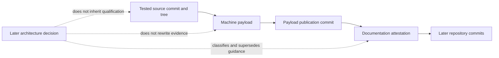

# Historical Architecture Dispositions

Status: **classification index; not a canonical architecture specification**

Decision point: 2026-08-29 production-runtime architecture mission

Canonical target: [Production Orchestration Architecture](PRODUCTION_ORCHESTRATION_ARCHITECTURE.md)

Decision record: [ADR 0002](adr/0002-production-orchestration-architecture.md)

Program: [Production Runtime Program](PRODUCTION_RUNTIME_PROGRAM.md)

## 1. Purpose and reading rule

This index preserves the difference between evidence that remains true and
guidance that no longer directs future implementation. It does not rewrite an
old verdict, grant a new verdict, or restate the canonical target. Where this
index and a linked source appear to specify product behavior, the linked
canonical architecture controls; this file only classifies provenance and
disposition.

Use the following vocabulary consistently:

| Disposition | Meaning |
|---|---|
| **Retained law** | A product invariant that remains normative in the target architecture. |
| **Observed implementation** | A fact qualified only for the cited source, tree, environment, and evidence. |
| **Compatibility projection** | A bounded outer translation for an existing consumer; not kernel vocabulary. |
| **Superseded guidance** | Advice that no longer directs future implementation but remains historical rationale. |
| **Unchanged evidence** | An immutable payload or mission record whose exact-source verdict remains intact. |
| **New proof obligation** | Target behavior that remains unqualified until a later governed mission produces evidence. |

The key rule is:

> A later architecture decision neither inherits nor invalidates an older
> exact-source verdict. It changes what is built next and creates new proof
> obligations.

## 2. Evidence-layer model

Qualification has layers with different authorities:



1. **Tested source commit/tree** identifies the implementation bytes exercised.
2. **Machine payload** records bounded commands, environment, results,
   limitations, digests, and failed/non-admissible attempts.
3. **Payload publication commit** introduces those immutable bytes without
   pretending the payload could predict its own commit.
4. **Documentation attestation** interprets and links the payload in a later
   docs-only commit.
5. **Later commits** contain the history but acquire no verdict by proximity.

Changing a later layer cannot silently change an earlier one. Copying an old
payload beside GapDB or API 2.0 source would neither qualify that source nor
invalidate the payload's original verdict.

## 3. Documentation disposition index

### 3.1 Active, decision, and compatibility records

| Path/title | Original purpose and source boundary | Mutability class | Observed implementation facts | Retained product laws | Superseded active guidance | Canonical successor | New proof obligation | Forbidden inference | Checksum/source verification |
|---|---|---|---|---|---|---|---|---|---|
| [README](../README.md) | Public entry point for the delivered Phase 1–3 repository at its cited evidence commits | Living active documentation; updated by governed documentation missions | Qualified Phase 1 authority, Beads 1.2.2 adapter, and Phase 3 mission method; SQLite is the observed qualified control store at those boundaries | Mission method, isolated concurrency, actor-level review, tracker neutrality, serialized integration | Any wording that makes the old Phase 4–7 sequence or SQLite the future production direction | [Production architecture](PRODUCTION_ORCHESTRATION_ARCHITECTURE.md) for target law; README remains the current delivery summary | WP06 must align current/target/retired labels without claiming target implementation | Repository HEAD inherits Phase 1–3 qualification; GapDB/API 2.0 already ship; README prose outranks evidence | Git history plus links to the exact Phase 1–3 evidence indexes |
| [Technical Project Plan](TECHNICAL_PROJECT_PLAN.md) | Original redesign plan, then Phase 1–3 delivery and evidence narrative | Living historical/active plan; normative conflicts must route to the canonical architecture | Records why SQLite, Beads, lanes, workspaces, review, and mission composition were selected and qualified at each phase | Authority separation, mission lifecycle, WorkRevision, isolated work, compare-before-compensate, one-machine boundary | SQLite-centered future storage, API 1.3/future-surface sequencing, and the old numbered production phase roadmap | [Production architecture](PRODUCTION_ORCHESTRATION_ARCHITECTURE.md) and [production program](PRODUCTION_RUNTIME_PROGRAM.md) | WP06 must preserve delivery history while replacing active target guidance | An old plan statement requalifies a new target or is erased because the target changed | Git history; cited mission reviews and evidence indexes |
| [Concurrency Scenarios](CONCURRENCY_SCENARIOS.md) | Pre-implementation torture specification subsequently implemented by Phase 1 at a frozen source | Historical proving contract and retained behavioral test catalog | Real Git/worktrees, real SQLite, fake tracker, crash matrix, stale writer, review, and integration scenarios were implemented at the Phase 1 boundary | Separate mutable workspaces, quarantine, stale refusal, ActorID independence, attribution-safe compensation, serialized integration | SQLite is the required representation for the next proving ground | [Production architecture](PRODUCTION_ORCHESTRATION_ARCHITECTURE.md) defines the retained laws; [program](PRODUCTION_RUNTIME_PROGRAM.md) schedules the GapDB replay | Re-run the crown-jewel and recovery/playback scenarios on the pinned GapDB boundary | The catalog alone is a pass; changing storage invalidates the old pass; a fence stops POSIX writes | [Phase 1 evidence](phase1-evidence/README.md), ADR 0001, and source-bound scenario manifest |
| [ADR 0001](adr/0001-phase1-authority-proving-ground-verdict.md) | Ratified Phase 1 verdict for frozen source `adf15aac...` and one machine/local filesystem | Historical decision; original body/facts immutable, contextual annotation allowed | Git 2.43.0 and modernc SQLite 1.57.0; 31/35 complete scenarios; final 65-shard campaign and explicit limitations | Lease-scoped workspaces, quarantine, immutable candidates, actor independence, stale refusal, serialized integration | Future production storage/API implications | [ADR 0002](adr/0002-production-orchestration-architecture.md) and [production architecture](PRODUCTION_ORCHESTRATION_ARCHITECTURE.md) | Qualify GapDB, API 2.0, complete host composition, and SQLite removal independently | Phase 1 was a mistake; its SQLite verdict transfers to GapDB; retained laws eliminate requalification | Frozen source, independent attestation, [Phase 1 evidence](phase1-evidence/README.md) |
| [ADR 0002](adr/0002-production-orchestration-architecture.md) | Proposed production decision synthesized after Phase 1–3 and the new storage/API/acceptance discussions | Current decision record; changed only through a later explicit ADR | It cites Phase 1–3 facts but implements no target behavior | Exactly the laws enumerated by the canonical architecture | Conflicting future-production guidance in older active records | [Production architecture](PRODUCTION_ORCHESTRATION_ARCHITECTURE.md) | Every M1–M5/release proof listed in the ADR | Ratification is implementation or qualification | Review/acceptance record of this documentation mission; later mission evidence |
| [API 1.3 projection](ORCHESTRATOR_API_1_3_PROJECTION.md) | Revalidated inventory mapping Python API 1.3 and strict consumers to the Phase 1 capability set | Historical/current compatibility inventory; outer-adapter guidance only | Seven-field envelope, command inventory, policy/error vocabulary, and identified composition gaps | Host-owned authority, typed errors, idempotency, no secret leakage, no remote store/Git/workspace authority | API 1.3 commands, lane vocabulary, and generic `transition` as future application semantics | [Orchestrator API 2.0](ORCHESTRATOR_API_2_0.md) | Implement safe one-operation translation and typed upgrade refusal outside kernel/application tiers | Mapping means the adapter ships; all 1.3 requests remain permanently supported; 1.3 can force a transition | Cited Python/Nano consumer sources and the document's 2026-08-25 revalidation boundary |
| [Orchestrator API 2.0](ORCHESTRATOR_API_2_0.md) | Proposed process-complete semantic application contract produced by WP02 | Current proposed normative subrecord; documentation only | No API 2.0 host or transport is claimed delivered | One application seam, closed named operations, host-owned mutation, resumable native operations, revisioned progress | API 1.3 as canonical vocabulary and generic state mutation | [Production architecture](PRODUCTION_ORCHESTRATION_ARCHITECTURE.md); API 2.0 is its application-contract refinement | M5 implements/conformance-tests API, CLI parity, progress, restart, and compatibility refusal | A specification is a server; a transport may add workflow semantics | WP02 independent review plus later black-box/conformance evidence |
| [Python Behavioral Inventory](PYTHON_BEHAVIOR_INVENTORY.md) | Ratified behavior baseline at Python source `d060cff...`, explicitly about semantics rather than package parity | Historical behavioral source; do not rewrite from the new decision point | Records mission, lane/workspace, lifecycle, review, acceptance, tracker, API, recovery, and known-gap behavior | Classified in section 4 below | SQLite as target representation; physical lane reuse; Markdown/Git status authority; ambient-CWD and Python package mechanisms | [Production architecture, behavioral preservation map](PRODUCTION_ORCHESTRATION_ARCHITECTURE.md#3-product-laws-and-behavioral-preservation) | Re-prove retained semantics on the production host and document explicit retirements | “Preserve behavior” means transliterate Python structure; every observed mechanism remains target law | Inventory source register, commit in [Mini resolution](MINI_REVIEW_RESOLUTION.md#ratification-effect), and Git history |
| [Mini Review Brief](MINI_REVIEW_BRIEF.md) | Original adversarial prompt against the pre-Phase-1 technical plan | Immutable review prompt; historical question set | Records the architecture as presented to the external reviewer, including SQLite-era assumptions | Its adversarial focus on authority leakage, concurrency, recovery, WorkRevision, and bookkeeping remains useful | None as a factual verdict; it is a prompt, not a decision | [Mini Review Resolution](MINI_REVIEW_RESOLUTION.md) | Continue applying the same adversarial questions to each new proving mission | Questions are findings or implementation evidence | Git history and paired resolution link |
| [Mini Review Resolution](MINI_REVIEW_RESOLUTION.md) | Accepted resolution of one blocker, five corrections, and delivery ordering before Phase 1 | Historical reviewed decision input; findings remain load-bearing as classified in section 5 | Records accepted workspace, WorkRevision, reviewer, compensation, machine-boundary, and torture-test corrections | All seven resolved findings, with storage representation amended | “SQLite control store” as the future product substrate; empirical result was still pending at that time | [Production architecture](PRODUCTION_ORCHESTRATION_ARCHITECTURE.md) and [ADR 0001](adr/0001-phase1-authority-proving-ground-verdict.md) | Replay the early disproof strategy for GapDB/production host | Later success makes the review irrelevant; the review itself proves Phase 1 passed | Git history; links to inventory, scenarios, ADR, and Phase 1 evidence |
| [Phase 1 acceptance erratum](PHASE1_ACCEPTANCE_ERRATA.md) | Living correction distinguishing accepted mission wording from implemented no-waiver behavior | Living compatibility correction; historical mission artifact remains immutable | Phase 1 implements no same-actor reviewer waiver | Default ActorID-level independence fails closed | The historical phrase suggesting an existing visible waiver | [Production architecture](PRODUCTION_ORCHESTRATION_ARCHITECTURE.md) for target policy | Any future exception is a separately specified, authorized, visible, tested feature | A bypass exists because old prose mentioned one | Phase 1 gate behavior, ADR 0001, and immutable mission artifact link |

### 3.2 Frozen evidence and completed mission records

| Path/title | Original purpose and source boundary | Mutability class | Observed implementation facts | Retained product laws | Superseded active guidance | Canonical successor | New proof obligation | Forbidden inference | Checksum/source verification |
|---|---|---|---|---|---|---|---|---|---|
| [Phase 1 evidence](phase1-evidence/README.md) | Source-bound authority/recovery campaign for `adf15aac...`; payload/attestation layering recorded in its index | **Unchanged evidence**; no WP07 edits anywhere in the directory | Real SQLite/Git/worktrees, fake tracker, 31/35 catalog completion, 65 exact shards, explicit failed/non-admissible attempts | Empirically supports the retained authority/concurrency laws within its scope | None in the frozen payload; extrapolating its SQLite representation into future guidance is superseded | [ADR 0001](adr/0001-phase1-authority-proving-ground-verdict.md) for verdict; [ADR 0002](adr/0002-production-orchestration-architecture.md) for future direction | Reproduce equivalent and new recovery/playback proofs on GapDB | Evidence qualifies later commits, GapDB, real trackers, multi-machine/NFS, power loss, or network partitions | Git tree `53deee38be006d6516772373a2e81baeebaaa31b`; path-set/object digest `a7e92723d9790c0e45de9bcb0d462322e1df39afca04bffb4013d5c70e2a58f7`; internal manifests |
| [Phase 2 evidence](phase2-evidence/README.md) | Bounded real-provider and portable/adversarial proof for the exact Beads 1.2.2 tuple | **Unchanged evidence**; checksummed payload frozen | Exact executable/source/schema/binary tuple, 11/11 real scenarios, portable/adversarial campaigns, stated safety gaps | Provider-neutral tracker boundary, one project binding, revisioned observations, fail-closed capability discovery | None of its tracker qualification directs control-store/API architecture | [Production architecture tracker boundary](PRODUCTION_ORCHESTRATION_ARCHITECTURE.md#4-authority-ownership) | Requalify provider composition with the production host where the program requires it | Beads owns execution/mission authority; another version inherits 1.2.2 qualification; payload fills publication gaps not recorded | `(cd docs/phase2-evidence && sha256sum --check SHA256SUMS)`; Git tree `05f8141c0425638d0a745cbb59fd5a3727939955`; path-set/object digest `17e77d6815adabd4cafbf0cf3305424d03254641272b24f05e79da61095ac1f1` |
| [Phase 3 evidence](phase3-evidence/README.md) | Source-bound software-development mission-method qualification for source `03afabd...` | **Unchanged evidence**; checksummed payload frozen | WorkRevision v2, deterministic finalization/reconciliation, pure next, transactional mission control, one-way tasks projection, real Beads two-item mission | Immutable executable generations, lifecycle authority, drift reconciliation, governed next, derived tasks | None in the frozen payload; extrapolating its persistence/proving composition into the production host is superseded | [Production architecture](PRODUCTION_ORCHESTRATION_ARCHITECTURE.md) and [program](PRODUCTION_RUNTIME_PROGRAM.md) | Recompose the mission method over GapDB and the complete execution/review/integration host | Later code inherits attempt 36/37 verdicts; Phase 3 already delivered production dispatch/API/acceptance | `(cd docs/phase3-evidence && sha256sum --check SHA256SUMS)`; Git tree `7b7c9a7ac656e7ef59614681b529a0cd83bcada8`; path-set/object digest `d6217614c8f246d1e27239d1944026bc98d4c4700ed64b810a49b01f7859bcb9` |
| [Phase 1 proving mission](../kitty-specs/phase1-two-agent-authority-proving-ground-01M0Q4A8/mission-review-report.md) | Completed governed mission that implemented the authority torture chamber | **Unchanged completed mission history** | Spec, plan, tasks, reviews, acceptance matrix, review report, and retrospective record what was accepted | Its accepted behavior remains evidence through ADR 0001 | Its representation does not direct the new storage/API target | ADR 0001 and production architecture | New missions cite, do not edit, this record | Editing old task/review state can make a new target appear accepted | Git tree `0a7da83b4f18c1137edd28b3693fa59dc93f3fe8`; path-set/object digest `e78b696091d64859fe5e24a8b936501b995df87f9dee48157c9f6da360f05906` |
| [Phase 1 closeout mission](../kitty-specs/phase-one-architecture-closeout-01M0WZQ9/mission-review-report.md) | Completed closeout, permanent guards, governance context, campaigns, API 1.3 projection, and errata | **Unchanged completed mission history** | Records the exact closeout verdict, guards, API 1.3 work, limitations, and acceptance correction | Guard discipline, governance provenance, explicit limitations | API 1.3 as future-final seam; SQLite representation as target | ADR 0002, API 2.0, and production program | Retain/adapt guards while proving new boundaries | Closeout qualifies API 2.0 or GapDB | Git tree `b3d1bf62ea9e99cd8ddbe7f8e5f81e11654c5689`; path-set/object digest `c9e927a5343ec4302740587133a8bd188ee9a8db94e9adc1c9348085efae5be7` |
| [Phase 2 Beads mission](../kitty-specs/beads-tracker-integration-01M0YG7E/mission-review-report.md) | Completed governed mission for provider-neutral contracts and exact Beads qualification | **Unchanged completed mission history** | Captures 11 WPs, provider tuple, conformance, backup, operations, evidence, and review | Bounded default tracker, no authority leakage, attribution-safe limits | No future control-store/API direction is inherited from this tracker mission | Production architecture and program | Prove production-host composition without broadening Beads authority | Ticket success is mission/acceptance/integration success | Git tree `476c8e5c6c81644e038ff1d3163decbe053d537c`; path-set/object digest `966b68553f954f2e92d0448e2dfb3d21d96d60a898daedd83bc037995f6fb957` |
| [Phase 3 mission-method mission](../kitty-specs/software-development-mission-method-01M11EX2/mission-review-report.md) | Completed governed mission for the software-development method through a two-item vertical slice | **Unchanged completed mission history** | Captures 12 WPs, schemas, reconciliation, persistence, projections, provider parity, and campaigns | Mission method, WorkRevision, action governance, derived tasks, pure next | Current persistence/composition is not the final production host | Production architecture and program | Re-host over GapDB, then prove full dispatch/review/acceptance/integration | A portable helper composition equals the production application | Git tree `b86f9dbd9fc44b9b5532ce2b6ff49cd3d441d136`; path-set/object digest `29e41fec5553e20b22322da0c98dce5af21b72a3bc4f47c341108e77076b6c30` |

## 4. Python behavior inventory classification

The [Python behavior inventory](PYTHON_BEHAVIOR_INVENTORY.md) remains the
source record. This section classifies its decisions from the new production
decision point; it does not amend the source.

### 4.1 Valuable product behavior retained

| Inventory source | Retained behavior | Target interpretation |
|---|---|---|
| [Mission method](PYTHON_BEHAVIOR_INVENTORY.md#31-mission-method-and-governance) | Missions are governed lifecycles; finalization precedes execution; review, acceptance, merge, and retrospective remain distinct | Spec Kitty remains lifecycle authority; Beads is work/discussion, not a mission epic |
| [Work graph](PYTHON_BEHAVIOR_INVENTORY.md#32-work-graph-and-finalization) | Work IDs differ from lanes/runs/workspaces; graph validation fails closed; dependency and overlap semantics remain explicit | Immutable generation-numbered WorkRevision plus typed reconciliation |
| [Lanes and workspaces](PYTHON_BEHAVIOR_INVENTORY.md#33-lanes-workspaces-and-parallel-execution) | Independent work runs concurrently in separate mutable checkouts; dependency heads and manual drift are validated | Logical lineage may remain; every lease receives a distinct disposable workspace and stale workspaces stay quarantined |
| [Lifecycle and durable state](PYTHON_BEHAVIOR_INVENTORY.md#34-work-package-lifecycle-and-durable-state) | Planned/claimed/implementation/review/approved/done distinctions, idempotency, and attributable recovery remain | Control journal events and projections replace Markdown/Git-file authority |
| [Handoff and review](PYTHON_BEHAVIOR_INVENTORY.md#35-handoff-and-review) | Review consumes an immutable candidate, preserves rework history, and rejects self-approval | Candidate evidence is revision-pinned; reviewer independence compares ActorID, with no Phase 1 waiver |
| [Acceptance and integration](PYTHON_BEHAVIOR_INVENTORY.md#36-acceptance-and-integration) | Acceptance is mission-wide and attributable; integration is serialized, local-first, preflighted, and conflict-preserving | Stack-neutral acceptance and repository/target-ref integration remain separate capabilities |
| [Tracker boundary](PYTHON_BEHAVIOR_INVENTORY.md#37-trackers-and-the-beads-boundary) | Provider failure is visible; assignment is coordination, not authority; compensation is attribution-safe | Beads is default first-party work substrate behind provider-neutral ports |
| [External orchestration](PYTHON_BEHAVIOR_INVENTORY.md#38-team-kitty-and-external-orchestration) | Offline local authority, versioned typed API, policy attribution, secret isolation, fail-closed host resolution | API 2.0 strengthens these through one host-owned application seam |
| [Recovery and migration](PYTHON_BEHAVIOR_INVENTORY.md#39-recovery-diagnosis-and-migration) | Recovery is durable, explicit, diagnosable, and validates before mutation | GapDB storage recovery, product playback, epoch replacement, and external reconciliation become separate proofs |

### 4.2 Representation recommendations superseded

| Inventory statement or mechanism | Disposition | Reason |
|---|---|---|
| SQLite event/command records as future canonical control authority | **Superseded guidance; retained observed implementation** | Phase 1–3 evidence remains valid, but the target is memory-primary authority with GapDB-only durable control state |
| SQLite-specific contention, WAL, schema, migration, and control-root recommendations | **Historical implementation guidance** | The new storage boundary requires a pinned GapDB public contract and new recovery/adoption proof |
| Same physical lane worktree reuse | **Retired representation** | Logical lane history survives; mutable workspaces are lease-scoped and never transferred |
| Markdown task boxes, `tasks.md`, `status.json`, matrices, and Git-merged status events as independent runtime authority | **Retired or projection-only** | Beads supplies mutable work; journal facts generate compatibility projections |
| Ambient current-directory inference and filesystem path identity | **Retired** | Host-resolved opaque IDs and scoped capabilities prevent wrong-workspace authority |
| Shared Git index as authoritative review persistence | **Retired** | Candidate-bound verdict events must commit transactionally without lost-writer races |
| Python package/command/physical-lane layout | **Not a porting target** | Capabilities and product laws define Go boundaries |

### 4.3 API and remote-host constraints strengthened

| Inventory finding | Strengthened target |
|---|---|
| X-03: remote/Team Kitty state cannot grant local execution or advance Git | All remote inputs are authenticated typed requests or observations; only the host application may authorize a command or invoke a Git/workspace port |
| X-04: versioned JSON contract over host operations | API 2.0 defines transport-neutral semantic envelopes, named operations, durable native-operation handles, and revisioned progress |
| X-05: attributable policy metadata with no secret smuggling | Actor, process, delegation, governance, policy, operation digest, and secret-reference boundaries are explicit per command |
| X-06: remote orchestrators do not open storage or infer paths | The single machine/filesystem owner alone opens GapDB and mutates host Git/workspaces; callers receive opaque IDs, not portable authority |
| X-07: unresolved authority fails loudly | Typed refusal, `decision_required`, and reconciliation replace generic transition, force-success, or guessed state |
| API 1.3 path/lane vocabulary | Safe requests translate at an outer adapter; lossy/unsafe operations receive a typed upgrade refusal and never enter kernel vocabulary |

## 5. Mini review findings remain load-bearing

All accepted findings in the [Mini resolution](MINI_REVIEW_RESOLUTION.md) remain
valid. Storage and API representations changed; the findings' safety content
did not.

| Finding | Current classification | Where it controls the target |
|---|---|---|
| [Workspace quarantine](MINI_REVIEW_RESOLUTION.md#blocker-a-database-token-cannot-fence-posix-writes) | **Retained and strengthened law** | A fence protects application calls, not POSIX. Expired W1 is never transferred; replacement lease gets W2. |
| [Early behavior characterization](MINI_REVIEW_RESOLUTION.md#high-characterize-python-behavior-before-ratifying-architecture) | **Retained governance method** | Product laws are attacked by behavioral evidence before implementation contracts freeze. The Python inventory remains the source baseline. |
| [WorkRevision generations](MINI_REVIEW_RESOLUTION.md#high-define-workrevision-generations-and-reconciliation) | **Retained law** | Immutable executable generations reconcile only through `continue`, `supersede`, `invalidate`, or `fork`. |
| [ActorID reviewer independence](MINI_REVIEW_RESOLUTION.md#high-reviewer-independence-must-be-actor-level) | **Retained law** | A new process for the same actor cannot approve its candidate; Phase 1 has no waiver. |
| [Attribution-safe compensation](MINI_REVIEW_RESOLUTION.md#medium-high-compensation-must-compare-before-undoing) | **Retained law** | Compensation checks provider revision, expected value, and operation attribution before mutation; ambiguity becomes a decision. |
| [One-machine authority](MINI_REVIEW_RESOLUTION.md#medium-declare-the-local-concurrency-boundary) | **Retained boundary, amended storage name** | One machine/filesystem authority owns the first GapDB runtime. Remote callers use API 2.0; no NFS/SMB/multi-owner store. |
| [Early torture test](MINI_REVIEW_RESOLUTION.md#delivery-concern-prove-concurrency-before-completing-the-architecture) | **Retained delivery strategy** | The first GapDB vertical proof replays the two-agent crash/zombie scenario before broad application scaffolding. |

## 6. Integrity capture for this disposition change

WP07 captured the frozen trees before editing at lane base
`45fd227e5537454a23caf7f17f8ed91603eeb60e`. The owned changes are limited to
this index and contextual annotations in ADR 0001 and the API 1.3 projection.

| Frozen family | Pre-edit Git tree | Pre-edit recursive path/object digest | Required after-state |
|---|---|---|---|
| `docs/phase1-evidence/**` | `53deee38be006d6516772373a2e81baeebaaa31b` | `a7e92723d9790c0e45de9bcb0d462322e1df39afca04bffb4013d5c70e2a58f7` | Identical tree, path set, and object IDs |
| `docs/phase2-evidence/**` | `05f8141c0425638d0a745cbb59fd5a3727939955` | `17e77d6815adabd4cafbf0cf3305424d03254641272b24f05e79da61095ac1f1` | Identical tree, path set, object IDs, and `SHA256SUMS` verification |
| `docs/phase3-evidence/**` | `7b7c9a7ac656e7ef59614681b529a0cd83bcada8` | `d6217614c8f246d1e27239d1944026bc98d4c4700ed64b810a49b01f7859bcb9` | Identical tree, path set, object IDs, and `SHA256SUMS` verification |
| Phase 1 proving mission | `0a7da83b4f18c1137edd28b3693fa59dc93f3fe8` | `e78b696091d64859fe5e24a8b936501b995df87f9dee48157c9f6da360f05906` | Identical completed mission history |
| Phase 1 closeout mission | `b3d1bf62ea9e99cd8ddbe7f8e5f81e11654c5689` | `c9e927a5343ec4302740587133a8bd188ee9a8db94e9adc1c9348085efae5be7` | Identical completed mission history |
| Phase 2 Beads mission | `476c8e5c6c81644e038ff1d3163decbe053d537c` | `966b68553f954f2e92d0448e2dfb3d21d96d60a898daedd83bc037995f6fb957` | Identical completed mission history |
| Phase 3 mission-method mission | `b86f9dbd9fc44b9b5532ce2b6ff49cd3d441d136` | `29e41fec5553e20b22322da0c98dce5af21b72a3bc4f47c341108e77076b6c30` | Identical completed mission history |

The review check is intentionally mechanical:

```bash
git diff --exit-code 45fd227e5537454a23caf7f17f8ed91603eeb60e -- \
  docs/phase1-evidence docs/phase2-evidence docs/phase3-evidence \
  kitty-specs/phase1-two-agent-authority-proving-ground-01M0Q4A8 \
  kitty-specs/phase-one-architecture-closeout-01M0WZQ9 \
  kitty-specs/beads-tracker-integration-01M0YG7E \
  kitty-specs/software-development-mission-method-01M11EX2

(cd docs/phase2-evidence && sha256sum --check SHA256SUMS)
(cd docs/phase3-evidence && sha256sum --check SHA256SUMS)
```

An empty diff and passing manifests prove only that WP07 preserved those
bytes. They do not broaden what the bytes prove.

## 7. Language audit

In this index and its two annotated records:

- **current** always names a dated compatibility inventory, a living delivery
  summary, or a revision-pinned state—not an unimplemented target;
- **production** is qualified as observed historical behavior or proposed
  target architecture;
- **canonical** routes to the production architecture or API 2.0 and never to
  this disposition index;
- **supported** is bound to an exact compatibility/provider tuple or an
  explicitly proposed policy; and
- no prior evidence is said to qualify GapDB, API 2.0, stack-neutral
  acceptance, the production host, or optional MCP.

Readers should report an unqualified use of those terms as documentation drift,
not resolve it by editing frozen evidence or completed mission history.
