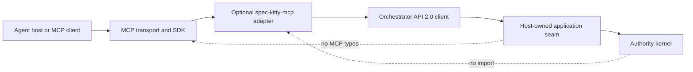
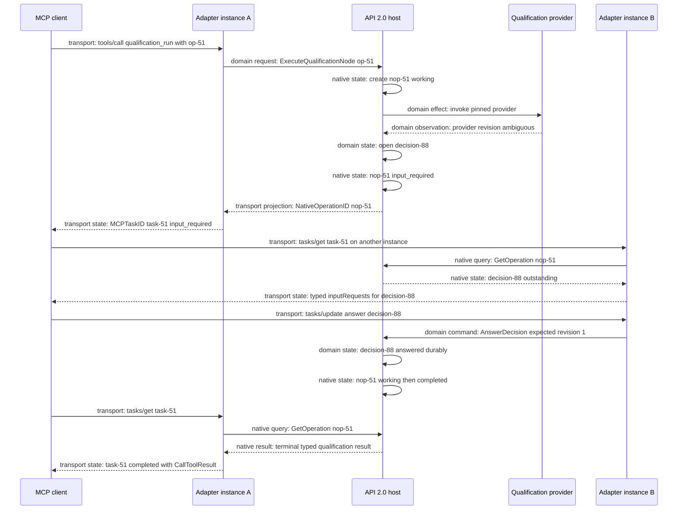
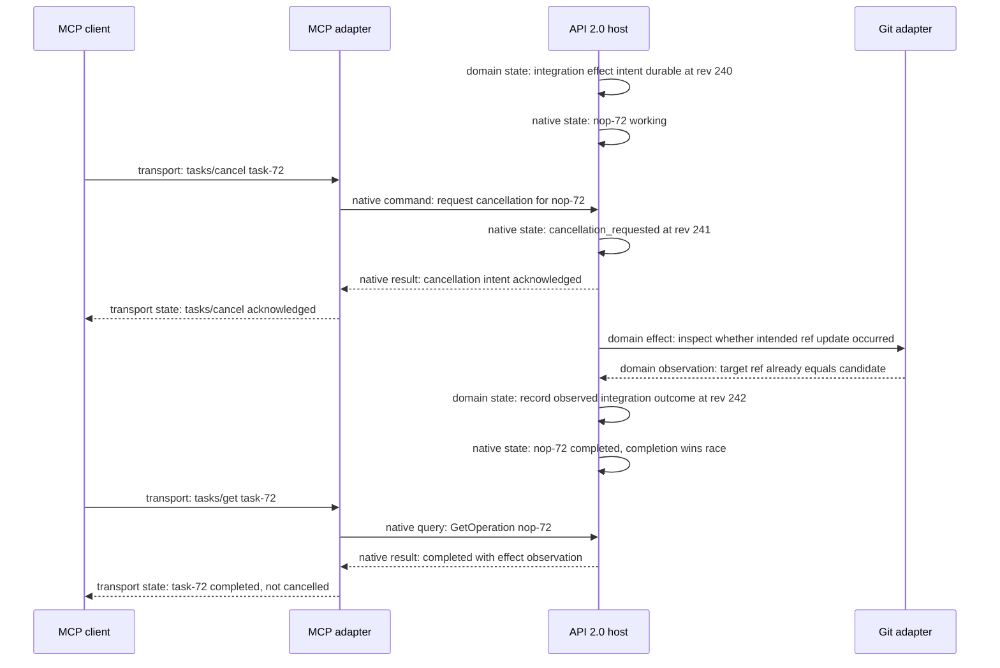

# Optional MCP 2026-07-28 Adapter

Status: **proposed optional adapter contract**

Delivery effect: documentation only; no MCP module, SDK dependency, server,
binary, generated schema, or runtime capability ships by virtue of this record

Application contract: [Orchestrator API 2.0](ORCHESTRATOR_API_2_0.md)

Canonical architecture: [Production Orchestration Architecture](PRODUCTION_ORCHESTRATION_ARCHITECTURE.md)

Mission-local inputs: [MCP projection contract](../kitty-specs/production-runtime-architecture-01M16GVA/contracts/mcp-2026-07-28-projection.md)
and [production data model](../kitty-specs/production-runtime-architecture-01M16GVA/data-model.md)

## 1. Status, optionality, and protocol assumptions

The proposed `spec-kitty-mcp` adapter makes the process-complete Orchestrator
API 2.0 convenient for MCP-capable agents. It is not Spec Kitty's application
protocol, state model, or authority boundary. The normal CLI and native API
remain complete when the adapter is absent.

This design uses three independently governed contracts:

| Layer | Proposed pin | Admission rule |
|---|---|---|
| Spec Kitty application | `spec-kitty.orchestrator/2` and the accepted API 2.0 command/query vocabulary | The adapter release declares an exact supported API minor range and refuses incompatible hosts. |
| MCP core | `2026-07-28` | Every request declares this revision. No fallback to a session-era protocol occurs unless a later, separate compatibility decision authorizes it. |
| MCP Tasks extension | `io.modelcontextprotocol/tasks`; current source is explicitly **draft** | M7 must pin an immutable extension revision, schema digest, and SDK implementation. “Draft” alone is not a reproducible version. |

The MCP core and Tasks extension pins are proposed and must be reverified at M7
admission. In particular, the extension evolves independently from MCP core;
declaring the core revision does not negotiate Tasks.

The baseline follows the official MCP `2026-07-28` stateless model:

- every request is self-describing and carries protocol/client capabilities;
- `server/discover` is optional discovery, not a handshake;
- method and name routing metadata can be carried in headers;
- list/read responses may carry cache hints;
- Multi Round-Trip Requests (MRTR) return needed input in-band; and
- `subscriptions/listen` carries opted-in notifications.

The baseline does not require `initialize`/`initialized`, `Mcp-Session-Id`,
legacy HTTP+SSE, Roots, Sampling, or Logging. Supporting an older era would be
a distinct adapter compatibility profile, never hidden state in this profile.

### 1.1 Product laws

1. Core build, install, qualification, and complete CLI missions require no
   MCP module, package, configuration, schema, or vocabulary.
2. Source dependencies point from MCP adapter to API 2.0 client; never inward.
3. Every MCP tool/resource outcome has a normal API and CLI equivalent.
4. Transport requests, connections, headers, `_meta`, client declarations,
   and task handles cannot mint domain authority.
5. One MCP Task projects one `NativeOperationID`; it is never a mission, work
   item, run, lease, workspace, review, acceptance, integration, or decision.
6. Task TTL and deletion govern adapter retrieval only. They never delete the
   native operation's durable mission facts or evidence.
7. Cancellation is cooperative intent, not rollback, lease revocation, or
   compensation.
8. Every stateless request is authenticated and reauthorized.

## 2. Separate-module packaging and deployment

The adapter is released as a separate Go module and `spec-kitty-mcp` binary.
Its module graph may contain the selected MCP SDK and the API 2.0 client. The
core module graph may contain neither the adapter nor the SDK.



### 2.1 Release tuple

Every adapter release records and signs this tuple:

| Item | Required evidence |
|---|---|
| adapter | source revision, module version, binary digest, SBOM, supported platforms |
| MCP core | exact `2026-07-28` schema/reference digest |
| Tasks | immutable extension revision and schema digest, not merely the moving `draft` URL |
| SDK | module version, module checksum, core/extension conformance status |
| API client | module version/digest and supported API 2.0 range |
| deployment profile | stdio or remote transport, routing-header behavior, auth mode, limits profile, task-token key policy |

An adapter and core may release independently. Compatibility is a tested
matrix, not an assumption that matching release dates imply compatibility.

### 2.2 Responsibility split

| Adapter-owned | Authority-host-owned |
|---|---|
| MCP decoding/encoding and revision checks | API 2.0 command/query schemas and legal actions |
| optional `server/discover`, tool/resource catalogs, cache hints | capability discovery and current policy truth |
| transport authentication integration and delegation presentation | ActorID resolution, delegation validation, command authorization |
| per-request capability negotiation, Tasks/MRTR projection | native operations, decisions, mission state, leases, evidence, effects |
| task-handle token codec, TTL projection, polling hints | durable `NativeOperationID` and operation/mission retention |
| transport limits, rate limiting, stream buffers, redaction | domain bounds, journal/watch revisions, artifact authorization |
| endpoint/listener configuration and API host address | GapDB, Beads, Git, workspace, qualification, and secret lifecycles |

The adapter can run beside the host for local stdio/Unix-socket access or as a
separate authenticated service. It never opens GapDB, Beads, Git repositories,
workspaces, or artifact storage directly.

### 2.3 Core-absence gate

A release cannot call MCP optional if any core artifact contains or requires
MCP. M7 qualification must prove all rows independently:

| Surface | Absence proof |
|---|---|
| core `go.mod`/`go.sum` | no MCP SDK or adapter module, direct or transitive |
| `go list -deps` / module graph | no MCP import path reachable from core packages or commands |
| core SBOM | no MCP component or adapter package |
| core binaries | no linked MCP packages, schemas, command handlers, or transport runtime |
| normal install | installs core CLI/host without downloading or configuring MCP |
| core tests/qualification | pass from an environment where the adapter and SDK are unavailable |
| complete CLI scenario | create, finalize, execute, review, accept, integrate, recover, query progress, and export without MCP |
| structural guard | mutant importing adapter/SDK into application or kernel fails CI |

The adapter may be installed later, upgraded independently, or hosted on
another process. Removal must not change any mission's legal action set.

## 3. API 2.0 capability discovery projection

Discovery is a projection of the host's API 2.0 discovery result plus the
currently authenticated actor's authorization. It never advertises a command
the host does not support or the actor cannot invoke.

```text
self-describing request
  -> authenticate transport principal
  -> resolve permitted ActorID delegation
  -> negotiate MCP core and per-request extensions
  -> query/cache API 2.0 capabilities under actor and policy revision
  -> intersect with adapter-supported projections
  -> publish deterministic authorized tools/resources
```

`server/discover`, `tools/list`, and `resources/list` return deterministic
ordering and cache metadata. Actor-specific catalogs use private cache scope.
The cache key binds authenticated principal/delegation, tenant, MCP revision,
extension set, adapter release, API capability revision, and policy revision.
Cache expiry does not authorize a later call: every tool/resource request is
validated again against the live host.

If discovery is skipped, a direct self-describing request still succeeds when
its declared revisions/capabilities are supported and current authorization
allows the named projection. Client self-reported name/version is diagnostic,
not authorization or behavior selection.

## 4. Tool catalog and authorization

Tool names are projection names, not new application operations. Each schema
uses bounded typed objects, opaque IDs, explicit expected revisions, and an
`operation_id` for mutation. It accepts no shell command, working-directory
inference, ambient mission, filesystem path as authority, raw event, force
flag, self-authored evidence verdict, or caller-created lease/fence/workspace.

### 4.1 Capability parity

| MCP tool family | API 2.0 operations projected | Normal CLI/API equivalent |
|---|---|---|
| `spec_kitty.mission_create` / `mission_amend` / `mission_cancel` | `CreateMission`, `AmendMissionIntent`, `RequestMissionCancellation` | Native API call; CLI mission create/amend/cancel command |
| `spec_kitty.mission_drive` | `DriveMissionUntilBoundary` | Native operation follow/detach; CLI drive/next loop |
| `spec_kitty.work_observe` / `work_finalize` / `work_reconcile` | tracker observation, `FinalizeWorkRevision`, `ReconcileWorkRevision` | Native work commands; CLI tracker/finalize/reconcile commands |
| `spec_kitty.work_claim` / `lease_heartbeat` / `run_report` | claim, heartbeat, run observations/outcome | Native execution commands; CLI agent execution commands |
| `spec_kitty.candidate_handoff` | `CreateCandidateHandoff` | Native handoff; CLI handoff/review transition |
| `spec_kitty.review_begin` / `review_record` / `review_verdict` | candidate review operations | Native review calls; CLI independent review commands |
| `spec_kitty.qualification_run` | `ExecuteQualificationNode` or bounded graph operation | Native qualification operation; CLI qualification command |
| `spec_kitty.acceptance_request` | `RequestAcceptanceEvaluation` | Native acceptance call; CLI acceptance gate |
| `spec_kitty.integration_request` | reserve/execute/reconcile integration operation | Native integration call; CLI merge/integration command |
| `spec_kitty.decision_answer` | `AnswerDecision` | Native decision call; CLI decision-answer command |
| `spec_kitty.checkpoint` / `recovery_reconcile` / `playback` / `terminal_export` | checkpoint, recovery, reconciliation, playback, export operations | Native operator calls; CLI administration commands |
| `spec_kitty.operation_cancel` | `RequestOperationCancellation` | Native cancellation call; CLI operation cancel |

Short requests return ordinary `CallToolResult`. When Tasks is declared for
that request, the server may choose a task result for eligible long-running
tools. A client cannot demand task creation, and a non-Tasks client still gets
complete semantics: the adapter returns a bounded native-operation handle in
an ordinary tool result and the client can query operation resources/tools.

### 4.2 Authorization rules

Every tool request carries MCP core revision/client capabilities, authenticated
principal/delegation context, explicit domain scope, and command inputs. The
adapter:

1. authenticates the request and issuer/audience under the deployment profile;
2. resolves rather than trusts an asserted `ActorID` and `ProcessID`;
3. validates the MCP and extension revision for this request;
4. canonicalizes the API command and lets the host verify its digest;
5. invokes the same API 2.0 authorization and concurrency checks as CLI; and
6. maps the typed result without weakening refusal or retry semantics.

Possession of `MissionID`, `NativeOperationID`, `MCPTaskID`, resource URI, or
task routing header never grants access. Review still compares accountable
actor identities. A model cannot approve its own candidate by presenting a
different process, client name, or transport credential.

## 5. Resource catalog and bounded representations

Resources are authorized read projections. URI templates contain opaque IDs
and explicit application revisions; they are locators, not authority tokens.

| Resource | API 2.0 query | Bounded representation |
|---|---|---|
| `spec-kitty://missions/{MissionID}/progress` | `GetMissionProgress` | Full schema-versioned snapshot, journal revision, epoch, freshness, graph/blockers/next actions |
| `spec-kitty://missions/{MissionID}/work/{WorkRevisionID}` | `GetWorkRevision`, `ListReadyWork` | Immutable graph summary and generation; no live tracker inference |
| `spec-kitty://missions/{MissionID}/runs` | authorized `GetRun` set | Active run/lease/workspace identities with secrets/fences/paths redacted by policy |
| `spec-kitty://missions/{MissionID}/decisions` | `ListOutstandingDecisions` | Typed choices, policy references, stable IDs, bounded explanation |
| `spec-kitty://candidates/{HandoffID}` | `GetCandidate` | Candidate digest, contributor identities, evidence/artifact references |
| `spec-kitty://reviews/{ReviewID}` | `GetReview` | Candidate-bound criteria and verdict projection |
| `spec-kitty://missions/{MissionID}/acceptance` | `GetAcceptance` | Claim/evidence/decision position, not artifact bodies |
| `spec-kitty://integrations/{IntegrationID}` | `GetIntegration` | Reservation/effect observation/terminal position |
| `spec-kitty://operations/{NativeOperationID}` | `GetOperation` | Status, progress revision, decisions, typed result/diagnostic, retention deadline |
| `spec-kitty://health` | `GetHealth`, authorized recovery detail | Minimal liveness or operator-authorized epoch/recovery state |

Resource reads report observed journal revision and projection freshness. They
never trigger tracker, Git, filesystem, provider, recovery, or compensation
effects to make a view “fresh.” Artifact/log bodies use a separately
authorized bounded artifact channel; MCP returns digest and locator only.

Prompts may later package human-facing usage guidance, but cannot introduce a
command, fill an identity from ambient state, or encode policy. The initial M7
adapter does not require prompts for capability completeness.

## 6. Native operation to Task mapping

Tasks is negotiated per request through `io.modelcontextprotocol/tasks`. The
adapter chooses task augmentation only for a supported `tools/call`, as allowed
by the current extension draft. Before returning `CreateTaskResult`, the
adapter must be able to resolve the task through `tasks/get` from any healthy
adapter instance.

### 6.1 Identity separation

| Identity | Owner and lifetime | Task relationship |
|---|---|---|
| `MCPTaskID` | Adapter-generated transport handle until TTL/purge | Refers to exactly one native operation; opaque to clients |
| `NativeOperationID` | API 2.0 application operation capability | Durable application identity and canonical source of operation state |
| `OperationID` | API 2.0 command idempotency identity | Duplicate tool calls replay by ID/digest; not necessarily equal to native operation |
| `MissionID` / `WorkID` | Mission/work capabilities | Scope of an operation, never represented by task lifetime or status |
| `RunID` / `LeaseID` / `WorkspaceID` | Execution/workspace capabilities | Remain live or expire by domain policy independent of task status |
| `DecisionID` | Decision capability | Referenced by `input_required`; task input can only answer it |
| `HandoffID` / `ReviewID` / `IntegrationID` | Candidate/review/integration capabilities | May be results/scope, never minted by a task |
| `EvidenceID` | Evidence capability | Referenced in results; task completion cannot manufacture it |

`MCPTaskID` uses a versioned, authenticated opaque token whose protected
payload identifies the adapter release/profile, `NativeOperationID`, creation
time, and retrieval expiry. All adapter instances in one deployment share a
bounded key-rotation policy. Decoding a token only identifies what to query;
the current principal is reauthorized against the native operation. A token
cannot encode domain authority or a success result.

This token shape removes sticky-session and adapter-database requirements. If
an adapter is restarted or another instance receives `tasks/get`, it decodes
the handle and queries API 2.0. Required `Mcp-Method`/`Mcp-Name` routing headers
are still validated, but routing may land on any instance.

### 6.2 Status and result mapping

| MCP Task field/state | Native source | Mapping law |
|---|---|---|
| `taskId` | `MCPTaskID` token for `NativeOperationID` | Never reuse for a different operation. |
| `working` | native `accepted`, `working`, or `cancellation_requested` | Cancellation intent may appear in bounded status metadata; it is not `cancelled`. |
| `input_required` | native outstanding durable `DecisionID` | `inputRequests` contains only typed authorized projections of outstanding decisions. |
| `completed` | native terminal result or a valid domain-negative/refusal result | Result is the normal typed `CallToolResult`; domain refusal/tool error may use `isError: true` while Task remains `completed`. |
| `failed` | failure to execute the JSON-RPC request/application invocation as a protocol operation | Contains JSON-RPC error. It must not represent a valid domain refusal or provider/test failure returned as a tool result. |
| `cancelled` | native operation durably confirms cooperative cancellation | Cancel acknowledgement alone is insufficient. |
| `ttlMs` | adapter retrieval policy | Starts at task creation and may be updated per extension rules; never mission/native-operation retention. This profile forbids unbounded `null`. |
| `pollIntervalMs` | adapter load hint | Advisory; aggressive polling may be rate-limited. It never changes operation scheduling. |
| progress notification | authorized native operation/progress snapshot | Carries complete bounded task state plus application revisions/references; delivery is not authority. |
| terminal retrieval | `GetOperation` recorded result plus adapter projection | Repeated `tasks/get` is stable while retained; native query/export survives task purge. |

An API-native `failed` status requires classification. If the application
successfully produced a typed negative result (qualification failed, evidence
inadmissible, integration conflict, provider error), MCP projects a
`completed` Task containing that tool result. `failed` is reserved for the
extension's JSON-RPC execution-failure meaning.

### 6.3 Loss, replay, and expiry

- Duplicate `tools/call` with the same API `OperationID` and digest returns the
  same native operation and deterministic task handle/profile projection.
- Same operation ID with a different digest becomes API
  `IDEMPOTENCY_CONFLICT` before effects.
- Adapter restart loses only transient delivery buffers. Task tokens resolve
  through API 2.0 on another instance.
- Task-token loss can be recovered through the explicitly known
  `NativeOperationID`, mission progress, or operation listing, subject to
  authorization. The adapter does not search by transcript text.
- After task TTL/purge, `tasks/get` may return the extension's invalid/expired
  handle error. The mission and operation evidence remain queryable through
  normal API/CLI retention.
- Multiple task handles for one native operation, if a future profile permits
  them, are projections of one state machine and cannot duplicate effects.

## 7. Stateless continuity and multi-instance routing

Every request includes or resolves:

| Context | Source and validation |
|---|---|
| MCP revision and client capabilities | Per-request protocol `_meta`; exact supported revision/extension intersection |
| method/name routing | Validated transport metadata plus JSON-RPC body; mismatch refuses |
| authenticated principal/delegation | Deployment auth headers/credential channel; issuer/audience and delegation revalidated |
| actor/process attribution | Resolved through host policy; asserted values are checked, never trusted |
| domain scope | Explicit opaque mission/work/candidate/operation identities in typed arguments/URI |
| concurrency | Expected journal/aggregate revision, epoch, generation, fence, candidate, or policy revision required by API command |
| idempotency | Explicit API `OperationID`; host-computed canonical request digest |
| continuity | `NativeOperationID`, `DecisionID`, `MCPTaskID`, and journal/progress revision—not a session |

No adapter process holds canonical mission state. Round-robin routing remains
correct because any instance can authenticate, decode a task token, query the
authority host, and render the current projection. Adapter-local discovery
caches and notification buffers are disposable.

When the deployment has several authority hosts, the deployment router maps
an opaque project/host routing reference to exactly one machine/filesystem
authority. This adapter design does not create distributed control-store
ownership.

## 8. Subscription/listen resume behavior

MCP notification delivery projects API 2.0 watch semantics. The client selects
an authorized progress resource URI containing `MissionID` and explicit
`after_revision`, or task IDs for task notifications. The adapter opens
`WatchMissionProgress(after_revision)` or `WatchOperation` after authorization.

```text
application journal revision -> canonical resume position
native operation progress revision -> canonical operation position
MCP subscription ID / connection / delivery count -> disposable transport state
```

Every progress notification includes the resulting journal revision and a
complete bounded snapshot or an authorized resource link. Reconnect supplies
the last fully applied application revision in a new request. A client never
resumes from an adapter delivery sequence number.

If the application revision was compacted, API 2.0 returns
`WATCH_RESET_REQUIRED` and a fresh snapshot revision. The adapter projects a
typed reset notification/result and closes or reestablishes the stream only
after client action; it never silently skips history. Adapter restart follows
the same path.

Slow consumers receive bounded buffering. When a buffer exceeds the profile's
item/byte limit, the adapter emits the last deliverable application revision
when possible, ends delivery with `BACKPRESSURE`/reset semantics, and releases
the watch. It does not grow memory without bound or slow the authority runtime.
Task notifications are snapshots; after loss, `tasks/get` supplies current
state and the native operation resource supplies canonical progress history.

## 9. MRTR and DecisionID input

MCP core MRTR and Tasks `inputRequests`/`tasks/update` are transport mechanisms
for an already durable API 2.0 `DecisionID`. They never create an implicit
decision from model prose.

An input projection contains:

- exact `DecisionID`, mission/native-operation scope, and opening revision;
- bounded typed choices or JSON Schema and explanatory context;
- authorization/delegation policy reference;
- expected decision and operation-progress revisions;
- expiry policy; and
- an idempotency identity for the answer.

For input required before task creation, the adapter uses MRTR: it returns an
`input_required` result and accepts a retry of the original request with the
opaque request state and keyed input responses. For input required during a
Task, `tasks/get`/notifications expose outstanding requests and `tasks/update`
supplies keyed responses. Both routes invoke the same `AnswerDecision` API
command.

The responding `ActorID` is resolved from the reauthenticated request; it is
not trusted from model content. The host verifies authorization, decision
status, expiry, response schema, and expected revision. Same answer operation
and digest replays. A duplicate with different content conflicts. Answers to
unknown, expired, unauthorized, or already terminal decisions return typed
refusals. Arbitrary model text, an “approve” word outside the schema, or a
client-generated DecisionID has no authority.

### 9.1 Qualification sequence reaching input_required

Every arrow is labeled by the kind of state it affects.



The Task may be retrieved from either adapter instance. The decision—not
`tasks/update` itself—authorizes the application transition.

## 10. Cancellation, completion, effects, and compensation

`tasks/cancel` authenticates the caller, resolves the task token, and invokes
`RequestOperationCancellation` with an idempotent API command. A successful
cancel RPC acknowledges that cancellation intent was accepted for processing.
It does not promise the Task will become `cancelled`.

| Race | Native/domain truth | MCP projection |
|---|---|---|
| completion commits before cancellation | terminal result wins; cancellation cannot rewrite it | cancel may acknowledge observation, then `tasks/get` reports `completed` |
| cancellation is observed at a cooperative boundary | cancellation intent and confirmed terminal cancellation are separate durable facts | `working` while pending, then `cancelled` only after confirmation |
| external effect intent exists but adapter has not executed it | cancellation policy may suppress dispatch only through normal effect reconciliation | never delete intent; terminal result explains suppression/reconciliation |
| external effect may already have happened | observe provider/Git/workspace state; blind retry/undo forbidden | remain `working` or input-required until reconciled; do not report rollback |
| decision is pending | cancellation can race with an authorized answer | first valid conditional state transition wins; report actual terminal state |
| task expires or client drops handle | no native cancellation occurs | retrieval may fail while mission/operation continues |

`tasks/cancel` never directly expires a lease, deletes/quarantines a workspace,
resets Git, clears a Beads assignment, withdraws a candidate, removes review or
evidence, or runs compensation. Compensation is a separate API operation and
may undo an external effect only when current provider revision, value, and
operation attribution still prove that effect belongs to the compensated
attempt.

### 10.1 Cancellation after durable effect intent



The cancel acknowledgement did not roll back Git and did not allow a blind
compensation. The observed domain fact determined the terminal result.

## 11. Privacy, retention, TTL, and backpressure

The following are proposed default adapter-profile bounds. M7 may tighten them
after protocol/SDK measurement but may not replace them with unbounded values.

| Surface | Proposed bound |
|---|---|
| complete MCP request | 256 KiB; tool arguments 128 KiB |
| ordinary tool/resource result | 512 KiB; larger bodies become artifact references |
| Task metadata/status/result wrapper | 64 KiB excluding separately bounded final tool result |
| `statusMessage` / diagnostic prose | 2 KiB UTF-8 |
| input requests/responses | 32 entries and 64 KiB total per update |
| list page | 200 items; stable cursor/cache key required |
| IDs and URI components | 128 bytes each after decoding; strict syntax |
| artifact references | 128 per result; digest, size, media type, authorized locator only |
| subscription notification | 256 KiB |
| per-subscription buffer | 128 notifications or 4 MiB, whichever occurs first |
| task retrieval | default 24 hours, maximum 7 days; non-null finite `ttlMs` |
| polling | default 2 seconds, minimum advertised 500 ms, rate limited by principal/task |

Task TTL begins with task creation and may change only within the advertised
profile. Purging a task token/projection never purges the native operation,
mission events, evidence, external-effect observations, or terminal mission
record. Operational retention is advertised separately by API 2.0.

The adapter redacts credentials, secret references, environment dumps,
filesystem paths not explicitly authorized, fence values, transcript bodies,
raw logs, provider output, stack traces, and artifact payloads. It stores no
request transcript as task metadata. Bounded diagnostics and artifact digests
are sufficient for explanation and retrieval through an authorized channel.

Rate and concurrency limits apply by principal, tenant/project, method/tool,
task, and subscription. A transport deadline bounds one invocation; it does
not cancel the native operation. Connection loss has no authority effect.

## 12. Core-absence, parity, and conformance qualification

### 12.1 Conformance matrix

| Scenario | Required observation | Failure signal |
|---|---|---|
| adapter absent | core builds/installs/tests and CLI completes a mission | any MCP dependency, config, type, or missing CLI capability |
| API/CLI versus MCP terminal evidence | normalized API result/evidence/terminal-export digests are identical | MCP-only evidence, altered verdict, or lost revision |
| different adapter instances | create/get/update/cancel requests can hit different healthy instances | sticky session or adapter-local task database required |
| duplicate/replayed tool requests | same operation/digest yields one native operation/effect; changed digest conflicts | duplicate lease, workspace, provider call, evidence, or Git effect |
| task expiry | `tasks/get` may expire while mission/native query remains resumable | mission history or operation evidence deleted |
| `input_required` | every input maps to an existing authorized `DecisionID` | prompt/model prose directly advances state |
| cancel/completion race | committed terminal result and effect observations win honestly | cancel acknowledgement rewritten as rollback/cancelled |
| progress reconnect | new instance resumes from explicit journal revision or reports reset | adapter cursor treated as canonical or history silently skipped |
| authority attack | adapter cannot mint lease/fence/workspace/evidence/review/Git outcome | any transport/session/task value accepted as authority |
| privacy and bounds | oversized requests/results/streams refuse or externalize safely | secrets/unbounded bodies retained or buffer grows without limit |
| extension absent | long-running tool returns native operation handle without a Task | Tasks required for semantic completeness |
| core/extension skew | unsupported core or Tasks pin refuses before effects | silent downgrade or draft-latest behavior drift |

### 12.2 Requirement coverage

| Requirement | Design location | Later executable proof |
|---|---|---|
| FR-020 / C-011 optional packaging | Sections 1–2 and core-absence gate | Core/CLI campaign passes with adapter and SDK physically unavailable. |
| FR-021 / C-012 stateless contract | Sections 1, 3, 7–9 | Requests route across instances using explicit identities/revisions with no initialize/session dependency. |
| FR-022 / C-013 Tasks mapping | Sections 6, 9, and 10 | Task expiry/input/cancel/completion races preserve native mission facts and authority. |
| FR-023 architecture enforcement | Sections 2 and 12.4 | Dependency/reachability and authority mutants fail CI. |
| NFR-010 protocol precision | Tools/resources/task/decision/cancellation tables | Every mutation identifies API operation, identity, authorization, replay, result, and refusal semantics. |
| NFR-013 optional-adapter isolation | Section 2.3 | Module graph, SBOM, binaries, install, tests, and full CLI workflow prove absence. |
| NFR-014 evidence economy | Sections 5 and 11 | Bounds tests reject oversized payloads or externalize bodies and prove no transcript/log/artifact payload in metadata. |

### 12.3 Capability parity gate

For every MCP tool, qualification invokes the equivalent native API and normal
CLI operation against identical starting state and compares:

- API command kind/version, operation ID/digest, and preconditions;
- resulting record IDs and durable journal revision;
- typed domain outcome or refusal and retry class;
- external-effect intent/observation identities;
- evidence and terminal export digests; and
- legal next actions and progress revision.

MCP formatting, task IDs, cache metadata, and delivery timestamps are excluded
from the normalized comparison. The adapter fails parity if it adds a legal
action or causes the host to skip an authority check.

### 12.4 Dependency and mutant controls

Release CI must kill mutants that:

- import the MCP adapter or SDK from core/application/kernel packages;
- advertise a host-unsupported or actor-unauthorized tool;
- trust a client `ActorID`, current directory, path, ref, session, or task as
  authority;
- create a second native operation on replay;
- map task expiry/cancel acknowledgement to mission deletion or lease expiry;
- map a domain refusal to Task `failed` instead of a completed tool result;
- accept arbitrary MRTR/model prose without `DecisionID` validation;
- resume progress from an adapter delivery cursor; or
- compensate without current revision/value/attribution comparison.

### 12.5 Primary sources and M7 re-verification

The design was checked on 2026-08-29 against these primary protocol sources:

- [MCP `2026-07-28` specification](https://modelcontextprotocol.io/specification/2026-07-28)
- [MCP `2026-07-28` release explanation](https://blog.modelcontextprotocol.io/posts/2026-07-28/)
- [MCP Tasks extension draft](https://tasks.extensions.modelcontextprotocol.io/specification/draft/tasks)

M7 admission must re-open the sources and record exact immutable revisions,
schema digests, supported methods, task states, MRTR shapes, routing headers,
subscription semantics, TTL/cancellation rules, and chosen Go SDK conformance.
If the extension still exposes only a moving draft, M7 must pin a source commit
and generated schema digest or defer implementation. It must not depend on
whatever `draft` means on build day.

Author validation for this WP04 design completed with these results:

| Check | Exact surface | Result |
|---|---|---|
| primary-source review | MCP core specification/release and Tasks draft, including per-request capabilities, task creation/get/update/cancel, status/error split, TTL, and subscriptions | pass on 2026-08-29; reverify at M7 |
| Mermaid parse/render | packaging boundary and both labeled adversarial sequences with Mermaid CLI 11.16.0 | pass |
| local links | API 2.0 in accepted WP02 dependency and canonical architecture in accepted WP01 dependency | pass |
| structure/whitespace | balanced Markdown fences and no `git diff --check` findings | pass |
| coverage | parity, core absence, identity, cancellation, bounds, requirement, and conformance tables | pass |

### 12.6 Deliberate non-goals and refusals

This design does not implement the adapter, choose a Go SDK version, support a
session-era baseline, distribute the authority host, expose raw domain CRUD,
define MCP-native mission state, create Tasks for every query, treat Tasks as
missions, parse model prose as decisions, or make MCP part of core release
qualification.

Review must reject the design or implementation if the normal CLI cannot do
something MCP can; the core must understand an MCP type; connection loss or
TTL changes authority; task status substitutes for mission/run/lease/evidence;
cancellation implies rollback; requests cannot move between instances; or a
task/resource/tool bypasses current API 2.0 authorization.
