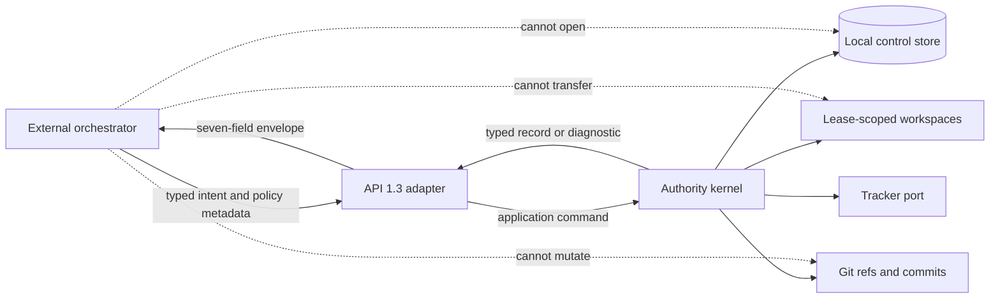
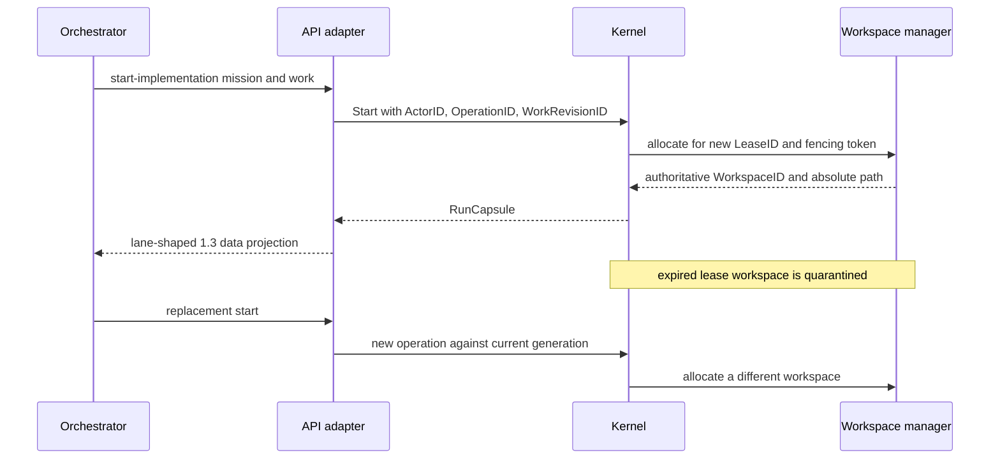

# Orchestrator API 1.3 projection

Status: compatibility design record; transport implementation deferred  
Target: `CONTRACT_VERSION = "1.3.0"`  
Revalidated: 2026-08-25

## Purpose and evidence basis

This record proves that the Phase 1 authority kernel can be projected through
the current Spec Kitty machine contract without moving authority into an
external orchestrator. It does not implement a CLI, HTTP, MCP, or Team Kitty
transport.

The mapping was revalidated against these local sources:

- canonical Python host `specify_cli/orchestrator_api/{commands,envelope}.py`;
- canonical Python contract tests in `tests/contract/test_orchestrator_api.py`;
- Nano Kitty's strict Go consumer in `internal/speckitty/contract.go`;
- the redesign's exported capability requests, records, diagnostics, and
  executable scenarios.

The separately reviewed Go donor remains context only. It targets contract 1.1
and has no repository-level license grant; no donor source, test, or prose is
used here.

## Compatibility posture

The adapter belongs outside the authority kernel.

An adapter may translate names and aggregate records. It may not infer
readiness from tracker status, mint leases, manufacture fencing tokens, compose
workspace paths, approve a candidate, or move Git refs outside kernel commands.

## Envelope and parsing contract

Every response has exactly these seven top-level fields:

| Field | Projection rule |
|---|---|
| `contract_version` | Literal `1.3.0`; reject incompatible negotiation. |
| `command` | Exact `orchestrator-api.<command>` identity for the invoked verb. |
| `timestamp` | Host-generated UTC timestamp; never supplied as authority by the caller. |
| `correlation_id` | Host-generated transport correlation, distinct from `OperationID`. |
| `success` | True only when the typed command outcome is successful. |
| `error_code` | Null on success; stable machine code on failure. |
| `data` | Command-specific JSON object; human prose is never parsed as state. |

Consumers should reject unknown or duplicate JSON fields, wrong command
identity, malformed timestamps, missing correlation, incompatible versions,
and trailing data. Stdout and stderr capture must be separately bounded. Human
CLI formatting is not a compatibility surface.

Contract 1.3 adds structured `--review-result-json` to `transition`, allowing a
normal `in_review` exit to carry a host-validated review result without using a
recovery-only force path.

## Command projection matrix

Classification meanings: **direct** needs only serialization; **translated**
adapts names or aggregation without changing authority; **partial** has a safe
kernel subset but lacks the mission-level operation; **deferred** needs a later
mission/application capability; **blocked** would require an authority-model
change. No canonical command is blocked.

| API 1.3 command | Kernel source | Class | Projection and remaining gap |
|---|---|---|---|
| `contract-version` | adapter composition metadata | Direct | Return 1.3 compatibility, runtime version, and supported actions. It owns no domain authority. |
| `mission-state` | `WorkRevision`, work consequences, run/handoff/review/integration records | Deferred | The facts are projectable, but the Phase 1 kernel intentionally has no mission aggregate or canonical lane-state projection. |
| `list-ready` | finalized `workgraph` dependencies and revision identity | Translated | Compute readiness only from the pinned graph plus authoritative outcomes. Mission-level response assembly remains adapter/application work. |
| `resolve-workspace` | `workspace.Record` and inspection | Translated | Resolve an existing lease-owned workspace by authoritative IDs. Absence is read-only and must not allocate or reuse a directory. |
| `start-implementation` | `execution.StartSaga`, `RunCapsule`, fresh workspace preparation, tracker saga | Translated | Map actor/policy/request identity to a start operation and return the lease-scoped capsule. Legacy lane wording is presentation only. |
| `start-review` | handoff lookup plus `review.Service` policy checks | Translated | Bind review to the immutable candidate and enforce actor-level independence before returning review context. A full mission lane projection is deferred. |
| `transition` | typed handoff, review, reconciliation, expiration, and integration commands | Partial | Expose only named, legal application commands. Never implement a generic arbitrary lane mutation. Structured review results map to candidate-bound verdict input. |
| `append-history` | future event/projection journal | Deferred | Phase 1 records typed authority events but has no canonical human activity-log append capability. Markdown must not become authority. |
| `accept-mission` | approved candidate records plus future mission acceptance aggregate | Deferred | Candidate approval exists; mission-wide criteria evaluation and acceptance record are later application capabilities. |
| `merge-mission` | `integration.Service` serialized by repository and target ref | Partial | Per-candidate fenced integration exists. Mission-wide ordering, aggregate preflight, and final mission state remain deferred. |

## Generation-scoped workspace translation

API 1.3 inherits lane-oriented names from the Python host. The adapter preserves
wire compatibility while strengthening their meaning:

`lane` remains a durable lineage/display concept. `workspace_path` denotes the
path recorded for one `WorkspaceID` bound to one `LeaseID`; it is not a reusable
lane directory. `resolve-workspace` never allocates, and a replacement lease
never inherits an expired lease's mutable checkout.

## Identity and idempotency translation

| API concept | Redesign identity | Rule |
|---|---|---|
| mission selector | `MissionID` plus presentation slug/number | Slugs and numbers resolve at the host; they never replace the durable ID. |
| work package | `WorkID` within `WorkRevisionID` | A running contract is generation-pinned. |
| actor | `ActorID` | Durable accountable subject; reviewer independence compares this identity. |
| execution | `ProcessID`, `RunID`, `LeaseID` | Process identity is not actor identity; live authority belongs to the lease. |
| transport correlation | correlation ID | Observability only; not an idempotency key. |
| effect replay | `OperationID` plus canonical request digest | Same operation/same digest replays; same operation/different digest conflicts. |
| workspace | `WorkspaceID` resolved by the host | Callers never construct authority from a filesystem path. |
| candidate/review | `HandoffID`, `ReviewID`, candidate commit | Verdicts remain bound to immutable evidence. |

The adapter must preserve typed retry safety and “may have applied” ambiguity
even where the legacy wire error vocabulary is coarser. A caller may repeat an
effect only with the same `OperationID` and request digest when the diagnostic
allows it.

## Policy and secret handling

Run-affecting API commands require policy metadata with:

`orchestrator_id`, `orchestrator_version`, `agent_family`, `approval_mode`,
`sandbox_mode`, `network_mode`, and `dangerous_flags`; `tool_restrictions` is
optional. The host rejects missing/wrong types, banned bypass flags, and
secret-like values recursively. Credentials, tokens, keys, passwords, and
other secrets must travel through a separate host-owned secret channel, never
policy JSON, envelopes, diagnostics, logs, or durable governance context.

Phase 1's `GovernanceContextRef` complements rather than replaces API policy
metadata. The former pins the doctrine/profile material that authorized a run;
the latter records the external orchestrator's execution posture. A future
adapter records both through the host application command.

## Error projection

| Kernel condition | API-family result | Required semantics |
|---|---|---|
| invalid or unresolved identity | usage/not-found/ambiguous code | No authority created; stable machine code, bounded prose. |
| incompatible version | `CONTRACT_VERSION_MISMATCH` | Fail before an effect. |
| missing/invalid policy | `POLICY_METADATA_REQUIRED` / `POLICY_VALIDATION_FAILED` | Fail before run-affecting authority. |
| active competing claim | `WP_ALREADY_CLAIMED` | Preserve current owner facts without leaking secrets. |
| stale lease/fence/generation | transition-rejected extension | Never retry under the stale authority. |
| absent candidate or review evidence | `WORKFLOW_EVIDENCE_REQUIRED` family | Fail closed; never synthesize acceptance. |
| repository/ref mismatch | `PREFLIGHT_FAILED` or typed Git code | Preserve observed and expected ref facts; no unsafe ref mutation. |
| ambiguous external effect | stable host error plus internal retry safety | Record that an effect may have applied and reconcile before compensating. |
| integration conflict or target movement | typed conflict/target-moved result | Preserve candidate and conflict evidence; do not force. |

Messages are explanatory only. External consumers branch on `error_code` and
typed data, not substrings.

## Host-only authority boundary

Remote orchestrators interact with the machine/filesystem owner of the control
store. They may submit typed intent, actor identity, policy metadata, and
idempotency identity. They may not:

- open SQLite or a future Gapdb control store directly;
- read a fencing token and treat it as permission to write arbitrary files;
- choose, transfer, or reactivate a workspace;
- infer readiness or acceptance from Beads or another tracker;
- mutate branches, evidence refs, or target refs outside the Git adapter;
- submit a self-authored success boolean as gate evidence;
- use force/bypass flags as normal workflow;
- place secrets in policy, command arguments, output, or stored diagnostics.

## Gap register and verdict

| Gap | Owner after Phase 1 | Authority impact |
|---|---|---|
| mission aggregate and lane projection | mission application capability | None; compose existing facts. |
| human history projection | event/projection capability | None if kept non-authoritative. |
| mission-wide acceptance | acceptance capability | Must consume pinned graph and candidate evidence. |
| mission-wide integration ordering | integration application layer | Must retain repository/target-ref serialization. |
| transport and bounded process invocation | external adapter | Must remain outside kernel packages. |

Verdict: every API 1.3 command has an explicit projection classification, and
no current kernel type prevents the adapter. The remaining work is application
composition and transport conformance—not a reason to weaken generation-scoped
workspaces, actor-level review independence, tracker neutrality, or host-owned
authority.
