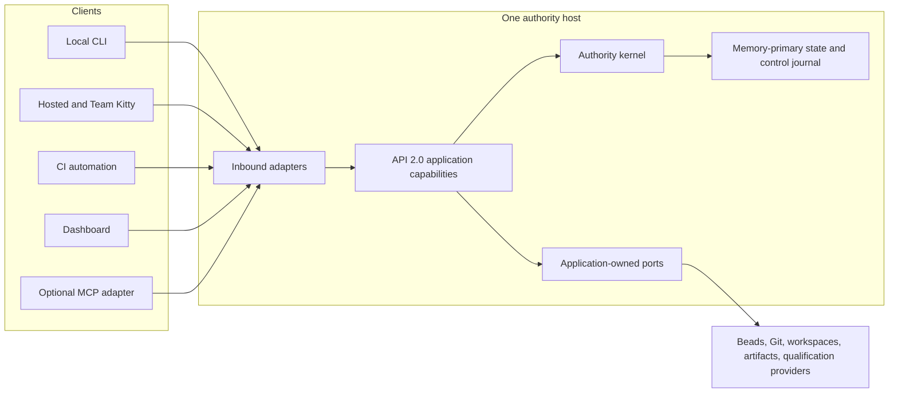
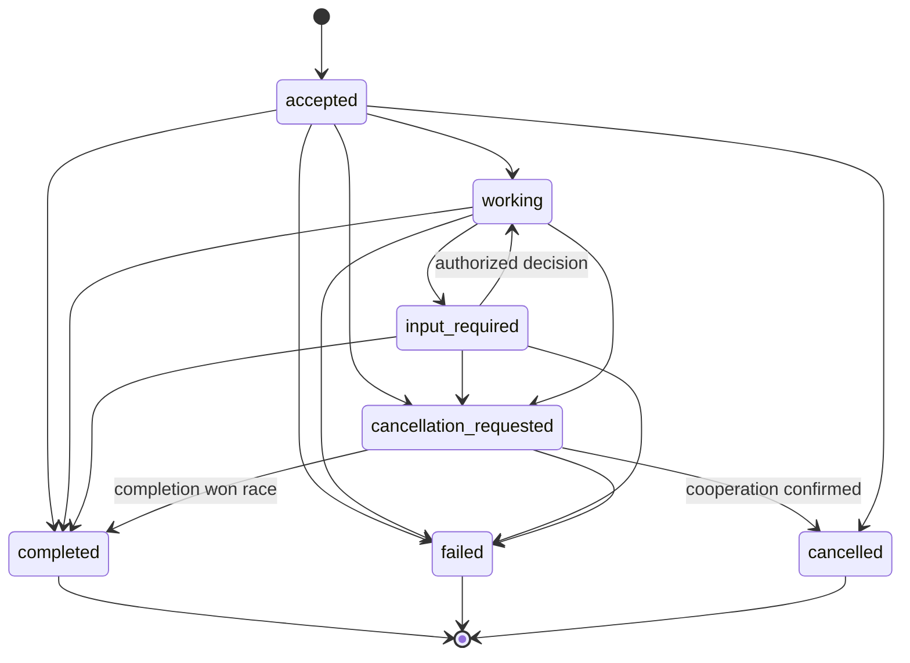

# Orchestrator API 2.0

Status: **proposed normative application contract**

Contract family: `spec-kitty.orchestrator/2`

Scope: one Spec Kitty authority host and one machine/local-filesystem authority

Delivery effect: documentation only; this document does not claim an API 2.0
host, transport, or client currently ships

Canonical architecture: [Production Orchestration Architecture](PRODUCTION_ORCHESTRATION_ARCHITECTURE.md)

Decision record: [ADR 0002](adr/0002-production-orchestration-architecture.md)

Historical compatibility surface: [Orchestrator API 1.3 projection](ORCHESTRATOR_API_1_3_PROJECTION.md)

## 1. Status, compatibility, and terminology

Orchestrator API 2.0 is the sole proposed application seam for the production
runtime. It is a semantic contract, not an HTTP, gRPC, Connect, Unix-socket,
CLI, or MCP wire definition. An in-process caller and every adapter invoke the
same application capabilities and receive equivalent typed outcomes.

API 1.3 remains an outer compatibility projection. Its command names and
lane-shaped vocabulary are not inputs to API 2.0 design. A compatibility
request either maps to exactly one legal API 2.0 operation under current policy
or fails with a stable upgrade diagnostic.

Normative words **must**, **must not**, **only**, and **never** define contract
requirements. The terms below have precise meanings:

| Term | Meaning |
|---|---|
| command | A named, versioned request to evaluate one domain operation. |
| operation identity | `OperationID`, the idempotency identity of one command request and its canonical digest. |
| native operation | A durable asynchronous application operation identified by `NativeOperationID`; it may outlive all transport requests. |
| domain refusal | A successfully executed command whose typed result says the requested domain transition was not admissible. |
| protocol failure | A failure to decode, authenticate, authorize routing, negotiate, or execute the application invocation. It is not a domain result. |
| journal revision | The globally ordered control revision at which facts were durably accepted. |
| projection freshness | Whether a returned read model is current through its reported journal revision and whether known reconciliation is outstanding. |
| compatibility command | An API 1.3 request translated at an outer adapter; it contributes no authority of its own. |

The API does not expose aggregate CRUD. Legal domain operations are closed and
named. Adding an operation requires a new command kind/version, authority and
idempotency rules, a durable-boundary definition, diagnostics, and conformance
tests.

## 2. Trust and host boundary

One machine/filesystem authority owns the first production host. Remote
callers cross that host boundary; they never open the control store or directly
mutate host files, workspaces, Git refs, provider state, or evidence.



Every adapter may authenticate a caller, translate a transport envelope, apply
rate limits, and project a typed response. It must not implement workflow
rules, infer readiness, create identities reserved to the host, weaken policy,
or convert human prose into authority.

### 2.1 Authentication, attribution, and authorization

Authentication establishes which principal reached the host. `ActorID`
attributes the durable accountable subject whose action is requested.
`ProcessID` identifies one execution process. These are distinct:

- an authenticated service may act for an `ActorID` only through an explicit,
  policy-authorized delegation;
- `ProcessID` is never proof of human or agent identity and never satisfies
  review independence;
- review independence compares the reviewer `ActorID` with every contributing
  implementation `ActorID`;
- authorization is re-evaluated for the named command, scope, current policy
  revision, and current authority state; and
- authentication, transport tenancy, or possession of an opaque ID never
  grants a workflow capability by itself.

The host generates or resolves authority identities such as `RunID`,
`LeaseID`, `WorkspaceID`, `HandoffID`, `ReviewID`, and `IntegrationID`. A
caller may supply a new `OperationID` and its accountable identities but may
not choose an authority record or claim a host-generated outcome.

### 2.2 Not API authority

| Value or system | What it may prove | What it never authorizes |
|---|---|---|
| GapDB revision | Ordering and conditional persistence of accepted facts | A legal lifecycle transition or acceptance verdict |
| Beads assignment/status | Mutable work observation at a provider revision | Execution, review, acceptance, integration, or mission advancement |
| Git ref or commit | A repository fact observed through the Git port | Candidate admission, review approval, or ref mutation |
| Filesystem path | Location recorded for a host-owned `WorkspaceID` | Lease ownership, workspace transfer, or candidate identity |
| `ProcessID` | Which execution instance acted | Durable actor identity, live lease authority, or reviewer independence |
| transport session | Connection and transport correlation | Operation lifetime, cancellation, lease ownership, or continuity |
| MCP Task | Optional retrieval handle for a native operation | Mission, work, run, lease, decision, or evidence authority |
| API 1.3 command | Compatibility intent that may be translated | Bypass of API 2.0 policy or creation of a missing semantic operation |

Secrets never appear in command scopes, policy metadata, diagnostics,
progress, event payloads, logs, watch cursors, or durable governance context.
Host-managed secret references are opaque and resolved only at the adapter that
needs them.

## 3. Versioned request, result, and diagnostic envelopes

The following are logical envelopes. A transport can encode them differently
only if the same validation and boundedness laws remain observable.

### 3.1 Command request

| Field | Required rule |
|---|---|
| `api_family` | Literal negotiated family `spec-kitty.orchestrator/2`. |
| `command.kind`, `command.version` | Closed named command and schema version. Unknown major versions refuse before effects. |
| `operation_id` | Caller-supplied opaque `OperationID`, unique within the host authority domain. |
| `request_digest` | Host-verifiable digest of canonical semantic request fields; transport metadata and deadlines are excluded. |
| `actor_id`, `process_id` | Required for attributable mutation; absence is an invalid request, not anonymous authority. |
| `scope` | Explicit bounded identities required by the command; never inferred from current directory, tracker selection, or session. |
| `preconditions` | Expected aggregate/journal revision, `RuntimeEpochID`, WorkRevision generation, lease/fence, candidate, policy, or provider revision as required. |
| `governance_revision`, `policy_revision` | Required whenever governance or policy affects admissibility. |
| `authorization_context` | Bounded delegation/tenant references; never credentials or self-authored approval. |
| `deadline` | Resource bound for this invocation. Expiry does not cancel a durable native operation. |

Canonicalization is deterministic for a command version. The host recomputes
the digest. The same `OperationID` and digest returns the recorded result; the
same `OperationID` with a different digest returns `IDEMPOTENCY_CONFLICT`
before reduction, adapters, or effects.

### 3.2 Command result

| Field | Rule |
|---|---|
| `command` | Echoes the accepted kind and version. |
| `operation_id`, `request_digest` | Echo the resolved idempotency pair. |
| `outcome` | Closed command-specific outcome, including admissible domain refusals. |
| `record_ids` | Bounded host-created identities resulting from the command. |
| `durable_revision` | Journal revision through which the result and any authority change are durable. |
| `observed_epoch` | `RuntimeEpochID` under which the command was evaluated. |
| `effect_state` | `none`, `intent_recorded`, `observed`, `ambiguous`, or `reconciliation_required`. |
| `next_actions` | Typed actions legal from the returned state; no shell prose. |
| `native_operation_id` | Present when execution continues asynchronously. |

A domain refusal such as `WORK_NOT_READY`, `INDEPENDENCE_VIOLATION`, or
`EVIDENCE_INADMISSIBLE` is a valid typed result when the application evaluated
the command successfully. A malformed frame, unsupported media encoding,
failed authentication, unavailable server, or reducer panic is a protocol or
server execution failure. Transports must preserve this distinction instead of
turning every negative domain outcome into a generic transport error.

### 3.3 Diagnostic

Every diagnostic contains a stable `code`, class, retry disposition, bounded
safe message, relevant current identities/revisions, whether an external
effect may have applied, and typed legal next actions. It never includes
secrets, raw provider output, stack traces, unbounded logs, or hidden repair.

Query envelopes carry `observed_journal_revision`, `runtime_epoch_id`, and a
`freshness` object with projection-through revision, reconciliation status,
and known staleness reason. Queries never acquire a write fence and never
silently repair disagreement.

### 3.4 Durable event and watch projection

An event projection contains event kind and schema version, opaque event
identity, aggregate type/identity, journal revision, runtime epoch for
authority-affecting facts, operation/actor/process attribution, distinct
causation and correlation, host-generated occurred/recorded times, a bounded
typed payload, and bounded external references/digests. Unknown event versions
fail closed or use an explicitly selected migration projection. Correlation is
observability, never authority.

External-effect intent and external-effect observation are different events.
A watcher cannot infer that an intent occurred, or that a response was
unambiguous, merely because a command result exists. Event bodies exclude raw
logs, transcripts, provider output, artifact bodies, and secrets. Clients can
query or watch authorized event projections but there is no API to append a
caller-authored control event.

## 4. Typed mission and work command families

All mutation families use the envelope laws above. In the tables, **durable**
means the command may not acknowledge application success before the stated
fact, result, and any effect intent are committed atomically to the control
journal.

### 4.1 Mission definition and lifecycle

Named commands: `CreateMission`, `AmendMissionIntent`, `AdmitMission`,
`BeginMission`, `RequestMissionCancellation`, and `CompleteMission`.

| Contract dimension | Requirement |
|---|---|
| scope and identities | `MissionID` is host-created on create; all later commands require it. Actor/process, operation, governance, policy, expected mission revision, and epoch are required when applicable. |
| authority | Mission capability alone decides lifecycle; tracker state and compatibility commands are observations. Completion requires satisfied review, acceptance, and integration policy. |
| idempotency | Operation/digest replay applies to every command. Amend and begin require expected mission revision. |
| durable boundary | Mission fact, operation result, aggregate head, and any export intent commit atomically. |
| external effects | Tracker/project notifications are post-commit outbox effects and cannot define the outcome. |
| refusals | invalid mission type, stale revision/epoch, policy failure, unresolved decision, incomplete gate, terminal mission, cancellation race. |

Mission cancellation records intent and follows mission policy. It does not
erase accepted facts, revoke leases implicitly, delete workspaces, or pretend
that already-observed external effects were rolled back.

### 4.2 Tracker observation and WorkRevision

Named commands: `ObserveTrackerWork`, `FinalizeWorkRevision`,
`DetectWorkRevisionDrift`, and `ReconcileWorkRevision` with exactly one
disposition: `continue`, `supersede`, `invalidate`, or `fork`.

| Contract dimension | Requirement |
|---|---|
| scope and identities | Mission, tracker binding, provider revision, observation identity, actor/process, operation, expected mission and current generation. Finalization creates a host-owned `WorkRevisionID`. |
| authority | The tracker owns mutable work definition. Spec Kitty alone pins the executable generation and owns consequences. |
| idempotency | Provider observation digest and revision participate in canonical digest. Finalize conflicts if the observed provider revision or expected generation moved. |
| durable boundary | Observation attribution, immutable graph digest, generation, operation result, and reconciliation decision commit before success. |
| external effects | Reading a tracker is an observation. Assignment/comment updates are separately recorded effect intents with compare-before-compensate attribution. |
| refusals | provider unavailable, stale/dishonest revision, malformed graph, dependency cycle, unresolved identity, active-generation conflict, reconciliation decision required, unsafe compensation. |

`continue` permits the existing generation to finish under its unchanged
contract. `supersede` creates a successor generation and prevents new work on
the predecessor while preserving already accepted evidence. `invalidate`
makes affected predecessor results inadmissible until explicit resolution.
`fork` creates a separately identified executable lineage. None mutates a
running `WorkRevision` in place.

### 4.3 Decisions

Named commands: `OpenDecision`, `AnswerDecision`, and `ExpireDecision`.

| Contract dimension | Requirement |
|---|---|
| scope and identities | Mission and optional work/native-operation scope, actor/process, operation, expected decision/mission revision, governance/policy revision. Open creates a host-owned `DecisionID`. |
| authority | The opening capability defines typed choices/response schema and authorization policy. `AnswerDecision` verifies the accountable actor/delegation against that policy. |
| idempotency | Opening and answering replay by operation/digest. An answer conditions on the outstanding decision and expected decision revision. |
| durable boundary | Decision, answer/expiry disposition, operation result, and any unblocked native-operation event commit atomically. |
| external effects | None are implied. A resulting adapter action requires its own durable effect intent. |
| refusals | unknown/terminal decision, unauthorized actor, stale revision, malformed choice, expired response policy, changed governance/policy requiring a new decision. |

Free-form prompts may explain a decision but cannot define hidden choices or
authority.

## 5. Execution, workspace, candidate, review, acceptance, and integration

### 5.1 Execution, leases, workspaces, and observations

Named commands: `ClaimReadyWork`, `HeartbeatLease`, `ReleaseLease`,
`ExpireLease`, `AbandonRun`, `BindFreshWorkspace`, `ObserveWorkspace`,
`QuarantineWorkspace`, `RecordRunObservation`, and `RecordImplementationOutcome`.

| Contract dimension | Requirement |
|---|---|
| scope and identities | Mission, `WorkRevisionID`, generation, `WorkID`, actor/process, epoch, and expected graph revision. Claim creates `RunID` and `LeaseID`; bind creates `WorkspaceID`. Lease mutations require exact lease, epoch, generation, and fence preconditions. |
| authority | Execution capability checks graph readiness and competing authority. Workspace capability alone allocates/binds paths. A path, process, or tracker assignment is never authority. |
| idempotency | Duplicate claim with the same operation/digest returns the same run/lease; it cannot allocate a second workspace or repeat assignment. Heartbeats condition on current lease revision. |
| durable boundary | Run/lease authority commits before a capsule is returned. Workspace binding commits before path disclosure. Expiry/quarantine commits before replacement claim. |
| external effects | Workspace allocation, tracker assignment, and Git inspection occur from durable effect intents. Their observations are recorded separately. |
| refusals | work not ready, competing claim, stale generation/epoch/fence, lease expired, workspace already bound, provider ambiguity, quarantine required, policy rejection. |

An expired lease's mutable workspace is never transferred. A replacement claim
receives a new lease and a fresh workspace. A zombie may continue writing the
old POSIX directory, but those writes cannot satisfy a current handoff without
an explicit reconciliation that creates new admissible evidence.

### 5.2 Candidate handoff

Named commands: `CreateCandidateHandoff`, `ReconcileCandidateObservation`, and
`WithdrawCandidate`.

| Contract dimension | Requirement |
|---|---|
| scope and identities | Current run/lease/fence/epoch, exact WorkRevision generation, Git commit/tree/ref observations, contributor `ActorID` set, criteria revision, actor/process, operation, and bounded artifact/evidence digests. Create returns host-owned `HandoffID`. |
| authority | Handoff capability validates current execution authority and observed immutable Git facts. A live directory and caller-authored success are not candidates. |
| idempotency | Operation/digest replay returns the same handoff. Candidate, generation, lease, and observed Git facts are preconditions. |
| durable boundary | Immutable candidate evidence, contributor attribution, operation result, and any artifact-publication intent commit before success. |
| external effects | Git and artifact systems are observed through ports; tracker commentary is an optional post-commit projection. |
| refusals | missing object, moved ref, stale lease/epoch/fence, generation drift, incomplete attribution, unavailable artifact, withdrawn/conflicting candidate. |

### 5.3 Independent review

Named commands: `BeginCandidateReview`, `RecordCriterionReview`,
`SubmitReviewVerdict`, and `ReconcileReview`.

| Contract dimension | Requirement |
|---|---|
| scope and identities | `HandoffID`, candidate digest, WorkRevision generation, reviewer actor/process, independence-policy revision, actor contributor set, expected review revision. Begin creates `ReviewID`; a review run may create its own `RunID` and lease under review policy. |
| authority | Review capability proves reviewer `ActorID` differs from every candidate contributor unless an explicit mission policy defines a visible exception. A new process for the same actor is not independent. |
| idempotency | Criterion and verdict commands replay by operation/digest and condition on candidate and review revisions. |
| durable boundary | Review claim, criterion evidence, verdict, actor attribution, and operation result commit before acknowledgement. |
| external effects | Tracker comments and artifact publication are post-commit projections. |
| refusals | independence violation, stale or withdrawn candidate, criterion mismatch, missing evidence, stale review revision, policy drift, reviewer lease expiry. |

### 5.4 Acceptance

Named commands: `RequestAcceptanceEvaluation`, `RecordAcceptanceDecision`, and
`ReconcileAcceptance`.

| Contract dimension | Requirement |
|---|---|
| scope and identities | Mission, candidate/handoff, WorkRevision generation, acceptance-plan revision, complete claim-set digest, evidence index revision, policy/governance revisions, actor/process, operation, and expected mission revision. |
| authority | Acceptance capability—not a provider, tracker, or caller—evaluates the complete current claim set and evidence admissibility. |
| idempotency | Operation/digest replay returns one decision. Candidate, generation, claim plan, evidence index, and policy revisions are preconditions. |
| durable boundary | Acceptance decision, cited evidence/waiver identities, policy revisions, operation result, and any projection intent commit before success. |
| external effects | None define the decision. Tracker/host notifications are post-commit projections. |
| refusals | missing/stale/untrusted evidence, candidate mismatch, incomplete claim set, unauthorized waiver, policy drift, unresolved provider decision. |

Evidence envelopes remain evidence, not verdicts.

### 5.5 Serialized integration

Named commands: `ReserveIntegration`, `ExecuteIntegration`,
`ReconcileIntegration`, and `AbandonIntegration`.

| Contract dimension | Requirement |
|---|---|
| scope and identities | Mission, candidate/handoff, accepted decision, repository identity, target ref, expected target object, actor/process, operation, epoch, and repository fence. Reserve creates `IntegrationID`. |
| authority | One integration capability serializes attempts by repository and target ref. Only the Git adapter moves refs after authority is reserved. |
| idempotency | Duplicate reserve/execute cannot create another slot or repeat a ref mutation. Current target and integration revisions are preconditions. |
| durable boundary | Reservation commits first. Execute records an effect intent before Git mutation; observed ref outcome commits separately. Terminal success requires the intended target fact to be observed and recorded. |
| external effects | Git ref movement is an attributed external effect. Ambiguous response triggers observation/reconciliation, never blind retry. |
| refusals | acceptance absent/stale, target moved, competing integration, repository fence stale, candidate object missing, merge conflict, ambiguous effect, policy rejection. |

Merge conflicts preserve the candidate and produce explicit repair work or a
decision. They never force success, discard the integration record, or make a
tracker projection authoritative.

## 6. Qualification, recovery, and administration commands

### 6.1 Qualification claims, bindings, and evidence

Named commands: `AssembleAcceptanceClaims`, `ProposeQualificationBinding`,
`ApproveQualificationBinding`, `RetireQualificationBinding`,
`ExecuteQualificationNode`, `SubmitEvidenceEnvelope`, `GrantEvidenceWaiver`,
and `RevokeEvidenceWaiver`.

| Contract dimension | Requirement |
|---|---|
| scope and identities | Mission/candidate, WorkRevision, `ClaimID`, binding revision, provider ID/version/digest, runner/trust domain, `EvidenceID`, policy/governance revisions, actor/process, operation. |
| authority | Policy layers form a strict claim union. Detection proposes only; an authorized decision approves a binding or waiver. Providers produce evidence but never acceptance. |
| idempotency | Execution/submission replay by operation and input digest. Candidate, claim plan, binding, provider, and input digests pin admissibility. |
| durable boundary | Claim plan, approved binding/waiver, qualification operation, or bounded evidence envelope commits before success. Artifact bodies remain in the artifact store by digest. |
| external effects | Provider execution is driven from an effect intent/native operation; output observation is recorded and decoded by a versioned typed protocol. |
| refusals | missing provider, binding drift, provider unavailable, untrusted runner, evidence stale/malformed/inadmissible, waiver unauthorized, artifact unavailable, output bound exceeded. |

Qualification progress and failures are native-operation state. Human-formatted
provider output is never parsed as control state.

### 6.2 Checkpoint, recovery, reconciliation, playback, and export

Named commands: `RequestCheckpoint`, `BeginRecovery`, `CommitRuntimeEpoch`,
`ReconcileExternalFact`, `ReconcilePendingEffect`, `RequestPlayback`, and
`ExportTerminalMissionRecord`.

| Contract dimension | Requirement |
|---|---|
| scope and identities | Database and mission identity, checkpoint/reducer versions, journal range, predecessor/current epoch, external observation revisions, actor/process and operation where attributable. |
| authority | Recovery capability validates storage and product state before committing a new epoch. Adapters only observe external systems. Playback owns no mutation capability. |
| idempotency | Recovery/reconciliation is operation-identified and conditions on current epoch/revision. Playback is content-addressed by event range and reducer version. |
| durable boundary | Checkpoint metadata, epoch creation, reconciliation disposition, and terminal export intent/result are journaled before success. |
| external effects | Playback invokes none. Reconciliation observes before deciding; compensation requires matching provider revision, value, and operation marker. |
| refusals | invalid snapshot/checkpoint digest, unsupported event/reducer version, degraded recovery, stale epoch, external ambiguity, unsafe compensation, incomplete journal range, export artifact failure. |

The recovery sequence is storage recovery, checkpoint validation, journal
reduction, durable new epoch, predecessor lease invalidation/workspace
quarantine, external reconciliation, then progress publication and command
admission. No “recovered” result may silently skip an authority category.

### 6.3 Administrative reads and bounded actions

`InspectHealth`, `InspectStorageRevision`, and `InspectRecoveryStatus` are
queries. `RequestCheckpoint` and `ExportTerminalMissionRecord` are commands.
There is no administrative raw-event append, raw-key mutation, arbitrary lease
owner change, force-transition, or direct compensation endpoint.

## 7. Query families and freshness

| Family | Required queries | Freshness and authorization |
|---|---|---|
| mission/progress | `GetMission`, `ListMissions`, `GetMissionProgress`, `WatchMissionProgress`, `ExplainProgressRevision` | Mission/tenant visibility; observed revision and projection/reconciliation status required. Explanation resolves one authorized bounded event/projection reason. |
| executable work | `GetWorkRevision`, `ListReadyWork` | Uses pinned graph, never live tracker status; reveals only authorized work metadata. |
| authority | `GetRun`, `GetWorkspace`, `GetRuntimeEpoch` | Paths and actor/process details are redacted by policy; no fencing secret is returned as portable authority. |
| evidence | `GetCandidate`, `GetReview`, `GetAcceptance`, `GetIntegration`, `GetEvidenceIndex` | Candidate and policy scope authorization; artifact bodies are separate bounded resources. |
| operations/decisions | `GetOperation`, `WatchOperation`, `ListOutstandingDecisions`, `ExplainDecision` | Operation subject/delegate authorization; explanations are bounded and do not expose hidden policy or secrets. |
| qualification | `GetQualificationGraph` | Returns claim/binding/evidence position at explicit revisions. |
| host | `GetHealth`, `GetRuntimeEpoch` | Minimal unauthenticated liveness may be separate; authority/recovery detail requires operator authorization. |

`ListMissions` supports stable bounded pagination with an opaque cursor bound to
the filter and observation revision. `GetMissionProgress` returns exactly one
snapshot at one journal revision. A newer revision arriving during assembly
does not produce a mixed snapshot.

Queries do not silently invoke trackers, Git, filesystems, providers, repair,
or compensation to become “fresh.” If required reconciliation is outstanding,
the response reports it and exposes a typed next action.

## 8. Native asynchronous operations and decision input

Operation-control commands are `DriveMissionUntilBoundary`,
`RequestOperationCancellation`, and `ReleaseOperationProjection`. Any bounded
long-running domain command may also create a native operation instead of
blocking its initiating invocation.

| Contract dimension | Requirement |
|---|---|
| scope and identities | Existing or newly host-created `NativeOperationID`, originating `OperationID`/digest, actor/process, mission/work/candidate scope, expected operation progress revision, policy/governance revision. |
| authority | The application operation capability advances state; a transport session or MCP Task is only a projection. Cancellation and input follow the operation's policy. |
| idempotency | Originating commands and cancellation requests replay by operation/digest. Progress transitions condition on monotonic operation progress revision. |
| durable boundary | Acceptance, input request, cancellation intent, and terminal result are durable operation/control events before publication. |
| external effects | Domain operation effect laws still apply. Releasing an operational projection never erases mission evidence or compensates an effect. |
| refusals | unknown/retention-expired operation, unauthorized observer/actor, terminal operation, stale progress revision, invalid decision input, cancellation not supported at the current boundary. |

### 8.1 State machine



The closed statuses are `accepted`, `working`, `input_required`,
`cancellation_requested`, `completed`, `failed`, and `cancelled`. Terminal
statuses are immutable. `accepted` means the operation record and request are
durable; it does not mean the domain outcome will succeed.

An input request contains a `DecisionID`, decision schema/choices, authorized
actor/delegation policy, opening operation-progress revision, expiry policy,
and bounded explanation. Input is accepted only by `AnswerDecision` with the
expected decision revision. Transport prompts and chat replies are not input
authority.

`RequestOperationCancellation` records cooperative intent. It does not revoke
a lease, compensate an effect, roll back a committed event, or guarantee the
terminal status `cancelled`. Completion can win before or after cancellation
intent is observed; the first valid terminal event wins by conditional
revision. A disconnect never requests cancellation.

Operational results have a bounded retention policy advertised at creation.
Expiry may remove the convenient operation projection, but mission events,
decisions, evidence, external-effect observations, and terminal export remain
under their own retention laws.

### 8.2 Representative native operations

| Example | Progress and possible input | Terminal meaning |
|---|---|---|
| qualification run | claim graph nodes, provider dispatch/observation, evidence decoding; may request a binding or trust decision | Completed can contain typed failed claims; provider/server execution failure is `failed`. |
| drive mission until boundary | repeatedly selects one legal next action; pauses on human decision, policy boundary, blocker, or requested stopping condition | Completed means the requested boundary was reached, not that the mission necessarily completed. |
| integration attempt | reserve, inspect target, record intent, perform mutation, observe target; ambiguous response requires reconciliation input | Completed only when the intended Git fact is observed and journaled. Conflict is a typed domain result. |
| recovery/reconciliation | restore, create epoch, inventory stale leases, observe external facts, resolve safe cases; ambiguous attribution requests a decision | Completed means required recovery categories were reconciled or explicitly blocked; no silent success. |

### 8.3 Bounded mission-driving example

The notation below is transport-neutral and omits display-only fields.

```text
1. Client invokes DriveMissionUntilBoundary v1
   OperationID=op-drive-42, ActorID=actor-lynn, ProcessID=proc-cli-7
   MissionID=mission-9, expected mission revision=118,
   RuntimeEpochID=epoch-3, governance revision=gov-12, policy revision=pol-8.

2. Host durably commits NativeOperationID=nop-42 as accepted at journal
   revision 119 and returns that acknowledgement. Work begins at operation
   progress revision 1.

3. Host finalizes WorkRevisionID=wr-9-g4, generation=4 and claims ready work.
   Progress snapshots advance at journal revisions 123 and 131. The client
   disconnects. nop-42, its lease, and the mission continue independently.

4. Client reconnects and calls GetOperation(nop-42), then
   WatchMissionProgress(mission-9, after_revision=123). It receives committed
   snapshots strictly after 123; it does not replay the original command.

5. Tracker drift makes continuation ambiguous. nop-42 becomes input_required
   at operation progress revision 6 and references DecisionID=decision-77 with
   choices continue, supersede, invalidate, or fork and policy=pol-8.

6. Authorized ActorID=actor-lynn invokes AnswerDecision with OperationID=op-answer-77,
   expected decision revision=1, choice=supersede. The new generation and
   answer are durable at journal revision 140 before acknowledgement.

7. nop-42 resumes, reaches the requested review boundary, and commits terminal
   result completed at journal revision 148, operation progress revision 9.
   Repeating op-drive-42 with its original digest returns this recorded result;
   reusing op-drive-42 with a different boundary returns IDEMPOTENCY_CONFLICT.
```

## 9. Mission progress snapshot and watch protocol

Progress is graph position, authority, blockers, and legal action—not an
author-maintained percentage and not tracker or Markdown state. A snapshot
conforms to the mission-local
[`progress.schema.json`](../kitty-specs/production-runtime-architecture-01M16GVA/contracts/progress.schema.json).

### 9.1 Complete bounded example

```json
{
  "schema_version": "2.0",
  "mission": {
    "id": "mission-9",
    "display_name": "Production host qualification",
    "mission_type": "software-dev",
    "work_revision_id": "wr-9-g4",
    "generation": 4
  },
  "lifecycle": {
    "phase": "implement-review",
    "status": "blocked",
    "acceptance": {
      "status": "waiting",
      "reason": "implementation and review remain incomplete"
    },
    "integration": {
      "status": "not_started"
    }
  },
  "work": {
    "total": 5,
    "counts": {
      "planned": 1,
      "ready": 1,
      "running": 1,
      "in_review": 1,
      "approved": 1
    }
  },
  "active_authority": [
    {
      "work_id": "work-3",
      "run_id": "run-31",
      "actor_id": "actor-codex",
      "process_id": "proc-884",
      "lease_id": "lease-31",
      "workspace_id": "workspace-31",
      "expires_at": "2026-08-29T20:16:00Z"
    }
  ],
  "graph": {
    "ready": ["work-4"],
    "critical_path": ["work-3", "work-5"],
    "blocked_path": ["work-5"]
  },
  "blockers": [
    {
      "id": "blocker-provider-7",
      "reason": "qualification provider revision changed after binding",
      "responsible_authority": "qualification-policy",
      "available_actions": ["approve_qualification_binding", "retire_qualification_binding"]
    }
  ],
  "decisions": [
    {
      "id": "decision-77",
      "reason": "tracker drift requires a WorkRevision disposition",
      "responsible_authority": "mission-owner",
      "available_actions": ["continue", "supersede", "invalidate", "fork"]
    }
  ],
  "drift": [
    {
      "id": "drift-tracker-12",
      "kind": "tracker",
      "severity": "blocking",
      "reason": "provider revision beads:728 differs from finalized beads:721"
    }
  ],
  "next_actions": [
    {
      "command": "answer_decision",
      "scope": {
        "mission_id": "mission-9",
        "decision_id": "decision-77"
      },
      "reason": "select the executable-graph reconciliation disposition"
    }
  ],
  "percentage": {
    "value": 40,
    "weighting_rule": "approved work divided by five equally weighted finalized work items"
  },
  "observation": {
    "journal_revision": 140,
    "runtime_epoch_id": "epoch-3",
    "observed_at": "2026-08-29T20:11:00Z",
    "last_progress_at": "2026-08-29T20:10:42Z",
    "checkpoint_through_revision": 128
  }
}
```

The percentage is optional, derived, and explicitly explains its weighting. It
cannot conceal that the critical path is blocked. Checkpoint staleness is
`journal_revision - checkpoint_through_revision` (12 revisions in this
example); clients need not guess it from timestamps. In schema version 2.0,
review position is expressed by lifecycle phase plus canonical work counts
(`in_review` here), while acceptance and integration use their explicit
position objects. `last_progress_at` identifies the most recent journaled
progress-producing fact; clients needing its typed explanation use that
snapshot revision with `ExplainProgressRevision` rather than
receiving an unbounded event body inside every snapshot.

### 9.2 List and get

- `ListMissions` returns bounded summary snapshots under one observation
  revision and a stable opaque pagination cursor.
- `GetMissionProgress` returns the full snapshot for one authorized mission.
- Both expose journal revision, runtime epoch, checkpoint boundary, known
  drift/reconciliation state, and projection freshness.
- Neither reads live tracker status or Markdown task boxes to invent current
  state. Those are outward projections or recorded observations. The immutable
  WorkRevision and control journal are inputs to progress.

### 9.3 Watch and resume

`WatchMissionProgress` requires `MissionID` and `after_revision`. It emits only
snapshots/events with journal revisions strictly greater than the supplied
revision, in order. Reconnect is explicit: the client supplies the last fully
processed revision, never a transport session token.

Watch retention and per-consumer buffers are bounded and discoverable. A slow
consumer receives `BACKPRESSURE` with its last deliverable revision or is
closed with `WATCH_RESET_REQUIRED`. If `after_revision` was compacted, the host
returns `WATCH_RESET_REQUIRED` plus authorization-filtered fresh snapshot and
its revision. It never silently skips revisions or grows memory without bound.

Authorization is checked when a watch opens and whenever relevant policy or
delegation changes. Revocation terminates delivery with a stable diagnostic;
it does not rewrite already durable history. Host restart preserves journal
resume semantics even when in-memory watch buffers disappear.

## 10. API 1.3 compatibility disposition

Compatibility code lives outside the kernel and application capability
packages. Every request passes current API 2.0 authentication, authorization,
preconditions, idempotency, evidence, and authority checks.

| Semantic class | Rule | Representative API 1.3 disposition |
|---|---|---|
| lossless safe projection | One read/result has the same semantics and bounded data. | `contract-version`; `list-ready` from the pinned WorkRevision; `resolve-workspace` for an existing authorized workspace. |
| safe with explicit additional query | Initial projection is safe but a client must query a native operation or richer record for completion/freshness. | `start-implementation`, `start-review`, and `merge-mission` may return an operation ID and require `GetOperation`/progress observation. |
| deprecated but unambiguous named mapping | A legacy verb maps only when current state admits exactly one named command. | A `transition` that uniquely means `CreateCandidateHandoff` or `SubmitReviewVerdict` after complete evidence validation. |
| unrepresentable and refused | Required API 2.0 identity, decision, evidence, or result cannot be expressed without loss. | Ambiguous `transition`, free-form `append-history` as authority, mission acceptance without claim/evidence revisions. |
| unsafe and permanently refused | The request would bypass authority or manufacture facts. | Force-success, caller-created lease/fence/workspace, raw event append, direct ref mutation, self-authored evidence success. |

| API 1.3 command | API 2.0 rule |
|---|---|
| `contract-version` | Safe read projection with explicit supported/minimum versions and feature discovery. |
| `mission-state` | Safe progress projection only if all required fields can be represented; otherwise require `GetMissionProgress`. |
| `list-ready` | Lossless projection from the finalized graph at an observed revision. |
| `resolve-workspace` | Read-only projection; never allocates, reuses, or transfers a workspace. |
| `start-implementation` | Maps to `ClaimReadyWork` and, when necessary, a native operation; normal authority checks apply. |
| `start-review` | Maps to `BeginCandidateReview` only with exact candidate and independence context. |
| `transition` | Maps only when exactly one legal named command exists. Ambiguity returns `COMPATIBILITY_UPGRADE_REQUIRED`. |
| `append-history` | May append a non-authoritative annotation through a future explicit projection capability; it can never write a control event. Otherwise refused. |
| `accept-mission` | Maps to `RequestAcceptanceEvaluation` only with complete current claim/evidence context; never trusts a legacy success flag. |
| `merge-mission` | Maps to serialized integration operations; may require follow-up operation observation. |

Compatibility refusal is stable and actionable: it identifies the unavailable
semantic class and the API 2.0 discovery/query or named command required. It
never chooses among multiple legal actions on the caller's behalf.

## 11. Discovery, errors, retries, deadlines, and privacy

### 11.1 Discovery and version negotiation

Clients first discover API family versions, supported command/query versions,
native-operation/watch capability, bounded limits, authentication schemes,
and optional adapter features. Negotiation selects a mutually supported major
family and command versions. Unsupported major versions return
`UNSUPPORTED_VERSION` before authentication-dependent domain detail or effects.
Feature absence is explicit; installing MCP cannot add an application command.

### 11.2 Diagnostic and retry matrix

| Stable class | Meaning | Retry disposition |
|---|---|---|
| `INVALID_REQUEST`, `UNSUPPORTED_VERSION` | Schema, digest, or negotiation invalid | Forbidden until request/version changes; use a new operation identity for a semantically changed command. |
| `UNAUTHENTICATED`, `UNAUTHORIZED` | Principal missing or action not permitted | Forbidden with current credentials/delegation; no effect. |
| `NOT_FOUND` | Authorized scoped identity absent | Forbidden unless discovery produces a different identity. |
| `REVISION_CONFLICT` | Aggregate, journal, provider, target, or policy revision moved | Observe current state, decide, then use a new `OperationID` for changed intent. |
| `IDEMPOTENCY_CONFLICT` | Same operation identity, different digest | Forbidden; never retry either request under that identity. |
| `STALE_EPOCH`, `STALE_FENCE`, `LEASE_EXPIRED` | Supplied execution authority is no longer current | Forbidden under stale authority; reacquire only through a new legal claim/operation. |
| `INDEPENDENCE_VIOLATION` | Reviewer actor overlaps candidate contributors | Forbidden unless explicit policy creates a separately visible admissible path. |
| `DRIFT_DECISION_REQUIRED`, `UNSAFE_COMPENSATION` | Current external/graph facts need observation or governed choice | Observe/answer decision, then submit a new operation if semantics change. |
| `EVIDENCE_INADMISSIBLE` | Evidence fails candidate, generation, policy, provider, runner, freshness, or artifact rules | Forbidden with that evidence; obtain new admissible evidence. |
| `PROVIDER_UNAVAILABLE` | Provider invocation could not complete | Same `OperationID` only if diagnostic says no effect occurred; ambiguous effects require reconciliation. |
| `BACKPRESSURE`, `WATCH_RESET_REQUIRED` | Consumer exceeded bounds or resume history compacted | Resume from reported revision or accept fresh snapshot; commands are unaffected. |
| `DEGRADED_RECOVERY` | Host cannot safely admit authority-changing commands | Reads may be limited; retry only after operator recovery and a new observed epoch. |
| `DEADLINE_EXCEEDED` | Invocation deadline ended | Query the recorded operation/result with the same identity; never assume cancel or blindly submit new intent. |
| `INTERNAL_FAILURE` | Server failed outside a typed domain result | Same operation identity may be queried/replayed only when response preserves may-have-applied state. |

Rate limits are bounded by principal, tenant, command cost, and watch/resource
class. Deadline expiry bounds one call, not durable work. Retry hints are
advisory and never override the table's authority requirements. Output,
diagnostic messages, decision explanations, provider observations, and artifact
references are size-bounded. Unbounded logs/transcripts live in an authorized
artifact store and are referenced by digest.

### 11.3 Client parity

| Client | Adapter responsibility | Forbidden semantic fork |
|---|---|---|
| local CLI | argument parsing, terminal rendering, operation follow/detach | parsing Markdown/worktrees to implement alternate `next` behavior |
| hosted/Team Kitty | authentication/delegation, tenancy, remote streaming | direct GapDB access or provider status as mission truth |
| CI | non-interactive policy and bounded waiting | force-success on timeout or human-formatted output parsing |
| dashboard | query/watch projection and authorized decisions | writing tracker status or percentages as lifecycle authority |
| optional MCP | tool/resource/task projection and protocol negotiation | unique command, session authority, or task cancellation as rollback |

## 12. Conformance and security proofs

### 12.1 Requirement and command-family coverage

| Requirement | Contract evidence | Required executable proof in later missions |
|---|---|---|
| FR-010 process-complete API | Sections 3–8 name envelopes, complete lifecycle commands, queries, events/operations, and diagnostics. | A black-box client completes a governed mission without tracker, Markdown, Git, workspace, or GapDB access. |
| FR-011 typed mutation surface | Sections 4–6 enumerate closed families; Section 12.3 lists refusals. | Mutants adding generic transition, raw mutation, or caller-created authority fail conformance. |
| FR-012 native asynchronous operations | Section 8 defines identities, states, input, cancellation races, retention, and resume. | Disconnect/restart/cancel/input races preserve one durable operation and mission history. |
| FR-013 mission progress | Section 9 defines full snapshots, a schema-valid example, list/get/watch, resume, reset, and freshness. | Slow/restarting watchers remain bounded and resume by journal revision. |
| FR-014 client parity | Sections 2, 7, and 11 route every client through one seam. | Equivalent CLI/remote/optional-adapter calls produce equivalent typed outcomes. |
| FR-023 architecture enforcement | Host diagram, not-authority table, and forbidden operations define import/capability boundaries. | Dependency/reachability guards and mutant controls prevent adapter-to-kernel leakage. |

### 12.2 Identity completeness

Every conceptual identity is accounted for:

| Identity | API use |
|---|---|
| `MissionID`, `WorkRevisionID`, `WorkID` | Explicit mission, generation, and work scope for commands/progress. |
| `ActorID`, `ProcessID` | Accountable attribution and execution instance; never conflated. |
| `RuntimeEpochID`, `OperationID` | Current authority lifetime and request idempotency. |
| `RunID`, `LeaseID`, `WorkspaceID` | Host-created execution and mutable-workspace authority chain. |
| `HandoffID`, `ReviewID`, `IntegrationID` | Immutable candidate, independent review, and serialized integration attempts. |
| `DecisionID` | Durable authorized input and reconciliation choices. |
| `ClaimID`, `EvidenceID` | Stack-neutral proposition and bounded provenance. |
| `NativeOperationID` | Transport-independent asynchronous lifecycle. |
| `MCPTaskID` | Optional projection only; not part of core command authority. |

### 12.3 Deliberately refused operations

The application has no generic `transition`; lane/status mutation; force-pass,
force-success, or gate bypass; raw event or GapDB key append; caller-created
lease, fence, workspace, handoff, review, integration, or evidence verdict;
workspace transfer/reactivation; direct Git ref mutation; direct tracker
assignment as authority; candidate-from-live-directory; same-actor review by
process swapping; un-attributed compensation; silent WorkRevision mutation;
side-effecting playback; cancellation-as-rollback; percentage-as-progress;
transport-session authority; or MCP-only workflow capability.

### 12.4 Conformance campaigns

Implementations must prove:

1. same operation/same digest returns one result; different digest conflicts
   before workspace, provider, evidence, or Git effects;
2. stale epoch/fence/generation and expired leases fail before repository-fence
   acquisition or adapter execution;
3. duplicate requests cannot create duplicate leases, workspaces, effects,
   reviews, evidence, or integration attempts;
4. a dishonest, stale, slow, or unavailable tracker cannot alter the finalized
   graph or make compensation overwrite human change;
5. remote callers cannot open GapDB or mutate host Git/workspaces;
6. a slow watcher receives bounded backpressure/reset and can reconnect after
   host restart using journal revision;
7. CLI, hosted, Team Kitty, CI, dashboard, and optional transports expose the
   same legal command/result semantics;
8. playback performs zero adapter calls and reproduces the terminal projection
   and digest from recorded facts;
9. logs, transcripts, provider output, and artifact bodies are excluded from
   durable envelopes except by bounded digest/reference; and
10. removing early authority checks or dependency guards kills a mutant test.

### 12.5 Review evidence for this design

The exact document tree assessed by WP02 is:

- `docs/ORCHESTRATOR_API_2_0.md` (this normative design);
- `docs/PRODUCTION_ORCHESTRATION_ARCHITECTURE.md` and
  `docs/adr/0002-production-orchestration-architecture.md` (authority
  vocabulary and precedence);
- `kitty-specs/production-runtime-architecture-01M16GVA/contracts/orchestrator-api-2.0.md`
  and `contracts/progress.schema.json` (mission-local source contracts);
- `kitty-specs/production-runtime-architecture-01M16GVA/data-model.md` (identity
  and operation/progress model); and
- `docs/ORCHESTRATOR_API_1_3_PROJECTION.md` (historical compatibility input).

Review must record:

- FR-010–FR-014 coverage using Section 12.1;
- the diagnostic/retry decisions in Section 11.2;
- successful Draft 2020-12 validation of the Section 9.1 JSON against the
  mission-local progress schema;
- local-link and Mermaid syntax checks; and
- the deliberate-refusal set in Section 12.3.

Author validation for this WP02 document completed with these results:

| Check | Exact surface | Result |
|---|---|---|
| progress schema | Section 9.1 JSON against `contracts/progress.schema.json`, Draft 2020-12 with the repository's `github.com/santhosh-tekuri/jsonschema/v6` dependency and format assertions | pass |
| Mermaid parse/render | Section 2 host-boundary flowchart and Section 8 native-operation state diagram with Mermaid CLI 11.16.0 | pass |
| local links | API 1.3 and mission-local schema in this lane; canonical architecture and ADR in accepted WP01 dependency tree | pass |
| whitespace | `git diff --check` for `docs/ORCHESTRATOR_API_2_0.md` | pass |
| coverage | command families and FR-010–FR-014 table; all data-model identities; diagnostic/retry and deliberate-refusal tables | pass |

The reviewer should attempt a complete mission using only this contract. Any
step that requires direct Beads, Markdown, worktree, Git, GapDB, or artifact
mutation is a contract defect, not an invitation to expose those systems.
