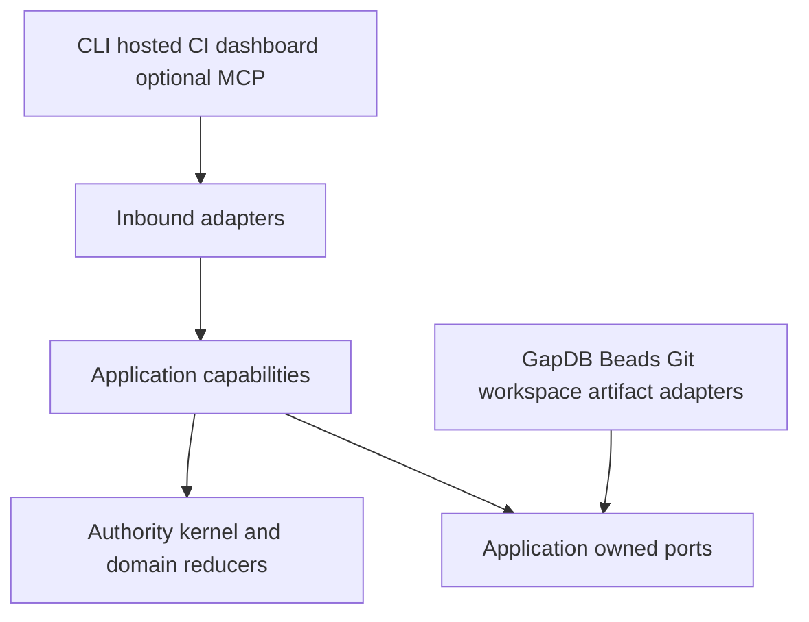
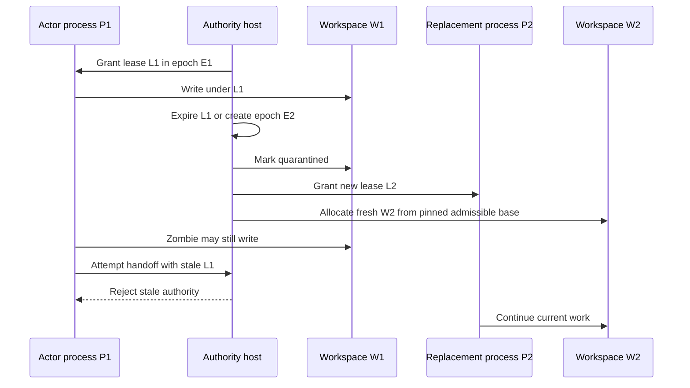

# Production Orchestration Architecture

Status: **normative architecture — M2 GapDB authority implementation candidate**

Decision record: [ADR 0002](adr/0002-production-orchestration-architecture.md)

Scope: first production runtime with one machine and one local-filesystem authority

Delivery effect: M2 implements the authority/storage boundary; later surfaces remain governed successors

<a id="fr-001"></a>
## 1. Scope, status, and precedence

This is the canonical recommendation for Spec Kitty's production orchestration
runtime. It preserves the empirically qualified product laws from Phases 1–3,
replaces active design guidance that conflicts with this target, and gives later
implementation missions one authority vocabulary. It does not rewrite or
broaden historical qualification.

Normative statements in this document use **must**, **must not**, **only**, and
**never**. The delivery labels below are controlled:

- **delivered**: present and qualified only at the cited source/evidence boundary;
- **retained**: a delivered product law that remains normative in the target;
- **amended**: delivered intent whose production representation or boundary changes;
- **proposed**: approved target direction that has not shipped;
- **retired**: intentionally absent from the target production model; and
- **historical**: evidence or guidance that remains true only in its recorded context.

The target is not multi-machine control-store ownership. Remote callers cross
the application boundary of the machine/filesystem owner. A shared-filesystem,
replicated, or multi-owner runtime requires a separate ADR and proving ground.

<a id="fr-002"></a>
## 2. Delivery truth

| Surface | Current evidence-backed truth | Target disposition |
|---|---|---|
| Storage | **implemented for M2 qualification** — GapDB is the only compiled production control-state substrate; source/module/SBOM/binary/install/help/runtime guards forbid SQLite resurrection. Historical Phase 1–3 SQLite evidence remains immutable but is not executable fallback. | **qualification boundary** — release readiness belongs only to the exact source/tree/RunID admitted by the closed M2 manifest and independent review. |
| Tracker | **delivered** — provider-neutral ports and the pinned Beads 1.2.2 JSON adapter are qualified by the [Phase 2 evidence](phase2-evidence/README.md). | **retained/amended** — Beads is the default first-party mutable work substrate, never execution, review, acceptance, integration, or mission authority. |
| Git and workspaces | **delivered** — distinct concurrent workspaces, lease generations, quarantine, repository-first integration fencing, and conflict preservation are qualified inside the [Phase 1 boundary](adr/0001-phase1-authority-proving-ground-verdict.md). | **retained/strengthened** — every replacement lease receives a fresh workspace; remote callers never mutate host workspaces or Git directly. |
| Executable work and composition | **implemented for M2 qualification** — the GapDB production host composes typed mission/workgraph, execution leases, workspaces, candidate handoff, independent review, acceptance, serialized integration, external effects, progress, restart, and playback. Earlier Phase 3 evidence remains the historical portable-method proof. | **M3 boundary** — compose real agents, the admitted Beads provider, and real repositories against the unchanged native capability laws. |
| Application API | **historical/proposed compatibility** — [API 1.3](ORCHESTRATOR_API_1_3_PROJECTION.md) is a design projection; transport serving and several mission-wide operations are deferred. | **proposed** — process-complete Orchestrator API 2.0 is the sole application seam. It does not ship today. |
| Acceptance | **delivered** — Phase 1–3 repository-specific Go campaigns and candidate-bound review evidence are source-bound proof, not a universal acceptance runtime; see the [Phase 1](phase1-evidence/README.md) and [Phase 3](phase3-evidence/README.md) indexes. | **proposed** — stack-neutral claims, revision-pinned provider bindings, evidence envelopes, and a policy gate. Neutral acceptance does not ship today. |
| MCP | **retired as a core assumption** — no MCP runtime ships in Phases 1–3. | **proposed** — an optional, separately packaged MCP `2026-07-28` adapter projects API 2.0 and native operations. MCP does not ship today and contributes no unique workflow semantic. |
| Packaging and host | **implemented for M2 qualification** — `cmd/spec-kitty` owns the native authority command surface and exact admitted project-local `gapdbd` lifecycle. | **later** — process-complete CLI/API delivery and remote clients remain M5; qualification code is never production authority. |
| Evidence | **delivered** — immutable, source-bound Phase 1–3 payloads remain historical truth at their cited commits. | **retained** — later claims require new candidate-bound evidence; copying old payloads into a new tree does not transfer qualification. |

<a id="fr-003"></a>
## 3. Product laws and behavioral preservation

The source inventory for this map is the
[Python behavior inventory](PYTHON_BEHAVIOR_INVENTORY.md), the
[mini-review resolution](MINI_REVIEW_RESOLUTION.md), and the frozen Phase 1–3
evidence. These are behavioral inputs, not Go package templates.

### 3.1 Preserved product laws

| Preserved law | Target expression |
|---|---|
| Missions are governed lifecycles, not tracker epics | Spec Kitty alone decides lifecycle and gates; the application exposes typed legal next actions. |
| Executable work is pinned before execution | A generation-numbered `WorkRevision` is immutable. Tracker drift creates explicit reconciliation; it never edits the active graph in place. |
| Independent work may execute concurrently | Mutable checkouts are isolated by lease generation while one control authority orders claims and integration. |
| Candidates and reviews are immutable evidence | Handoffs bind exact Git facts, WorkRevision, contributors, criteria, and evidence. Reviews consume the handoff, not a live directory. |
| Review is independent at the accountable-subject boundary | Reviewer `ActorID` differs from every candidate contributor `ActorID`. A different `ProcessID` for the same actor is not independent. There is no default waiver. |
| Stale authority fails closed | Epoch, lease, fence, generation, candidate, and ref mismatches produce typed refusal or reconciliation. |
| Integration is serialized | One integration authority exists per repository and target ref; conflicts preserve candidates and produce explicit repair work. |
| Acceptance precedes integration completion | Candidate-bound review and acceptance evidence are distinct from Git movement and tracker status. |

### 3.2 Strengthened behavior

| Prior gain or gap | Strengthened target | Later proof obligation |
|---|---|---|
| Finalized work was intended to be immutable but could drift across representations | Every executable graph is a durable `WorkRevision` generation with `continue`, `supersede`, `invalidate`, or `fork` reconciliation. | M2/M3 fault and mutant tests prove stale generations cannot hand off, review, accept, or integrate. |
| Database fencing rejected application calls but could not stop POSIX writes | Lease expiry quarantines W1 permanently; replacement authority receives W2. | M1 repeats the real zombie scenario and proves W1 output cannot become current without explicit reconciliation. |
| Reviewer collision checks could be process/role shaped | Independence is an `ActorID` invariant; `ProcessID` remains diagnostic/execution identity. | M3 proves same-actor self-review refusal across distinct processes. |
| Recovery used durable records but product explanation and storage recovery could blur | GapDB recovery, the control journal, checkpoints, runtime epochs, reconciliation, and playback are separate contracts. | M1 proves identical restored/playback digest and zero adapter calls during playback. |
| External compensation could overwrite human change | Compensation compares current provider state and attribution before undoing anything. | M3 injects human/provider drift and proves ambiguous state becomes `decision_required`. |
| Evidence could be prose-shaped or stale | Evidence envelopes bind claim, candidate, generation, policy, provider, runner, time, and digests. | M4 proves two materially different providers under one neutral gate and stale-evidence invalidation. |

### 3.3 Amended representation or boundary

| Behavior retained | Representation/boundary amendment |
|---|---|
| Durable ordered coordination | SQLite tables and Git-merged status files cease to define the target. Versioned product events, checkpoints, idempotency results, and outbox intent use GapDB atomic mutations. |
| Work planning and visible discussion | Beads owns mutable work definition and discussion; Spec Kitty pins a generation and owns every execution consequence. |
| Lane lineage | Lane vocabulary may remain compatibility/display information. Product authority uses `WorkID`, `WorkRevisionID`, `RunID`, `LeaseID`, `WorkspaceID`, candidates, and integration identities. |
| Simple agent `next` experience | `next` becomes an application query/action over typed capabilities, not filesystem/frontmatter interpretation. |
| Local CLI and external access | CLI, hosted, automation, dashboard, and optional MCP adapters all invoke the same application capabilities. Remote access never opens the store or constructs workspace/Git authority. |
| Acceptance matrices and campaign output | Structured claims and evidence generate human projections; ecosystem-specific commands exist only inside qualification providers. |

### 3.4 Intentional retirements

| Retired target behavior | Replacement behavior | Later proof obligation |
|---|---|---|
| Markdown checkboxes, frontmatter, `tasks.md`, `status.json`, or matrices as runtime authority | Mutable work comes from the configured tracker; finalized work and lifecycle facts come from the control journal and projections. | M3/M5 prove full execution and progress without parsing these files. |
| Python physical-lane vocabulary as product state | Explicit work revision, run, lease, workspace, candidate, review, and integration identities. | API 1.3 compatibility fixtures translate or refuse lane-shaped input without leaking it into API 2.0. |
| Generic transition or force-success commands | Closed typed command families with explicit preconditions, authority, evidence, and diagnostics. | M5 black-box negative tests prove callers cannot skip gates or mint authority. |
| Ecosystem-specific acceptance in the kernel | Stack-neutral claims plus explicit qualification bindings and evidence envelopes. | M4 import/dependency guards and two-provider conformance proof. |
| Filesystem/Git projections as canonical mission state | Memory-primary projections rebuilt from checkpoint plus journal; Git and workspace facts are reconciled external observations. | M1/M3 restart and manual-mutation campaigns. |
| Reusing an expired mutable workspace | Fresh W2 from an admissible pinned base; W1 remains quarantined evidence. | M1 zombie-writer proof. |
| Review authority committed through a shared Git index | Transactional candidate-bound verdict events with referenced artifacts. | M3 concurrent-review race proof. |
| SQLite as fallback, migration runtime, or compatibility safety net | GapDB-only normal production graph; unsupported historical state fails with an actionable offline disposition. | M2 module/SBOM/binary/install/runtime absence proof. |

<a id="fr-004"></a>
## 4. Authority ownership

Every row has exactly one writable owner. “Durable evidence” can include an
observed fact from another authority, but it does not grant that system write
authority over the category named by the row.

| State category | Single writable authority | Durable evidence | Allowed projections | Forbidden inference |
|---|---|---|---|---|
| Mission intent and lifecycle | Spec Kitty mission capability | Control events and mission checkpoint | CLI, API, Team Kitty, optional MCP | Tracker status or Markdown advances the mission |
| Mutable work definition | Configured primary tracker (`Beads` by default) | Tracker-native revision and attributed observations | Human tracker views and WorkRevision input | Assignment grants execution authority |
| Executable graph | Spec Kitty WorkRevision capability | Immutable generation plus reconciliation events | Scheduler, progress, compatibility tasks | A later tracker edit mutates a running contract |
| Run and lease | Spec Kitty execution capability | Run, lease, epoch, heartbeat, expiry, and outcome events | Run capsule and progress | Process identity or ticket claim equals authority |
| Mutable workspace | Host workspace capability | Lease binding and observed filesystem/Git facts | Scoped path inside a run capsule | A replacement inherits an expired directory |
| Candidate | Spec Kitty handoff capability | Handoff event referencing exact Git commit/tree/ref observations | Review context and progress | Live directory contents are a candidate |
| Review | Spec Kitty review capability | Candidate-bound criterion results and verdict events | Tracker comment, progress, acceptance input | Same actor in a new process is independent |
| Acceptance | Spec Kitty acceptance capability | Policy decision and evidence references | CLI/API result and tracker summary | Closed tickets or successful prose imply acceptance |
| Integration | Spec Kitty integration capability | Integration phase events and observed Git ref outcome | Progress and terminal work projection | Tracker merge slot or caller-provided ref result moves Git |
| Native operation | Spec Kitty application operation capability | Operation events, input decisions, cancellation intent, and terminal result | CLI follow, API, optional MCP Task | Transport session or task TTL owns the operation |
| Mission progress | Spec Kitty projection capability | Rebuildable checkpoint/journal/graph revision | List/Get/Watch clients | Percentage, Markdown, or Beads status is canonical progress |
| External-effect intent and attribution | Spec Kitty effect/outbox capability | Stable intent, attempt, observation, and attribution events | Operator diagnostics and reconciliation | An intent proves the effect happened |
| External provider state | The external provider named by its adapter contract | Provider revision/value plus Spec Kitty observation | Reconciliation and human/provider views | Spec Kitty's desired value proves provider state |

The canonical ownership summary is:

```text
Beads       -> what mutable work exists and its discussion
Spec Kitty  -> whether work may execute, how it is reviewed and accepted
Git         -> code, commits, trees, and ref outcomes
GapDB       -> target ordered control-state substrate, not product semantics
```

## 5. Component and dependency boundaries

Compile-time dependencies point inward. Adapters implement inward-owned ports;
they do not contribute domain vocabulary or authority. Runtime calls through a
port can point toward an external system without reversing the source
dependency.



Boundary rules:

1. The kernel imports no SQL/SQLite, GapDB, Beads, Git implementation,
   filesystem allocation, qualification-provider, transport, or MCP package.
2. Application capabilities own typed commands, queries, events, identities,
   policy checks, and port contracts.
3. Inbound adapters translate and authorize; they never implement alternate
   workflow rules.
4. Outbound adapters report observations and typed failures. They do not return
   self-authored product verdicts.
5. One machine/filesystem authority owns the first production host. Remote
   callers use application capabilities and never open GapDB or mutate host
   workspaces/Git directly.

<a id="fr-005"></a>
## 6. Memory-primary state and durable command protocol

The active authority runtime serves current aggregates, WorkRevision indexes,
lease state, ready sets, progress projections, idempotency cache, and watch
publication from one memory-resident owner. Those views are memory-primary for
latency; they are not memory-only authority.

An authority-changing command follows exactly this order:

1. Canonicalize the typed request and compute its request digest.
2. Resolve `OperationID`. Same ID and same digest returns the recorded result;
   same ID and different digest fails with `IDEMPOTENCY_CONFLICT`.
3. Verify current aggregate revision, `RuntimeEpochID`, lease/fence, generation,
   candidate, policy, and other command-specific preconditions.
4. Purely reduce the command against the current in-memory projection. No
   adapter or external effect executes during reduction.
5. Submit one conditional, atomic GapDB mutation containing complete versioned
   events, operation result, aggregate heads, checkpoint metadata, and any
   external-effect intent. Authority changes request **durable** acknowledgement.
6. After durable success, publish committed events to memory and revision
   watchers.
7. Dispatch durable effect intents asynchronously through adapters.

An application success response is impossible before step 5 succeeds. A crash
after step 5 but before the response is resolved by repeating the same
`OperationID` and digest. Reconstructible telemetry may use memory
acknowledgement only under an explicit loss contract and can never grant
authority, satisfy acceptance, hide a decision, or manufacture progress.

<a id="fr-008"></a>
## 7. Target GapDB boundary and SQLite retirement

GapDB is the **proposed** sole production control-state substrate. It supplies
ordered conditional mutations, global revisions, atomic batches, bounded scans
and watches, WAL-before-publication, memory/durable acknowledgements,
checksummed snapshots, and strict byte recovery. Spec Kitty supplies product
semantics, event schemas, checkpoints, policy, playback, and reconciliation.

The first proving mission uses a separately owned, project-local `gapdbd`
sidecar through GapDB's public Unix-socket client. The inspected GapDB release
surface publishes client/types and protocol v1; the owner/server lifecycle is
internal and is not an embeddable public lifecycle. Spec Kitty must package,
discover, start or connect to, health-check, reconnect to, and stop the exact
pinned sidecar. It must not import GapDB `internal/server`, locate an arbitrary
binary on `PATH`, or assume a future embedding API.

M1 qualified and obtained human signature over the adoption tuple: GapDB source
revision, `gapdbd` binary digest, public client version/digest, protocol
version, lifecycle policy, platform/filesystem boundary, and evidence digest.
M2 removes the retired implementation after that admitted decision and proves
its absence from production source, `go.mod` and transitive graph, SBOM, built
binaries, install, fallback, runtime configuration, and hidden migration paths.
Historical evidence remains unchanged and unsupported old state fails
honestly; dual-write or fallback operation is not permitted.

<a id="fr-006"></a>
## 8. Recovery protocol

Recovery separates five contracts that must not be collapsed:

1. **GapDB storage recovery** validates database identity and format, loads the
   latest valid checksummed snapshot, and replays complete WAL frames. This
   answers which bytes and revisions survived.
2. **Spec Kitty product restore** validates the latest mission checkpoint and
   its prefix digest, then reduces subsequent versioned control events. This
   reconstructs what the accepted facts mean.
3. **Runtime-epoch replacement** durably creates a new `RuntimeEpochID` before
   new commands are admitted. Every predecessor lease becomes non-current.
4. **External reconciliation** observes Git refs/objects/workspaces, Beads,
   artifacts, and pending outbox effects through typed adapters. It records
   `continue`, `supersede`, `invalidate`, `fork`, `retry`, `compensate`, or
   `decision_required`; it does not silently repair disagreement.
5. **Progress publication** exposes the recovered journal revision, drift,
   blockers, and legal next actions only after required reconciliation.

```text
GapDB snapshot + WAL
  -> checkpoint validation
  -> later event reduction
  -> durable new runtime epoch
  -> predecessor lease invalidation and workspace quarantine
  -> external reconciliation
  -> recovered progress
  -> command admission
```

### 8.1 Checkpoint selection and readiness precedence

A checkpoint is an accelerator, never a second authority. An invalid latest
checkpoint therefore does not by itself invalidate an otherwise complete and
compatible control journal, and it never permits the runtime to guess state.
Restore applies this deterministic order for each mission:

1. Validate recovered journal identity, continuity, event schemas, and reducer
   compatibility first. If any of these checks fails, do not consult a
   checkpoint as an alternate source of truth; enter `closed` recovery.
2. Inspect checkpoint candidates from greatest through-revision to least. A
   candidate is usable only when every validity rule in the control-journal
   contract passes. Reject and diagnose an invalid candidate, then consider
   the next older candidate; never repair it in place or omit journal events to
   make it fit.
3. Select the newest valid checkpoint whose checkpoint bytes plus subsequent
   journal suffix fit the configured startup replay budget. The budget is
   revision-pinned policy and is computed from deterministic inputs such as
   encoded bytes and event count, not from whichever candidate finishes first.
4. If no checkpoint is both valid and within budget, reduce the complete
   journal from its origin only when that reduction fits the same budget.
5. If neither an older valid checkpoint nor full-journal reduction is
   admissible, refuse command admission and enter `degraded` recovery. Do not
   create a runtime epoch, reconcile external systems, publish an authoritative
   mission projection, or acknowledge authority-changing work.

Thus the legal precedence is **newest valid bounded checkpoint, then full
journal when bounded, then refusal**. An invalid latest checkpoint is retained
or quarantined as forensic evidence and appears in recovery diagnostics even
when an older checkpoint or full reduction succeeds.

`Degraded` means the recovered journal is intact and compatible but the
configured replay budget or an operational resource limit prevents safe
product restore; only recovery diagnosis and operator actions are available.
`Closed` means authoritative integrity or compatibility cannot be established,
or durable creation of the replacement runtime epoch fails. Neither state is
ready, and neither may grant a lease or dispatch an external effect.

For `degraded` recovery, an operator may run a side-effect-free offline journal
verification and checkpoint rebuild with the pinned schema/reducer, or approve
a new explicit startup-policy revision with a larger deterministic budget,
then restart recovery. For `closed` recovery, the operator must restore a
verified GapDB backup, install a compatible reducer/schema migration, or repair
the storage/runtime fault and retry. There is no force-ready option: operator
action cannot accept a corrupt checkpoint, skip an event, fabricate a
projection, or bypass durable epoch creation.

<a id="fr-007"></a>
## 9. Playback and portable terminal evidence

Playback is a pure reducer over an explicit checkpoint/journal prefix and
recorded external observations. It never re-handles commands and never invokes
network, Git, filesystem, tracker, qualification, artifact, outbox, or
compensation adapters. Unknown schema/event versions fail closed or require an
explicit versioned migration reducer; they are not skipped.

For fixed event bytes, reducer version, schema versions, policy revisions, and
observation records, playback must produce the same mission projection,
decision explanation, evidence index, and terminal digest. A portable terminal
record binds the journal prefix, reducer, policy, WorkRevision, candidates,
reviews, acceptance, and integration result. It explains historical effects;
it does not repeat them.

GapDB backup/restore proves storage recovery. It does not, by itself, prove
product playback or mission resumability.

## 10. Workspace fencing and the zombie writer

A fence token fences Spec Kitty application operations; it cannot fence
arbitrary POSIX writes by a live shell, IDE, or agent. Therefore a workspace is
permanently bound to the lease generation that created it. Expiry or epoch
replacement quarantines the workspace; no later lease receives it.



W2 is required because the host cannot prove P1 stopped writing W1. Reusing W1
would let an unfenceable writer change the replacement's live input. W1 output
can be inspected or harvested only through explicit reconciliation after the
writer is demonstrably quiescent; it never becomes current merely because it
contains a valid Git commit.

<a id="fr-009"></a>
## 11. Tracker, Git, and external effects

Beads is the default first-party owner of mutable work definitions, dependency
discussion, assignment, and human-visible history. After finalization, tracker
change is an observation that may trigger WorkRevision reconciliation. Beads
assignment or status never grants execution, review, acceptance, integration,
or mission lifecycle authority.

Git owns code, commits, trees, ancestry, and ref outcomes. Spec Kitty owns the
decision to create a candidate or attempt integration. It records exact Git
observations around those decisions. A caller, tracker, or control-store record
cannot manufacture a commit or ref outcome; conversely, a moved branch does not
inherit a review or acceptance verdict.

External effects use durable intent, attempt, and observation events with a
stable effect identity and strongest available provider attribution. Recovery
may retry only under the provider's idempotency contract. Compensation is
allowed only after compare-before-compensate proves current external state is
still attributable to the effect being undone. Ambiguity yields
`decision_required`, never a destructive guess.

## 12. Candidate, review, acceptance, and integration

A handoff is the immutable review boundary. It binds the candidate commit/tree,
WorkRevision, run/lease generation, contributor ActorIDs, criteria/evidence
digest, and observed workspace/ref facts. Review consumes this record. The
reviewer ActorID must differ from every contributor ActorID regardless of
ProcessID.

Acceptance is a proposed stack-neutral decision over the strict union of
required claims. Qualification providers produce typed evidence envelopes;
they do not decide acceptance. Evidence is exact-candidate by default, and any
reuse policy names every stable input. `pass`, `fail`, `error`, `skipped`, and
`waived` remain distinct. A waiver is attributable, scoped, candidate-bound,
policy-authorized, and visible; a missing required provider produces a decision,
not a silent skip.

Integration begins only from an admissible candidate and acceptance result. It
serializes by repository plus target ref, probes current Git state, records each
phase, and reconciles a crash before retry. Conflict leaves the target unchanged
and preserves candidate and repair evidence. Tracker merge slots do not move
Git, and Git movement does not mark work accepted by itself.

## 13. Application boundary summary

Orchestrator API 2.0 is the **proposed** process-complete application seam.
Commands use a closed vocabulary, explicit identities, `OperationID` plus
request digest, expected revisions/epoch/fence, policy/governance context, and
typed results or diagnostics. There is no generic transition, force-success,
caller-minted lease, caller-selected workspace, direct store mutation, or
direct Git-ref mutation.

Queries expose revisioned mission progress: phase, WorkRevision generation,
work counts, active authority, critical and blocked paths, blockers, decisions,
legal next actions, drift, and last progress. Percentage, if present, is a
labeled secondary derivation. Native operations make bounded long-running work
resumable across disconnects with typed input requests, cooperative cancellation
intent, progress revision, and terminal result. Cancellation does not revoke a
lease, undo an effect, or prove rollback.

The complete contracts are owned by dependent WPs:

- [Orchestrator API 2.0 and mission progress](ORCHESTRATOR_API_2_0.md);
- [stack-neutral acceptance](STACK_NEUTRAL_ACCEPTANCE.md);
- [optional MCP 2026-07-28 adapter](MCP_2026_07_28_ADAPTER.md); and
- [production runtime program](PRODUCTION_RUNTIME_PROGRAM.md).

These links are intentionally forward references until their dependent WPs
integrate. API 1.3 remains an outer compatibility projection and may translate
or refuse legacy commands; it is not the source of API 2.0 semantics.

<a id="fr-023"></a>
## 14. Architecture enforcement

The production program must close boundary violations by construction:

1. Directional import guards classify kernel, application, ports, and adapters.
   They reject SQLite/SQL, GapDB, Beads, Git implementation, filesystem,
   ecosystem qualification, HTTP/RPC, MCP, Python, and Markdown-authority
   dependencies from the kernel.
2. Reachability guards prove the production composition uses only approved
   adapters and rejects tested-but-unwired safety mechanisms.
3. Module, transitive dependency, SBOM, binary-symbol/string, install, and
   runtime-configuration checks prove SQLite and optional MCP absence where
   required.
4. Mutant tests delete or invert epoch, fence, generation, candidate,
   ActorID-independence, attribution, and integration-serialization checks and
   must fail for the intended reason.
5. Playback tests replace every external adapter with a fail-on-call mutant.
6. Compatibility tests prove API 1.3 and historical projections cannot expose a
   generic transition, caller-created authority, or filesystem/store access.
7. Documentation gates distinguish delivered and proposed claims and validate
   requirement anchors, local links, and conservative Mermaid syntax.

Word bans alone are insufficient; guards must inspect dependency direction,
production reachability, and executable refusal behavior.

## 15. Compatibility and documentation disposition

- [ADR 0001](adr/0001-phase1-authority-proving-ground-verdict.md) and all
  Phase 1–3 evidence remain **historical** and unchanged at their attested
  commits. Their current-boundary verdicts are not rescinded.
- [API 1.3](ORCHESTRATOR_API_1_3_PROJECTION.md) remains a compatibility design
  record. Conflicting use of lane vocabulary or incomplete operations does not
  constrain the canonical API.
- [The Python inventory](PYTHON_BEHAVIOR_INVENTORY.md) and
  [mini-review resolution](MINI_REVIEW_RESOLUTION.md) remain behavioral evidence,
  not active package or persistence recommendations.
- `README.md` and [the technical project plan](TECHNICAL_PROJECT_PLAN.md) retain
  historical evidence links while describing the current GapDB-only production
  graph. Older source-bound delivery claims do not become a fallback.
- The future [historical dispositions record](HISTORICAL_ARCHITECTURE_DISPOSITIONS.md)
  will enumerate exact retained/amended/superseded passages without editing
  frozen payloads.

Compatibility import, if later approved, is offline, explicit, dry-run first,
digest/count verified, and outside the normal production graph. Unsupported or
ambiguous historical state fails with an actionable disposition rather than
invented authority.

## 16. Risks and proof obligations

| Risk | Architectural response | Required proof |
|---|---|---|
| GapDB public lifecycle or packaging is insufficient | Pinned external sidecar; no internal imports or unpinned PATH discovery | M1 public Unix-socket lifecycle, crash, ambiguity, and signed-tuple qualification |
| Storage recovery is mistaken for product recovery | Separate WAL/snapshot, journal/checkpoint, epoch, reconciliation, and playback contracts | M1 restored and playback digests plus zero playback adapter calls |
| Zombie process corrupts replacement work | Permanent W1 quarantine and fresh W2 | M1 real two-agent zombie torture scenario |
| Beads becomes scheduler/mission authority | Single-owner matrix and provider-neutral tracker port | M3 dishonest/stale/unavailable provider campaign |
| Evidence remains ecosystem- or prose-shaped | Neutral claim/evidence kernel and explicit providers | M4 two-stack conformance and import guards |
| API clients mint authority | Closed commands and host-generated/verified identities | M5 black-box negative contract suite |
| Optional transport contaminates core | Separately packaged adapter over API 2.0 | M7 core build/install with MCP absent and task-loss/cancel races |
| SQLite survives as hidden safety net | No dual production graph; structural absence gates | M2 source/module/SBOM/binary/install/runtime proof |

## 17. Validation and provenance appendix

### Historical evidence reviewed

- Phase 1 frozen source `adf15aac42f3f03dd27ad6252df973bcd8b42433`,
  evidence payload `c02d6a7bb60ed1495734bb3e23744f872db629e5`, and
  independent attestation `ae7c39adf1aecd9ced3da63a5a883d0b81fe4c46`.
- Phase 2 immutable payload `106c7a2016bfade66d7b4e93592da8b7b81259a6`,
  real-provider source `315660fcabc0a72c538934a326748a09600afb36`,
  bounded-quality source `a2401c2e8723dc4ea21a01a61da08311f5330d01`,
  strict correction `47afd5ada9fb6c621fc5b64f82fccd1f68a4465d`,
  and repository composition attestation
  `8fbb9d9f1b9277b7f2ad1b93d8dce901c8cdac4e`.
- Phase 3 tested source `03afabd6d875dd133d18fa759669498d92e097be`
  and immutable payload `dfe477926f7d33b0cbe0e002d413938058231ffd`.

### GapDB design-input tuple

The design review inspected module `github.com/spec-kitty/gapdb`, protocol v1,
MVP product merge `c364b0970842b324c469a47c3384188c0f32f351`,
source-bound performance/adoption code
`3a98149c005031a77a85c42c04caae7073b80dad`, and local reviewed checkout
`ff3dd478f87c6b4cbb1dcc168562f99879ba8c25`. The repository had no immutable
release tag at review time. `gapdbd` binary digest, public client release
version, lifecycle policy, and human adoption signature are therefore
**unselected**, not silently inferred from the local checkout. M1 must create
the immutable production adoption tuple.

### Schema and contract versions reviewed

- Phase 1 results schema 3 and scenario-catalog schema 2; Phase 2 evidence
  schema 1; Phase 3 evidence schema 3.
- Current compatibility API `1.3.0`.
- Proposed API/progress `2.0`, acceptance evidence `1.0`, program manifest
  `1.0`, GapDB protocol v1 (`schema_version: 1`), and optional MCP
  `2026-07-28` plus independently negotiated Tasks extension.
- Control events and mission checkpoints require explicit schema and reducer
  versions; no implementation version is claimed by this documentation mission.

### Document checks

- Ownership review: every state category above has one writable owner.
- Mermaid: one `flowchart TB` and one conservative `sequenceDiagram`; no
  extensions or renderer-specific directives.
- Requirement traceability: FR-001 through FR-009 and FR-023 resolve to the
  explicit anchors in sections 1–4, 6–9, 11, and 14.
- Forward links intentionally unresolved until dependent WPs integrate:
  `ORCHESTRATOR_API_2_0.md`, `STACK_NEUTRAL_ACCEPTANCE.md`,
  `MCP_2026_07_28_ADAPTER.md`, `PRODUCTION_RUNTIME_PROGRAM.md`, and
  `HISTORICAL_ARCHITECTURE_DISPOSITIONS.md`.
- Frozen evidence payloads were read only and are outside this change.

## 18. M2 successor contract

M3 and M4 may consume only a verifier-admitted tuple from one immutable M2
manifest. The stable surface is consumer-owned domain ports plus the exact
`family/event_schema/reducer` registry, operation binding and replay rules,
checkpoint and fresh-epoch recovery, memory-primary progress snapshots, and
typed historical-root disposition. Storage keys, provider clients, sidecar
lifecycle objects, qualification packages, and evidence-directory layouts are
not consumer contracts.

The first host has one machine and one filesystem authority. A successor calls
the production host; it never opens the database. Tracker observations and Git
facts remain external evidence and cannot grant mission, execution, review,
acceptance, or integration authority. Playback remains pure and external-effect
free. Any incompatible schema/reducer, absent admission, stale epoch, mixed
source identity, or unsupported historical root fails closed.

The dependency split is deliberate:

- M3 composes real agents, the qualified tracker, Git, and lease-scoped
  workspaces through these ports.
- M4 binds stack-neutral acceptance claims to qualified evidence providers.
- M5 later exposes the joined capabilities through API 2.0 and the ordinary
  complete CLI.
- Team Kitty and the optional stateless MCP Tasks adapter consume the API later
  and contribute no authority semantic.

No successor may import `internal/testcampaign/m2`, invoke the qualifier as a
runtime service, import a concrete store adapter into a kernel, infer readiness
from a workflow cursor, or add a dual-write, importer, selector, or fallback.
