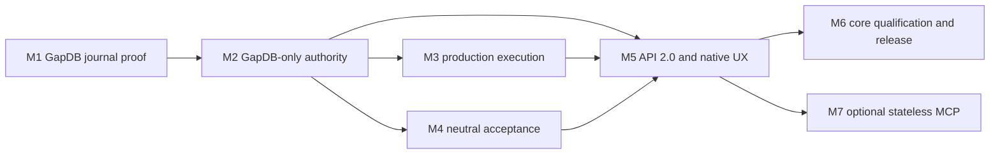

# Production Runtime Program

Status: **proposed implementation program**

Program ID: `production-runtime`

Normative architecture: [Production Orchestration Architecture](PRODUCTION_ORCHESTRATION_ARCHITECTURE.md)

Decision record: [ADR 0002](adr/0002-production-orchestration-architecture.md)

Machine contracts:

- [Published program manifest](programs/production-runtime-program.json)
- [Mission-source program manifest](../kitty-specs/production-runtime-architecture-01M16GVA/program-manifest.json)
- [Program manifest schema](../kitty-specs/production-runtime-architecture-01M16GVA/contracts/program-manifest.schema.json)

This roadmap turns the proposed production architecture into seven bounded,
dependency-ordered implementation missions. It does not create, admit, start,
or complete those missions. Every mission remains subject to its own Spec Kitty
specify, plan, tasks, implement/review, accept, merge, mission-review, and
retrospective gates.

## 1. Program status

All seven entries are **proposed**. The current documentation mission publishes
the program and its admission rules; it does not transfer the historical Phase
1–3 qualification to GapDB, a production host, API 2.0, neutral acceptance, or
MCP.

The program is intentionally not a mega-mission:

- M1 can disprove the storage and recovery direction before broad migration.
- M2 cannot start until that proof and its exact GapDB adoption tuple are
  accepted.
- M3 and M4 test different consequences of M2 and may run concurrently.
- M5 is the join that exposes their capabilities through one application seam.
- M6 qualifies the ordinary core release.
- M7 is optional, independently packaged, and off the core critical path.

Candidate count, dependency edges, status, and ordering may change only through
explicit program reconciliation. An informal issue edit, Beads status, branch
name, or MCP Task cannot change this program.

## 2. Dependency graph and critical path



The declared critical path is:

```text
M1 -> M2 -> M3 -> M5 -> M6
```

M4 is still a mandatory predecessor of M5. The declared path records the
production-execution branch selected by the machine manifest; the actual
elapsed path can pass through M4 if neutral-acceptance proof finishes later.
No calendar or agent estimate is implied.

Parallel groups are exact:

| Group | Missions | Shared predecessor | Join or independence rule |
|---|---|---|---|
| `after-M2` | M3, M4 | M2 | Both must be accepted before M5. They share only frozen identity, journal/evidence, candidate, and policy contracts. |
| `after-M5` | M6, M7 | M5 | M6 qualifies the core release. M7 may proceed independently and cannot delay M6 without an explicit revised program decision. |

## 3. Program summary

| ID | Outcome | Primary falsification target | Dependencies | Entry evidence | Exit evidence | Non-goal | Principal risk | Rollback |
|---|---|---|---|---|---|---|---|---|
| M1 | Prove a narrow durable authority and recovery slice over a pinned `gapdbd` sidecar. | GapDB can atomically support the control journal, projection, checkpoint, restart epoch, and side-effect-free playback through the two-agent zombie scenario. | None | Ratified architecture; immutable GapDB tuple; existing two-agent harness. | Boundary crash/ambiguity proof; fresh replacement workspace and identical replay digest; fourteen external adoption scenarios plus human signature. | Full store migration. | Client-only integration can hide lifecycle, ambiguity, or replay faults. | Stop; retain current runtime as historical evidence; do not begin M2. |
| M2 | Move every authority capability to the event/CAS model and erase SQLite from production. | Every authority capability can run without SQL constraints, dual truth, fallback, or lost refusal semantics. | M1 | Accepted M1 evidence; frozen behavior inventory; identified consumer-owned ports. | GapDB authority suites; recovery coverage for every event family; structural SQLite absence. | Silent legacy-state import. | Table-to-key transliteration preserves accidental semantics. | Revert the unshipped adapter as a unit; never enable dual write or fallback. |
| M3 | Compose real agents, Beads, workspaces, review, and Git integration safely. | The concurrency crown jewel survives disagreement among GapDB, Beads, Git, filesystems, processes, agents, and humans. | M2 | Accepted GapDB authority; qualified Beads tuple; frozen Git/workspace/review/integration laws. | Concurrent isolated agents; zombie/tracker/reassignment/review/fence proof; conflict repair. | Neutral acceptance or public API. | Tracker, process, or filesystem state accidentally gains authority. | Remove the unqualified composition root; retain qualified domain services. |
| M4 | Judge stack-neutral claims through explicitly bound providers. | One neutral gate judges the same claim through different providers without ecosystem semantics. | M2 | Accepted durable evidence substrate; stable candidate identities; ratified acceptance contract. | Cross-provider parity; explicit missing/stale/waiver behavior; ecosystem-import mutants fail. | Universalize this repository's Go commands. | Provider convenience leaks tool semantics into the kernel. | Disable bindings and retain their evidence as non-admissible history. |
| M5 | Expose the complete process through API 2.0 and the normal CLI. | A client can drive, disconnect, resume, and understand a mission without direct external-state inspection. | M2, M3, M4 | Accepted authority, execution, and acceptance; ratified API/progress/operation contracts. | Black-box CLI/API parity; resumable operations and convergent progress; bounded API 1.3 translation/refusal. | Put MCP in the core binary. | Transport vocabulary recreates generic mutation or leaks host authority. | Retain application capabilities; remove unqualified transports or mappings. |
| M6 | Qualify installation and sustained multi-mission operation as the core release. | Independently proven components remain safe under load, crashes, installation, restart, and recovery. | M5 | Accepted process-complete runtime; signed GapDB and Beads tuples; ratified platform/load targets. | Exact load/soak/crash/security/backup census; no Python/SQLite/MCP requirement; complete operator diagnosis. | Delay core for MCP. | Lifecycle, packaging, or recovery seams fail despite local proofs. | Withhold release artifact and retain source-bound failure evidence. |
| M7 | Add an independently packaged MCP `2026-07-28` Tasks adapter. | Connection loss, task expiry, input pauses, and cancellation races cannot alter durable mission authority. | M5 | Accepted API/native operations; pinned MCP core and Tasks revisions. | Core-absence proof; stateless/task-race/progress proof; CLI/MCP terminal equivalence. | MCP-only semantics or a core dependency. | MCP Task identity is mistaken for domain authority. | Remove the adapter without changing core state or behavior. |

## 4. Program-wide admission and evidence law

### 4.1 Admission

A designated maintainer or program operator admits a proposed mission through a
recorded Spec Kitty decision. Admission requires:

1. every predecessor to be `complete` at an immutable mission identity and
   accepted evidence revision;
2. every named external tuple to identify immutable source, protocol, binary,
   policy, and signer facts required by that mission;
3. the candidate mission specification to preserve the manifest's outcome,
   falsification target, non-goals, stop conditions, and rollback boundary;
4. no more than three named dependencies; and
5. an acyclic program manifest that includes the candidate and its current
   edges.

Beads can display the decision, but cannot make it. An MCP Task can carry the
request, but cannot make it. A branch, tag name, tracker assignment, or passing
package scaffold is not admission evidence.

Dependency resolution uses immutable identity, not a mutable label. At minimum
the record binds the predecessor mission ID, terminal source commit/tree,
accepted evidence digest, mission-review verdict, and any provider or protocol
tuple consumed by the successor.

### 4.2 Program states

| State | Meaning |
|---|---|
| `proposed` | Candidate exists in the roadmap but has no execution authority. |
| `admitted` | Entry evidence and dependency identities were accepted; the governed mission may be created or activated. |
| `active` | The mission is executing within its own lifecycle and work graph. |
| `blocked` | Progress is intentionally stopped by missing, failed, stale, or contradictory evidence; the mission is not terminal. |
| `complete` | Independent gates, merge, mission review, and terminal evidence are complete at an immutable identity. |
| `superseded` | A reconciled successor replaces this candidate or its unexecuted remainder; prior evidence remains historical. |
| `cancelled` | The candidate will not proceed under the current program decision; completed predecessor evidence is untouched. |

### 4.3 Superseded evidence

If an upstream release, protocol, policy, or mission result is superseded:

- a proposed or admitted consumer cannot start until its dependency binding is
  reconciled;
- an active consumer becomes `blocked` if the changed fact can affect its
  authority, evidence admissibility, or falsification result;
- previously completed evidence remains immutable and accurately scoped to its
  original tuple;
- a maintainer records whether the consumer continues, is requalified,
  superseded, split, reordered, or cancelled; and
- no consumer silently retargets a mutable branch, `latest` release, executable
  on `PATH`, tracker revision, or transport draft.

### 4.4 Program reconciliation

Reconciliation may add, split, supersede, cancel, or reorder candidates only
through an explicit decision that publishes a schema-valid acyclic manifest.
The decision states its actor, rationale, old and new manifest digests,
affected mission IDs, dependency-evidence dispositions, and critical-path
effect. Completed mission evidence is never rewritten.

Rollback always means withholding or removing unqualified composition. It does
not mean enabling SQLite, Python, an embedded migration mode, a generic API
transition, tracker authority, or MCP-only workflow behavior forbidden by the
architecture.

## 5. Mission cards

### M1 — GapDB Control Journal Proving Ground

**Status:** proposed

**Outcome:** Prove a narrow durable authority and recovery slice over a pinned
`gapdbd` sidecar.

**Primary falsification target:** GapDB can atomically support the control
journal, projection, checkpoint, restart epoch, and side-effect-free playback
through the two-agent zombie scenario.

**Dependencies:** none.

**Immutable entry evidence:**

- the production orchestration architecture is ratified;
- the existing two-agent invariant and fault harness is identified by source
  commit and scenario census; and
- one GapDB adoption tuple binds all of:
  - source revision or immutable release identity;
  - `gapdbd` binary digest;
  - public client version;
  - wire/storage protocol version;
  - owner lifecycle policy for discovery, start-or-connect, health, reconnect,
    shutdown, and orphan recovery; and
  - the accountable human signer.

The absence of a current GapDB release tag is an entry-gate fact, not permission
to bind `main` or discover an arbitrary executable. The tuple must be made
immutable before M1 is admitted.

**Scope:**

- one production-shaped vertical slice with two work items and two agents;
- one conditional durable GapDB atomic batch containing the domain event,
  idempotency result, aggregate/projection head, checkpoint metadata where due,
  and external-effect/outbox intent;
- bounded versioned domain events and deterministic reducers;
- product checkpoint restore plus subsequent journal replay;
- new runtime epoch after restart and rejection of pre-restart authority;
- lease expiry, quarantine, and a fresh replacement workspace;
- ambiguous response reconciliation using the same operation identity;
- playback from recorded external observations with every side-effect adapter
  disabled or asserting zero calls;
- all fourteen GapDB adoption scenarios through the real external adapter; and
- a human adoption record signed over the exact tuple and evidence digests.

**Exit evidence:**

- crash and ambiguous-response injection passes at every durable boundary;
- a repeated operation with the same ID and digest returns the recorded result,
  while a changed digest fails closed;
- replacement authority receives a fresh workspace and the zombie remains
  confined to its quarantined workspace;
- restored live state and side-effect-free playback produce the same canonical
  digest;
- playback makes zero Git, Beads, workspace, agent, or compensation calls;
- all fourteen external adoption scenarios pass; and
- the attributable human adoption record accepts exactly the tested tuple.

**Non-goal:** migrate every existing authority repository. M1 is not a partial
production cutover and creates no SQLite fallback decision.

**Risk:** a client-only proof can overlook sidecar owner lifecycle, response
ambiguity, bounded record design, or the difference between GapDB byte recovery
and product replay.

**Rollback/stop:** stop after the proving slice, preserve the failure evidence,
and do not admit M2. The current Phase 1–3 runtime remains historical evidence,
not a production fallback in the target architecture.

**Successors consume:** event and checkpoint versions, reducer digest contract,
runtime-epoch rules, sidecar tuple/lifecycle policy, response-ambiguity behavior,
and signed adoption evidence.

### M2 — GapDB-Only Production Authority

**Status:** proposed

**Outcome:** Move all authority capabilities to the event and CAS model and
erase SQLite from the production graph.

**Primary falsification target:** Every authority capability can run without
SQL constraints, dual truth, SQLite fallback, or loss of refusal semantics.

**Dependencies:** M1.

**Immutable entry evidence:** accepted M1 journal/checkpoint/epoch/sidecar and
adoption evidence; the frozen Phase 1–3 behavior inventory; an inventory of
consumer-owned persistence ports and their atomicity/refusal contracts.

**Scope:** capability-shaped implementations for mission lifecycle, artifacts,
WorkRevision finalization and reconciliation, execution, leases, workspaces,
external-effect attribution, handoff, review, integration, idempotency,
checkpoints, restoration, and recovery. Each capability owns its aggregate
contract and uses the M1 event/reducer substrate.

Table-to-key transliteration is forbidden. So are dual writes, read fallback,
configuration fallback, a hidden SQLite importer, indefinite compatibility,
and a mode that silently changes authority by detecting an old file.

**Exit evidence:**

- every authority port and applicable refusal, scenario, race, fault, recovery,
  and mutant suite passes against GapDB;
- ambiguous response and restart coverage exists for every authority-changing
  event family;
- static source/reachability checks find no production SQLite implementation;
- `go.mod`, all transitives, the SBOM, built binaries, clean installation,
  fallback logic, and runtime configuration contain no SQLite dependency; and
- unsupported historical SQLite state fails with an actionable offline
  disposition rather than importing or ignoring it.

**Non-goal:** promise automatic migration of historical SQLite state.

**Risk:** a mechanical schema port reproduces SQLite structure, weakens the
event model, and hides cross-aggregate conditions in application read/modify
write sequences.

**Rollback:** revert the unshipped GapDB authority adapter as a unit and repair
it on its branch. Never ship dual writes or re-enable the forbidden fallback.

**Successors consume:** GapDB-backed domain ports, stable event families,
recovery/ambiguity semantics, structural absence evidence, and a production
authority composition that no longer exposes SQL behavior.

### M3 — Production Mission Execution and Beads Composition

**Status:** proposed; parallel group `after-M2`.

**Outcome:** Compose real agent, workspace, tracker, review, and Git integration
paths without losing concurrency safety.

**Primary falsification target:** The concurrency crown jewel survives when
GapDB, Beads, Git, workspaces, processes, agents, and human edits disagree.

**Dependencies:** M2.

**Immutable entry evidence:** accepted M2 authority evidence; a qualified Beads
tuple and portable conformance contract; frozen Git, workspace, review, and
integration product laws.

**Scope:** the real production composition root, dependency-aware dispatch,
claims and lease renewal/expiry, lease-scoped workspaces, immutable handoff,
ActorID-independent review and rejection cycles, attribution-safe tracker
projection/compensation, repository-first integration fencing, serialized
integration, and conflict repair work.

Required adversarial cases include:

- two processes racing for the same work;
- two agents executing independent work in distinct workspaces;
- the same `ActorID` attempting review under a different `ProcessID`;
- an expired zombie continuing ordinary writes in its quarantined workspace;
- tracker responses that are stale, dishonest, unavailable, or contradicted by
  a human edit;
- human reassignment between effect and compensation;
- compare-before-compensate over provider revision, value, and operation marker;
- simultaneous integration attempts for one repository/target fence; and
- a merge conflict that preserves candidates and creates explicit repair work.

**Exit evidence:** all required cases pass with exact census, no tracker fact
grants execution/review/integration authority, the primary checkout remains
untouched, dirty/unowned workspaces are never deleted, and recovery produces
typed next actions rather than fabricated success.

**Non-goals:** implement the neutral acceptance kernel or public API.

**Risk:** production wiring can bypass domain laws by treating a tracker claim,
process, path, or Git ref as authority.

**Rollback:** remove the unqualified composition root and retain the already
qualified domain services and provider evidence.

**Successors consume:** typed production use cases, run capsules, candidate and
review outcomes, integration records, recovery diagnostics, and real default
Beads composition.

### M4 — Stack-Neutral Acceptance Runtime

**Status:** proposed; parallel group `after-M2`.

**Outcome:** Judge stack-neutral claims using explicitly bound,
provenance-rich evidence providers.

**Primary falsification target:** One neutral gate can judge the same claim
through materially different providers without importing ecosystem semantics.

**Dependencies:** M2.

**Immutable entry evidence:** accepted M2 durable event/evidence substrate;
stable candidate, WorkRevision, review, actor, and governance identities; the
ratified acceptance evidence contract.

**Scope:** acceptance claims; strict union of organization, project,
mission-type, and mission requirements; revision-pinned provider bindings;
bounded evidence envelopes; pass/fail/error/skipped/waived outcomes;
dependency-aware qualification graphs; concurrent execution; content-based
reuse and targeted invalidation; suggestion-only stack detection; and external
process, CI-attestation, and human-decision provider ports.

**Exit evidence:**

- materially different provider fixtures prove one claim contract and produce
  the same gate decision;
- an unbound required claim becomes `decision_required` rather than skipped;
- candidate, WorkRevision, binding, provider, policy, or relevant input changes
  invalidate exactly the affected evidence;
- a waiver binds actor, authority, reason, scope, candidate, policy, and expiry
  when applicable; and
- rejecting mutants prove the kernel imports no ecosystem/provider package and
  never parses human-formatted output to invent a result.

**Non-goal:** make this repository's Go commands universal product law. They
remain one project's qualification-provider configuration.

**Risk:** an attractive built-in provider becomes an implicit language policy
or auto-detection silently weakens the strict required union.

**Rollback:** disable unqualified bindings while retaining their attributable
evidence as non-admissible history. Do not weaken claims to obtain a pass.

**Successors consume:** claim, binding, evidence, waiver, decision, operation,
and progress contracts that are independent of any local stack.

### Why M3 and M4 can proceed concurrently

Both depend on M2's immutable journal, identity, candidate, and policy
contracts, but they do not own each other's decisions. M3 proves that work can
be produced, reviewed, and integrated safely. M4 proves that required claims
can be evidenced and judged neutrally. M5 consumes accepted versions of both:
the production command capabilities from M3 and the gate/qualification
capabilities from M4. Neither mission may edit the other's public contract after
admission without program and WorkRevision reconciliation.

### M5 — Orchestrator API 2.0, Native Operations, Progress, and CLI

**Status:** proposed.

**Outcome:** Expose the complete production process through one typed
application boundary and normal CLI.

**Primary falsification target:** A client can drive, disconnect from, resume,
and understand a mission without reading Beads, Markdown, worktrees, Git refs,
or GapDB directly.

**Dependencies:** M2, M3, M4.

**Immutable entry evidence:** accepted M2 authority, M3 production execution,
and M4 acceptance evidence; ratified API 2.0, progress, native-operation, and
API 1.3 compatibility contracts.

**Scope:** closed typed commands and queries; native asynchronous operations
with progress, input requests, cooperative cancellation, and terminal results;
`ListMissions`, `GetMissionProgress`, and revision-resumable
`WatchMissionProgress`; phase/generation/work counts, active runs, review and
integration position, critical path, blockers, next actions, drift, and journal
revision; the normal `spec-kitty` CLI and host service; bounded API 1.3
translation/refusal.

**Exit evidence:**

- black-box API and normal CLI complete equivalent missions;
- a client disconnects, the host restarts, and the same operation identity
  resumes idempotently;
- snapshot plus watch converges and resynchronizes after lag/compaction;
- progress explains exact position, blocking reason, and legitimate next
  actions without direct external-state inspection;
- callers cannot mint leases, transfer workspaces, mutate refs, submit generic
  transitions, or force success; and
- API 1.3 fixtures translate safely or return typed incompatibility.

**Non-goal:** implement MCP inside the core binary.

**Risk:** transport-shaped vocabulary recreates a generic state machine or
exposes host authority to remote callers.

**Rollback:** retain internal application capabilities and remove unqualified
public transports or compatibility mappings.

**Successors consume:** the process-complete native application contract,
operation/task-neutral lifecycle, progress snapshots and revisions, CLI parity,
and transport authorization/refusal rules.

### M6 — Core Production Qualification and Release

**Status:** proposed; parallel group `after-M5`.

**Outcome:** Qualify clean installation and sustained multi-mission operation
as the core production release.

**Primary falsification target:** Independently proven components remain safe
under sustained concurrency, arbitrary crash timing, installation, restart,
and operator recovery.

**Dependencies:** M5.

**Immutable entry evidence:** accepted M5 process-complete runtime; signed and
pinned GapDB and Beads production tuples; ratified supported platform and load
targets.

**Scope:** clean installation; reproducible core and sidecar binaries; sustained
multi-mission and multi-agent load; soak; crash injection across every mutating
command family; backup/restore digest; checkpoint and terminal-evidence
retention; path, symlink, permission, socket, ref, and malicious-provider
security tests; operator doctor/recovery; supported-platform documentation; and
source-bound release manifests.

**Exit evidence:** exact load/soak/crash/recovery/security/backup census;
restored terminal digest equality; reproducible dependency and binary identity;
no required Python, SQLite, or MCP in source-reachable core installation; and
operator diagnosis for every durable blocked state without direct GapDB edits.

**Non-goal:** delay the core release for M7.

**Risk:** correct local components can still fail at lifecycle, packaging,
resource, security, or operator-recovery seams.

**Rollback:** withhold the release artifact and preserve source-bound failure
evidence for repair. Never enable a forbidden runtime fallback.

**Successors consume:** a qualified core release tuple and operational support
boundary. M7 consumes M5, not M6, so MCP work cannot redefine core admission.

### M7 — Optional Stateless MCP 2026-07-28 Tasks Adapter

**Status:** proposed; parallel group `after-M5`; **not on the core critical
path**.

**Outcome:** Provide an independently packaged agent-native projection over API
2.0.

**Primary falsification target:** Connection loss, task expiry, input pauses,
and cancellation races cannot alter or replace durable mission authority.

**Dependencies:** M5.

**Immutable entry evidence:** accepted M5 API 2.0/native-operation contracts;
pinned MCP `2026-07-28` core and Tasks extension revisions.

**Scope:** a separate module and binary; stateless self-describing requests;
explicit Spec Kitty handles; resource discovery; progress subscriptions; MRTR
input; and MCP Tasks as transport projections of native `OperationID` values.
No protocol session, task TTL, or adapter instance owns mission state.

**Exit evidence:**

- core builds, installs, and completes a mission with the MCP module absent;
- the core module graph and binary contain no MCP SDK;
- requests can land on different adapter instances;
- connection loss or Task TTL expiry leaves the native operation and mission
  resumable;
- `input_required` resolves a real decision without creating alternate state;
- cancellation/completion races preserve the committed domain outcome;
- progress resumes from the last journal revision; and
- CLI-only and MCP-driven workflows produce equivalent terminal evidence.

**Non-goal:** create MCP-only workflow semantics or place MCP on the core
critical path.

**Risk:** transport task identity or lifecycle is mistaken for mission, work,
run, lease, review, or acceptance authority.

**Rollback:** remove or disable the independent adapter without changing the
core application, mission history, or native operation result.

**Successors consume:** none for the first core release. Later integrations may
consume only the independently qualified adapter tuple.

## 6. Exact M1 torture chamber

M1 is the first admitted experiment because it attacks the most consequential
unproven claim: whether memory-primary authority, durable evidence, external
effects, process lifetime, filesystem state, and replay can disagree without
duplicating authority or history. It is not merely the smallest coding task.

```text
Precondition
  pin GapDB source revision + gapdbd digest + client/protocol version
  pin sidecar lifecycle policy and evidence signer
  launch the exact project-local gapdbd; reject PATH discovery

Arrange
  1 project
  1 real GapDB owner and public client
  1 real Git repository
  2 finalized independent work items
  2 implementation actors/processes
  1 bounded tracker implementation

Execute
  concurrently claim both work items
    -> durable event/idempotency/projection/outbox atomic batch
    -> allocate separate lease-scoped workspaces W1 and W2

  kill process A at each boundary
    -> before request publication
    -> after GapDB acceptance but before client response
    -> after workspace creation but before durable binding
    -> after durable binding but before run-capsule response
    -> after external-effect intent but before observation

  lose one durable response deliberately
    -> repeat the same OperationID + digest
    -> reconcile the recorded result; never duplicate the effect

  let A stop heartbeating while the process remains alive
    -> expire its lease
    -> quarantine W1; never transfer it
    -> replacement process C receives a new lease and fresh workspace W3

  let zombie A resume ordinary writes in W1
    -> reject its stale epoch/lease/fence at handoff, review, and integration
    -> W1 output survives only as quarantined evidence

  restart the host/owner boundary
    -> establish a new RuntimeEpochID
    -> reject every pre-restart authority capsule
    -> restore the latest product checkpoint
    -> replay later domain events in revision/order sequence
    -> reconcile recorded Git/tracker observations without repeating effects

  finish admissible work from W2 and W3
    -> immutable handoff
    -> review by independent ActorIDs
    -> serialized integration

Verify
  live restored-state digest == side-effect-free playback digest
  playback adapter call count == 0
  one valid authority per work revision at every observation
  one integration authority per repository/target at every observation
  replacement workspace identity != expired workspace identity
  all fourteen external GapDB adoption scenarios pass
  human signature covers the exact tuple and evidence digests
```

Stop rule:

> If M1 cannot preserve authority and reproduce its canonical replay digest
> through this two-agent zombie scenario, do not begin the six-thousand-line
> storage replacement in M2.

## 7. Stop/go and rollback decisions

| Decision point | Go evidence | Stop response |
|---|---|---|
| Admit M1 | Architecture ratified; immutable sidecar/client/protocol/lifecycle/signer tuple; harness pinned. | Keep M1 proposed until every tuple field is immutable. |
| Admit M2 | M1 exit evidence and signed adoption record accepted at exact identities. | Preserve M1 findings; no broad store replacement. |
| Admit M3/M4 | M2 proves complete authority behavior and structural SQLite absence. | Neither parallel consumer may bypass failed or partial M2. |
| Admit M5 | Both M3 and M4 accepted, plus M2 identity still current. | Block the join; do not expose a partial process as API 2.0. |
| Admit M6 | M5 black-box process/CLI evidence accepted; release targets ratified. | Withhold production artifacts. |
| Admit M7 | M5 accepted; exact MCP core/Tasks revisions pinned. | Core release may continue; optional adapter remains absent. |

Package scaffolding, interface declarations, a green fake that cannot
misbehave, or an authored README is never sufficient exit evidence. Every
mission must execute its primary disproof experiment and retain the observed
result, including failures and non-admissible attempts.

## 8. Program risks and ownership

| Risk | Accountable capability owner | Program control |
|---|---|---|
| GapDB release/lifecycle tuple is mutable or incomplete | M1 storage-adoption owner and human signer | Admission rejects mutable branch/PATH identities; tuple includes lifecycle policy and digest. |
| Product journal is confused with GapDB WAL or watch history | M1 journal/reducer owner | Separate checkpoint/event/replay contracts and digest proof. |
| SQLite semantics survive as a key-shaped clone | M2 authority owners | Capability-shaped ports, atomic mutants, and structural absence checks. |
| Beads becomes execution or acceptance authority | M3 composition owner | Retained provider-neutral ports, dishonest-provider tests, and authority assertions. |
| Acceptance becomes Python-, Go-, or CI-shaped | M4 acceptance owner | Neutral kernel imports no provider; same claim passes through different fixtures. |
| API or compatibility surface mints authority | M5 application-boundary owner | Closed commands, expected revisions, host-owned mutation, negative black-box tests. |
| Optional MCP becomes required | M7 adapter owner and M6 release owner | Separate module/binary; core-absence and CLI parity are release evidence. |
| Program grows by convenience | Program maintainer | Explicit reconciliation, schema/acyclicity validation, one falsification target per mission. |

The architecture owner decides boundary changes. Each mission's accountable
maintainer owns its evidence and stop decision. Independent reviewers own gate
verdicts. Provider maintainers own external tuple facts, not Spec Kitty product
authority.

## 9. Machine/human parity and validation

The published manifest is a location-adjusted copy of the mission-source
manifest: every field except `$schema` must be byte-equivalent after canonical
JSON ordering. This roadmap displays every machine field:

| Machine field | Human location |
|---|---|
| `program_id`, `title`, `status` | Program status and mission-card headings |
| `critical_path`, `dependencies`, `parallel_group` | Dependency graph and parallel groups |
| `outcome`, `primary_falsification_target` | Program summary and each mission card |
| `entry_evidence`, `exit_evidence` | Mission-card admission and exit sections |
| `non_goals`, `risk`, `rollback` | Mission cards and stop/go table |

Reproduce the contract checks from the repository root:

```bash
PROGRAM=docs/programs/production-runtime-program.json
SOURCE=kitty-specs/production-runtime-architecture-01M16GVA/program-manifest.json
SCHEMA=kitty-specs/production-runtime-architecture-01M16GVA/contracts/program-manifest.schema.json

uvx check-jsonschema --schemafile "$SCHEMA" "$PROGRAM"

jq -e '([.missions[].id] | length) == ([.missions[].id] | unique | length)' "$PROGRAM"
jq -e 'all(.missions[]; (.dependencies | length) <= 3)' "$PROGRAM"
jq -e '([.missions[].id] as $ids | all(.missions[]; .dependencies as $deps | all($deps[]; . as $dep | ($ids | index($dep)) != null)))' "$PROGRAM"
jq -e '.critical_path == ["M1", "M2", "M3", "M5", "M6"]' "$PROGRAM"
jq -e '. as $root | .critical_path as $path | all(range(0; ($path | length) - 1); . as $index | $path[$index] as $from | $path[$index + 1] as $to | any($root.missions[]; .id == $to and (.dependencies | index($from) != null)))' "$PROGRAM"
jq -e '([.missions[] | {key:.id,value:.dependencies}] | from_entries) == {M1:[],M2:["M1"],M3:["M2"],M4:["M2"],M5:["M2","M3","M4"],M6:["M5"],M7:["M5"]}' "$PROGRAM"

jq -r '.missions[] as $mission | $mission.dependencies[]? | "\(.) \($mission.id)"' "$PROGRAM" | tsort

diff -u \
  <(jq -S 'del(."$schema")' "$SOURCE") \
  <(jq -S 'del(."$schema")' "$PROGRAM")
```

Expected topological constraints are `M1 < M2`, `M2 < M3`, `M2 < M4`,
`M2 < M5`, `M3 < M5`, `M4 < M5`, `M5 < M6`, and `M5 < M7`.
`tsort` must exit zero. The human comparison must find seven proposed missions,
one falsification target per mission, no hidden dependency, parallel groups
`after-M2` and `after-M5`, and no package-scaffolding exit criterion.

## 10. Creating the next governed mission

Do not create all seven mission directories in advance. After this architecture
mission is accepted and merged, an accountable maintainer should:

1. resolve and record the immutable M1 GapDB/harness entry evidence;
2. record the M1 admission decision against the digest of this manifest;
3. create only the admitted mission:

   ```bash
   spec-kitty specify gapdb-control-journal-proving-ground \
     --mission-type software-dev \
     --topology lanes_with_coord
   ```

4. carry that mission through specify, plan, tasks, implement/review, accept,
   merge, mission-review, and retrospective; and
5. reconcile this program using M1's immutable terminal evidence before
   admitting M2.

If the M1 specification cannot preserve the falsification target, torture
sequence, non-goal, and stop rule above, cancel or supersede the candidate
rather than weakening the proof to start implementation.

## 11. Program non-goals

- Create or start M1–M7 during this documentation mission.
- Estimate dates, story points, throughput, or agent counts without evidence.
- Freeze Go package boundaries before vertical experiments earn them.
- Let a failed M1 or M2 be bypassed by a consumer.
- Treat a mutable branch, `latest` release, `PATH` binary, Beads ticket, or MCP
  Task as dependency evidence.
- Move M7 onto the core critical path without explicit reconciliation.
- Implement production behavior in this roadmap.
