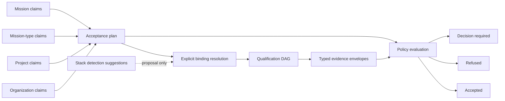
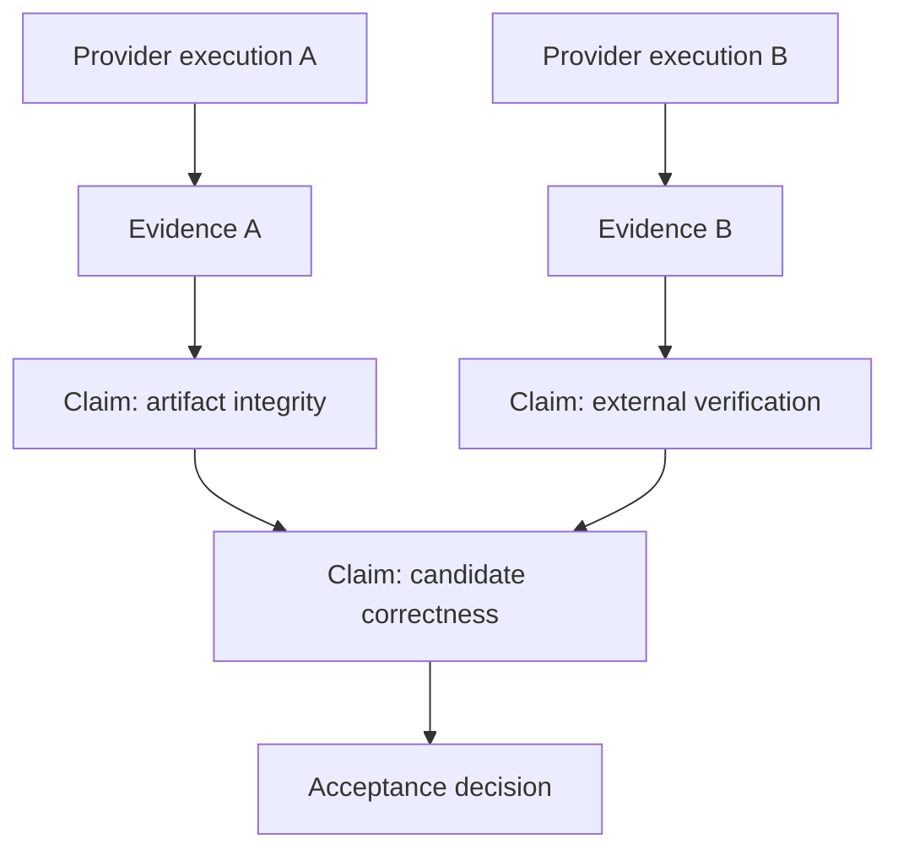

# Stack-Neutral Acceptance Proof System

**Status:** Proposed target architecture; no production acceptance engine or
provider described here is currently shipped.

**Authority:** This document is the normative acceptance subrecord of the
[production orchestration architecture](PRODUCTION_ORCHESTRATION_ARCHITECTURE.md).
It refines that record without changing its authority laws.

**Contract:** [Acceptance evidence envelope 1.0](../kitty-specs/production-runtime-architecture-01M16GVA/contracts/acceptance-evidence.schema.json)

**Requirements:** C-009, C-010, C-017; FR-015--FR-019, FR-023; NFR-010,
NFR-012, NFR-014.

## 1. Scope and proof-system boundary

Spec Kitty accepts a candidate by evaluating propositions, not by recognizing
the language, toolchain, repository layout, or organization that produced it.
The target design separates four concepts that are often accidentally fused:

| Concept | Question it answers | Authority | It must not do |
|---|---|---|---|
| `AcceptanceClaim` | What must be true? | Resolved policy | Name a command or choose a provider |
| `QualificationBinding` | Which approved capability may produce proof? | Explicit organization, project, mission, or operator decision | Add or remove a required claim |
| `EvidenceEnvelope` | What bounded observation was produced for exact inputs? | Immutable provider output admitted by the application | Decide acceptance |
| `AcceptanceDecision` | Does the complete admissible evidence set satisfy policy? | Acceptance kernel | Execute tools or infer facts from presentation output |



The gate is therefore a proof-policy evaluator. A provider can report a
successful observation but cannot declare the mission accepted. Conversely, a
provider execution failure is a durable fact and cannot be converted into an
implicit skip.

This design applies unchanged to software, documentation, research, data,
migration, compliance, and mixed-stack missions. Repository-specific commands
remain useful, but only inside explicitly approved provider bindings.

### Non-goals

- Selecting built-in ecosystem providers for production.
- Treating any repository task or script as a universal acceptance claim.
- Running shell text copied from tracker fields or mission prose.
- Storing raw logs, test streams, secrets, or artifact bodies in evidence.
- Giving CI systems, local processes, or human actors inherent trust.
- Implementing providers, policy code, schedulers, or architecture tests in
  this documentation mission.

## 2. Acceptance-plan composition

An `AcceptancePlan` is an immutable generation of the executable proof graph.
It contains:

- `AcceptancePlanRevisionID`, mission and candidate scope, and creation time;
- the exact organization, project, mission-type, and mission policy revisions;
- the strict-union claim set and each claim's evaluated conditional state;
- approved binding revisions or an actionable missing-provider record;
- the claim dependency DAG and its stable digest;
- policy and governance revisions used for evidence admissibility;
- the actor and operation that resolved the plan.

### 2.1 Strict union law

Let `R(L)` be the required claims contributed by layer `L`. Required policy is:

```text
R(plan) = R(organization) union R(project) union R(mission-type) union R(mission)
```

A lower layer may add claims, narrow its own provider choice, or make a rule
more restrictive. It cannot subtract, downgrade, shadow, or silently replace a
claim required by a higher layer. A higher-layer policy owner may publish a new
revision that explicitly supersedes its own earlier claim; that produces a new
plan revision and leaves the old decision reproducible.

Conditional claims join the plan before execution. Their typed predicates are
evaluated against revision-pinned facts, and the plan records the predicate,
inputs, result, and reason. A false condition makes the claim
`not_applicable`; it is not runtime `skipped` evidence.

### 2.2 Identity, duplicates, and conflicts

Each claim has a stable, namespaced `ClaimID`. Resolution applies these rules:

1. A single definition is included with its source provenance.
2. Byte-equivalent definitions with the same identity are deduplicated, while
   every contributing source remains recorded.
3. Different definitions with the same identity are a policy conflict. Plan
   resolution stops with `decision_required`; layer precedence does not guess
   which proposition was intended.
4. Semantically related claims with different identities both remain. The
   policy author must publish an explicit supersession in the source layer if
   one should cease to apply.
5. Any claim, predicate input, dependency, or binding change creates a new
   `AcceptancePlanRevisionID`; a running plan never mutates in place.

### 2.3 Policy-union example

| Source layer | Required claim | Resolved result |
|---|---|---|
| Organization | `security.supply-chain-attested` | Retained |
| Project | `documentation.links-resolve` | Retained |
| Mission type | `candidate.objective-correctness` | Retained |
| Mission | `migration.external-system-verified` | Retained |
| Mission | `security.supply-chain-attested` with identical definition | Deduplicated; both sources recorded |

If the project attempts to mark `security.supply-chain-attested` optional, the
resolver emits a conflict and no executable plan. It does not apply a
last-writer-wins rule.

## 3. Acceptance claims

`AcceptanceClaim` has the following implementable shape:

| Field | Meaning and invariant |
|---|---|
| `claim_id` | Stable namespaced identity within and across plan revisions |
| `capability` | Stack-neutral proof capability, such as `artifact.integrity` |
| `proposition` | Human-readable statement of what must be true; never an invocation |
| `source_layer` | Organization, project, mission type, mission, or attributed human addition |
| `source_revision` | Exact policy revision that contributed the claim |
| `scope` | Mission, work, candidate, artifact, environment, or named external system |
| `requiredness` | `required`, `optional`, or `conditional` |
| `condition` | Closed, versioned typed predicate plus revision-pinned inputs; absent unless conditional |
| `freshness` | Exact candidate by default, or an explicit stable-input reuse policy |
| `allowed_evidence_kinds` | Permitted proof mechanisms and runner trust constraints |
| `dependencies` | Claim IDs whose admissible outcomes are prerequisites |

Typed conditional predicates are a small closed vocabulary, for example
`artifact_kind_is`, `mission_attribute_equals`, `external_target_present`, and
boolean composition. They cannot contain code, a shell expression, or an
arbitrary query. Unknown predicate versions produce `decision_required`.

### 3.1 Representative claims

| Claim ID | Capability | Proposition | Typical scope |
|---|---|---|---|
| `candidate.objective-correctness` | `candidate.correctness` | The candidate satisfies its approved behavioral obligations. | Candidate |
| `documentation.links-resolve` | `documentation.integrity` | Every governed local reference resolves within the published documentation set. | Artifact set |
| `design.independent-approval` | `governance.human-decision` | An authorized independent reviewer approves the candidate's design. | Candidate |
| `migration.external-system-verified` | `migration.external-verification` | The target system confirms the required migration postconditions. | External system |
| `dataset.quality-thresholds` | `data.quality` | The candidate dataset satisfies the revision-pinned quality thresholds. | Artifact |
| `security.supply-chain-attested` | `security.attestation` | The candidate's governed inputs have an admissible supply-chain attestation. | Candidate |

These propositions deliberately do not say how to prove themselves. A mixed
project and a non-code research mission can use the same vocabulary; only their
claims, policy, and approved bindings differ.

### 3.2 Dependency semantics

A dependency means that evaluating or executing a claim without admissible
evidence for its predecessors is invalid. It does not mean that a predecessor's
provider gets to decide the descendant's outcome. Cycles are rejected during
plan resolution. Optional claims may be dependencies only when policy defines
the missing-optional behavior explicitly.

## 4. Qualification providers and explicit bindings

A `QualificationProvider` publishes a typed capability descriptor:

- provider ID, semantic version, immutable implementation digest, and protocol
  version;
- provider kind and supported evidence kinds;
- accepted typed request and returned evidence protocol versions;
- bounded resource, timeout, cancellation, environment, network, output, and
  secret capabilities;
- runner and trust-domain requirements;
- availability observations and diagnostics;
- lifecycle status and compatibility window.

Provider kinds initially include:

| Kind | Execution boundary |
|---|---|
| Bounded local argv | An executable plus an argument array under an approved sandbox and resource policy; never a shell string |
| CI attestation | A signed, typed attestation fetched or received through a provider port |
| Signed human decision | An attributed decision with configured authority and independence constraints |
| Typed remote evaluator | A future versioned request/response protocol with explicit trust and retry semantics |

### 4.1 `QualificationBinding`

| Field | Meaning and invariant |
|---|---|
| `binding_revision` | Immutable identity of this complete binding |
| `claim_id` | The claim this binding may serve |
| `provider_id`, `provider_version`, `provider_digest` | Exact provider identity; all required |
| `binding_source` | Organization, project, mission, or attributed operator decision plus source revision |
| `supported_evidence_kinds` | Intersection of claim allowance and provider capability |
| `execution_policy` | Typed, bounded invocation/request, resources, timeout, network, environment, output, and secret rules |
| `trust_domain` | Required runner trust domain and attestation verification policy |
| `evidence_decoder` | Versioned typed decoder; it validates machine evidence, never presentation text |
| `availability` | Time-bounded observation: `available`, `unavailable`, or `unknown`, with reason |
| `lifecycle_status` | `proposed`, `approved`, `retired`, or `unavailable` |

`availability` is an observation, while lifecycle status is a governed
decision. A provider may be approved but temporarily unavailable. That yields
an actionable `decision_required` result for a required claim unless policy
explicitly permits another approved binding.

### 4.2 Resolution and lifecycle

1. Discovery may publish provider descriptors.
2. Detection may create binding suggestions with supporting observations.
3. An authorized policy operation approves a complete, revision-pinned
   binding. Approval records actor, source, policy revision, and operation ID.
4. Replacement approves a new binding revision and retires the old one for new
   plans. Existing plan revisions retain the old binding for reproducibility.
5. Retirement prevents selection by new plans but never invalidates historical
   evidence by deletion.
6. Unavailability records why execution cannot currently proceed and exposes
   legal actions: wait, repair, approve an alternate provider, revise the
   claim, or seek a policy-authorized waiver.

Organization constraints form the outer allow/deny and trust boundary. Project
or mission policy may select a more specific provider only within that
boundary. Narrower layers never invent a default, weaken trust, or activate a
suggestion merely because no other binding exists.

### 4.3 Suggestion-only detection

A detector observes repository or mission facts and emits:

```text
BindingSuggestion {
  suggestion_id, observed_revision, detector_id, detector_digest,
  claim_id, proposed_provider, proposed_binding_template, reasons, expires_at
}
```

For example, observing a module manifest may recommend a local correctness
recipe. It cannot add a claim, approve the provider, change requiredness, or
execute anything. Accepting the suggestion is a named, authorized operation
that creates a new plan revision. Detector failure leaves policy unchanged.

### 4.4 Acceptance mutation protocol

These are application capability semantics, not transport-specific command
names. The process-complete API may project them into its own envelopes, but it
must preserve their identity, idempotency, authority, and failure rules.

| Capability | Identity and idempotency | Authority | Typed refusal/failure |
|---|---|---|---|
| Resolve plan | Mission, candidate, WorkRevision, policy revisions, and caller idempotency key resolve to one immutable plan ID | Host acceptance application | Policy conflict, unknown predicate, or missing binding returns `decision_required`; no partial plan becomes executable |
| Approve or retire binding | Claim, proposed binding revision, expected policy revision, and operator key | Actor authorized by binding-source policy | Stale policy, forbidden provider/trust domain, digest mismatch, or conflicting replay is refused |
| Start qualification | Plan, claim, binding, candidate, and caller key form the logical operation ID | Host scheduler after lease/mission policy checks | Missing/unavailable binding, stale plan, or resource refusal is typed; no provider is silently substituted |
| Request cancellation | Qualification operation ID, expected revision, reason, and caller key | Operation owner or configured authority | Unknown, terminal, or stale operation is reported; the request does not claim provider termination |
| Admit provider result | Active attempt ID plus exact typed envelope and protocol revision | Host application through the provider port; remote actors cannot write evidence directly | Malformed, mismatched, oversized, duplicate-conflicting, or untrusted output is rejected and the attempt records `error` |
| Grant or revoke waiver | Claim, candidate, scope, policy basis/revision, actor, and caller key | Configured waiver authority | Wrong scope, stale candidate, missing independence, expiry, or insufficient authority is refused |
| Evaluate acceptance | Plan, candidate, WorkRevision, selected evidence set, expected journal revision, and caller key | Acceptance kernel invoked by the host application | Incomplete proof returns refusal or `decision_required`; no `force-success` operation exists |

Every accepted mutation appends durable operation and domain evidence before
success is acknowledged. A repeated idempotency key with identical inputs
returns the prior result; the same key with different inputs is a conflict.
Presentation strings, generic state transitions, and caller-created evidence
IDs cannot bypass these capabilities.

## 5. Evidence envelope and artifact boundary

The version 1.0 schema is deliberately bounded. Every field has a proof or
recovery purpose:

| Schema field | Why it exists |
|---|---|
| `schema_version` | Selects exact decoding and validation semantics |
| `evidence_id` | Immutable identity used by decisions, audit, and deduplication |
| `claim_id` | Names the proposition observed; it is not inferred from provider identity |
| `mission_id` | Prevents cross-mission evidence confusion |
| `work_revision_id` | Pins the executable graph generation |
| `candidate_id` | Pins the exact candidate under judgment |
| `outcome` | Typed observation: `pass`, `fail`, `error`, `skipped`, or `waived` |
| `provider` | Pins provider ID, version, implementation digest, and binding revision |
| `runner` | Identifies the execution/decision actor and configured trust domain |
| `policy_revision` | Pins policy used for execution and admissibility when relevant |
| `governance_revision` | Pins doctrine/profile context when relevant |
| `started_at`, `finished_at` | Establish ordering and bounded duration; time alone never proves freshness |
| `input_digest` | Commits to the canonical stable-input manifest used for reuse decisions |
| `result_digest` | Commits to the typed result body or attestation |
| `artifact_digests` | Bounded references to immutable external artifacts |
| `log_digest` | Reference to external diagnostic logs, not the logs themselves |
| `diagnostic` | Bounded, non-authoritative human aid; never parsed into a verdict |
| `waiver` | Required only for `waived`; carries accountable authorization facts |

`policy_revision` and `governance_revision` are populated whenever either can
affect execution, trust, admissibility, or outcome. The implementation may
require them universally even though schema 1.0 permits omission for evidence
whose policy proves them irrelevant.

Unbounded result bodies, logs, transcripts, reports, binary attestations, and
artifacts live in an immutable artifact service. The envelope stores only
digests and bounded diagnostics. Secret values are neither artifacts nor
diagnostics; an environment contract records secret identities and versions,
not their contents.

## 6. Outcomes, admissibility, freshness, and reuse

### 6.1 Outcome semantics

| Outcome | Provider observation | Gate meaning |
|---|---|---|
| `pass` | The typed proof mechanism observed the proposition as satisfied. | Satisfies a claim only if fresh, trusted, correctly bound, and policy-admissible. |
| `fail` | The mechanism ran correctly and observed the proposition as false. | Negative evidence; normally causes refusal for a required claim. |
| `error` | The mechanism could not produce a valid positive or negative observation. | Provider execution/protocol failure; never converted to `fail` or `skipped`. |
| `skipped` | The provider did not execute for an explicitly typed reason. | Does not satisfy a required claim unless policy explicitly defines an admissible skip. |
| `waived` | An accountable authority authorized an exception for this exact scope. | Satisfies only when waiver policy, authority, candidate, scope, and time remain admissible. |

Schema validity proves only that an envelope is structurally well formed. It
does not prove its signature, freshness, trust, binding, claim applicability,
or policy admissibility.

### 6.2 Freshness manifest

Exact-candidate evidence is the default. Reuse requires reconstructing and
validating the canonical stable-input manifest whose canonical encoding hashes
to `input_digest`:

1. candidate identity and source/tree/artifact digest;
2. WorkRevision ID and executable-graph digest;
3. claim identity and full claim-definition digest;
4. binding revision and binding-definition digest;
5. provider ID, version, implementation digest, and evidence protocol;
6. runner identity class, trust domain, and trust-policy revision;
7. acceptance policy and governance revisions;
8. bounded environment contract, including platform and named secret versions;
9. every referenced input artifact digest;
10. typed conditional-predicate inputs and dependency evidence identities.

The manifest is content-addressed and may be retained as an external artifact;
the envelope carries its digest. A cache hit is admissible only after each
component required by that claim's freshness policy compares equal. A policy
revision may explicitly declare selected components irrelevant, but that rule
itself is revision-pinned and audited.

Invalidation is targeted. Candidate drift invalidates claims whose manifests
include changed candidate inputs and their descendants. A documentation-only
change need not invalidate an external data measurement if policy and the
manifest prove independence. Binding, provider, trust, policy, governance, or
environment changes invalidate only evidence that depends on them. No evidence
is deleted; it becomes inadmissible for the new plan.

### 6.3 Admissibility algorithm

For each applicable required claim, the kernel:

1. selects evidence named by the decision operation, never by presentation
   order or provider exit status;
2. validates schema and typed protocol;
3. matches mission, claim, candidate, WorkRevision, plan, and binding revision;
4. verifies provider and runner identity, digest, trust, signature as
   applicable, and bounded execution policy;
5. recomputes or verifies the stable-input manifest and freshness rule;
6. checks outcome-specific policy, including waiver authorization and
   revocation;
7. evaluates claim dependencies;
8. records an admissibility result and bounded reason for every considered
   envelope.

Any required claim without admissible satisfying evidence prevents acceptance.
An absent qualified binding returns `decision_required`; negative evidence
returns policy refusal; execution/protocol failure returns a distinct
qualification error and may permit a governed retry.

## 7. Waivers are governed evidence

A waiver is not a boolean, a comment, or an “ignore failure” option. The schema
requires:

| Check | Required proof |
|---|---|
| Signer | `signer_actor_id` resolves to a durable actor identity |
| Authority | `authority` names the configured decision role/capability |
| Reason | Bounded non-empty rationale |
| Scope | Exact claim/artifact/environment scope; wildcards require explicit policy support |
| Candidate | Inherited from the envelope's exact `candidate_id` |
| Policy basis | `policy_basis` and `policy_revision` authorize this exception kind |
| Visibility | Projected in progress, final decision, audit, and terminal evidence |
| Time | Optional `expires_at`; policy may require one |
| Revocation | Checked against durable revocation events before every decision or reuse |
| Audit | Signer, operation, timestamps, source revision, envelope, and decision are retained |

Revocation never edits an envelope. It appends a revocation fact keyed to the
waiver evidence and causes later admissibility checks to reject it. A waiver
cannot cross candidates, claims, scopes, policy revisions, or authority
boundaries unless an explicit policy says so and the stable-input proof remains
complete.

## 8. Qualification DAG, execution, and progress

The immutable acceptance plan compiles claims and approved provider bindings
into a DAG. A claim node owns proposition state; an execution node owns one
provider attempt; an evidence node owns immutable output. This separation
supports several independent providers for one claim without multiplying the
claim itself.



### 8.1 Scheduling and operation identity

- Ready execution nodes with satisfied dependencies run concurrently within
  configured resource and trust-domain limits.
- A logical `QualificationOperationID` is derived from mission, candidate,
  acceptance-plan revision, claim, binding, and caller idempotency key.
  Repeating the same request returns the existing operation.
- Every physical try has a distinct `AttemptID`; retries never overwrite an
  earlier error or its diagnostics.
- Timeout produces typed `error` evidence and an operation diagnostic.
  Retry policy is bounded by count, backoff, error class, and deadline.
- Cancellation is cooperative. `cancellation_requested` is not terminal;
  completion, confirmed cancellation, timeout, or lost-runner reconciliation
  records what actually occurred.
- An execution that may have produced an external effect is reconciled before
  retry. Idempotency does not authorize duplicating unknown effects.

Dependency failure blocks descendants with stable reason IDs referencing the
actual failed or errored ancestor. Descendants are `blocked`; the system does
not manufacture `skipped` envelopes that hide the root failure.

### 8.2 Progress projection

Progress is a bounded read model at one journal revision:

- mission, candidate, WorkRevision, and acceptance-plan revision;
- total/applicable claim counts and counts by ready, running, satisfied,
  failed, errored, blocked, waived, and decision-required state;
- active operations and attempts with start, timeout, and cancellation state;
- ready set, critical path, and blocked paths;
- missing/unavailable providers and legal next actions;
- reused, invalidated, and newly produced evidence counts;
- last journal revision and last progress time.

A percentage, if shown, declares its weighting and never replaces the graph,
critical path, or blockers. Provider progress is advisory until represented by
a typed envelope or durable operation event.

### 8.3 Acceptance decision record

`AcceptanceDecision` records:

- decision ID, mission, candidate, WorkRevision, acceptance-plan revision, and
  policy/governance revisions;
- decision operation ID, deciding kernel version, actor/process attribution,
  and journal revision;
- the complete applicable claim set;
- the exact evidence IDs considered and each admissibility result;
- waiver and revocation facts consulted;
- outcome `accepted`, `refused`, or `decision_required`;
- stable reasons and legal next actions;
- creation time and digest of the complete decision record.

The record is immutable. New evidence, drift, a binding decision, or a policy
change creates a new decision revision rather than rewriting history.

## 9. Architectural isolation and permanent controls

The proposed packages follow capabilities, not provider ecosystems:

```text
acceptance kernel
  claim | plan | policy | admissibility | evidence | decision
                 |
provider ports   | typed execution and attestation contracts
                 |
provider adapters
  local-process | CI-attestation | signed-human | typed-remote | project tools
                 |
application
  resolves plans | schedules qualification | records evidence | invokes gate
```

The dependency direction is inward through ports. The acceptance kernel cannot
import:

- provider adapters or provider registries;
- language, package-manager, build-system, or ecosystem tooling;
- shell/process execution packages;
- CI-vendor clients or result parsers;
- transport, tracker, artifact-store, or persistence implementations;
- human-interface or presentation parsers.

Provider ports use closed typed requests, results, diagnostics, cancellation,
and identity values. The application owns orchestration and durable recording.
Adapters can depend on ports and external SDKs; the kernel never depends on
adapters.

### 9.1 Load-bearing checks and mutants

Permanent architecture tests must:

1. enumerate kernel packages and reject imports from adapter, transport,
   tracker, persistence, process-execution, and ecosystem tiers;
2. reject kernel source containing provider command names or command recipes;
3. reject dependencies on provider result/presentation parsers;
4. prove the guard itself by injecting one forbidden import and one forbidden
   command token into a kernel fixture;
5. run contract tests against a deliberately stupid fake provider that knows
   only typed request/evidence envelopes;
6. run the same gate cases using unrelated provider adapters and verify equal
   admissibility decisions for equal evidence.

Mutation fixtures must include familiar tool tokens such as `pytest`, `go
test`, `npm`, Maven, Cargo, and CI-vendor APIs. Their presence in adapter tests
may be legitimate; any dependency or execution recipe in kernel packages must
fail the scope guard. The guard is layered, so adding a real provider never
requires deleting neutrality enforcement.

The fake provider must also misbehave: return stale candidate IDs, stale
binding revisions, untrusted runner domains, malformed evidence, conflicting
operation IDs, and typed errors. A fake that always tells the truth cannot
prove the boundary.

## 10. Claim-to-provider matrix

This matrix is illustrative configuration, not a built-in provider catalog:

| Claim | Allowed evidence kind | Approved binding example | Missing-provider behavior |
|---|---|---|---|
| `candidate.objective-correctness` | Typed local observation or signed remote attestation | Project-approved bounded local evaluator | `decision_required` with approve/repair/waive actions |
| `documentation.links-resolve` | Typed artifact validation | Documentation graph validator | `decision_required`; never assume prose review |
| `design.independent-approval` | Signed human decision | Organization reviewer-authority binding | `decision_required`; actor independence remains policy |
| `migration.external-system-verified` | Typed remote attestation | Mission-approved target verifier | `decision_required`; tracker closure is not evidence |
| `dataset.quality-thresholds` | Typed measurement report | Project data-quality evaluator | `decision_required` |
| `security.supply-chain-attested` | Signed attestation | Organization-approved trust service | `decision_required`; no lower-layer substitute outside trust policy |

An unfamiliar fictional toolchain can provide a conforming typed adapter and
obtain an explicit binding. No claim, gate vocabulary, or kernel package needs
to change.

## 11. Cross-provider evidence examples

The next two providers produce evidence for the same claim and candidate. The
first is a bounded local evaluation; the second is a signed CI attestation
whose signature/result body is stored externally under `result_digest`.
Policy may require either one or both; schema validity alone chooses neither.

### 11.1 Local process provider

```json
{
  "schema_version": "1.0",
  "evidence_id": "ev:local:01M16H001",
  "claim_id": "candidate.objective-correctness",
  "mission_id": "mission:01M16GVA",
  "work_revision_id": "work-revision:7",
  "candidate_id": "candidate:4f2c9a1",
  "outcome": "pass",
  "provider": {
    "id": "provider:project-local-evaluator",
    "version": "1.4.2",
    "digest": "sha256:aaaaaaaaaaaaaaaaaaaaaaaaaaaaaaaaaaaaaaaaaaaaaaaaaaaaaaaaaaaaaaaa",
    "binding_revision": "binding:correctness:12"
  },
  "runner": {
    "id": "runner:host:alpha",
    "trust_domain": "trust:project-local-sandbox"
  },
  "policy_revision": "policy:acceptance:22",
  "governance_revision": "governance:charter:9",
  "started_at": "2026-08-29T14:10:00Z",
  "finished_at": "2026-08-29T14:11:12Z",
  "input_digest": "sha256:7777777777777777777777777777777777777777777777777777777777777777",
  "result_digest": "sha256:cccccccccccccccccccccccccccccccccccccccccccccccccccccccccccccccc",
  "artifact_digests": [
    "sha256:dddddddddddddddddddddddddddddddddddddddddddddddddddddddddddddddd"
  ],
  "log_digest": "sha256:eeeeeeeeeeeeeeeeeeeeeeeeeeeeeeeeeeeeeeeeeeeeeeeeeeeeeeeeeeeeeeee",
  "diagnostic": "Typed evaluator completed; full report and logs are external artifacts."
}
```

Decision link: acceptance decision `decision:41` admits this envelope only
after matching plan `acceptance-plan:22`, binding `binding:correctness:12`, the
runner trust policy, and the recomputed stable-input manifest.

### 11.2 Signed CI attestation provider

```json
{
  "schema_version": "1.0",
  "evidence_id": "ev:ci:01M16H002",
  "claim_id": "candidate.objective-correctness",
  "mission_id": "mission:01M16GVA",
  "work_revision_id": "work-revision:7",
  "candidate_id": "candidate:4f2c9a1",
  "outcome": "pass",
  "provider": {
    "id": "provider:org-signed-attestation",
    "version": "3.1.0",
    "digest": "sha256:1111111111111111111111111111111111111111111111111111111111111111",
    "binding_revision": "binding:correctness:13"
  },
  "runner": {
    "id": "runner:ci:verified-2048",
    "trust_domain": "trust:organization-ci"
  },
  "policy_revision": "policy:acceptance:22",
  "governance_revision": "governance:charter:9",
  "started_at": "2026-08-29T14:10:05Z",
  "finished_at": "2026-08-29T14:12:42Z",
  "input_digest": "sha256:bbbbbbbbbbbbbbbbbbbbbbbbbbbbbbbbbbbbbbbbbbbbbbbbbbbbbbbbbbbbbbbb",
  "result_digest": "sha256:2222222222222222222222222222222222222222222222222222222222222222",
  "artifact_digests": [
    "sha256:3333333333333333333333333333333333333333333333333333333333333333"
  ],
  "diagnostic": "Signature and typed attestation verified; attestation body is externally retained."
}
```

Decision link: policy revision `policy:acceptance:22` permits this evidence kind
and trust domain. Decision `decision:42` can therefore reach the same claim
result without knowing which system produced the attestation.

### 11.3 Valid waiver evidence

```json
{
  "schema_version": "1.0",
  "evidence_id": "ev:waiver:01M16H003",
  "claim_id": "migration.external-system-verified",
  "mission_id": "mission:01M16GVA",
  "work_revision_id": "work-revision:7",
  "candidate_id": "candidate:4f2c9a1",
  "outcome": "waived",
  "provider": {
    "id": "provider:authorized-human-decision",
    "version": "1.0.0",
    "digest": "sha256:4444444444444444444444444444444444444444444444444444444444444444",
    "binding_revision": "binding:migration-waiver:2"
  },
  "runner": {
    "id": "actor:release-authority:17",
    "trust_domain": "trust:organization-release-authority"
  },
  "policy_revision": "policy:acceptance:22",
  "governance_revision": "governance:charter:9",
  "started_at": "2026-08-29T14:20:00Z",
  "finished_at": "2026-08-29T14:20:01Z",
  "input_digest": "sha256:5555555555555555555555555555555555555555555555555555555555555555",
  "result_digest": "sha256:6666666666666666666666666666666666666666666666666666666666666666",
  "diagnostic": "Exception applies only to the named verification claim and exact candidate.",
  "waiver": {
    "signer_actor_id": "actor:release-authority:17",
    "authority": "authority:migration-exception",
    "reason": "Target verification window is unavailable; policy permits one time-bounded release exception.",
    "scope": "claim:migration.external-system-verified",
    "expires_at": "2026-08-30T14:20:00Z",
    "policy_basis": "policy-rule:migration-window-exception"
  }
}
```

Decision link: decision `decision:43` must additionally prove the signer held
`authority:migration-exception`, the waiver was not revoked or expired, and its
scope and candidate match. A structurally valid waiver can still be refused.

### 11.4 Negative cases

| Case | Defect | Required result |
|---|---|---|
| Stale candidate | Envelope names `candidate:4f2c9a0`, or its input manifest commits to the old tree | Inadmissible `stale_candidate`; rerun affected nodes |
| Missing provider | Required claim has no approved available binding | `decision_required` with explicit approval/repair/waiver actions |
| Wrong binding revision | Envelope names a retired or different binding than the plan | Inadmissible `binding_mismatch`; never select by provider name alone |
| Untrusted runner | Runner trust domain is outside the binding's trust policy | Inadmissible `untrusted_runner` |
| Human-formatted output only | Process exits successfully and prints “all checks passed” but emits no typed envelope | Provider `error`; presentation text has no authority |
| Waiver object on `pass` | Non-waived outcome includes `waiver` | Schema rejection |
| `waived` without waiver | Waived outcome omits accountable authorization | Schema rejection |
| Provider timeout | Attempt exceeds bounded execution policy | Typed `error`, descendants blocked with the error as root cause |

## 12. End-to-end decision walkthrough

1. The application resolves organization, project, mission-type, and mission
   policies. Their strict union produces six required claims in
   `acceptance-plan:22`.
2. Five claims have approved bindings. External migration verification has
   none, so plan execution returns `decision_required`; it does not skip that
   claim or weaken the policy.
3. Detection suggests a typed remote evaluator. An authorized operator reviews
   its digest, trust domain, execution policy, and decoder, then approves
   `binding:migration:3`. This explicit decision creates
   `acceptance-plan:23`.
4. Four independent provider nodes start concurrently. Two dependent nodes
   remain blocked on their declared predecessors. Every logical operation has
   one stable idempotency identity and every retry has a distinct attempt.
5. Three providers return typed pass evidence. One returns `error` because its
   remote attestation is malformed. The error remains visible; its descendant
   names that operation as the blocking cause.
6. While the malformed result is repaired, a documentation-only candidate
   change creates a new candidate. Stable-input comparison invalidates the
   documentation-integrity evidence and its descendants. The external data and
   migration evidence are reused because their complete manifests and policy
   prove independence from the changed artifact.
7. The documentation provider reruns. The migration verifier is now
   unavailable. Policy exposes a time-bounded waiver action. If the signer lacks
   authority or the scope is broader than the single claim, the gate refuses
   it. If all waiver checks pass, a `waived` envelope becomes admissible for
   only this candidate and claim.
8. The kernel evaluates every applicable required claim against the complete
   selected evidence set. It records `decision:44` with the exact plan,
   candidate, WorkRevision, policy/governance revisions, evidence IDs,
   admissibility findings, waiver status, journal revision, and final outcome.
9. Any later policy, governance, candidate, WorkRevision, binding, provider, or
   revocation change produces a new plan or decision revision. The historical
   decision remains reproducible and is never silently rewritten.

## 13. Validation record and future qualification

The three positive JSON examples above are intended to validate against
evidence-envelope schema 1.0. The validation for this documentation change must
report:

```text
local-process: valid
signed-ci-attestation: valid
authorized-waiver: valid
waived-without-waiver mutant: rejected
pass-with-waiver mutant: rejected
```

This record demonstrates structural conformance only. Future implementation
missions must separately prove:

- strict policy union, conflict refusal, and immutable plan revisions;
- explicit binding approval and suggestion-only detection;
- typed local, remote, CI, and human provider conformance;
- complete freshness manifests, targeted invalidation, and safe cache reuse;
- waiver authority, expiry, revocation, audit, and visibility;
- concurrent DAG scheduling, bounded retry, cancellation, reconciliation, and
  truthful progress;
- kernel dependency guards and load-bearing mutants;
- equal decisions for materially different stacks and proof mechanisms;
- durable, candidate-bound acceptance decisions under crash and playback.

Until those missions pass their own review, acceptance, merge, mission review,
and retrospective gates, this document is a target contract rather than a
claim that the production runtime already behaves this way.
