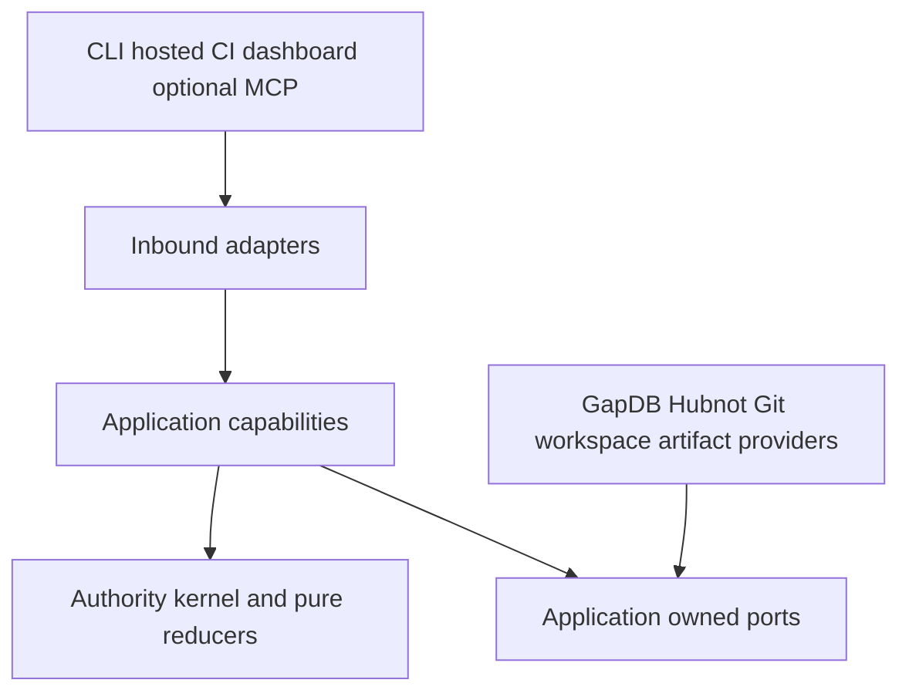
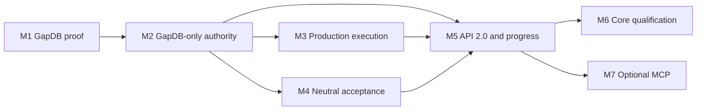

# Spec Kitty Production Runtime: Technical Project Plan

Status: **Phase 1–3 delivered at source-bound evidence boundaries; production
architecture ratified; M1–M7 implementation proposed**

Updated: 2026-08-29

Canonical target: [Production Orchestration Architecture](https://github.com/spec-kitty/spec-kitty-redesign/blob/main/docs/PRODUCTION_ORCHESTRATION_ARCHITECTURE.md)

Decision record: [ADR 0002](https://github.com/spec-kitty/spec-kitty-redesign/blob/main/docs/adr/0002-production-orchestration-architecture.md)

Delivery program: [Production Runtime Program](https://github.com/spec-kitty/spec-kitty-redesign/blob/main/docs/PRODUCTION_RUNTIME_PROGRAM.md)

This plan is an implementation guide and delivery-truth index. It summarizes
the canonical records but does not redefine them. When this plan and a linked
specialized contract differ, the canonical architecture and its accepted
specialized record control.

## 1. Executive decision

Build Spec Kitty as a Go-native set of cohesive authority capabilities rather
than a translation of Python modules and artifact choreography. Preserve the
product laws already proved by Phase 1–3, then recompose them on a memory-primary,
GapDB-only production host.

The stable ownership model is:

```text
Hubnot       -> mutable work definition, dependencies, discussion, assignment
Spec Kitty  -> mission, WorkRevision, execution, review, acceptance, integration
Git         -> source objects, commits, trees, ancestry, and ref outcomes
GapDB       -> target ordered control-state substrate, never product semantics
```

The first production runtime retains one machine and one filesystem authority.
Remote callers cross Orchestrator API 2.0 rather than opening GapDB or mutating
host workspaces and Git directly.

## 2. Delivery truth and compatibility

### 2.1 Delivered now

| Phase | Delivered behavior | Qualification boundary |
|---|---|---|
| Phase 1 | Concurrent leases, isolated lease-scoped worktrees, stale refusal, workspace quarantine, immutable handoff, ActorID-level review independence, and serialized conflict-preserving integration | Frozen source and evidence cited by [ADR 0001](adr/0001-phase1-authority-proving-ground-verdict.md) and the [Phase 1 index](phase1-evidence/README.md) |
| Phase 2 | Provider-neutral tracker ports and exact Beads 1.2.2 JSON integration, including portable, dishonest, contention, backup, and real-provider evidence | Exact tuple and source-bound [Phase 2 evidence](phase2-evidence/README.md) |
| Phase 3 | Governed specify/plan/decompose/finalize flow, immutable WorkRevision generations, semantic drift, `continue | supersede | invalidate | fork`, action-scoped governance, typed pure `next`, and derived tasks | Exact source and [Phase 3 evidence](phase3-evidence/README.md) |

The current repository contains the proving/helper command
`cmd/spk-phase1-helper`. It does not contain the production `spec-kitty` host,
GapDB runtime, API 2.0 server, stack-neutral acceptance engine, or MCP adapter.
SQLite is the observed Phase 1–3 control-store implementation; that historical
qualification remains valid only at its recorded boundary.

### 2.2 Ratified target

GapDB is the sole target production control-state substrate. SQLite is not a
fallback, migration runtime, dual-write peer, or safety net. API 2.0 is the
target application vocabulary. API 1.3 remains a compatibility inventory and
outer projection. Acceptance becomes stack-neutral. MCP `2026-07-28` is an
optional separately packaged projection whose Tasks map to native operations.

“Ratified” creates proof obligations; it does not make these components ship.
The old spelling “Gapdb” remains searchable in historical records, but this plan
uses the project name GapDB.

### 2.3 Historical evidence rule

A later architecture decision neither inherits nor invalidates an older
exact-source verdict. It changes what is built next. Frozen evidence and
completed mission records remain untouched. Copying an old payload beside a
new implementation neither qualifies the new code nor changes the old result.

## 3. Migration classification of the previous active plan

The previous plan was inventoried before replacement. The dispositions below
cover every normative topic named by WP06: source of truth, storage, events,
recovery, API, acceptance, MCP, repository layout, delivery phases, validation,
risks, and definition of done.

| Previous section | Disposition | Active treatment |
|---|---|---|
| 1 Executive decision | Amend | Retain the behavior-first Go re-architecture; replace SQLite/API 1.3 future direction with the ratified target |
| 2 Why this project exists | Retain | Python is behavioral evidence, not a package template |
| 3 Product outcomes | Amend | Retain mission/concurrency/tracker outcomes; route external surfaces through API 2.0 and neutral acceptance |
| 4 Non-goals | Amend | Retain anti-transliteration and anti-plugin-soup limits; add no production fallback and optional MCP isolation |
| 5 Product laws | Retain/amend | Retain authority, isolation, review, integration, recovery, and compensation laws; replace SQLite-specific representation |
| 6 Conceptual model | Amend | Retain stable identities; add runtime epoch, operation, decision, claim, evidence, and native-operation identities from canonical records |
| 7 Source-of-truth matrix | Replace | Use the canonical single-writable-owner matrix summarized in section 5 |
| 8 Architectural shape | Link-only summary | Canonical component and dependency boundaries control; this plan records only implementation sequencing |
| 9 Beads integration | Retain as delivered history | Exact 1.2.2 tuple and bounded capabilities remain valid; Beads never expands into execution or mission authority |
| 10 Mission methodology | Retain/amend | Preserve mission and WorkRevision semantics; target journal/API representation replaces filesystem state |
| 11 Concurrency and workspace design | Retain law, replace storage | Keep quarantine/fresh replacement, leases, and serialized integration; replace SQLite persistence with GapDB journal/checkpoint/epoch contracts |
| 12 Events, commands, queries | Replace | API 2.0 closed commands, durable operations, journal revisions, progress, and typed diagnostics control |
| 13 Integrations | Replace/link | API 2.0 is the sole seam; Team Kitty and optional MCP are adapters, not alternate control planes |
| 14 Repository organization | Move to historical context | Capability boundaries remain; speculative directory names are not a production contract |
| 15 CLI surface | Replace | Current helper is documented honestly; future CLI projects API 2.0 and cannot be advertised as shipped |
| 16 Migration and compatibility | Amend | Behavior inventory remains; API 1.3 becomes bounded translation/refusal; any data import is explicit offline work outside the normal graph |
| 17 Old Phase 0–7 roadmap | Replace | The dependency-ordered M1–M7 program is the only active delivery sequence |
| 18 Validation strategy | Amend | Retain contention/fault/model testing; add GapDB tuple, playback, structural absence, API, provider-neutral, and optional-module proofs |
| 19 Observability and operations | Amend | Revisioned progress, typed decisions, recovery state, and native operations replace proposed store-shaped diagnostics |
| 20 Risks | Retain/amend | Preserve authority-leak and concurrency risks; add lifecycle tuple, playback, hidden SQLite, API authority, and MCP isolation risks |
| 21 ADR queue | Move to historical context | ADR 0002 and accepted specialized documents now resolve the production questions |
| 22 Focused decisions | Replace | Unresolved implementation choices are mission entry checks; product direction is no longer open-ended |
| 23 Definition of done | Replace | M6 core qualification and the release definition in section 13 control |
| Appendix A Mini review brief | Move to historical context | The accepted resolution remains linked evidence, not an active review prompt |
| Appendix B references | Link-only summary | Current canonical and historical indexes replace local prototype paths |

## 4. Product laws retained across the redesign

1. **Mission authority:** a mission is a governed lifecycle, not a tracker epic.
2. **Executable graph immutability:** execution consumes one generation-numbered
   WorkRevision. Tracker drift cannot mutate it in place.
3. **Independent concurrency:** independent work may run concurrently only in
   distinct mutable workspaces.
4. **Lease-scoped workspace:** expiry quarantines W1 permanently from ordinary
   authority; a replacement receives fresh W2.
5. **Stale refusal:** epoch, generation, lease, fence, candidate, policy, and ref
   mismatches fail closed before external effects.
6. **Immutable candidate boundary:** review consumes a recorded Git candidate,
   contributor set, criteria/evidence digest, and exact generation.
7. **Actor-level review independence:** the reviewer ActorID differs from every
   contributor ActorID. Phase 1 has no waiver or bypass. Phase 1 has no
   same-actor waiver.
8. **Stack-neutral acceptance:** providers produce evidence; only Spec Kitty's
   acceptance capability decides the complete claim set.
9. **Singular integration:** one repository/target-ref authority serializes Git
   mutation and preserves conflict/repair evidence.
10. **Attribution-safe compensation:** undo only when provider revision, value,
    and operation marker still attribute the state to the compensated attempt.
11. **Honest recovery:** storage recovery, product restore, epoch replacement,
    external reconciliation, and playback are different claims.
12. **Projection-only documents and transports:** Markdown, dashboards, tracker
    status, API compatibility, and MCP never become independent authority.

## 5. Authority and component boundaries

Every category has one writable owner:

| State | Writable owner | Never inferred from |
|---|---|---|
| Mission lifecycle | Spec Kitty mission capability | Tracker status or Markdown |
| Mutable work definition | Configured primary tracker; Hubnot by default | Assignment as execution authority |
| Executable graph | Spec Kitty WorkRevision capability | A later provider edit |
| Run and lease | Spec Kitty execution capability | Process identity or ticket claim |
| Mutable workspace | Host workspace capability | A path or previous lease |
| Candidate | Spec Kitty handoff capability, from observed Git facts | Live directory contents |
| Review | Spec Kitty review capability | Same actor in another process |
| Acceptance | Spec Kitty acceptance capability | Provider success, tracker closure, or prose |
| Integration decision | Spec Kitty integration capability | A tracker merge slot |
| Git result | Git, observed through its adapter | Desired state in the journal |
| Native operation | Spec Kitty operation capability | Transport session or MCP Task |
| Progress | Rebuildable Spec Kitty projection at a journal revision | Hand-maintained percentage |
| External provider state | Named external provider | Spec Kitty's desired value |

Compile-time dependencies point inward:



The kernel imports no SQLite/SQL, GapDB, Hubnot, Git implementation, filesystem
allocator, qualification ecosystem, transport, or MCP package. Adapters report
observations and typed failures; they do not author product verdicts.

## 6. Current Hubnot delivery boundary

The active provider is the source-and-binary-pinned public Hubnot CLI through
neutral ports and the compiled tracker consumer. See [Hubnot tracker](HUBNOT_TRACKER.md)
for installation, actor binding, complete work, effects and bounded recovery.
Simple catalog and assignment are unguarded; guarded definition replacement,
atomic claims and conditional compensation refuse. Discussion distinguishes
claimed author from actual signing actor. Read revisions are equality-only.

The exact Beads 1.2.2 tuple and its capabilities remain historical Phase 2 evidence;
they are not current installation instructions or inherited Hubnot guarantees.
M2 adoption and M3 real-agent composition remain separate program gates.

## 7. Target GapDB journal, checkpoint, and recovery

### 7.1 Memory-primary, durably acknowledged

The authority host serves aggregates, WorkRevision indexes, ready sets, lease
state, progress, idempotency results, and watchers from one memory-resident
owner. Memory is the fast active representation, not the durable source.

An authority-changing command follows this order:

1. canonicalize the typed request and verify its OperationID/digest;
2. check current revision, runtime epoch, generation, lease/fence, candidate,
   policy, and command-specific preconditions;
3. reduce the command purely against the in-memory projection;
4. submit one conditional atomic GapDB mutation containing complete versioned
   events, operation result, aggregate heads, checkpoint metadata, and effect
   intents;
5. acknowledge success only after durable confirmation;
6. publish committed events to memory and watchers; and
7. dispatch external effects asynchronously through ports.

Same OperationID and digest replays one recorded result. The same ID with a
different digest fails before reduction or effects.

### 7.2 Sidecar and adoption tuple

M1 uses a separately owned, project-local `gapdbd` sidecar through the public
Unix-socket client. It does not import GapDB `internal/server`, discover an
arbitrary executable on `PATH`, or assume an unshipped embedding lifecycle.

The signed M1 tuple pins source revision, `gapdbd` binary digest, public client
version/digest, protocol version, lifecycle policy, supported platform and local
filesystem boundary, and evidence digest. M2 cannot start until that tuple and
the journal torture proof are accepted.

### 7.3 Recovery contracts

```text
GapDB snapshot and WAL recovery
  -> Spec Kitty checkpoint validation
  -> later control-event reduction
  -> durable new RuntimeEpochID
  -> predecessor lease invalidation and workspace quarantine
  -> external fact and pending-effect reconciliation
  -> recovered revisioned progress
  -> authority-changing command admission
```

A checkpoint accelerates restore; it is never a second authority. Playback is
a pure reducer over explicit checkpoint/journal facts and recorded external
observations. It invokes no tracker, Git, filesystem, provider, artifact,
outbox, or compensation adapter. Unknown event/reducer versions fail closed.

## 8. Production execution, review, and integration

Hubnot observations become an immutable executable generation only after graph
validation and explicit finalization. Drift yields one of `continue`,
`supersede`, `invalidate`, or `fork`; a running contract never changes in place.

Claiming ready work durably creates a run and lease before a capsule is returned.
Workspace allocation is an external saga after durable intent. Expired authority
quarantines its workspace before replacement claim. A candidate handoff binds
exact commit/tree/ref observations, WorkRevision, run/lease generation,
contributors, criteria, and evidence.

Review is candidate-bound and ActorID-independent. Acceptance evaluates the
complete current claim set. Integration then reserves one repository/target-ref
attempt, records a durable effect intent, moves Git only through its adapter,
and records the observed outcome. Ambiguous effects reconcile before retry.
Conflicts preserve the candidate and create explicit repair work.

Every tracker, workspace, artifact, and Git saga follows this law:

> Compensation may undo only external state still demonstrably attributable to
> the operation being compensated.

Ambiguity is `decision_required`, never a destructive guess.

## 9. Orchestrator API 2.0 and mission progress

[Orchestrator API 2.0](https://github.com/spec-kitty/spec-kitty-redesign/blob/main/docs/ORCHESTRATOR_API_2_0.md)
is the proposed process-complete semantic seam. It is transport-neutral and
defines closed named command families, typed results/refusals, explicit scope,
OperationID/digest replay, host-created authority identities, policy/governance
revisions, and bounded diagnostics.

Progress is graph position and authority at one journal revision. A snapshot
includes phase, WorkRevision generation, canonical work counts, active runs and
leases, ready/critical/blocked paths, blockers, decisions, drift, legal next
actions, epoch, checkpoint boundary, and freshness. A percentage is optional,
derived, and labeled with its weighting rule.

Native operations outlive transport requests. They support disconnect/reconnect,
durable `input_required` decisions, cooperative cancellation intent, monotonic
progress revisions, and immutable terminal results. Disconnect is not cancel;
cancel is not lease revocation, compensation, or rollback.

[API 1.3](ORCHESTRATOR_API_1_3_PROJECTION.md) remains compatibility history.
One request may translate to exactly one safe named API 2.0 operation. Ambiguous,
lossy, or authority-creating requests receive a typed upgrade refusal.

## 10. Stack-neutral acceptance

[The acceptance proof-system record](https://github.com/spec-kitty/spec-kitty-redesign/blob/main/docs/STACK_NEUTRAL_ACCEPTANCE.md)
separates four concepts:

| Concept | Responsibility |
|---|---|
| AcceptanceClaim | A stack-neutral proposition contributed by policy |
| QualificationBinding | An explicitly approved provider/version/digest and execution/trust policy |
| EvidenceEnvelope | A bounded observation tied to mission, WorkRevision, candidate, provider, runner, policy, and input/result digests |
| AcceptanceDecision | Kernel evaluation of the complete admissible proof set |

Required claims form the strict union of organization, project, mission-type,
and mission policy. Narrower layers may add or strengthen but not remove a
higher-layer claim. Detection proposes bindings only; an authorized operation
approves them. Missing providers produce a visible decision rather than an
implicit skip.

`pass`, `fail`, `error`, `skipped`, and `waived` remain distinct. Waivers are
candidate-, claim-, scope-, authority-, policy-, and time-bound evidence.
Provider commands and human-formatted output never enter kernel vocabulary.

## 11. Optional MCP projection

[The MCP adapter record](https://github.com/spec-kitty/spec-kitty-redesign/blob/main/docs/MCP_2026_07_28_ADAPTER.md)
defines an optional separate module and binary over API 2.0. Core build, install,
tests, complete CLI missions, and qualification must pass with the adapter and
SDK physically absent.

The proposed adapter pins MCP core `2026-07-28` and independently pins an
immutable Tasks extension revision/schema digest at M7 admission. One MCP Task
projects one NativeOperationID. Stateless requests reauthenticate and
reauthorize; task tokens, TTL, transport connections, and delivery cursors own
no mission authority.

Task expiry removes retrieval convenience, not mission history. `tasks/cancel`
records cooperative cancellation intent; actual completion, cancellation, or
effect reconciliation determines the terminal truth. Every MCP tool has an
equivalent normal API and CLI operation.

## 12. Dependency-ordered implementation program

The program contains seven proposed governed missions:

| ID | Mission | Dependencies | Primary falsification target |
|---|---|---|---|
| M1 | GapDB journal proof | none | Public pinned sidecar lifecycle cannot preserve one authority history and identical restore/playback digest under zombie/crash faults |
| M2 | GapDB-only authority replacement | M1 | SQLite remains reachable through production source, dependencies, binary, config, fallback, or migration |
| M3 | Production execution composition | M2 | Real tracker/Git/workspace/review/integration disagreement can create duplicate or stale authority |
| M4 | Stack-neutral acceptance implementation | M2 | Kernel needs ecosystem commands or two materially different providers yield unequal gate semantics |
| M5 | API 2.0, native operations, progress, and CLI | M2, M3, M4 | A caller can mint authority, or disconnect/restart loses operation/progress truth |
| M6 | Core qualification and release | M5 | Sustained concurrency/crash/install/recovery fails or Python/SQLite/MCP remains in core |
| M7 | Optional MCP adapter | M5 | Adapter absence breaks core, or task/session/cancel state changes durable authority |



Critical path: M1 → M2 → M3 → M5 → M6. M3 and M4 may run in parallel after
M2 because they own separate execution and acceptance boundaries. M6 and M7
may run in parallel after M5; M7 is deliberately off the core release path.

The program stop rule is binding: if M1 cannot preserve authority and the
restore/playback digest through the two-agent zombie torture chamber, stop.
Do not begin the large M2 replacement and do not fall back to SQLite.

## 13. Qualification and release evidence

Each mission must make its hardest claim falsifiable before broad scaffolding.
The combined program requires:

- exact GapDB source/client/protocol/binary/lifecycle tuple and signed human
  adoption record;
- crash injection after every durable journal and external-effect boundary;
- identical restore and playback projections/digests with fail-on-call adapters;
- fresh replacement workspaces while a real stale writer continues in W1;
- structural absence of SQLite across source, module graph, SBOM, binary,
  install, configuration, and runtime paths;
- dishonest, stale, slow, unavailable, and human-modified tracker scenarios;
- ActorID-level self-review mutants and serialized integration races;
- at least two materially different qualification providers under one neutral
  gate, including stale and malformed evidence;
- black-box API/CLI mission completion without direct tracker, store, Git, or
  workspace mutation;
- bounded progress watch restart/backpressure/reset and operation cancellation
  races; and
- a full core scenario with MCP and its SDK absent.

M6 is the release gate. M7 qualifies only the optional artifact. Evidence
payloads identify tested source/tree, environment, complete census, commands,
digests, failures, and limitations. Documentation attestation follows payload
publication; later commits do not inherit the verdict.

## 14. Principal risks and controls

| Risk | Control and proof |
|---|---|
| GapDB lifecycle is not a stable public product boundary | M1 pins the external sidecar tuple and rejects internal imports or arbitrary PATH discovery |
| Storage recovery is confused with product resumability | Separate storage, checkpoint/journal, epoch, reconciliation, playback, and portable terminal record proofs |
| Fencing is mistaken for filesystem control | Permanent W1 quarantine, fresh W2, and real zombie-writer fault campaign |
| Hubnot semantics leak into the kernel | Layered import/reachability guards and deliberately stupid/dishonest tracker conformance |
| SQLite survives as a hidden safety net | M2 structural absence gates across every production surface |
| External compensation overwrites human work | Compare provider revision, value, and operation attribution; ambiguity requires a decision |
| API clients manufacture facts | Closed commands, host-generated authority identities, black-box negative and mutant suites |
| Ecosystem command recipes contaminate acceptance | Neutral claims/bindings/evidence kernel plus unrelated-provider parity |
| An optional transport gains unique semantics | Separate MCP module, core-absence gate, capability parity, and task/cancel/TTL races |
| Compatibility recreates Python structure | API 1.3 and file projections stay outer adapters with explicit refusal |
| Multi-machine assumptions leak into local storage | One authority host; remote clients use API 2.0; distributed ownership requires another ADR |

## 15. Production definition of done

The core production release is complete only when:

- a clean supported host installs and starts without Python, SQLite, or MCP;
- a pinned project-local `gapdbd` lifecycle passes its signed adoption proof;
- checkpoint plus journal restore, new epoch, reconciliation, playback, and
  terminal export are deterministic and operationally documented;
- Hubnot-backed work finalizes into immutable executable generations without
  tracker authority leakage;
- two or more agents execute independent work in distinct lease-owned
  workspaces, and stale/zombie authority cannot hand off or integrate;
- different ActorIDs review exact candidates and acceptance evaluates the
  complete neutral claim set;
- integration is serialized by repository/target ref and conflict evidence is
  recoverable;
- CLI and API 2.0 complete the same mission and expose revisioned progress,
  decisions, operations, and legal next actions;
- sustained contention, arbitrary crash timing, install/restart/recovery,
  architecture mutants, security review, and supported-platform qualification
  pass at one frozen source; and
- operators can diagnose every durable blocked state without editing storage.

The optional MCP release has a separate definition: core absence, API/CLI
parity, multi-instance stateless routing, Tasks revision pinning, decision input,
TTL, loss, backpressure, cancellation/effect races, privacy, and boundedness.

## 16. Active and historical indexes

### Active target records

- [Production Orchestration Architecture](https://github.com/spec-kitty/spec-kitty-redesign/blob/main/docs/PRODUCTION_ORCHESTRATION_ARCHITECTURE.md)
- [ADR 0002](https://github.com/spec-kitty/spec-kitty-redesign/blob/main/docs/adr/0002-production-orchestration-architecture.md)
- [Orchestrator API 2.0](https://github.com/spec-kitty/spec-kitty-redesign/blob/main/docs/ORCHESTRATOR_API_2_0.md)
- [Stack-Neutral Acceptance](https://github.com/spec-kitty/spec-kitty-redesign/blob/main/docs/STACK_NEUTRAL_ACCEPTANCE.md)
- [Optional MCP Adapter](https://github.com/spec-kitty/spec-kitty-redesign/blob/main/docs/MCP_2026_07_28_ADAPTER.md)
- [Production Runtime Program](https://github.com/spec-kitty/spec-kitty-redesign/blob/main/docs/PRODUCTION_RUNTIME_PROGRAM.md)

### Compatibility and historical context

- [Historical Architecture Dispositions](https://github.com/spec-kitty/spec-kitty-redesign/blob/main/docs/HISTORICAL_ARCHITECTURE_DISPOSITIONS.md)
- [Orchestrator API 1.3 Projection](ORCHESTRATOR_API_1_3_PROJECTION.md)
- [Python Behavior Inventory](PYTHON_BEHAVIOR_INVENTORY.md)
- [Mini Review Resolution](MINI_REVIEW_RESOLUTION.md)
- [Concurrency Scenarios](CONCURRENCY_SCENARIOS.md)
- [Phase 1 Erratum](PHASE1_ACCEPTANCE_ERRATA.md)
- [Phase 1 Evidence](phase1-evidence/README.md)
- [Phase 2 Evidence](phase2-evidence/README.md)
- [Phase 3 Evidence](phase3-evidence/README.md)

These records explain why the present architecture exists. They are not a
second source of production semantics.

## 17. Active-language audit

The migration deliberately retains the following terms. Their qualifiers keep
historical and compatibility truth from competing with the target:

| Retained term | Why it remains | Why it is not normative target guidance |
|---|---|---|
| SQLite | Names the observed Phase 1–3 implementation and the M2 structural-absence proof | Every target statement names GapDB-only authority and forbids fallback/dual write |
| API 1.3 | Identifies an existing compatibility inventory and consumer boundary | API 2.0 is the sole proposed application vocabulary; unsafe translations refuse |
| Beads 1.2.2 | Records the exact delivered provider tuple and operating commands | Beads owns mutable work/discussion only and remains behind provider-neutral ports |
| Go campaign commands | Reproduces current repository qualification | Commands live in project/provider bindings; they are not universal acceptance claims |
| MCP | Explains an optional proposed adapter and its core-absence proof | No MCP code ships now, and the normal CLI/API remain semantically complete without it |

The pre-migration conflict search found SQLite-shaped future storage, API 1.3
future-surface sequencing, fixed repository acceptance commands, and an
undifferentiated MCP paragraph in the old active plan. The post-migration search
retains those words only in the qualified categories above, in historical
classification, or as an explicit falsification/absence condition.
