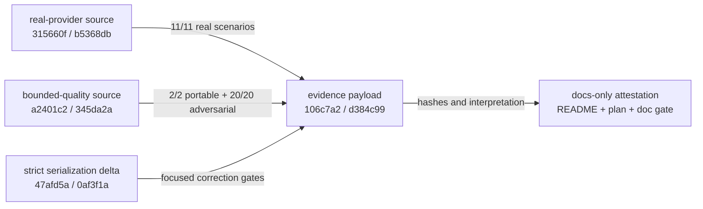

# Phase 2 evidence index

This directory publishes the bounded proof for the Beads tracker integration.
It separates measured machine facts, human interpretation, limitations, and the
commit that introduced the payload.

## Immutable payload

| File | Purpose |
|---|---|
| [`qualification-evidence.json`](qualification-evidence.json) | Byte-for-byte copy of the admissible real-provider schema-1 artifact |
| [`campaign-census.json`](campaign-census.json) | Exact portable, adversarial, quality, real-provider, gate, and hosted-baseline ledger |
| [`results.md`](results.md) | Product-claim to machine-test mapping, including superseded attempts |
| [`limitations.md`](limitations.md) | Qualified boundaries and explicit non-claims |
| [`SHA256SUMS`](SHA256SUMS) | SHA-256 manifest for the four payload files above |

The payload commit is:

```text
commit: 106c7a2016bfade66d7b4e93592da8b7b81259a6
tree:   d384c99d971a3b1545f8b28d84ea629793742e03
```

This index and the repository documentation form the following docs-only
attestation. That two-step structure avoids asking an evidence file to predict
the commit that will contain itself.

Verify the payload bytes:

```bash
(cd docs/phase2-evidence && sha256sum --check SHA256SUMS)
git show --stat 106c7a2016bfade66d7b4e93592da8b7b81259a6
```

## Provenance layers

Qualification is attached to tested source, not inherited by directory
proximity.



- Real-provider source commit:
  `315660fcabc0a72c538934a326748a09600afb36`; tree
  `b5368db98c0a2270fc53bcb741635d182bb10e20`.
- Clean bounded-quality source commit:
  `a2401c2e8723dc4ea21a01a61da08311f5330d01`; tree
  `345da2a489e2de26d5d8e2bfa23fe12d93d0dbb4`.
- Strict serialization correction commit:
  `47afd5ada9fb6c621fc5b64f82fccd1f68a4465d`; tree
  `0af3f1ad5d67ebdb759f37a0907aebd3a0682ca2`.

A later commit does not inherit any of those verdicts merely because it carries
these files. Changes to product, provider, protocol, qualification, or authority
code require a newly frozen candidate and new evidence.

## WP11 closeout attestation

The documentation payload was subsequently exercised as part of the repository's
source-bound quality campaign. The first clean attempt at docs attestation commit
`6985cec1f139504f067f439b4ddc709482ded5ee` correctly failed the architecture
census: all four new documentation tests passed, but the exact campaign manifest
had not registered them. That failure was not relabeled as a pass.

Commit `8fbb9d9f1b9277b7f2ad1b93d8dce901c8cdac4e`, tree
`3611d0bc8e51aa9ee3c6f2c977b9b15eb417d6b9`, added exactly those four census
entries and a removal mutant for each. A clean `make quality` run bound to that
identity then recorded:

| Campaign/profile | Verdict | Duration |
|---|---:|---:|
| provider portable | pass | 169 ms |
| provider adversarial | pass | 263,850 ms |
| provider bounded | pass | 264,080 ms |
| acceptance | pass | 21,150 ms |
| architecture, including the WP11 documentation gate | pass | 9,727 ms |
| scope | pass | 1,494 ms |
| quality | pass | 32,466 ms |

That clean run also passed build, race, vet, static analysis, module
verification, and vulnerability scanning. It qualifies the repository-level
composition at `8fbb9d9`; it does not replace or broaden the earlier
real-provider tuple recorded in `qualification-evidence.json`. This section is a
following docs-only attestation and is intentionally outside `SHA256SUMS`; the
four immutable payload files and payload commit remain unchanged.

## Qualified tuple

```text
Beads executable: 1.2.2
source tag commit: 6c124203e771433a3550c348771a5b5e27fd3c21
JSON envelope:    BD_JSON_ENVELOPE=1
schema_version:   1
integration:      argv-only documented JSON CLI
binary SHA-256:   0c9990691b3b574d4772c0a9fed260769d68af57eb8072ee2a60ff0b619c7bb6
```

The real artifact ran from 2026-08-26T18:12:16.289887399Z through
2026-08-26T18:19:09.579949867Z on Linux/amd64. It records 11 expected, 11
started, 11 terminal, 11 passed, zero failed, 23 authority audits, and zero
authority-invariant failures.

## Reproduce the portable proof

After `go mod download`, these commands need no Beads installation or network:

```bash
artifact_dir="$(mktemp -d /tmp/spec-kitty-phase2-portable.XXXXXX)"
make beads-contract ARTIFACT_DIR="$artifact_dir"
make quality ARTIFACT_DIR="$artifact_dir"
go test ./internal/architecture -run 'BeadsDocumentation|Phase2Evidence' -count=10
```

Compare the generated `*.report.json` and `*.campaign.json` files with the
censuses, source binding, and durations in `campaign-census.json`.

## Reproduce the real-provider proof

Real qualification intentionally has stronger prerequisites. Use the reviewed
installer, an isolated temporary provider root, a pinned disposable Dolt server,
and an offline Linux network namespace. The authoritative orchestration is
[`../../.github/workflows/beads-qualification.yml`](../../.github/workflows/beads-qualification.yml),
which passes an absolute verified Beads path, installer identity, server tuple,
and `OFFLINE_ENFORCED=linux-network-namespace` to `make beads-qualification`.

Do not weaken the target to accept an arbitrary PATH binary or a network-enabled
run. Missing prerequisites must produce `non_admissible`, not a partial pass.

## Privacy and publication

The published payload excludes credentials, raw environment dumps, absolute home
paths, descriptions, criteria text, comment bodies, arbitrary stderr, raw test
event streams, provider databases, and backup contents. Workspace convergence
was asserted during the real run, but schema 1 did not retain the randomized
fixture's `ws1:` digest; that publication gap is explicit in `limitations.md` and
`campaign-census.json` rather than repaired with a fabricated value.
