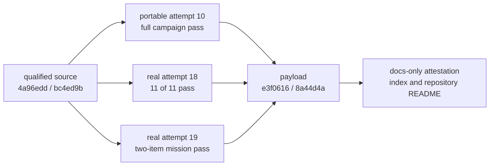

# Phase 3 evidence index

This directory publishes the source-bound qualification record for the
software-development mission method. It separates the tested implementation,
immutable payload, documentation attestation, failed attempts, and explicit
non-claims.

## Immutable payload

| File | Purpose |
|---|---|
| [`qualification-evidence.json`](qualification-evidence.json) | Bounded machine summary of source, host, profiles, scale proofs, provider evidence, gates, and privacy |
| [`campaign-census.json`](campaign-census.json) | Exact profile/test census, artifact digests, and failed/non-admissible attempt ledger |
| [`results.md`](results.md) | FR/NFR/constraint/success-criterion mapping to executable proof |
| [`limitations.md`](limitations.md) | Tested boundary and explicit non-claims |
| [`SHA256SUMS`](SHA256SUMS) | SHA-256 manifest for the four immutable payload files |

The immutable payload commit is:

```text
commit: e3f061660535446b5595b1943d9976c909f8d6cd
tree:   8a44d4a39fc22b2fdd043e3ae2638df967ce8ef5
```

This index and the repository README are a following documentation-only
attestation. They sit outside `SHA256SUMS`, so the payload never has to predict
the commit containing itself.

Verify the payload:

```bash
(cd docs/phase3-evidence && sha256sum --check SHA256SUMS)
git show --stat e3f061660535446b5595b1943d9976c909f8d6cd
```

## Provenance layers



The tested source is commit
`4a96edd13d135497ef0662e25e78d5394cdb32ca`, tree
`bc4ed9bbf7d3255fc7afc0e249672fb8a6020047`. Attempt 10 ran the full portable
ladder against that clean identity. Attempt 18 ran the frozen eleven-scenario
Beads qualification in an offline network namespace. Attempt 19 independently
ran the durable two-item Phase 3 Beads selector. All three passed.

A later commit does not inherit those verdicts. Any product, authority,
provider, protocol, campaign, or evidence-serializer change requires another
frozen source candidate and another qualification record.

## What was proved

- 1,000 deterministic semantic mutations produced 1,000 structured drift
  results and zero silent current-generation changes.
- 100 canonical normalization repetitions produced one byte representation and
  digest.
- 100 two-process finalization races produced exactly one current generation
  with restart-safe replay/conflict losers.
- Nine declared transaction, saga, and postcommit/pre-response boundaries were
  reached and recovered without partial aggregates.
- 100 projection attacks, 100 governance-history reconstructions, and 100 pure
  `next` reads produced zero unauthorized writes or historical reinterpretation.
- The historical 73-test scenario census, architecture/scope mutants, race,
  vet, staticcheck, module, vulnerability, formatting, and build gates passed.
- The exact Beads 1.2.2 tuple passed 11/11 frozen scenarios, 1,000/1,000
  provider-native contention operations, and the durable two-item mission path.

The complete numerical and test-identity record is in
`qualification-evidence.json` and `campaign-census.json`.

## Failure history is part of the proof

Attempts 01–09 were not erased: the ledger retains toolchain/prerequisite
failures, exact-census failures, load-sensitive claimant observations, and the
stale-authority ordering defect. Containment attempts 11–16 remain
non-admissible or diagnostic; attempt 17 is explicitly diagnostic rather than
canonical evidence. Only attempts 10, 18, and 19 satisfy their stated pass
contracts.

Raw test streams, provider databases, Dolt logs, temporary SQLite files,
environment state, and authored provider bodies remain outside the repository.
The payload includes only bounded safe summaries and selected artifact digests.

## Reproduce portable evidence

After modules are available, these commands run without Beads or network:

```bash
artifact_dir="$(mktemp -d /tmp/go-kitty3-phase3.XXXXXX)"
make mission-contract ARTIFACT_DIR="$artifact_dir"
make mission-acceptance ARTIFACT_DIR="$artifact_dir"
make mission-adversarial ARTIFACT_DIR="$artifact_dir"
make full-campaign ARTIFACT_DIR="$artifact_dir"
```

For the PR-equivalent bounded path:

```bash
artifact_dir="$(mktemp -d /tmp/go-kitty3-quality.XXXXXX)"
make quality ARTIFACT_DIR="$artifact_dir"
```

Real-provider reproduction requires the exact reviewed Beads installer identity,
binary digest, Dolt tuple, and offline namespace described by
[`../../.github/workflows/beads-qualification.yml`](../../.github/workflows/beads-qualification.yml).
Missing any prerequisite must remain `non_admissible`.

## Publication privacy

The payload contains no absolute home path, credential, environment dump,
private transcript, raw provider database, unrestricted stderr, or raw test
stream. Missing durations and hosted measurements are `null` or pending rather
than rewritten as zero.
