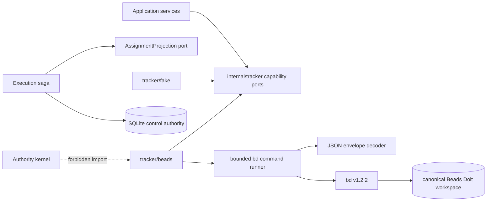
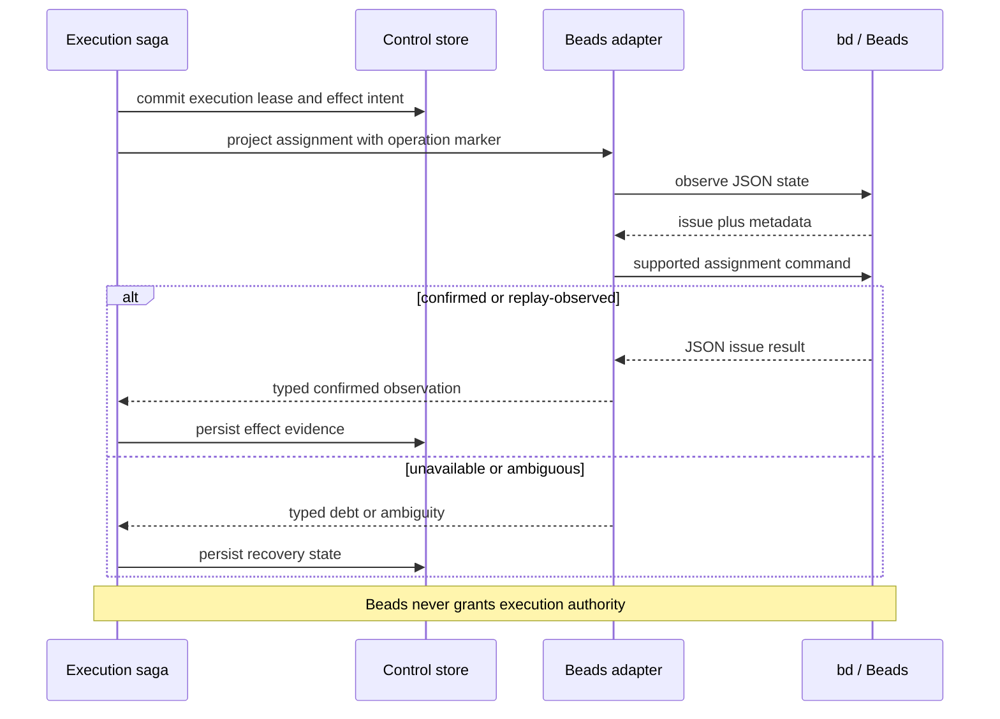

# Implementation Plan: Beads Tracker Integration

**Branch**: `feat/beads-tracker-integration` | **Date**: 2026-08-26 | **Spec**: [spec.md](spec.md)  
**Input**: Phase 2 tracker-substrate specification in `kitty-specs/beads-tracker-integration-01M0YG7E/spec.md`

## Summary

Implement Beads v1.2.2 as the first production tracker adapter without making it a mission engine. The adapter invokes only the documented `bd --json` automation protocol with schema envelopes enabled, publishes exact capabilities, translates provider state into narrow tracker ports, and leaves all execution/review/integration decisions in the existing authority kernel.

The implementation proceeds as a vertical slice rather than a universal connector framework:

1. extend the provider-neutral tracker contract with small capability interfaces;
2. build a bounded, cancelable JSON command transport and protocol decoder;
3. discover one explicit canonical Beads workspace shared across worktrees;
4. translate catalog, dependency, criteria, comment, and assignment observations;
5. preserve saga correctness by refusing conditional mutations Beads cannot prove;
6. run portable conformance against the fake provider and an adversarial command harness;
7. qualify the same behavior against a checksum-verified Beads v1.2.2 binary and temporary Dolt workspace;
8. publish CI evidence and correct the project documentation.

Beads remains an external executable, not a Go module dependency. No Beads internal package or Dolt schema becomes part of this module.

## Engineering Alignment

- **Authority invariant**: tracker facts may describe or project work, but cannot mint a run, lease, fence, workspace, review verdict, acceptance verdict, or integration result.
- **Mutation invariant**: an adapter reports the guarantee the provider actually supplies. Local serialization or pre-read comparison never becomes provider-side CAS.
- **Compensation invariant**: recovery mutates external state only if expected revision, value, and operation marker are proven at the mutation boundary. Otherwise it records a typed reconciliation conflict.
- **Identity invariant**: Spec Kitty `WorkID` remains durable; Beads IDs are external mappings.
- **Workspace invariant**: all worktrees resolve one explicit Beads workspace; no implicit nested discovery or per-lane database is allowed.
- **Protocol invariant**: production consumes only versioned JSON stdout/stderr with bounded process execution; human formatting is never parsed.
- **Delivery invariant**: every provider fault scenario carries the Phase 1 universal authority assertions and stale-process probe.

## Technical Context

**Language/Version**: Go 1.26 module; Beads CLI v1.2.2; Beads JSON envelope schema 1  
**Primary Dependencies**: Go standard library process/JSON/crypto primitives; existing `modernc.org/sqlite` control-store adapter; external checksum-verified `bd` executable for real-provider qualification  
**Storage**: Existing SQLite control store remains authoritative for runs/effects; Beads uses a separately owned Dolt workspace; fake tracker uses its durable test file  
**Testing**: Go unit and contract tests, adversarial subprocess harness, portable fake-provider conformance, real Beads temporary-workspace integration, repeated authority/fault scenarios, race detector, architecture mutant controls, scheduled qualification evidence  
**Target Platform**: First-release Linux/amd64 local filesystem authority; code remains portable across Go-supported POSIX hosts where Beads v1.2.2 is available  
**Project Type**: Single Go command/module organized by product capabilities and adapter tiers  
**Performance Goals**: healthy local preflight p95 <= 1 s/100 runs; warm single-item read p95 <= 500 ms/200 reads; PR quality campaign <= 10 min; 1,000 concurrent supported-mode creates with zero identity collisions  
**Constraints**: offline after installation; default command timeout <= 30 s; bounded stdout/stderr; no direct Beads internal imports or Dolt SQL; no human-output parsing; no false CAS; no unsolicited hooks/agent-file/Git changes  
**Scale/Scope**: one machine/filesystem authority, one canonical Beads workspace per project, two or more local agent processes/worktrees, six provider capability families, initial compatibility pinned to v1.2.2/schema 1

## Charter Check

*Pre-research gate: PASS. Post-design gate: PASS.*

| Directive | Design response | Gate |
|---|---|---|
| 001 Architectural integrity | Extend the Phase 1 tier policy with a slash-bounded Beads adapter package and retain rejecting kernel-import mutants. Capability interfaces stay in `internal/tracker`. | Pass |
| 010 Specification fidelity | Every implementation concern maps to explicit FR/NFR/constraint IDs; unsupported safe compensation remains a required result, not a hidden compromise. | Pass |
| 024 Locality of change | Production changes are confined to tracker contracts, the Beads adapter, composition wiring needed for qualification, architecture policy, and existing test campaign registration. | Pass |
| 028 Search discipline | Existing contracts, campaign manifests, Beads v1.2.2 documentation/source, and donor concepts were inspected before proposing new types. | Pass |
| 030 Test and typecheck | The existing quality ladder is extended with bounded provider contract tests and scheduled real-provider qualification; race, vet, staticcheck, govulncheck, format, and builds remain mandatory. | Pass |

No charter violation requires complexity justification. The project charter is present as `.kittify/charter/charter.yaml`; there is no generated `charter.md`.

## Architecture

### Capability topology



The composition root selects adapters; authority packages depend only on `internal/tracker`. `internal/tracker/beads` may contain nested protocol/test-harness packages and is classified as an adapter prefix. It has no Go dependency on the Beads module.

### Port decomposition

Avoid a single interface that forces every tracker to impersonate Beads:

- `Catalog`: create, read, update provider-owned work facts and stable mappings;
- `Graph`: read/write blocking dependencies and expose provider readiness diagnostically;
- `Discussion`: append/read operation-attributed comments;
- `AssignmentProjection`: observe assignment, project ownership, and attempt safe compensation according to declared guarantees;
- `Inspector`: identity, compatibility, workspace, mode, health, and capability reporting;
- `Exporter`: non-destructive export/backup diagnostics.

The existing narrow `Provider` remains source-compatible while it is decomposed or embedded from these smaller interfaces. Application services request the minimum interface they need.

### Process boundary

Every invocation is built from a closed command vocabulary. Callers pass typed requests, never raw argument fragments. The runner:

1. resolves and pins an absolute executable path;
2. sets an explicit working directory and canonical `BEADS_DIR`;
3. sets `BD_JSON_ENVELOPE=1`, `BD_NON_INTERACTIVE=1`, and a sanitized environment;
4. supplies `--json` to supported commands;
5. captures stdout and stderr through independent bounded buffers;
6. terminates the process group on context cancellation or timeout;
7. decodes exactly one schema envelope from stdout, or one documented JSON error from stderr;
8. returns duration, exit classification, decoded value, and ambiguity information without logging payload bodies.

Commands that emit JSONL, such as export, use a separate streaming decoder with per-record and aggregate limits; they are never fed into the single-envelope decoder.

### Observation revision

Beads timestamps are not sufficient revision tokens. The adapter creates a deterministic 64-bit observation token from a versioned canonical encoding of all known provider-owned fields relevant to the operation: issue ID, title, description, acceptance, dependency edges, assignee, selected namespaced metadata, comments/markers when requested, and timestamps. Sorting rules make maps, labels, dependencies, and comments deterministic.

This token detects drift and supports replay classification. It does **not** claim to guard a later Beads mutation. Capability reporting distinguishes:

- observation comparison;
- atomic claim;
- arbitrary guarded update;
- attribution-safe compensation.

For v1.2.2, observation comparison and atomic claim are supported; arbitrary guarded update and attribution-safe arbitrary compensation are unsupported.

### Assignment and recovery



Compensation starts with a fresh observation. If the provider lacks a conditional mutation that can enforce the expected observation at write time, the adapter returns `safe_compensation_unsupported`; it does not issue `bd update` to clear assignment. This may leave a stale visual projection, which is recorded as reconciliation debt. Direct human changes always win over automated cleanup.

### Concurrency modes

- **Embedded**: Beads documents single-writer file locking. Read operations may proceed; adapter writes are serialized across Spec Kitty processes with a lock rooted beside the canonical binding. Preflight reports that direct external writers are outside this serialization boundary.
- **Server**: concurrent provider writes are allowed only after health/capability qualification proves the configured server mode.
- **Mismatch**: if two worktrees resolve different canonical workspace identities, all mutating capability calls fail before spawning `bd`.

Neither mode changes Spec Kitty lease uniqueness. Beads atomic claim is useful visible coordination and a cross-check only.

### Evidence and rollout

The normal PR campaign uses the fake provider and adversarial subprocess harness, so contributors do not need Beads. A dedicated `beads` campaign builds or downloads the pinned release using an allowlisted SHA-256, initializes only temporary stealth/non-interactive data, runs real-provider conformance, and emits redacted JSON evidence. It runs in the scheduled workflow and is available manually; a bounded real-provider smoke may join PR CI only if hosted timing remains below the 10-minute budget.

There is no automatic activation or data migration in this mission. The adapter is production-quality and selectable, but changing an existing project's tracker binding remains an explicit operator action.

## Project Structure

### Documentation (this mission)

```text
kitty-specs/beads-tracker-integration-01M0YG7E/
├── plan.md
├── research.md
├── data-model.md
├── quickstart.md
├── contracts/
│   ├── tracker-capabilities.md
│   ├── beads-json-protocol.md
│   └── qualification-evidence.schema.json
└── tasks/                         # created only by /spec-kitty.tasks
```

### Source Code (repository root)

```text
internal/
├── tracker/
│   ├── provider.go               # existing assignment contract and errors
│   ├── capabilities.go           # small provider-neutral ports and values
│   ├── conformance/              # reusable contract assertions
│   ├── fake/                     # durable portable reference provider
│   └── beads/
│       ├── adapter.go            # capability composition
│       ├── binding.go            # executable/workspace/version resolution
│       ├── command.go            # closed command runner
│       ├── protocol.go           # envelope/error/JSONL decoding
│       ├── revision.go           # canonical observation digest
│       ├── catalog.go
│       ├── graph.go
│       ├── discussion.go
│       ├── assignment.go
│       ├── inspect.go
│       ├── export.go
│       └── testdata/             # dishonest executable fixtures
├── architecture/
│   ├── policy.go                 # adapter-prefix classification
│   └── policy_test.go            # positive and rejecting mutants
├── execution/                    # only typed diagnostic/capability adaptation
├── scenario/                     # provider fault + universal-invariant cases
└── testcampaign/
    ├── manifest.go               # bounded and real-provider profiles
    └── cmd/campaign/

.github/workflows/
├── quality.yml
└── full-campaign.yml             # installs/verifies pinned provider for scheduled qualification

docs/
├── TECHNICAL_PROJECT_PLAN.md
└── phase2-evidence/

Makefile
README.md
```

**Structure Decision**: Extend the existing single-module capability layout. Provider-neutral types stay in `internal/tracker`; all Beads protocol knowledge stays under the slash-bounded `internal/tracker/beads` adapter prefix. No generic connectors substrate, new ledger, protobuf layer, service process, or provider SDK is introduced.

## Complexity Tracking

No charter violations are accepted. The subprocess protocol layer is necessary because Beads v1.2.2 exposes no supported public Go package; directly importing internal code or querying Dolt would be less stable and would violate the product boundary.

## Implementation Concern Map

### IC-01 — Tracker capability vocabulary

- **Purpose**: Define small portable ports, capability levels, opaque observations, stable mappings, structured criteria, diagnostics, and safe-compensation outcomes.
- **Relevant requirements**: FR-001, FR-006–FR-017; C-001, C-004, C-007
- **Affected surfaces**: `internal/tracker/provider.go`, new `internal/tracker/capabilities.go`, fake-provider implementation and tests
- **Sequencing/depends-on**: none
- **Risks**: A Beads-shaped fat interface or a silent source incompatibility would leak provider semantics; conformance must allow capability absence.

### IC-02 — Architecture policy evolution

- **Purpose**: Admit the Beads adapter prefix while proving the kernel cannot import it or acquire provider-specific semantics/dependencies.
- **Relevant requirements**: FR-021, NFR-008; C-002, C-008
- **Affected surfaces**: `internal/architecture/policy.go`, `internal/architecture/policy_test.go`, campaign census
- **Sequencing/depends-on**: IC-01
- **Risks**: Exact-package classification would reject nested protocol packages; a broad prefix could overlap `internal/tracker` and create ambiguous classification.

### IC-03 — Bounded JSON command protocol

- **Purpose**: Execute only supported `bd` commands with deterministic environment, cancellation, output bounds, envelope/error decoding, and ambiguity classification.
- **Relevant requirements**: FR-002, FR-003, FR-016, FR-017; NFR-003, NFR-007, NFR-012; C-002, C-003
- **Affected surfaces**: `internal/tracker/beads/command.go`, `protocol.go`, dishonest executable fixtures
- **Sequencing/depends-on**: IC-01, IC-02
- **Risks**: stderr warnings may coexist with success; killing only the parent process can leak children; export JSONL is a different wire shape.

### IC-04 — Binding, discovery, and health

- **Purpose**: Resolve a pinned executable and one canonical workspace, negotiate version/schema/mode/capabilities, and refuse unsafe mutation before side effects.
- **Relevant requirements**: FR-003–FR-006, FR-017, FR-019; NFR-001, NFR-011; C-003, C-005, C-006
- **Affected surfaces**: `internal/tracker/beads/binding.go`, `inspect.go`, configuration values, worktree integration tests
- **Sequencing/depends-on**: IC-03
- **Risks**: implicit Beads discovery can bind a nested database; health commands may include Git/hook warnings that are diagnostic but not blockers.

### IC-05 — Catalog identity and structured work

- **Purpose**: Translate stable work mappings, human briefs, structured criteria, content-derived revisions, and provider-owned updates.
- **Relevant requirements**: FR-007–FR-009, FR-013, FR-024; NFR-002, NFR-006
- **Affected surfaces**: `internal/tracker/beads/catalog.go`, `revision.go`, metadata codecs, fake/provider conformance
- **Sequencing/depends-on**: IC-01, IC-03, IC-04
- **Risks**: metadata replacement can erase human/provider keys; timestamp-only revisions miss ties; ambiguous create can duplicate work without mapping lookup.

### IC-06 — Graph and discussion

- **Purpose**: Translate blocking dependencies, provider readiness diagnostics, and operation-attributed idempotent comments without adopting Beads workflow state.
- **Relevant requirements**: FR-010, FR-011, FR-016; C-001, C-008
- **Affected surfaces**: `internal/tracker/beads/graph.go`, `discussion.go`, portable conformance suite
- **Sequencing/depends-on**: IC-05
- **Risks**: dependency direction is easy to invert; Beads comments have no native conditional append, so idempotency requires marker observation and honest ambiguity handling.

### IC-07 — Assignment projection and reconciliation

- **Purpose**: Adapt the existing tracker saga to explicit provider guarantees, observe retries, preserve human edits, and safely refuse unsupported compensation.
- **Relevant requirements**: FR-012–FR-019, FR-022; NFR-004, NFR-005, NFR-009; C-004, C-012
- **Affected surfaces**: `internal/tracker/beads/assignment.go`, `internal/execution/external_effect.go`, control-store effect diagnostics, recovery tests
- **Sequencing/depends-on**: IC-01, IC-03–IC-05
- **Risks**: the current `CompareAndSetAssignment` name overstates Beads guarantees; compatibility adaptation must not weaken fake-provider CAS or mark unsafe cleanup complete.

### IC-08 — Adversarial and real-provider qualification

- **Purpose**: Prove portable behavior against fake, dishonest subprocess, and real Beads under concurrency, ambiguity, contention, schema skew, and direct human change.
- **Relevant requirements**: FR-018–FR-023; NFR-004–NFR-014
- **Affected surfaces**: `internal/tracker/conformance`, Beads integration tests, `internal/scenario`, `internal/testcampaign/manifest.go`, `Makefile`, workflows
- **Sequencing/depends-on**: IC-02–IC-07
- **Risks**: a truthful fake cannot prove stale/wrong responses; real-provider installation can make PR CI slow or supply-chain-unsafe; every registered test changes exact campaign censuses.

### IC-09 — Operations and technical documentation

- **Purpose**: Publish installation, compatibility, backup/export, recovery, capability limits, evidence, and the corrected CLI-vs-Go-API decision.
- **Relevant requirements**: FR-020, FR-023, FR-024; NFR-011–NFR-015
- **Affected surfaces**: `README.md`, `docs/TECHNICAL_PROJECT_PLAN.md`, `docs/phase2-evidence/`, `kitty-specs/beads-tracker-integration-01M0YG7E/quickstart.md`
- **Sequencing/depends-on**: IC-04–IC-08
- **Risks**: documentation must distinguish export/interchange from full Dolt backup and must not promise production activation that this mission does not perform.

## Delivery Strategy

The first executable increment is intentionally narrow: protocol runner + binding preflight + read one issue from a fake `bd` process, with architecture mutants. Subsequent increments add real work mapping, graph/comments, assignment/reconciliation, and finally real-provider qualification. Every increment must include a working scenario; package scaffolding alone is not progress.

The mission is ready for task slicing when:

- all contracts below are internally consistent;
- decision verification is clean;
- no plan statement changes a functional requirement;
- the safe-compensation refusal is represented as an implementable typed outcome;
- the real-provider campaign is optional for ordinary unit development but mandatory for mission acceptance.
