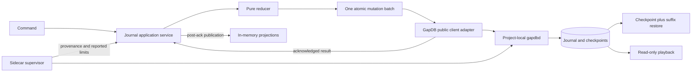
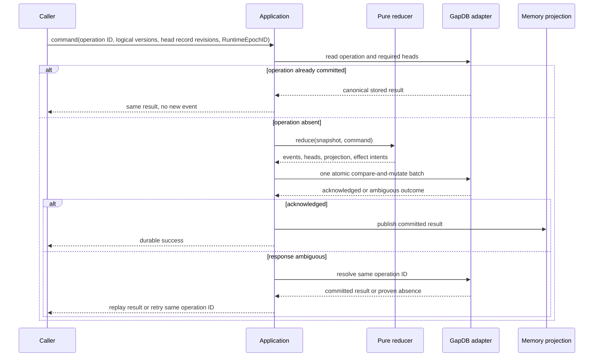

# Implementation Plan: GapDB Control-Journal Proving Ground

**Mission**: `gapdb-control-journal-proving-ground-01M18EVR`

**Status**: Planning artifact; no production capability is claimed

**Planning branch**: `kitty/mission-gapdb-control-journal-proving-ground-01M18EVR`

**Final merge target**: `main`

## 1. Purpose and falsification target

This mission builds the smallest executable proving ground capable of disproving
the proposed production authority runtime. It must show, with one attributable
campaign, that a pure Go control journal can:

1. accept one logical command as one durable GapDB batch;
2. publish no success before that batch is acknowledged;
3. resolve a lost response without inventing a second command identity;
4. restore from a valid checkpoint plus an ordered event suffix;
5. reconstruct playback without calling an adapter or writing state;
6. preserve Spec Kitty's workspace, review, tracker, and serialized-integration
   laws under concurrent processes and injected failures; and
7. emit evidence sufficient for independent adoption review.

The primary falsification target is the boundary where process lifetime,
filesystem state, Git state, tracker state, and durable authority disagree.
Passing unit tests without passing the combined campaign is not admission
evidence.

## Technical Context

**Language/Version**: Go 1.26 application module; qualification and admitted sidecar build pinned to Go 1.26.7  
**Primary Dependencies**: Go standard library; pinned `github.com/spec-kitty/gapdb` public client/module; `golang.org/x/sys` for Linux process identity; `github.com/santhosh-tekuri/jsonschema/v6` for contract validation; existing Spec Kitty execution, workspace, handoff, review, integration, workgraph, tracker, and Git capability packages  
**Storage**: GapDB protocol/storage v1 through one exact project-local external `gapdbd`; in-memory projections rebuilt from the versioned control journal; existing SQLite code is comparison-only and is neither fallback nor dual truth  
**Testing**: Go unit/property tests, `go test -race`, closed architecture guards and mutants, real public-client sidecar scenarios, stable fault injection, semantic evidence fixtures, and one combined source-bound campaign  
**Target Platform**: Linux/amd64, one host and one local filesystem authority; remote agents cross a future orchestrator boundary rather than opening the store  
**Project Type**: Go CLI/runtime proving slice with a pure control-journal kernel, outbound GapDB/lifecycle adapters, and a local qualification command  
**Performance Goals**: Memory-first live reads; deterministic bounded restore of at most 16,000 events/48 MiB in 32 scan pages with two stale-snapshot restarts; product limits remain strictly below admitted GapDB ceilings  
**Constraints**: One logical command is one durable batch; no current-batch revision prediction; no SQLite fallback, PATH discovery, CLI-prose parsing, internal GapDB server import, workspace transfer, same-contributor review, or unbounded replay  
**Scale/Scope**: M1 proves two concurrent work items, exactly 14 external scenarios, five GapDB-specific cuts, eight named reliability campaigns, 19 mutants, and one ordered two-agent torture trial; it does not authorize full production migration

### 2.1 Admitted GapDB tuple

Every implementation, qualification, and reproduction run uses this immutable
tuple:

| Field | Required value |
|---|---|
| Repository | `https://github.com/spec-kitty/gapdb.git` |
| Source revision | `ff3dd478f87c6b4cbb1dcc168562f99879ba8c25` |
| Source tree | `64ada3cd6328aca73ef902e4ab9fe0405823841c` |
| Release tag | None; admission uses the pseudo-version and exact source identities |
| Go module | `github.com/spec-kitty/gapdb` |
| Module version | `v0.0.0-20260824033134-ff3dd478f87c` |
| Module sum | `h1:kmYoO7Q3PlsNM6M0dSYtuJJSQSlbflC2wz3d/Bek2L0=` |
| go.mod sum | `h1:8xNZ3k+SQIqcxLkS8bjbooOAv9xzZcbg5arjKaV6fcQ=` |
| Sidecar install recipe | `GOBIN=<project-bin-directory> CGO_ENABLED=0 GOTOOLCHAIN=go1.26.7 go install -trimpath github.com/spec-kitty/gapdb/cmd/gapdbd@v0.0.0-20260824033134-ff3dd478f87c` |
| Artifact kind | `pinned_module_install` |
| Sidecar SHA-256 | `62219cfddbc72467bd491e8ca2309b49cfc935b68df51b5500b31c51c4c84a1e` |
| Sidecar size | `5300621` bytes |
| Reproducibility | 2 builds, 2 byte-identical results |
| Wire protocol | `1` |
| Wire reference SHA-256 | `cd08e19252628a1cbfe5bd43018caae86569e041dc01f9d4472dc2eae72389c2` |
| Storage protocol | `1` |
| Storage reference SHA-256 | `6d4cca9611e9e272e02d6e566dccc887dacf738c1da8c5d580237f731018295c` |
| Platform | `linux/amd64`, one host and one local-filesystem authority |
| Admission document SHA-256 | `4ddf904a48c83fe343ea9589bdf6ef7108af71b4b8140d76da68abdaf9d5824d` |

`admitted_tuple_sha256` means the SHA-256 of the exact bytes of
`docs/programs/evidence/m1-admission.json`, with no JSON reserialization or
newline normalization. Runtime and evidence load tuple fields by their JSON
pointers from those verified bytes. Generated JSON artifacts are encoded once
with the canonical JSON v1 rules in the control-journal contract and hashed over
those exact bytes; copied files are hashed over their exact stored bytes.

The project invokes the digest-named binary by absolute path. It never searches
`PATH`, imports a GapDB internal/server package, parses CLI prose, or falls
back to SQLite.

### 2.2 Current code retained

The proving ground composes existing domain behavior rather than rewriting it:

- `internal/execution`: actor/process/run/lease/fence authority rules;
- `internal/workspace`: lease-scoped worktrees and quarantine;
- `internal/handoff`: immutable candidate evidence;
- `internal/review`: contributor/reviewer independence;
- `internal/integration`: repository fencing and serialized integration;
- `internal/workgraph`: immutable executable generations and reconciliation;
- `internal/tracker`: provider-neutral work and attribution-safe compensation;
- `internal/gitrepo`: observable Git operations; and
- `internal/architecture`: enforceable dependency policy.

Existing SQLite storage code is historical comparison material only. Its
`controlstore.Settings`, table model, and `sqlite.Store` shape are not ports,
interfaces, or compatibility targets for this mission.

### 2.3 New package boundaries

| Package | Ownership |
|---|---|
| `internal/controljournal` | Versioned command, preallocated event identity, operation, aggregate-version, opaque RuntimeEpochID, checkpoint, and error contracts |
| `internal/controljournal/reducer` | Pure deterministic state transition and invariant checks |
| `internal/controljournal/checkpoint` | Canonical checkpoint encode, hash, validate, and selection policy |
| `internal/controljournal/playback` | Read-only deterministic reconstruction and query projection |
| `internal/controljournal/application` | Validate command, derive one commit batch, acknowledge, and publish |
| `internal/controlstore/gapdb` | Narrow outbound adapter using only GapDB's public Go client |
| `internal/sidecar/gapdb` | Exact-binary verification, process identity, startup, health, shutdown, and orphan handling |
| `internal/provingground` | M1 composition root joining the journal to retained domain services |
| `internal/testcampaign/m1` | Fault harness, 14 scenarios, ordered torture trial, and evidence emission |
| `cmd/spk-m1-proving-ground` | Local qualification entry point; not a production CLI commitment |

The GapDB public module import allowlist contains exactly two packages:
`internal/controlstore/gapdb` and `internal/sidecar/gapdb`. An import from
any other package fails the architecture test. The substring/package path
`internal/server` is forbidden everywhere, including the two allowlisted
packages. The journal, reducer, checkpoint, playback, application, and retained
kernel packages therefore cannot acquire GapDB dependency gravity. The adapter
exposes journal-shaped primitives rather than tables: atomic
compare-and-mutate, exact key reads, bounded prefix scans, and
health/config inspection.

The architecture policy gains negative dependency checks and executable mutant
controls. A mutant must prove failure if any package outside the exact
`internal/controlstore/gapdb` and `internal/sidecar/gapdb` allowlist imports
the public GapDB module, if a `PATH` lookup is introduced, or if
`internal/server` is referenced anywhere.

## 3. Runtime architecture



The GapDB adapter is an outbound mechanism, not the authority model. Authority
is the ordered event history and the pure reducer that interprets it.

## 4. Canonical journal model

### 4.1 Namespace and keys

All persisted M1 product keys use exactly one mission-scoped prefix:
`spk/v1/<project-id>/<mission-id>/...`. ProjectID prevents cross-project
collision; MissionID bounds this proving slice and permits deterministic
mission deletion/export without claiming a future cross-mission production
layout. Components are normalized, length checked before concatenation, and
never contain `/`, NUL, `.`, or `..`. No leading-slash, `/v1/projects`,
project-only, table-shaped, or alternate compatibility key form is accepted.

| Purpose | Key form |
|---|---|
| Database binding | `spk/v1/<project-id>/<mission-id>/binding` |
| Immutable runtime epoch | `spk/v1/<project-id>/<mission-id>/runtime/epochs/<runtime-epoch-id>` |
| Current runtime binding | `spk/v1/<project-id>/<mission-id>/runtime/current` |
| Command receipt/result | `spk/v1/<project-id>/<mission-id>/operations/<operation-id>` |
| Journal event | `spk/v1/<project-id>/<mission-id>/journal/<event-id>` |
| Aggregate head | `spk/v1/<project-id>/<mission-id>/heads/<aggregate-kind>/<aggregate-id>` |
| Checkpoint selector | `spk/v1/<project-id>/<mission-id>/checkpoint-head` |
| Checkpoint blob | `spk/v1/<project-id>/<mission-id>/checkpoints/<checkpoint-id>` |
| Deferred effect intent | `spk/v1/<project-id>/<mission-id>/effects/<effect-id>/intent` |
| Effect attempt | `spk/v1/<project-id>/<mission-id>/effects/<effect-id>/attempts/<attempt-id>` |
| Effect observation | `spk/v1/<project-id>/<mission-id>/effects/<effect-id>/observations/<observation-id>` |

An event envelope contains a preallocated EventID, operation and aggregate
identity, opaque RuntimeEpochID, zero-based `event_index`, positive
`event_count`, versioned payload/observations, and relevant
actor/process/run/lease-generation/fence/doctrine/profile provenance. It does
not contain or predict the current batch's GapDB revision. IDs and timestamps
are inputs to the reducer; the reducer does not read clocks, random sources,
environment, network, Git, tracker, filesystem, or GapDB.

GapDB returns each stored event's authoritative `Record.Revision`. Replay
orders by `(Record.Revision, event_index, EventID)` and rejects mixed-revision,
missing, duplicate, or non-consecutive operation groups. The operation commit
revision likewise comes from the stored operation record's metadata after
acknowledgement or read reconciliation; it is never precommitted in its value.

### 4.2 One logical command, one durable batch



The batch includes the operation record, all events, affected aggregate heads
with per-aggregate projection digests, and deferred effect intents. A due
prior-prefix checkpoint blob and its selector are also included in the same
batch. The implementation must
not split this batch for convenience. No observer sees a successful result,
updated projection, or runnable external effect before the batch acknowledgement
or resolution proves the operation committed.

Operation identity is stable across transport retries. If a response is lost,
resolution first reads `operations/<operation-id>`. A matching canonical
command hash returns the stored result; a different hash is an identity
collision and fails closed; proven absence permits retry with the same ID.
Uncertainty never creates a new operation ID.

### 4.3 Distinct authority coordinates

Four coordinates must never be collapsed:

- `RuntimeEpochID` is an opaque identity for one admitted host lifetime;
- aggregate logical version is product state stored in each aggregate head;
- lease generation identifies replacement order within work authority; and
- fence token protects Spec Kitty authority operations, not POSIX writes.

Every aggregate mutation supplies its exact expected logical version and the
observed GapDB `Record.Revision` used for that head's CAS. Omission is a
validation failure; the adapter may not fill either from a fresh read.
Compare-and-mutate checks and projection digests are scoped to affected
aggregates, so unrelated work can commit concurrently. A global projection or
epoch CAS is forbidden. A canonical whole-product digest is computed by a
stable fold of all restored aggregate heads for restore/playback comparison and
evidence; it is not a per-command mutation.

Startup durably inserts a fresh RuntimeEpoch record and updates the single
`runtime/current` binding before admission, including after clean restart.
Ordinary commands pin that current opaque ID but do not mutate the binding.
Run capsules conform to `contracts/authority-capsule-v1.schema.json` and carry
RuntimeEpochID, aggregate authority-head Record.Revision, lease generation, and
fence token as separate fields; no generic numeric “epoch” substitutes for
them.
Lease expiry does not advance the host epoch: it journals lease-expiry,
authority, and quarantine transitions. Process A's expired W1 is quarantined;
concurrent Process B retains W2; replacement Process C for Actor A gets W3.
Stale lease-generation/fence/head preconditions prevent Process A from
handoff, review, or integration authority.

## 5. Sidecar lifecycle and provenance

The supervisor owns one project-local sidecar and one project-local data
directory outside Git worktrees. Remote agents must use a future orchestrator
boundary; they do not open this store.

Startup is fail-closed:

1. resolve configured absolute directories and reject symlinks, traversal,
   unsafe ownership, or group/world-writable ancestors;
2. open the digest-named binary without following symlinks;
3. verify regular-file identity, mode, size, and SHA-256 from the held descriptor;
4. execute that same opened object through a descriptor-preserving mechanism
   such as `/proc/self/fd`; if the platform cannot close the
   verify-to-exec race, refuse startup;
5. record host-observed executable device/inode/digest, spawned PID/start time,
   pidfd identity, arguments, data directory, configured daemon socket, tuple,
   and supervisor run;
6. over an actual successful connection to that configured socket, require a
   strict protocol-v1 typed response envelope; compare public `Status`
   database ID, owner PID/start, revisions, limits, and lifecycle; use
   `Health` only for reported subsystem health; and use `DescribeConfig`
   only for reported configuration and limits;
7. treat storage version 1 and its reference digest as pinned admission facts,
   not daemon-reported fields; compare the database binding and recovered bytes
   through the declared storage contract; and
8. atomically publish a signed provenance record only after those checks.

Existing-process attachment opens a pidfd, validates `/proc/<pid>/stat` start
identity, opens and hashes `/proc/<pid>/exe`, and correlates public health with
the Status database/owner fields received through the actual configured-socket
connection. Socket identity is host-observed from the connection, never called
a Status/Health field. Executable/module/build facts are host-proven admission
facts, never called daemon-reported. Any missing or disagreeing observation
refuses attachment. Shutdown signals only the validated pidfd and rechecks
identity; PID reuse cannot target an unrelated process. Orphans that cannot be
proven to be the admitted executable remain untouched and block startup with
operator instructions.

For `GJ-02`, an explicit qualification proxy owns a distinct product-facing
Unix socket and connects to the configured daemon socket. It forwards the
complete typed request, consumes and validates the complete accepted response
from the daemon, then drops the product-facing connection before forwarding
that response. The product reconnects and reconciles through an ordinary public
read of the same OperationID. Provenance records both sockets and the proxy's
source/binary identity. No internal hook, daemon socket destruction, or
fabricated client timeout is admissible.

The lifecycle contract is Linux-first for this proving ground. Unsupported
platforms report a typed qualification refusal rather than silently weakening
the invariant.

## 6. Product budgets and checkpoint policy

The product clamps GapDB below its admitted defaults. Startup compares every
limit using the fields actually supplied by public Status and DescribeConfig; a
lower limit, disagreement, or unreported required field fails closed. Boundary
tests exercise exactly limit, limit plus one, and reported-config mismatch.

| Budget | Product maximum | Admitted GapDB default |
|---|---:|---:|
| Canonical key | 1 KiB | 4 KiB |
| Ordinary value | 256 KiB | 8 MiB |
| Checkpoint value | 4 MiB | 8 MiB |
| Events per command | 128 | constrained by batch |
| Mutations per batch | 256 | 1,024 |
| Raw encoded batch | 6 MiB | 16 MiB |
| Wire frame | 12 MiB | 16 MiB |
| Prefix-scan records per page | 500 | 1,000 |
| Prefix-scan bytes per page | 8 MiB | 16 MiB |
| Concurrent clients | 32 | 256 |

The 256-mutation ceiling reserves capacity for one operation record, 128 events,
32 affected aggregate heads, two checkpoint records, 16 effect intents, and
future envelope overhead. The six-MiB batch and twelve-MiB wire
limits leave encoding and response headroom while allowing a four-MiB
checkpoint.

A checkpoint becomes due after the earliest of 128 accepted commands, 512
events, or 4 MiB of canonical event payload since the previous checkpoint.
When the next command is formed, checkpoint creation deterministically snapshots
the already-accepted prior prefix: its known through-record revision, terminal
EventID, prefix digest, reducer/schema sets, and canonical projection digest.
The checkpoint never claims the forming command's server-assigned revision.
Its bytes and selector are inserted in that next command's atomic batch.

Startup considers newest-to-oldest checkpoint candidates. It hashes each
candidate's complete canonical bytes outside the checkpoint and accepts the
newest whose schema, through-position, selector byte hash, reducer/schema sets,
project/mission identity, projection digest, and journal-prefix commitment
validate. An invalid newest checkpoint is
quarantined as evidence, not silently trusted. The runtime may choose an older
valid checkpoint and replay the suffix only if all deterministic replay bounds
remain satisfied. Otherwise it attempts bounded full-journal replay. If neither
path qualifies, authority remains closed and the operator must preserve the
store, inspect the typed reason, restore an approved backup or increase the
explicit policy through review, then rerun qualification.

Deterministic startup eligibility is capped at 16,000 events, 48 MiB canonical
event bytes, and 32 scan pages of at most 500 records/8 MiB each. At most two
stale-snapshot restarts are allowed before the store is declared unstable and
startup refuses. Wall-clock duration is recorded as an operational SLO but does
not decide deterministic eligibility.

Playback reads stored EventEnvelope plus Record.Revision values through a fixed
through-position, validates the total replay order and hashes,
and reduces into an isolated in-memory value. It imports and calls no GapDB
adapter directly, performs no write, advances no cursor, triggers no effect,
and cannot acquire a lease. The caller supplies an immutable event reader;
tests use an in-memory reader and a panic-on-call adapter spy.

## 7. Cross-domain composition

### 7.1 Tracker reconciliation

Tracker observations enter as versioned facts; they do not become authority by
themselves. A stale or contradictory provider response causes explicit
reconciliation. Compensation executes only when provider revision, expected
value, and operation marker still prove the state belongs to the operation
being compensated. A human edit therefore defeats stale compensation safely.
Provider slowness, outage, stale revisions, and false state are required test
conditions.

### 7.2 Independent review

Candidate handoff freezes commit, tree, workspace generation, run, actor,
process, lease, fence, work revision, and journal through-position evidence. Review
requires an actor distinct from the contributor unless a future explicit
mission policy says otherwise; this mission has no such waiver. A different
process with the same actor is not independent.

### 7.3 Serialized integration

Accepted candidates may prepare concurrently, but integration is serialized by
repository-scoped authority. Eligibility is checked before acquiring the
repository fence and checked again after acquisition. Branch movement,
candidate mismatch, conflict, or stale review refuses integration. Only a
durably journaled integration result may be reported as success.

## 8. Fault model and qualification

Stable fault IDs are part of the evidence contract:

| ID | Cut |
|---|---|
| `GJ-01` | Before request publication |
| `GJ-02` | After durable acceptance but before client response |
| `GJ-03` | After workspace creation but before durable binding |
| `GJ-04` | After durable binding but before run-capsule response |
| `GJ-05` | After effect intent but before observation |

`GJ-02` must be a real response-loss cut at the public socket after server
acceptance; a client-only fabricated timeout is not admissible.

Required terminal evidence is exact: GJ-01 changes no operation-attributable
record and retry is a first attempt; GJ-02 reconciles one batch/result; GJ-03
quarantines or safely collects the authority-free orphan and retry creates one
authorized workspace; GJ-04 reconstructs the existing lease, binding, and
capsule without a second workspace; GJ-05 observes provider state and records
one attributable outcome without blind repeat or unsafe compensation. Zombie
resume is a separate combined-campaign obligation, not a renamed fault cut.

### 8.1 Fourteen external-adapter scenarios

One clean qualification run executes the exact historical adoption catalog
against the admitted sidecar and public client:

1. `data/get-put`;
2. `conditional/cas-delete`;
3. `batch/atomic`;
4. `scan/sorted-prefix`;
5. `watch/registered-order`;
6. `expiry/release-authority`;
7. `ack/memory-visible`;
8. `ack/durable-restart`;
9. `inspect/authority`;
10. `authority/lease`;
11. `authority/review`;
12. `authority/workflow`;
13. `authority/integration`; and
14. `response-loss/reconcile`.

These 14 prove external-adapter continuity. Product-specific checkpoint,
playback, epoch, workspace/zombie, provider reconciliation, review, and
integration obligations are additional combined-campaign proof, not substitute
names for the historical catalog.

### 8.2 Combined campaign

Admissible evidence comes from one `RunID` umbrella. Under it, the harness
starts and proves the exact sidecar, executes scenarios 1–14, then runs one
ordered two-agent torture trial in the same repository and store:

1. Actor A/Process A claims into W1 while Actor B/Process B claims into W2;
2. faults `GJ-01` through `GJ-05` are injected at their exact declared cuts;
3. one expired Process A resumes as a zombie in W1 while original Process B
   retains W2 and replacement Process C works in fresh W3;
4. within the same umbrella RunID, the external owner and product host restart,
   restore the journal, durably admit a new RuntimeEpochID, and prove a capsule
   from the predecessor RuntimeEpochID refuses;
5. the tracker is slow, unavailable, stale, and human-modified in controlled
   phases;
6. both immutable candidates are completed and reviewed by actors absent from
   their complete contributor ActorID sets;
7. simultaneous integration attempts serialize, including one controlled
   conflict and one branch-movement refusal; and
8. checkpoint-plus-suffix restore and fresh-process playback reconstruct the
   final accepted history with byte-equal canonical digests, exactly zero
   playback adapter calls, and exactly zero playback durable writes.

An admissible pass manifest has exactly 14 ordered terminal scenario records
and one terminal ordered-trial record. The required 100-repetition reliability/property checks
are focused subtrials summarized under that same RunID, not additional
top-level scenario or ordered-trial records.

Evidence schemas are deliberately honest: a terminal failure or incomplete run
may retain not-started/nonterminal/incomplete child records, false invariants,
surviving/not-run mutants, and a partial ordered trial with FR-044/SC-013 false.
Those records are valid evidence but never admissible pass evidence.

The pass predicate is a conjunction, enforced where practical by JSON Schema
conditionals and completely by the deterministic semantic verifier:

- all exact 14 scenarios and exact five GJ cuts started, terminated, and passed;
- all exact 19 architecture/behavior mutants were killed;
- the independent campaign review passed;
- the ordered trial started, terminated, passed, and has FR-044 and SC-013 true;
- every fixed universal-invariant field is true;
- the eight exact focused summaries below each have
  `started == terminal == passed >= 100`;
- every child RunID equals the umbrella RunID; and
- artifact, runtime-epoch inequality, reviewer/contributor, candidate,
  restore/playback, zero-call/write, and serialization semantics all verify.

| Summary ID | Requirement |
|---|---|
| `atomic-publication-nfr001` | NFR-001 atomic publication |
| `lost-response-idempotency-nfr002` | NFR-002 lost-response/idempotency |
| `concurrent-claims-nfr003` | NFR-003 concurrent claims |
| `competing-integrations-nfr004` | NFR-004 competing integrations |
| `restore-playback-nfr005` | NFR-005 restore/playback equality |
| `restart-epoch-nfr007` | NFR-007 restart epoch freshness |
| `zombie-isolation-nfr008` | NFR-008 zombie isolation |
| `attribution-reassignment-nfr015` | NFR-015 attribution/reassignment |

If any conjunct fails, `outcome: pass` is invalid. The record remains
`fail` or `incomplete` and is retained for audit.

Evidence assembled from separate successful runs is non-admissible. A retry
inside an active campaign keeps its stable child identity; only after the
campaign has a terminal `fail` or `incomplete` outcome may an operator start
a full rerun, and that rerun must use a new RunID and preserve the prior
evidence. Every child
record carries the umbrella RunID, scenario/trial ID, seed, fault ID and cut,
tuple/provenance digest, repository before/after identity, journal
Record.Revision/index/EventID through-position,
checkpoint identity, invariant observations, and artifact hashes.

### 8.3 Mutant controls

The qualification suite must kill at least these deliberate defects:

- split one command across two GapDB batches;
- publish success before acknowledgement;
- generate a new operation ID after an ambiguous response;
- fill in a missing aggregate logical version or observed head-record revision
  from a new read;
- key events by a predicted GapDB revision, embed the current commit revision in
  operation/event/checkpoint values, or replay by EventID alone;
- use one-based/non-consecutive event indices or ignore mixed Record.Revisions
  within one operation group;
- checkpoint the forming command rather than a known prior accepted prefix;
- serialize unrelated aggregates through a global epoch or projection-head CAS;
- make unrelated aggregate commands conflict through a shared projection head;
- advance RuntimeEpochID on lease expiry or conflate it with lease generation or
  fence token;
- hand workspace W1 to replacement Process C instead of allocating W3;
- permit the contributor actor to approve its own candidate;
- trust an invalid newest checkpoint;
- let playback call the adapter or write;
- use watch history as the authoritative journal;
- attribute socket/storage/executable facts to Status or Health fields that do
  not report them;
- simulate GJ-02 with a fake timeout instead of the response-drop proxy;
- import the public GapDB module from any package other than the exact two
  allowlisted adapter/lifecycle packages, find `gapdbd` through `PATH`, or
  reference `internal/server` anywhere;
- accept a signature lacking the complete combined RunID campaign.

## 9. Test and evidence ladder

The implementation is built in vertical slices and promoted only when the lower
gate is green:

1. **Contract**: compile every schema with
   `github.com/santhosh-tekuri/jsonschema/v6`, validate positive/negative
   fixtures, canonical encoding, ID/key normalization, exact/plus-one limits,
   and typed errors. These tests live in the already classified
   `internal/architecture` test surface; `kitty-specs/.../contracts` remains
   JSON/Markdown-only so the closed production package graph is not weakened.
2. **Reducer**: deterministic property tests, Record.Revision/index/EventID
   ordering corruption, missing logical/head revision refusal, operation
   identity, RuntimeEpochID scoping, and externally hashed checkpoints.
3. **Adapter**: public-client contract tests against a disposable exact sidecar,
   atomicity, snapshot/prefix pagination, reported-config mismatch, and
   ambiguous response resolution.
4. **Lifecycle**: symlink/path substitution, executable replacement race, PID
   reuse, orphan identity, socket/database mismatch, and shutdown ownership.
5. **Composition**: workspace quarantine, tracker comparison-before-compensate,
   actor-independent review, and pre/post-fence integration eligibility.
6. **Fault**: stable `GJ-01`–`GJ-05` cuts with invariant assertions after
   every cut.
7. **Campaign**: one clean 14/14 external run plus the ordered torture trial
   under one RunID.
8. **Quality**: race detector, vet, static analysis, vulnerability/module
   verification, formatting, builds, architecture guards, and mutant controls.

Generated artifacts are content-addressed and include:

- run manifest and environment;
- admitted tuple and sidecar provenance;
- scenario results and invariant observations;
- journal/checkpoint/playback summaries;
- fault injection ledger;
- repository/workspace/tracker/review/integration observations;
- command/tool outputs with hashes;
- architecture-mutant results;
- independent reviewer identity and verdict; and
- signed human adoption record.

No self-reported “pass” is sufficient: the evidence verifier recomputes hashes,
requires one complete combined RunID, verifies the exact tuple, and rejects
missing, duplicate, foreign, or non-admissible children.

## 10. Rollout, stop, and recovery mechanics

This mission does not replace the current production backend. The proving ground
is opt-in, project-local, and started only by its qualification command.

Rollout stages are:

1. compile-only contracts and architecture guards;
2. disposable-store adapter/lifecycle tests;
3. local proving-ground scenarios;
4. clean combined campaign;
5. independent evidence review;
6. signed human adoption decision.

Stop immediately and preserve the sidecar data directory, provenance, logs, Git
state, and evidence if a durable acknowledgement cannot be reconciled, hashes or
versions disagree, the journal is non-contiguous, replay exceeds bounds, an
orphan cannot be proven, a stale process gains authority, reviewer independence
fails, or repository integration escapes serialization. Process/owner restarts
inside an active combined campaign retain its RunID. Only a full campaign rerun
after terminal failure/incompletion gets a new RunID; failed evidence is
immutable and never overwritten.

An adoption signature authorizes only the admitted tuple and this evidence
schema. It does not authorize a future GapDB revision, relaxed budget, remote
shared store, hosted Team Kitty path, or general production migration.

## 11. Project structure

```text
cmd/
  spk-m1-proving-ground/
internal/
  architecture/
  controljournal/
    reducer/
    checkpoint/
    playback/
    application/
  controlstore/
    gapdb/
  sidecar/
    gapdb/
  provingground/
  testcampaign/
    m1/
kitty-specs/gapdb-control-journal-proving-ground-01M18EVR/
  contracts/
  evidence/
  plan.md
  quickstart.md
```

## 12. Implementation Concern Map

Concerns describe dependency order and ownership; they are not work packages.

| Concern | Requirements | Depends on | Implementation and falsification evidence |
|---|---|---|---|
| IC-01 Versioned contracts and budgets | FR-008, FR-014–FR-017; NFR-011, NFR-013; C-007, C-009 | — | Schemas, fixtures, canonical bytes, exact/plus-one tests |
| IC-02 Pure reducer and operation identity | FR-007–FR-013, FR-015–FR-018; NFR-001, NFR-002 | IC-01 | Properties plus split-batch/pre-ack/new-ID/revision-fill mutants |
| IC-03 Checkpoint, restore, playback | FR-019–FR-025; NFR-005, NFR-006, NFR-010, NFR-012; C-010, C-011 | IC-01, IC-02 | Invalid-latest fallback, bounded refusal, 2,001+ event replay, zero-call spy |
| IC-04 Narrow public GapDB adapter | FR-006, FR-011–FR-014; NFR-009, NFR-011; C-003, C-006, C-008 | IC-01, IC-02 | Real sidecar atomicity/config/ambiguity tests; no table-shaped API |
| IC-05 Exact sidecar lifecycle | FR-001–FR-005; NFR-014; C-002, C-004, C-005 | IC-01 | Digest/FD exec/pidfd/orphan mutants and provenance verifier |
| IC-06 Authority application flow | FR-007–FR-013, FR-022, FR-026–FR-029; NFR-001, NFR-002, NFR-007 | IC-02, IC-03, IC-04 | One-batch sequence plus GJ-01/GJ-02 publication and ambiguity recovery |
| IC-07 Workspace and zombie composition | FR-023, FR-030–FR-034; NFR-003, NFR-008, NFR-017; C-012, C-013 | IC-05, IC-06 | GJ-03/GJ-04, W1-reuse mutant, independent W2 and fresh W3 evidence |
| IC-08 Tracker, review, integration | FR-026–FR-028, FR-035–FR-038; NFR-004, NFR-015; C-014 | IC-06, IC-07 | GJ-05, bad-provider cases, same-actor mutant, pre/post-fence tests |
| IC-09 Qualification and evidence | FR-006, FR-029, FR-039–FR-041, FR-044; NFR-001–NFR-010, NFR-016, NFR-017; SC-001–SC-011, SC-013 | IC-03–IC-08 | Five cuts, 14/14, ordered trial, single-RunID verifier |
| IC-10 Adoption decision | FR-001, FR-040–FR-043; SC-011, SC-012; C-001, C-015–C-018 | IC-09 | Independent review and signed human record or explicit refusal |

Parallel work is safe after IC-01: IC-03, IC-04, and IC-05 may proceed in
parallel against frozen contracts; retained-domain composition tests for
workspace and tracker may be prepared independently. IC-06 waits for reducer
and adapter behavior, IC-07/IC-08 join at application authority, and IC-09 is
the single integration point.

## 13. Planning and branch authority

The planning CLI currently reports the mission branch as its branch context.
That is a tooling defect, not merge authority. Planning occurs on
`kitty/mission-gapdb-control-journal-proving-ground-01M18EVR`; implementation
uses governed lanes; final integration targets `main` as declared by mission
metadata and the production-runtime program. No lane or mission branch may
self-merge.

## 14. Exit condition

The mission exits only when the exact pinned tuple has one independently
verifiable combined RunID containing 14/14 scenarios and the ordered torture
trial, all mutant controls are killed, all universal invariants hold, and a
human signs an adoption or refusal record. An implementation-complete verdict
without that evidence leaves GapDB production adoption pending.
