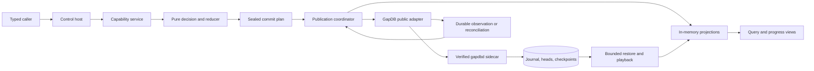
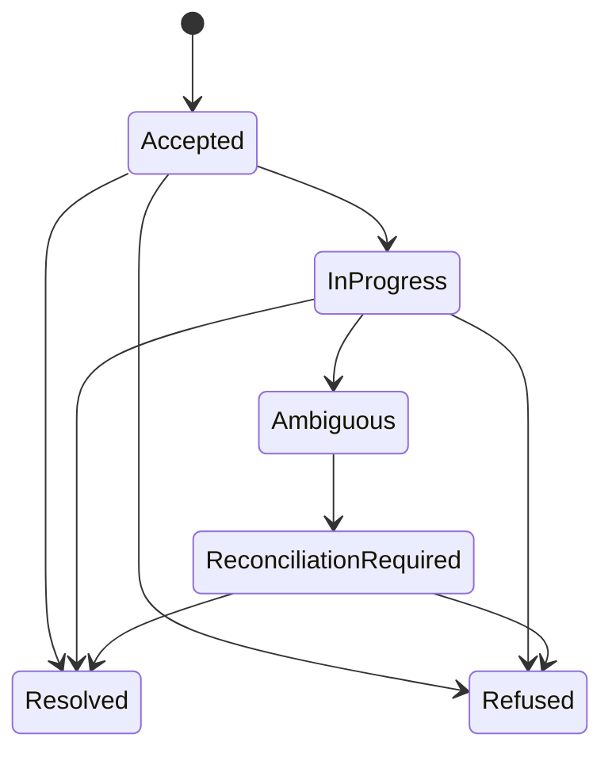
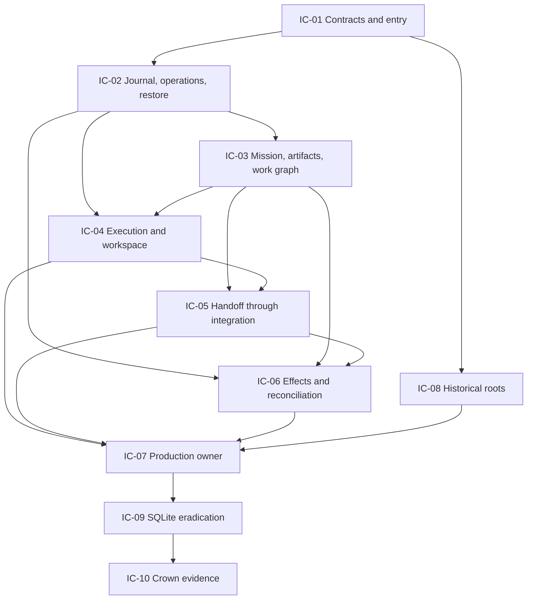

# Implementation Plan: GapDB-Only Production Authority

**Mission**: `gapdb-only-production-authority-01M1GWDJ`  
**Branch**: `feat/gapdb-only-production-authority`  
**Date**: 2026-09-02  
**Spec**: [spec.md](spec.md)  
**Status**: Post-approval correction ratified; WP01 structural deadline proof
requires reapproval before WP04 resumes with behavioral deadline evidence

## Summary

M2 replaces the historical SQLite authority with a memory-primary runtime whose
only durable production substrate is the exact GapDB tuple admitted by M1.
Current state is served from one owner-held in-memory projection. Every accepted
authority transition is first published as versioned capability events,
aggregate heads, operation progress, and effect intents in one conditional
durable GapDB batch. Restart reconstructs the same projection from the newest
compatible product checkpoint plus immutable per-aggregate event suffixes,
admits a fresh runtime epoch, and refuses predecessor authority.

The replacement is organized around capability-owned commands, events,
reducers, and narrow persistence ports. It is not a key/value transcription of
the old schema. SQLite is removed from source, tests, module graphs, binaries,
installations, configuration, fallbacks, and migration paths. Historical roots
are diagnosed before current state is created and require an explicit offline
disposition.

## Technical Context

**Language/Version**: Go 1.26 module; qualification and release builds use Go 1.26.7  
**Primary Dependencies**: Go standard library; pinned public `github.com/spec-kitty/gapdb` client; `golang.org/x/sys` for admitted Linux lifecycle identity; `github.com/santhosh-tekuri/jsonschema/v6` for evidence contracts  
**Storage**: one exact project-local `gapdbd` over a Unix socket; versioned application journal, aggregate heads, operation bindings/states, product checkpoints, and in-memory projections; no SQL store  
**Testing**: Go unit/contract/property tests, bounded race and stress censuses, real-sidecar fault injection, replay purity probes, behavior inventory parity, architecture mutants, clean-install/SBOM/binary inspection, and one M2 crown campaign  
**Target Platform**: initial production qualification on Linux/amd64, one machine and local-filesystem authority; remote clients cross application/API boundaries  
**Project Type**: modular Go runtime and CLI composition with a pure domain/control-journal kernel and outbound sidecar adapter  
**Performance Goals**: current-state query p95 below 2 ms; durable authority mutation p95 below 8 ms; checkpoint-plus-10,000-operation recovery p95 below 2 seconds on the declared reference machine  
**Constraints**: one writable owner; one conditional batch per accepted stage; global OperationID binding; no provider internals, SQL, fallback, dual write, implicit import, backend selector, external I/O during playback, or transfer of an expired workspace  
**Scale/Scope**: all Phase 1–3 authority capabilities, at least 10,000 work items/operations in recovery fixtures, 100 repetitions per declared race/fault cut, and one source-bound final evidence census

### Immutable M1 entry evidence

M2 admits exactly the record at
`docs/programs/evidence/m1-adoption.json`:

| Coordinate | Required value |
|---|---|
| Decision | `adopt` |
| M1 source commit | `e05a5e46feb3e65ff42c4544c16678c440ef3818` |
| M1 source tree | `c7b932b3d85833beee1a84d8a1ae7f4e4a75ec73` |
| Evidence manifest SHA-256 | `397f93a9b0f1ea24715ba57b0cb58aeb489e13a7e27e8bc76259597f36f2f309` |
| Admitted tuple SHA-256 | `4ddf904a48c83fe343ea9589bdf6ef7108af71b4b8140d76da68abdaf9d5824d` |
| Sidecar SHA-256 | `62219cfddbc72467bd491e8ca2309b49cfc935b68df51b5500b31c51c4c84a1e` |
| Evidence release | `m1-gapdb-evidence-v1` |

The first implementation gate and final qualification download and reverify the
published evidence archive. Any tuple drift stops M2 for a new adoption
decision; a compatible-looking later binary cannot inherit this evidence.

## Charter Check

The plan satisfies the active compact charter directives:

| Directive | Plan consequence | Gate |
|---|---|---|
| 001 — preserve product behavior | Frozen Exact/Strengthen inventory maps to capability contracts and observable results, not Python or SQL structure. | No behavior is removed without explicit reconciliation. |
| 010 — maintain verifiable authority | Every mutation has typed preconditions, durable evidence, refusal order, and replay semantics. | No read-modify-write convention substitutes for CAS. |
| 024 — retain concurrency | Unrelated aggregates publish independently; per-work authority and repository integration remain separately fenced. | No global per-command journal head or mission mutex. |
| 028 — evidence before claims | Capability proofs and final crown evidence are source/artifact/census bound. | Scaffolding or green compilation is not completion. |
| 030 — independent acceptance | Reviewer ActorID independence and source-bound final review remain explicit. | Implementation actors cannot approve their own work unless a recorded policy permits it. |

**Pre-research gate**: passed. M1 is accepted and its tuple is immutable.  
**Post-design gate**: passed. The design has no unresolved clarification marker,
table-shaped persistence interface, dual authority, or implicit migration path.

## Architecture



The host is the sole production composition root. Domain packages own meaning;
the common journal owns canonical publication mechanics and the acknowledged
projection coordinator; the GapDB adapter owns provider translation; the
sidecar supervisor owns process and database identity. Callers cannot
construct repositories or open the store. Capability packages may reach the
foundation coordinator but direct capability-to-adapter reachability is a
permanent architecture violation.

### Command publication and operation identity

One caller-visible operation may contain several legitimate durable stages.
The design therefore separates three identities:

- `OperationID`: stable caller identity for the entire command/saga;
- `OperationBinding`: immutable host-global meaning of that ID; and
- `PublicationID`: deterministic storage request identity for one durable
  operation-state transition.

`OperationBinding` includes command kind/schema, canonical intent digest,
typed scope, ActorID/ProcessID, governance/policy coordinates, and original
epoch provenance. Runtime epoch is not included in the stable intent digest.
An exact existing binding is resolved before current-epoch admission so a
committed result remains replayable after restart. A mismatched binding refuses
before capability reads or effects. A proven-absent predecessor request
requires explicit re-evaluation under the new epoch.

`OperationState` is an ordinary versioned aggregate:



The first meaningful accepted stage inserts the absent binding and atomically
publishes OperationState, capability transitions, aggregate heads, and effect
intents. Later stages CAS OperationState and affected capability heads. A
decomposition or provider “reservation” is allowed only when it records a real
requested state plus durable effect intent; naked reservations are forbidden.

The sealed common `CommitPlan` validates identity, canonical membership,
budgets, expected logical versions, expected provider revisions, event-family
registration, and one-provider-call publication. It interprets no mission,
review, integration, or provider policy. Every affected aggregate emits exactly
one transition event and increments once per publication.

The required operation event uses the closed operation event schema 2/reducer
2 tuple. Its payload is the canonical OperationState transition preimage,
excluding only the PublicationID that sealing derives. The final envelope
supplies that PublicationID, so historical operation progress and exact
event/effect membership can be reconstructed from immutable journal material.
The incomplete operation `1/1` tuple is rejected rather than treated as an
alias.

A foundation publication coordinator registers each sealed plan before
delivery. It accepts only a durable exact acknowledgement or complete
same-identity reconciliation and advances projection state only afterward.
Its bounded revision-keyed acknowledgement ledger supports at least 10,000
publications between seals. At a quiescent checkpoint barrier it orders
acknowledgements by provider revision and folds the prior prefix with revision,
PublicationID, plan digest, and sealed record-set digest. Every atomic
publication persists those otherwise process-local proof coordinates in one
immutable, absent-conditioned publication witness. The plan digest binds the
witness contract version; the witness is constructed afterward so no identity
is recursive. One foundation-owned pure helper performs the fold for both the
live tracker and restore. Unresolved ambiguity blocks the seal without
serializing unrelated durable commits.

The seal also binds the terminal PublicationID selected by greatest provider
revision. A checkpoint at watermark `R` records that acknowledged identity as
its covered-through publication. The later atomic publication that writes the
checkpoint record and retained-ring slot occurs at `C > R` and remains suffix;
the checkpoint never attempts to contain its own creating PublicationID. The
foundation owns the sole strict canonical operation-summary codec consumed by
checkpoint and restore code.

All persistence-facing v2 record encoders converge on one recursively
canonical final-byte representation. Recovery admission compares rather than
rewrites provider bytes, while established semantic digest preimages remain
unchanged. This makes the durable pipeline closed under
`Encode -> RecoveryRecordV2 -> Decode` and prevents capability packages from
reconstructing foundation wire.

### Capability-owned authority

| Aggregate owner | Representative facts and invariants |
|---|---|
| Runtime host | epoch admission, readiness, predecessor invalidation; no commands before ready |
| Mission | coarse lifecycle, activity history, blockers, decisions, terminal outcome, derived readiness census |
| Artifact catalog/revision | immutable content/provenance, latest-revision CAS, exact verdict |
| Work graph | immutable generation, drift, `continue/supersede/invalidate/fork`, eligibility guards |
| Execution slot | run, lease generation, heartbeat, expiry, one current authority |
| Workspace | immutable lease binding, preparation stages, quarantine, never transferred |
| Handoff slot | candidate identity, repository observations, contributor ActorIDs, replacement/refusal |
| Review slot | attempt, criterion evidence, terminal verdict, ActorID independence |
| Acceptance | current candidates/reviews/policy/waivers and exact decision evidence |
| Integration target/attempt | repository fence, staged publication, conflict/repair, at-most-once admission |
| External effect | intent, attempt, observation, ambiguity, attribution-safe compensation |
| Outbox | durable successor notification, delivery observation, no authority transfer |
| Operation | global binding, stage progression, typed result and event/effect membership |

Cross-aggregate eligibility cannot rely on a read followed by an unrelated
write. A bounded, deterministic set of workgraph eligibility guard shards is
updated with graph reconciliation and CASed by start, handoff, review,
acceptance, and integration. This prevents stale-generation admission without a
mission-wide hot key or a 10,000-mutation successor batch. The shard count and
contention budget are frozen by contract and benchmark evidence.

### Checkpoint and suffix recovery

GapDB Watch is a bounded notification facility, not the product journal. M2
therefore uses immutable events addressed by aggregate identity and positive
logical version. A checkpoint contains canonical projected state and a complete
aggregate/version census through a positive provider revision.

```mermaid
sequenceDiagram
    participant H as Restarting host
    participant G as GapDB adapter
    participant P as Pure playback
    participant E as Epoch authority

    H->>G: recover durable bytes and load checkpoint candidates
    G-->>H: newest compatible checkpoint and stable head census
    H->>G: read each new or advanced aggregate version
    G-->>H: immutable events with record revisions
    H->>P: validate operation membership and ordered event union
    P-->>H: canonical projection and digest
    H->>E: atomically admit fresh runtime epoch
    E-->>H: ready; predecessor capsules are stale
```

Aggregate heads are globally enumerable at
`spk/v2/heads/<scope>/<aggregate-kind>/<aggregate-id>`. Immutable events retain
the scope-first journal layout. The former
`spk/v2/scopes/<scope>/heads/...` spelling is rejected, not read as a
compatibility alias. Host-global operation binding/head records form a second
bounded census under `spk/v2/operations/`.
Each publication also has one exact-read immutable witness at
`spk/v2/publications/<publication-id>/witness` carrying its operation
coordinate, plan digest, and non-witness record-set digest/count. It shares the
publication's provider revision and consumes one of the 256 allowed atomic
mutations.

Restore command admission remains closed while it:

1. captures a positive durable store coordinate `(DatabaseID, R)`;
2. selects the newest valid compatible bounded checkpoint;
3. requires the initial aggregate-head and operation-census pages to report
   `R`, then uses their provider-pinned continuation cursors;
4. enumerates exact event versions after each checkpointed aggregate version;
5. reads them with bounded concurrency and byte/count limits;
6. requires every record revision to be positive and no greater than `R`, and
   reconstructs historical OperationState from operation events;
7. exact-reads and validates one witness for every distinct suffix
   PublicationID, requiring the same operation coordinate and provider
   revision;
8. advances the checkpoint prefix with the shared pure helper and validates
   operation suffixes from their checkpoint boundaries;
9. sorts the union by `(Record.Revision, EventIndex, EventID)`;
10. reduces without external or persistence capabilities;
11. matches every terminal head and whole-product digest; and
12. rechecks the same DatabaseID and exactly `R` before admitting a fresh
    epoch.

The frozen GapDB API has no as-of `Get` and does not accept a requested
revision on the first prefix-scan page; the design makes no such claim. Equal
capture/final coordinates, first-page `R`, cursor staleness, and record
revision bounds form the enforceable stable-attempt proof. Any movement or
replacement discards all material collected by that attempt.

No checkpoint falls back to a watch stream. With no compatible checkpoint, a
bounded complete head/event reconstruction is allowed. Missing versions,
unknown schemas/reducers, partial operation membership, unstable traversal, or
over-budget history keeps the host closed with a typed recovery diagnosis.
Domain deletion retains a tombstone head; physical head deletion is forbidden.

Checkpoint creation uses a sealed, already-validated projection/prefix
capability and a rolling digest; it does not re-reduce the full origin. A
bounded retained candidate ring permits fallback from a corrupt latest
checkpoint to an earlier compatible one and rejects contradictory candidates
at the same watermark.

Registry compatibility seals the exact registry ID/version, publication rule,
ordering tuple, and sorted family/schema/reducer/owner census. Reducer
compatibility also seals a declared implementation digest. Runtime reduction
is a stateless `Apply`; bounded repeated-call determinism qualification is a
separate concern and cannot cap a 10,000-operation replay at 256 observations.

The provider-neutral recovery vocabulary belongs to the journal foundation:
closed semantic record addresses/scan targets, store revision coordinates,
immutable records/pages, typed recovery errors, and canonical aggregate
comparators. Event, head, binding, and OperationState values expose every
semantic field required for validation through defensive accessors. GapDB keys
and public client values remain adapter-private translations. Checkpoints store
a compact operation summary of counts and fixed-size boundaries rather than
copying every variable-length OperationID or terminal result. Each boundary
contains an OperationID lookup digest, checkpoint logical version, and leaf
digest; the leaf commits to the full prior operation state. Restore joins the
boundary to an exact ID from the operation-head scan, reads the boundary event,
and verifies the leaf before using the suffix. The final structured checkpoint
encoder must prove 10,000 maximum-version boundaries and outer summary
overhead fit `MaxOperationSummaryBytesV2 = 2,112,000` bytes, leaving 2,082,304
bytes for aggregate entries and remaining checkpoint metadata.

### Refusal parity and external effects

Every capability decides semantic validity before constructing a commit plan.
Multi-head CAS protects facts that may change between decision and publication.
After a CAS loss, the service first rereads the global operation binding/state:
the same operation may have committed. Otherwise it identifies the moved
capability or eligibility guard and returns the defined earliest typed refusal.
It never silently chooses a new OperationID.

External mutation follows the durable saga law:

> A compensation may undo only state still demonstrably attributable to the
> operation being compensated.

Intent precedes every provider call. Retry or compensation compares provider
revision, value, and operation marker. Unavailable, stale, contradictory, or
unattributable observations create explicit reconciliation-required state.
Playback merely reduces those observations and cannot invoke an adapter.

### Historical-root disposition

A read-only classifier runs before sidecar startup or current-state creation.
It resolves and inspects the control root without executing SQL and recognizes
known historical filenames, SQLite headers and companions, copied/renamed
signatures, mixed layouts, unsafe symlinks/ownership, malformed current state,
and ambiguous look-alikes. Findings are canonical evidence in a bounded
`HistoricalStateDisposition`.

- empty supported root: initialize one current authority;
- current valid root: recover normally;
- historical, mixed, unsafe, foreign, or ambiguous root: return
  `OFFLINE_DISPOSITION_REQUIRED` before mutation;
- no production importer, rescue read, dual write, backend switch, waiver, or
  “prefer current” rule exists.

### Structural SQLite absence

The final removal gate proves absence rather than a disabled configuration:

1. delete `internal/controlstore/sqlite` and SQL-only composition/tests;
2. remove `modernc.org/sqlite` and all SQLite-exclusive transitives from the
   module graph;
3. prohibit SQL/SQLite imports, aliases, copied code, generated files, build
   tags, reflection strings, subprocesses, migrations, selectors, flags, env
   vars, and help/config text from production reachability;
4. produce a deterministic CycloneDX SBOM and inspect every built binary;
5. perform a clean-checkout module verification, build, installation, and
   runtime smoke test; and
6. kill one controlled mutant for every prohibited surface.

Historical documents and frozen evidence remain admissible only under exact
path-scoped exclusions. Go tests do not retain the driver as a comparator.

## Project Structure

### Mission documentation

```text
kitty-specs/gapdb-only-production-authority-01M1GWDJ/
├── spec.md
├── plan.md
├── research.md
├── data-model.md
├── quickstart.md
├── contracts/
│   ├── authority-journal-v2.md
│   ├── event-family-registry-v2.json
│   ├── historical-state-disposition-v1.schema.json
│   ├── m2-qualification-v1.schema.json
│   └── operation-binding-v2.schema.json
└── tasks.md
```

### Production and qualification code

```text
cmd/
├── spec-kitty/
└── spk-m2-qualification/

internal/
├── architecture/
├── artifact/
├── controljournal/
│   ├── application/
│   ├── checkpoint/
│   ├── playback/
│   └── reducer/
├── controlstore/
│   └── gapdb/
├── execution/
├── handoff/
├── helpercmd/
├── integration/
├── mission/
├── productionruntime/
├── review/
├── sidecar/gapdb/
├── testcampaign/m2/
├── workgraph/
└── workspace/
```

**Structure Decision**: Preserve the existing capability packages and move
persistence interfaces inward to their owners. Extend the common journal only
with provider-neutral publication/recovery primitives. `internal/productionruntime`
is the sole normal composition root; `internal/testcampaign/m2` and
`cmd/spk-m2-qualification` own qualification only. No replacement god-store is
introduced.

## Validation and evidence strategy

Each capability slice must pass before its dependents begin:

- contract and reducer tests for accepted and refused transitions;
- same-aggregate contention plus unrelated-aggregate progress;
- crash before/after batch publication and lost/malformed acknowledgement;
- restart and checkpoint-suffix equality with zero playback I/O;
- stable operation replay and changed-binding conflict;
- applicable behavior-inventory and refusal-order cases; and
- at least one rejecting semantic/architecture mutant.

The final source-bound campaign additionally executes:

- a complete two-item mission with restart between every major phase;
- 100 two-agent authority trials and 100 clean/unclean epoch replacements;
- 100 semantic publication/replay repetitions for every authority-changing
  family, 100 repetitions of every transport/acknowledgement/reconciliation
  cut through the shared host-command publication boundary, and an executable
  guard plus killed bypass mutant proving no family routes around that boundary;
- historical/mixed/malformed/unsafe root matrices;
- structural source/module/SBOM/binary/install/config/runtime absence gates;
- 10,000-operation recovery and latency measurements over the declared runs;
- a complete frozen behavior traceability matrix; and
- independent evidence verification and mission review.

Failed, incomplete, and non-admissible campaigns remain immutable evidence.
Only one complete census from one exact source/tree/dependency/binary tuple may
support the final M2 decision.

## Implementation Concern Map

### IC-01 — Entry evidence and frozen contracts

- **Purpose**: Reverify M1 admission, freeze v2 event/operation/key/budget contracts, and strengthen architecture guards before implementation spreads.
- **Relevant requirements**: FR-001, FR-023, FR-033, FR-035; NFR-013–NFR-015.
- **Affected surfaces**: `docs/programs/evidence`, mission `contracts/`, `internal/architecture`, `internal/controljournal`.
- **Sequencing/depends-on**: none.
- **Risks**: mutable admission aliases; guards that match filenames instead of semantics; untested guard mutants.

### IC-02 — Publication, global operations, and suffix recovery

- **Purpose**: Implement sealed multi-aggregate publication, host-global operation binding/state, per-aggregate versioned events, checkpoints, and pure restore.
- **Relevant requirements**: FR-002–FR-006, FR-019–FR-022, FR-025; NFR-001, NFR-002, NFR-005–NFR-009, NFR-012.
- **Affected surfaces**: `internal/controljournal/**`, `internal/controlstore/gapdb/**`.
- **Sequencing/depends-on**: IC-01.
- **Risks**: current-epoch checks blocking historical result replay; same-version multi-event inconsistency; suffix design regressing into global serialization.

### IC-03 — Mission, artifacts, and WorkRevision authority

- **Purpose**: Move definition-time authority and executable graph generations onto capability events and explicit reconciliation.
- **Relevant requirements**: FR-007–FR-010, FR-023, FR-024.
- **Affected surfaces**: `internal/mission`, `internal/artifact`, `internal/workgraph`, capability GapDB adapters.
- **Sequencing/depends-on**: IC-02.
- **Risks**: table-shaped interfaces; stale generation accepted during concurrent successor publication; oversized eligibility updates.

### IC-04 — Execution, lease, and workspace authority

- **Purpose**: Preserve concurrent one-current-authority execution and permanent lease-scoped workspace identity across replacement and restart.
- **Relevant requirements**: FR-011, FR-012, FR-020, FR-024.
- **Affected surfaces**: `internal/execution`, `internal/workspace`, capability GapDB adapters.
- **Sequencing/depends-on**: IC-02, IC-03.
- **Risks**: process-local locks mistaken for correctness; predecessor epoch replay; workspace transfer after expiry.

### IC-05 — Handoff, review, acceptance, and integration

- **Purpose**: Persist candidate evidence, ActorID independence, current-evidence acceptance, and serialized Git publication without legacy eligibility.
- **Relevant requirements**: FR-013–FR-016, FR-024.
- **Affected surfaces**: `internal/handoff`, `internal/review`, `internal/integration`, acceptance services, capability GapDB adapters.
- **Sequencing/depends-on**: IC-03, IC-04.
- **Risks**: reviewer process separation replacing actor independence; repository fence acquired before an earlier refusal; silent `legacy-v1` fallback.

### IC-06 — Effects, outbox, and reconciliation

- **Purpose**: Preserve intent-before-effect, stable retries, compare-before-compensate, staged operation progress, and honest ambiguity.
- **Relevant requirements**: FR-017, FR-018, FR-022, FR-025, FR-034.
- **Affected surfaces**: execution/mission effect services, tracker contracts, outbox, `internal/controljournal`.
- **Sequencing/depends-on**: IC-02; integrates with IC-03–IC-05.
- **Risks**: provider observations treated as truth; replay dispatching effects; compensation undoing human changes.

### IC-07 — Production owner and progress projections

- **Purpose**: Compose one sidecar/host owner, recover memory-primary projections, expose query-only current progress, and remove raw database inputs.
- **Relevant requirements**: FR-002, FR-003, FR-019, FR-020, FR-034, FR-036.
- **Affected surfaces**: `internal/productionruntime`, `internal/helpercmd`, `cmd/spec-kitty`, sidecar supervisor.
- **Sequencing/depends-on**: IC-02–IC-06.
- **Risks**: multiple CLI owners opening one store; projection writes becoming second truth; transport vocabulary leaking into kernel contracts.

### IC-08 — Historical-state classifier

- **Purpose**: Detect historical, mixed, unsafe, or ambiguous roots before current mutation and emit offline dispositions.
- **Relevant requirements**: FR-026–FR-030, FR-034.
- **Affected surfaces**: startup/root policy, `internal/productionruntime`, documentation and contract fixtures.
- **Sequencing/depends-on**: IC-01; must integrate before IC-07 admits startup.
- **Risks**: executing SQL for detection; false empty-root classification; hidden importer or waiver.

### IC-09 — SQLite eradication and closed architecture

- **Purpose**: Remove legacy implementation and prove structural absence over source, dependencies, artifacts, installation, configuration, and runtime.
- **Relevant requirements**: FR-028–FR-033; NFR-014, NFR-017.
- **Affected surfaces**: `internal/controlstore/sqlite`, `go.mod`, tests, Makefile, CI, SBOM/build tooling.
- **Sequencing/depends-on**: IC-03–IC-08.
- **Risks**: test-only driver retention; generated/tagged/subprocess escape; deleting guards instead of layering them.

### IC-10 — Crown campaign and successor publication

- **Purpose**: Bind all capability, race, fault, recovery, performance, absence, install, behavior, and mutant evidence into one independently verifiable M2 result.
- **Relevant requirements**: FR-023–FR-025, FR-035, FR-036; all NFRs and SCs.
- **Affected surfaces**: `internal/testcampaign/m2`, `cmd/spk-m2-qualification`, mission evidence, README/program documents.
- **Sequencing/depends-on**: IC-01–IC-09.
- **Risks**: assembled evidence from different commits; incomplete census; qualification helper accidentally becoming a production authority path.



## Restore deadline capability boundary

Restore is the consumer-owned I/O coordinator, not the pure playback kernel.
It owns the explicit elapsed-attempt budget required by bounded recovery and
may use `time.Duration` plus context deadlines to enforce it. The architecture
guard admits only the exact `internal/controljournal/v2/restore -> time` edge.
Foundation, checkpoint, playback, and all other v2 packages remain time-free,
and time cannot participate in durable state or authority decisions. A
permanent widening mutant prevents this exception from becoming a prefix-wide
allowance. WP01 proves structural confinement and absence of ambient-clock
capabilities; WP04 proves the real validation and deadline data flow through
source-bound execution; WP17 binds both to overlay mutants and one exact source
identity. No architecture test models arbitrary Go control flow. See
`post-approval-defect-7.md` and `post-approval-defect-8.md`.

## Complexity Tracking

| Deliberate complexity | Why needed | Simpler alternative rejected because |
|---|---|---|
| Global immutable operation binding plus mutable OperationState | Preserves one identity across staged review/integration/effect workflows and restart replay. | A single terminal record cannot represent legitimate progress; mission-scoped records permit cross-capability collisions. |
| Per-aggregate version-addressed events plus head census | Provides checkpoint suffix enumeration without changing GapDB or serializing unrelated work. | Watch history is compactable notification state; an EventID-only scan is not suffix bounded; a global log head destroys concurrency. |
| Eligibility guard sharding | Makes stale WorkRevision refusal atomic with work commands while retaining independent-lane progress. | Read-then-write is unsafe; one mission guard serializes all work; one mutation per 10,000 items exceeds batch limits. |
| Read-only historical classifier | Prevents silent data loss or split authority after deleting SQLite. | Ignoring old roots appears as empty state; automatic import creates a second truth and is outside M2. |
| Layered structural absence campaign | The product claim is that SQLite cannot be reached or selected, not merely that a new default exists. | Deleting one constructor leaves dependencies, test imports, build-tag paths, and future fallback seams. |

No charter violation is accepted. These mechanisms are direct controls for
requirements that cannot be enforced by a simpler in-process convention.
