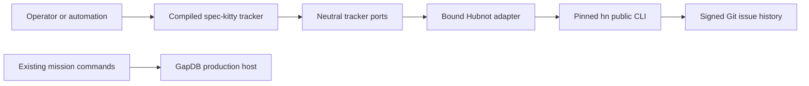

# Implementation Plan: Hubnot Tracker Replacement

**Branch**: `feat/hubnot-tracker-replacement` | **Date**: 2026-09-09 | **Spec**: [spec.md](spec.md)
**Planning base and merge target**: `feat/hubnot-tracker-replacement`; runtime branch match confirmed. Baseline `94e7c8542d7e543558391ab6fffda7a28e6e3759`.

## Summary

Replace active Beads integration with a public-CLI Hubnot adapter and a compiled tracker-only consumer. Preserve neutral ports, immutable work revisions, authority checks, frozen evidence and user data. Stage the successor alongside the old provider, qualify it, then atomically switch active installers, campaigns, CI and current documentation and retire the old runtime.

Signed history supports observable retry identity, but actor-head checks are not global issue compare-and-swap. Catalog and assignment remain unguarded. Complete definition create/read and blocking graph are supported; guarded definition update and conditional compensation refuse before mutation. No capability changes M2 adoption or admits M3.

## Technical Context

**Language/Version**: Go 1.26.7, installed toolchain with GOTOOLCHAIN=local.
**Primary Dependencies**: Existing module graph, public source-and-binary-pinned Hubnot CLI, Git. No private Hubnot imports.
**Storage**: Hubnot accepted signed Git history; existing GapDB authority unchanged; no adapter database.
**Testing**: Portable conformance, subprocess adversaries, focused package/race checks, compiled consumer acceptance, closed real-provider census, all applicable quality/build/module/static/race gates.
**Target Platform**: First qualified tuple Linux amd64 on this host; other targets require independent tuple evidence.
**Project Type**: Existing Go CLI, inward-facing internal/tracker ports and boundary adapter internal/tracker/hubnot.
**Performance Goals**: Compiled consumer returns 1,000 complete current mapped definitions within 120 seconds; separately measure known-reference observation and original-operation recovery.
**Constraints**: 256 KiB encoded mutation; each child 8 MiB stdout, 64 KiB stderr, 30 seconds; logical observation cumulative 64 MiB, 10,000 items, 120 seconds including at most two restarts after initial attempt. Default detailed page size 8. Refuse instead of truncating.
**Scale/Scope**: Catalog, rich definition create/read, graph, descriptive assignment, attributed discussion, replay and disposable reconstruction. No general migration or control-store work.

## Engineering Alignment

The user authorized replacement and delegated routine choices. Discovery resolves architecture, explicit binding, conservative capabilities and public operation recovery. Current issue inventory is empty; 19 original provider data files and historical backup material remain intact. No migration engine is justified. Actual project activation remains an explicit operator binding action outside qualification.

The upstream prerequisite supplies public signer discovery, actor pinning at signing, original signed operation lookup and detailed pagination. Its independently accepted source/build tuple is required before adapter qualification. Implementation uses its reviewed concrete contract, not guessed APIs.

## Charter Check

Pre- and post-design gates pass: architecture 001, fidelity 010, locality 024, efficient tools 028, meaningful validation 030. Provider observations remain descriptive. Existing WorkDefinitionCapabilities.Validate and Require retain their meanings. No authority arises from assignment, comments, keys or mutable metadata. Control playback performs zero provider I/O. internal/helpercmd/production.go retains unavailable readiness/decomposition/integration seams.

Independent spec review passed with four clarifications applied. Plan review precedes tasks. Authors and reviewers differ. Local success and hosted synchronization evidence remain distinct.

## Architecture and Flow



Tracker dispatch precedes control-root classification and calls real neutral provider ports without host initialization. Existing mission commands retain their lifecycle. There is no provider-to-authority path.

One transport owns immutable binding and budgets. One read layer owns coherent detailed inventory, known-reference observations, mapping and canonical proofs. One original-operation engine serves all mutation families. Definition creation uses low-level relation primitives in that layer, avoiding a catalog/graph cycle. Aggregate port assertions land after real methods exist.

Contracts: [provider](contracts/provider.md), [consumer](contracts/consumer.md), [qualification](contracts/qualification.md). Amend these and notify affected authors before changing a shared interface.

## Project Structure

```text
internal/tracker/hubnot/         binding, protocol, codec, observation, ports
internal/tracker/inventory.go   neutral current-definition inventory
internal/helpercmd/provider*    separate tracker DTO and dispatch
internal/testcampaign/          evidence, census and active selector
scripts/install-qualified-hubnot.sh
.github/workflows/              active qualification and campaigns
docs/HUBNOT_TRACKER.md
docs/HUBNOT_QUALIFICATION.md
kitty-specs/hubnot-tracker-replacement-01M22QEJ/
  contracts/, reviews/, research/, occurrence_map.yaml, quickstart.md
```

## Implementation Concern Map

| Concern | Purpose and surfaces | Requirements | Dependencies and risks |
|---|---|---|---|
| IC-01 Bound transport | adapter/binding/transport/protocol/errors, neutral concurrency enum if needed, architecture policy | FR-001/008/009/013, NFR-001/004, C-001/003 | Accepted upstream contract; actor preflight alone is insufficient |
| IC-02 Lossless reads | codec/observation/revision/mapping, neutral inventory port | FR-002/004/005/006/007/009, NFR-001/002/004 | IC-01; reject mixed snapshots and contradictory mappings; no N per-issue history inventory |
| IC-03 Original operations and definitions | operation/catalog/definition, shared relation primitive | FR-003/004/008, NFR-004, C-002 | IC-02; replay original semantics, accurately report partial saga facts |
| IC-04 Graph | graph portable API | FR-005/008/009, C-001/002 | IC-03; correct direction, cycles/missing/conflicts never become permission |
| IC-05 Assignment/discussion | corresponding portable APIs, new neutral attributed-discussion values/port | FR-006/007/008, NFR-004, C-001/002 | IC-03; signer and accountable author distinct, unsupported conditional effects refuse |
| IC-06 Native consumer | aggregate inspect/capabilities, helpercmd provider dispatch, reachability | FR-001/010/011, C-001/005 | IC-03/04/05; no control-host startup or M2 composition changes |
| IC-07 Qualification | installer, real runner, evidence/reference schema | FR-012/013/014, NFR-001/003, C-003 | IC-06 and accepted source; no omitted scenario admitted |
| IC-08 Ignore scanner | absence scanner/mutants/exact census and closed M2 receipt admission | NFR-005, C-004 | Independent; inert patterns are not hidden-file exemptions |
| IC-09 Atomic cutover | old runtime removal, execution/scenario callers, campaign/CI/current docs | FR-011/014/015, NFR-003, C-004/005 | IC-01–08; retain historical validators and asserted bytes |
| IC-10 Integrated acceptance | compiled consumer/performance tests, final instructions/evidence | All 25 requirements and SC-001–005 | IC-09; full rich fixture, separate setup/read timing |

Task generation translates concerns using the exclusive ownership proposal. Every package compiles without future success stubs. The low-level mutation engine precedes portable graph/effects; graph and effects may proceed independently. Scanner work is independent. Cutover is atomic only after successor qualification exists.

## Cutover and Historical Disposition

All eight occurrence categories are manual review in occurrence_map.yaml. Change active imports/selectors/commands/installers/capabilities semantically. Execution/scenario callers of old adapter move to the successor, or neutral fixtures only when genuinely testing provider-independent behavior. Frozen missions, Phase 1/2/3 evidence, release/source identities, receipts and .beads remain immutable. Preserve historical validators, even where filenames retain Beads. Rejecting legacy-provider strings remain meaningful guards.

Before cutover old active campaigns remain intact. Actual provider initialization, binding rewrite, fetch/sync/publish in the user project are excluded. Compare the original 19-file manifest at acceptance. No branch/stash cleanup.

## Validation and Completion

Independent review per package; failures return to owner. Final complete quality/race/build/module gates and real-provider census must pass alongside requirement matrix and data/evidence hashes. Accept and merge through runtime into feature target, independently review merged mission and record retrospective. Local qualification never implies hosted checks or human adoption.

## Complexity Tracking

No charter exception. Small upstream changes avoid signer races, lost-response corruption and per-issue inventory process expansion. Global CAS emulation, direct adapter Git mutation, second persistent store and general migration were rejected as unnecessary or semantically unsound.

### Attributed discussion results

WP05 owns new internal/tracker/discussion_observation.go and its tests. A small immutable attributed-discussion port retains each existing portable entry, actual transport signer and complete signed/common proof, with both richer append results and coherent observation. Existing Discussion remains a compatibility projection over the same implementation. WP06 consumes the richer neutral port so original append/replay results expose both author and signer without a fresh current read or provider-proof parsing. Existing capability files remain unchanged; ownership stays disjoint and the original lane DAG is preserved.
