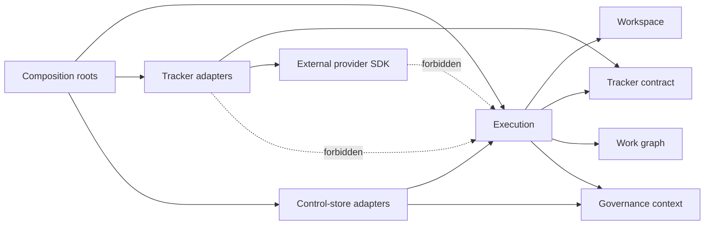
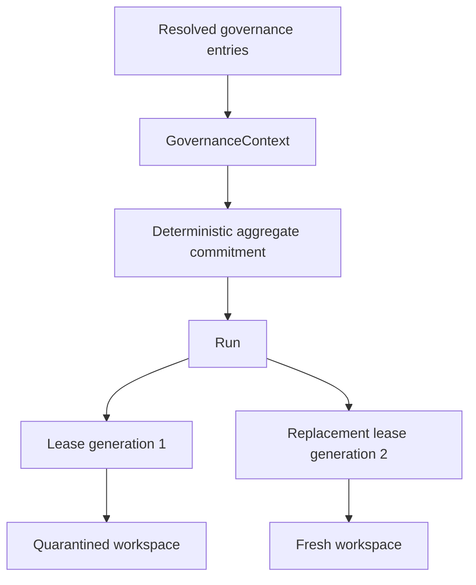
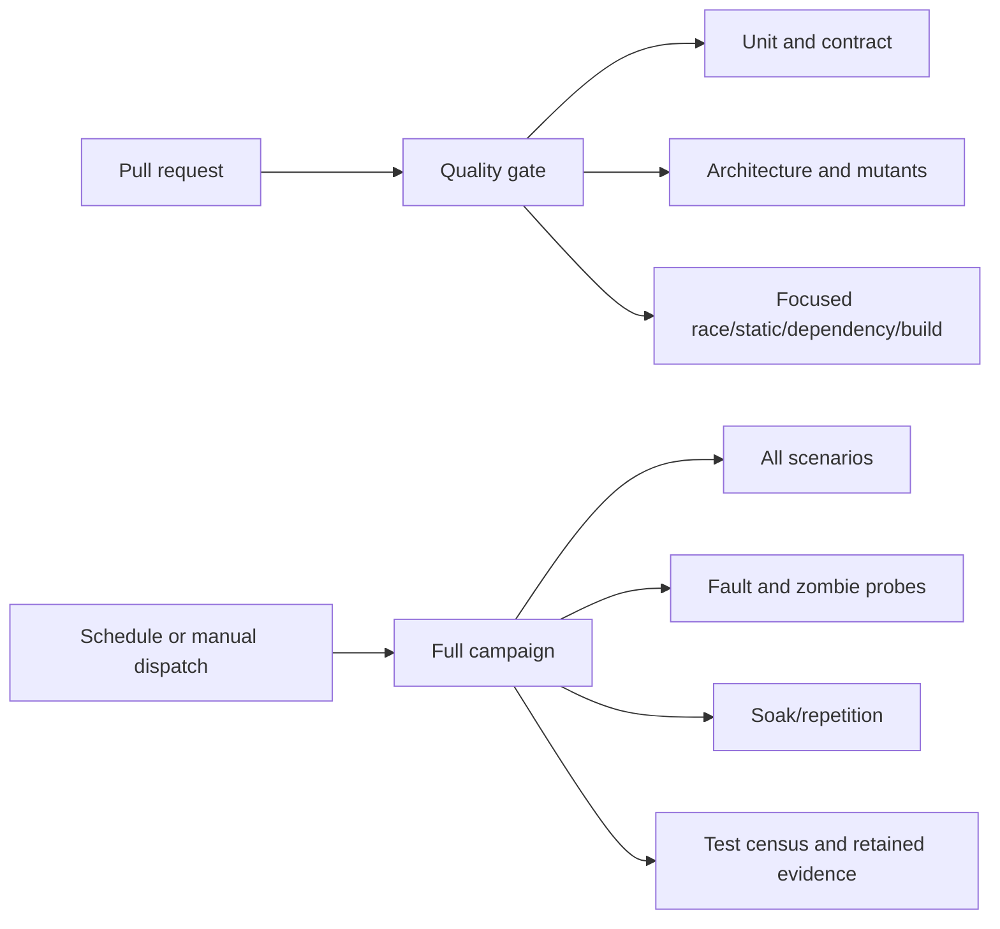

# Implementation Plan: Phase One Architecture Closeout

**Branch**: `feat/phase-one-architecture-closeout` | **Date**: 2026-08-25 | **Spec**: [spec.md](spec.md)  
**Input**: Harden the completed Phase 1 authority kernel before provider integration begins.

## Summary

Replace the temporary Phase 1 source allowlist with a permanent, capability-aware dependency guard; add non-vacuous reachability and early-refusal tests; split routine and exhaustive validation into enforceable CI campaigns; add a minimal run-owned governance-context aggregate and forward migration; and record how the current typed kernel projects onto Orchestrator API 1.3.

The implementation remains intentionally small. It introduces no provider, server, protobuf core, general ledger, or replacement control store. Architectural checks are written in Go and operate on Go package metadata and syntax trees rather than parsing human-formatted CLI output.

## Technical Context

**Language/Version**: Go 1.26  
**Primary Dependencies**: Go standard library; existing `modernc.org/sqlite` adapter; Git and GitHub Actions as external development tools  
**Storage**: Existing portable control-store contracts plus the current SQLite adapter; a forward-only schema migration adds governance-context state  
**Testing**: Go unit tests, contract tests, black-box temporary-repository scenarios, race detector, staticcheck, govulncheck, architecture mutants, focused repeated tests, and scheduled fault/soak campaigns  
**Target Platform**: Local Linux/macOS developer hosts; one control-store owner per machine/filesystem authority  
**Project Type**: Single Go module organized by product capability  
**Performance Goals**: Pull-request validation completes within 8 minutes at p95 over ten representative runs; isolated contention regression succeeds 20 consecutive times  
**Constraints**: No Phase 2 integrations, no Python runtime or Markdown parsing in production, no donor-source copying, no weakening of Phase 1 authority invariants  
**Scale/Scope**: Approximately fifteen existing production packages, one schema migration, two CI campaigns, and one version-pinned external-contract mapping

## Engineering Alignment

1. **Capability boundaries remain primary.** “Kernel” is an architectural policy classification over capability packages, not a new horizontal `kernel/` directory.
2. **The adapter exception is narrow.** A future `internal/tracker/beads` package may import Beads; `internal/tracker` contracts and all authority capabilities may not.
3. **Architecture tests must prove non-vacuity.** Each guard has a green fixture and a rejecting mutation whose diagnostic must implicate the mutated edge or symbol.
4. **Governance is pinned once per run.** A run owns an immutable context reference; leases resolve through their run rather than duplicating mutable policy fields.
5. **Existing stores remain adapters.** The portable governance model belongs outside SQLite. SQLite receives a forward migration only because it is the current proving adapter.
6. **CI is tiered by feedback purpose.** Pull requests get a bounded, high-signal gate; exhaustive fault and soak scenarios run on schedule and manual dispatch.
7. **Orchestrator work is documentation only.** Contract 1.3 is mapped against current typed commands so future API work stays translational, but no transport package is introduced.

## Charter Check

### Pre-research gate

| Governance rule | Result | Evidence |
|---|---|---|
| Architectural integrity | Pass | Directional package rules and provider isolation are the primary deliverable. |
| Specification fidelity | Pass | Every concern maps to explicit FR/NFR/constraint identifiers. |
| Locality of change | Pass | Changes remain within architecture tests, CI, control-store provenance, the targeted integration regression, and mission docs. |
| Efficient tooling | Pass | Go-native graph/AST checks replace shell/Python repository copies. |
| Test/typecheck gate | Pass | Acceptance and rejecting fixtures precede production changes; race and static gates are mandatory. |

### Post-design gate

The design introduces one new portable value-object package and one architecture-quality package. Neither becomes a business authority. Provider-specific imports remain restricted to adapters, governance context remains owned by runs, and external transport remains deferred. No charter exception is required.

## Architecture

### Dependency-policy view



The guard classifies every production package and checks each local import edge. Unknown packages fail. Test-only scenario packages are classified separately rather than silently omitted.

### Governance ownership



The context describes the policy input that authorized the run. It does not claim exact model-wire delivery. Existing runs migrate with an explicit unknown context; new run admission requires a validated context reference.

### Validation topology



## Project Structure

### Documentation

```text
kitty-specs/phase-one-architecture-closeout-01M0WZQ9/
├── spec.md
├── plan.md
├── research.md
├── data-model.md
├── quickstart.md
├── contracts/
│   ├── architecture-guard.md
│   ├── governance-context.md
│   ├── orchestrator-api-1.3-projection.md
│   └── validation-campaigns.md
└── tasks.md
```

### Source code

```text
.github/workflows/
├── quality.yml                 # PR/push bounded gate
└── full-campaign.yml           # schedule/manual exhaustive campaign

internal/
├── architecture/
│   ├── policy.go               # tier classification and edge evaluation
│   ├── graph.go                # Go package graph loading
│   └── reachability.go         # selected production caller census
├── governancecontext/
│   ├── model.go                # commitments, ordered entries, aggregate
│   └── digest.go               # framed deterministic digest
├── execution/                  # run admission carries context ref
├── controlstore/               # portable store contracts
├── controlstore/sqlite/        # forward migration and adapter persistence
├── integration/                # pre-fence refusal remains explicit
└── scenario/                   # short/full classifications and universal invariants

Makefile                         # named local quality campaigns
.gitignore                       # generated bin/ output
```

**Structure Decision**: Keep product code organized by capability. `internal/architecture` is a bounded quality capability, not a new application layer. `internal/governancecontext` owns provider-neutral provenance values. SQLite persists those values through the existing control-store boundary.

## Data and Migration Design

1. Add portable `Commitment`, `Entry`, and `Context` values with validation and deterministic framed hashing.
2. Add `GovernanceContextID` to the typed ID vocabulary.
3. Require new `StartRunRequest` values to carry a validated governance-context reference.
4. Extend the store contract so context persistence and run creation are one store-owned transaction.
5. Add SQLite tables for contexts and ordered entries plus a nullable run foreign key.
6. Preserve existing rows with `NULL`, interpreted only as `unknown_pre_provenance`.
7. Add a database trigger or equivalent adapter constraint preventing newly admitted runs from referencing missing context rows.
8. Avoid lease columns: the lease's immutable `run_id` is already the governing relationship.

## Test Strategy

### Acceptance first

- A temporary-module fixture proves an adapter may name a provider while a kernel import of that adapter fails.
- Unknown production roots and missing load-bearing allow rules fail with exact implicated edges.
- A fabricated selected guard with only test callers fails reachability.
- The early integration-refusal test observes zero repository-fence acquisition; a test seam mutant demonstrates detection.
- Twenty isolated contention runs assert error kind and an upper deadline, never a minimum duration.
- Governance contexts reject missing algorithm/digest, duplicate or invalid identities, unstable ordering, and altered content.
- A migration fixture upgrades a shipped earlier schema and proves every existing run/lease/workspace remains readable.
- A zero-match test transcript fails campaign verification.

### Universal invariants

`assertUniversalInvariants`, including stale-process probing, remains common to all scenario profiles. Short/full classification changes scheduling only; it must not change invariant content.

### Campaigns

- `make preflight`: formatting, buildability, and tool availability.
- `make contract`: unit and portable contract suites.
- `make acceptance`: bounded happy/adversarial scenarios.
- `make scope`: dependency, reachability, and mutant guards.
- `make static`: vet and staticcheck.
- `make dependencies`: module verification and govulncheck.
- `make quality`: PR aggregate.
- `make fault`, `make soak`, `make full-campaign`: exhaustive scheduled/manual aggregates.

Every curated selector uses `go test -json` and verifies the expected test-name set against terminal events.

## Implementation Concern Map

### IC-01 — Permanent architecture policy

- **Purpose**: Replace Phase 1's flat source/name allowlist with tier classification and directional import rules.
- **Relevant requirements**: FR-001–FR-004, NFR-003, NFR-008
- **Affected surfaces**: `internal/architecture/`, `internal/scenario/repetition_test.go`
- **Sequencing/depends-on**: none
- **Risks**: Encoding current accidental imports as permanent policy; guard must expose a reviewed baseline and fail closed on additions.

### IC-02 — Production reachability

- **Purpose**: Detect selected guards and concrete implementations that are tested but not wired.
- **Relevant requirements**: FR-005, NFR-003
- **Affected surfaces**: `internal/architecture/reachability.go`, composition roots, guard markers
- **Sequencing/depends-on**: IC-01
- **Risks**: A universal census would overfit implementation details; scope targets to authority-critical seams.

### IC-03 — Stable authority regressions

- **Purpose**: Fix the contention assertion and prove inadmissible integration refuses before repository-fence acquisition.
- **Relevant requirements**: FR-007–FR-009, NFR-002–NFR-005
- **Affected surfaces**: `internal/controlstore/sqlite/authority_test.go`, `internal/controlstore/sqlite/integration.go`, focused tests, `.gitignore`, Phase 1 acceptance artifacts
- **Sequencing/depends-on**: none
- **Risks**: Tests passing from sibling contention or observing the final error without proving side-effect order.

### IC-04 — Run-owned governance provenance

- **Purpose**: Establish immutable context identity before provider-backed runs expand persistent state.
- **Relevant requirements**: FR-010–FR-011, NFR-006–NFR-007
- **Affected surfaces**: `internal/governancecontext/`, `internal/ids/`, `internal/execution/`, `internal/controlstore/`, `internal/controlstore/sqlite/`
- **Sequencing/depends-on**: none
- **Risks**: Fabricating historical provenance, duplicating context on leases, or coupling portable values to SQLite.

### IC-05 — Sustainable validation campaigns

- **Purpose**: Make routine validation fast without weakening exhaustive evidence.
- **Relevant requirements**: FR-006, FR-013, NFR-001, NFR-004–NFR-005, NFR-009
- **Affected surfaces**: `Makefile`, `.github/workflows/`, `internal/scenario/`, test-census helper
- **Sequencing/depends-on**: IC-01–IC-03
- **Risks**: Hidden zero-match success, duplicated gate definitions, mutable shared CI state, or unpinned actions.

### IC-06 — Orchestrator 1.3 projectability

- **Purpose**: Freeze an evidence-based mapping from kernel types to the current external contract without adding a transport.
- **Relevant requirements**: FR-012, C-003, C-007
- **Affected surfaces**: `contracts/orchestrator-api-1.3-projection.md`, architecture docs
- **Sequencing/depends-on**: IC-04
- **Risks**: Confusing the Python host's lane semantics with the redesign's lease/workspace authority or using the donor port's obsolete 1.1 contract.

## Delivery Sequence

1. Land architecture and reachability guards with accepting and rejecting fixtures.
2. Close the two authority regressions and documentation hygiene gaps.
3. Add governance-context model, then store contract and SQLite migration.
4. Split validation campaigns and wire CI after the test taxonomy is stable.
5. Complete the Orchestrator API 1.3 projection against final typed results.
6. Run focused repetitions, full suite, race, static, dependency, formatting, and binary-build qualification.

Independent work can proceed on IC-01/IC-02, IC-03, and IC-04. IC-05 follows the test taxonomy; IC-06 follows the final provenance/result shapes.

## Complexity Tracking

No charter violation requires justification. The new packages each own one coherent capability and replace or prevent larger ad hoc mechanisms.
