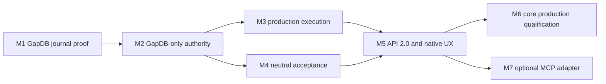

# Architecture Review and Program Quickstart

This mission is documentation-only. It prepares the production redesign for work-package planning and, after ratification, for a dependency-ordered program of implementation missions. It does not yet ship GapDB production authority, API 2.0, neutral acceptance, or MCP.

## Five-minute review path

1. Read [spec.md](spec.md) for scope, requirements, constraints, and success criteria.
2. Read [research.md](research.md) for decisions and rejected alternatives.
3. Read [data-model.md](data-model.md) for authority ownership, durable identities, recovery, operations, progress, acceptance, and program entities.
4. Inspect the contracts:
   - [control journal and recovery](contracts/control-journal.md)
   - [Orchestrator API 2.0](contracts/orchestrator-api-2.0.md)
   - [mission progress schema](contracts/progress.schema.json)
   - [acceptance evidence schema](contracts/acceptance-evidence.schema.json)
   - [optional MCP projection](contracts/mcp-2026-07-28-projection.md)
   - [program manifest schema](contracts/program-manifest.schema.json)
5. Review the program below, starting with M1's falsification target.

## Delivery truth

| Surface | Current delivered state | Ratified target |
|---|---|---|
| Authority substrate | Phase 1–3 SQLite implementation and frozen evidence | GapDB only; no SQLite production dependency or fallback |
| Work tracker | Provider-neutral contract, qualified Beads adapter, fake conformance providers | Beads is the default first-party composition; tracker never owns execution authority |
| Execution | Proven domain services and exhaustive scenarios; helper-oriented composition | Production host, real agent dispatch, lease workspaces, independent review, serialized integration |
| API | API 1.3 compatibility projection and proving commands | Process-complete typed API 2.0 with native operations and progress |
| Acceptance | Repository-specific Go qualification and frozen campaign evidence | Stack-neutral claims, provider bindings, evidence envelopes, and policy gate |
| MCP | Not implemented | Optional separate `2026-07-28` adapter; Tasks project native operations |

Historical evidence remains valid for the exact commits it attests. It does not qualify the proposed architecture automatically.

## Program graph



M3 and M4 may run concurrently. M7 may run concurrently with M6 and is not on the core release critical path.

## Candidate implementation missions

### M1 — GapDB Control Journal Proving Ground

**Falsify**: GapDB can atomically support the control journal, active projection, checkpoint, new runtime epoch, and side-effect-free playback through the exact two-agent zombie scenario.

**Entry evidence**: this architecture is ratified; an immutable GapDB source/binary/client/protocol tuple is selected; the existing two-agent invariant harness is available.

**Exit evidence**: real `gapdbd` external adapter; durable event/idempotency/projection/outbox batch; crash and ambiguous-response injection; replacement lease receives a fresh workspace; replay digest matches; playback calls no adapters; all GapDB adoption scenarios pass; a human signs the exact adoption record.

**Non-goal**: migrating every current authority repository.

### M2 — GapDB-Only Production Authority

**Depends on**: M1.

**Falsify**: every existing authority capability can use the event/CAS model without SQL constraints, dual truth, SQLite fallback, or lost refusal semantics.

**Exit evidence**: every authority port runs on GapDB; all relevant scenario/race/fault/mutant suites pass; recovery covers every authority event family; `internal/controlstore/sqlite`, its driver, transitive dependencies, fallback, and hidden migration paths are absent from production source, module graph, SBOM, and binaries.

**Non-goal**: pretending to import legacy SQLite state. Unsupported old state fails with an actionable diagnostic.

### M3 — Production Mission Execution and Beads Composition

**Depends on**: M2 and the pinned qualified Beads contract.

**Falsify**: isolated concurrency remains correct when GapDB, Beads, Git, agents, workspaces, process lifetime, and human tracker edits disagree.

**Exit evidence**: two real agents use distinct worktrees; a claim race yields one authority; same-actor review is refused even across processes; zombies remain quarantined; stale/dishonest/unavailable Beads is recoverable; compare-before-compensate preserves human edits; integration serializes and conflict creates explicit repair work.

### M4 — Stack-Neutral Acceptance Runtime

**Depends on**: M2 and the ratified acceptance evidence contract.

**Falsify**: one neutral gate can judge the same claim through materially different providers without importing or inferring ecosystem semantics.

**Exit evidence**: multiple provider kinds prove one claim contract; missing providers require a decision; candidate/policy/provider drift invalidates evidence; waivers are fully attributed and scoped; kernel imports contain no language, build, CI, or provider dependencies; human-formatted command output cannot manufacture a verdict.

### M5 — Orchestrator API 2.0, Native Operations, Progress, and CLI

**Depends on**: M2, M3, and M4.

**Falsify**: a client can drive, disconnect from, resume, and understand a mission through one typed boundary without reading Beads, Markdown, worktrees, Git refs, or GapDB.

**Exit evidence**: black-box API and normal CLI complete equivalent missions; operations survive disconnect/restart; progress snapshot plus revisioned watch converges; blockers expose legal next actions; clients cannot mint authority; API 1.3 safely translates or refuses each fixture.

### M6 — Core Production Qualification and Release

**Depends on**: M5 plus signed GapDB and Beads production tuples.

**Falsify**: independently proven components remain safe under sustained multi-mission concurrency, arbitrary crash timing, clean installation, restart, and operator recovery.

**Exit evidence**: ratified load and soak census; crash injection across every command family; no duplicate authority, lost accepted transition, transferred workspace, self-review, or overlapping integration; backup restores the terminal playback digest; security, packaging, install, doctor, and recovery gates pass; the core installation requires no Python, SQLite, or MCP.

### M7 — Optional Stateless MCP 2026-07-28 Tasks Adapter

**Depends on**: M5 and the pinned MCP core/Tasks contracts.

**Falsify**: connection loss, task expiry, input pauses, and cancellation races cannot alter or replace durable Spec Kitty authority.

**Exit evidence**: separate module and binary; core builds and runs with MCP absent; stateless requests may reach different adapter instances; task loss leaves native operations resumable; decisions and cancellations preserve domain outcomes; progress resumes by application revision; CLI and MCP workflows yield equivalent terminal evidence.

## Mission admission rule

A candidate mission becomes active only when every dependency is complete and its named entry evidence is immutable and reviewable. Each mission then receives its own specification, plan, work packages, independent implementation/review loops, acceptance, merge, mission review, and retrospective. Program order is reconciled explicitly when evidence changes; no ticket status or transport task silently admits work.

## First experiment

M1 must remain a vertical torture test, not a storage package scaffold:

```text
2 work items + 2 agents + real GapDB + fake/dishonest tracker + real Git
  -> claim concurrently
  -> allocate separate workspaces
  -> crash at every durable boundary
  -> expire one lease and start a replacement in a new workspace
  -> resume from checkpoint and journal
  -> finish, independently review, accept, and serialize integration
  -> play back with zero external effects
```

Inject stale writers, manual branch movement, tracker outage and mutation, response loss, owner restart, simultaneous integration, and merge conflict. If this cannot preserve authority and reproduce its state digest, stop the program before replacing the full SQLite implementation.

## Review questions

- Does any state category have two writable authorities or no owner?
- Can any success be acknowledged without enough durable evidence to resume honestly?
- Can a restarted or remote process inherit authority through ambient state?
- Can Beads, Git, MCP, provider output, or a compatibility API manufacture mission state?
- Can playback trigger an external effect?
- Does every compensation prove the external state is still attributable?
- Does each mission have exactly one falsification target and at most three dependencies?
- Could the core ship and operate if the optional MCP repository disappeared?

## Next governed action

After this planning package is reviewed and explicitly approved, run the Spec Kitty tasks phase for mission `01M16GVAPZHXJPSY62B97QHR5W`. Do not start M1 until this documentation mission has completed its own implementation, review, acceptance, merge, mission review, and retrospective.
