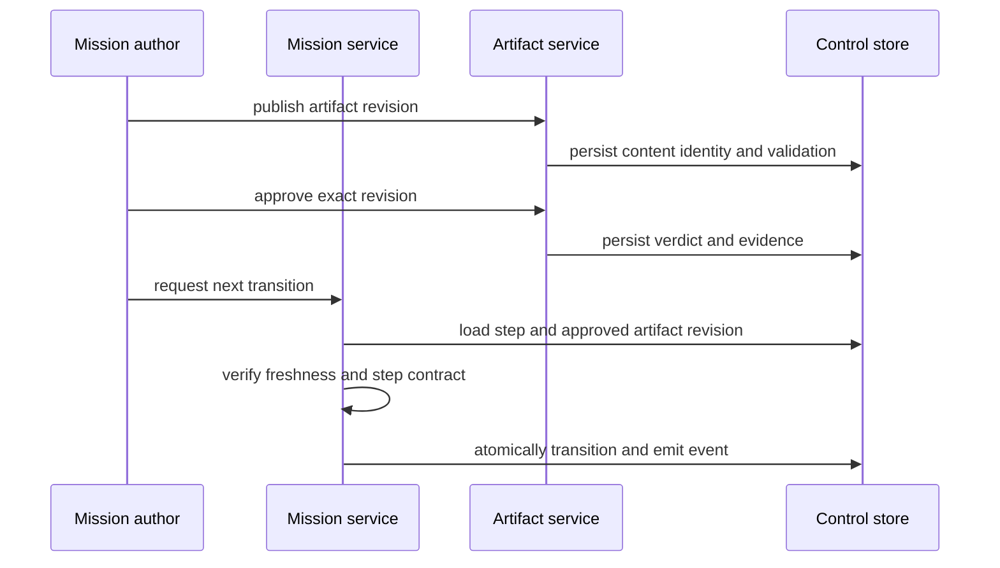
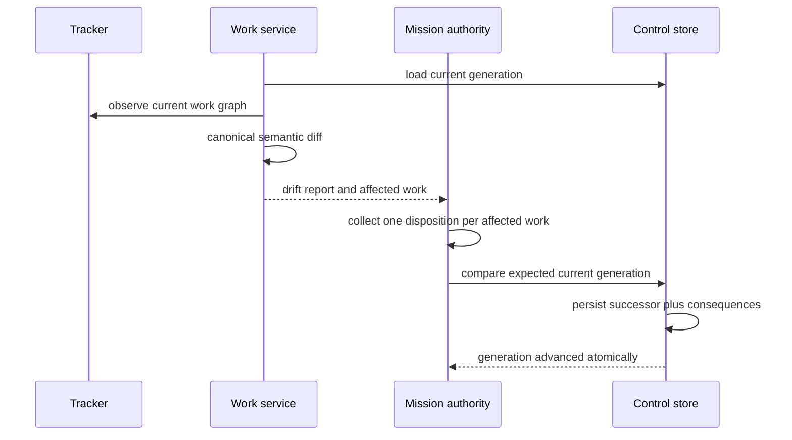

# Implementation Plan: Software Development Mission Method

**Branch**: `feat/software-development-mission-method` | **Date**: 2026-08-27 | **Spec**: [spec.md](spec.md)
**Input**: Approved mission specification in `kitty-specs/software-development-mission-method-01M11EX2/spec.md`

## Summary

Deliver the first complete software-development mission-method vertical slice
above the Phase 1 authority kernel and Phase 2 tracker boundary. A mission will
progress through typed specify and plan gates, decompose two dependency-related
work items into a provider-neutral tracker, finalize an immutable executable
graph generation, detect later provider drift, reconcile affected work with
mixed per-work dispositions, and expose the next legal outcome through a pure
typed query. `tasks.md` becomes a regenerable output that is never parsed as
authority.

The plan reuses the existing `workgraph.Revision`, reconciliation consequence
model, SQLite finalization/reconciliation transactions, sealed
`governancecontext.Context`, tracker ports, durable fake provider, Beads adapter,
campaign runner, and architecture mutant framework. New capability boundaries
are introduced only where the executable slice earns them: mission lifecycle,
artifact revision/approval, the statically registered software-development
definition, and non-authoritative projection.

## Engineering Alignment

- Preserve the existing capability-oriented architecture; do not translate the
  Python command/package structure.
- Keep SQLite as the qualified control-store adapter for this mission. Gapdb
  adoption remains a separately approved migration.
- Treat provider reads and local publication as an honest saga: finalization
  pins the exact observed provider revisions, rechecks them before local
  publication, and reports later change as drift. It does not claim a
  cross-store transaction.
- Extend the existing WorkRevision format compatibly rather than inventing a
  second executable-graph model.
- Publish one successor graph atomically with a set of per-work dispositions;
  the existing disposition consequence rules remain the policy source.
- Keep `next` pure. Mutating actions named by `next` require their own operation
  identity and governance context.
- Use the existing helper binary as the qualification composition root. A
  production CLI, API, MCP, and Team Kitty surface remain Phase 6.

## Technical Context

**Language/Version**: Go 1.26.4  
**Primary Dependencies**: Go standard library; existing provider-neutral tracker contracts; existing Beads v1.2.2 JSON adapter; `modernc.org/sqlite` through the control-store adapter only  
**Storage**: Existing transactional control-store port with SQLite schema v12 as the starting adapter; primary tracker for mutable work definitions  
**Testing**: Table-driven unit and contract tests, durable fake-provider conformance, qualified Beads scenarios, deterministic clocks, fault injection, architecture reachability mutants, test-campaign censuses, race detector, vet, staticcheck, module verification, vulnerability scan, formatting, and binary builds  
**Target Platform**: Local Linux/amd64 qualification; portable Go domain packages; one machine/filesystem control authority  
**Project Type**: Single Go module with internal vertical capabilities and one qualification composition root  
**Performance Goals**: p95 under 500 ms for local 100-item mission queries and projections excluding provider time; finalization/reconciliation under 2 seconds excluding provider time; bounded PR campaign under 10 minutes  
**Constraints**: No tracker-derived mission transitions; no Markdown authority; no cross-store atomicity claim; no production worktree/review/integration implementation; no Gapdb migration; no external transport server  
**Scale/Scope**: One built-in software-development mission definition; 100-item qualification graphs; 1,000 drift mutations; 100 two-process finalization races; two tracker implementations in the proving scenario

## Charter Check

The project charter exists as `.kittify/charter/charter.yaml`; no rendered
`.kittify/charter/charter.md` is present. Planning therefore uses the compact
governance context resolved by Spec Kitty for the `plan` action.

| Directive | Plan response | Gate |
|---|---|---:|
| 001 Architectural integrity | Add only earned vertical capabilities; extend the existing WorkRevision, governance, tracker, control-store, and campaign seams. | Pass |
| 010 Specification fidelity | Map every FR, NFR, constraint, and success criterion to concerns and qualification contracts; defer Phase 4–6 behavior explicitly. | Pass |
| 024 Locality of change | Keep provider changes behind existing tracker ports and persistence changes behind the control-store adapter. | Pass |
| 028 Search discipline | Use repository-native structural and text search for discovery; no speculative package duplication. | Pass |
| 030 Test/typecheck gate | Preserve the existing quality ladder and add mission-method profiles with exact censuses and mutant controls. | Pass |

No charter exception is required. This gate is re-evaluated after the Phase 1
design artifacts below; no new conflict was found.

## Architectural Decisions

### AD-01 — Mission lifecycle is a vertical authority capability

Create `internal/mission` for mission instances, step state, transitions,
decisions, blockers, pure next results, and store ports. It owns lifecycle
authority but not artifact content, tracker protocol, workgraph policy, or
transport rendering.

### AD-02 — Software development is a static definition

Create `internal/missiontype/softwaredev` as data and transition policy over
the public mission contracts. The composition root registers its exact key and
version. Missing, duplicate, or unsupported definitions fail closed; no dynamic
workflow DSL or silent default is introduced.

### AD-03 — Artifact revision and approval are separate from files

Create `internal/artifact` for typed artifact identity, immutable content
digest/revision, validation result, approval evidence, and approval freshness.
The initial repository-file adapter may load specification and plan bytes, but
mission transitions consume artifact revisions from the control store rather
than inferring approval from file presence.

### AD-04 — WorkRevision v2 extends the proven graph

Extend `internal/workgraph` so a revision also pins predecessor identity,
planning source commit, provider observation set, descriptions/design context,
structured criterion metadata, write scopes, dependency satisfaction policy,
and the post-collapse lane DAG. Preserve deterministic canonical JSON and
strict decoding. Existing v1 records remain readable and are never rewritten.

### AD-05 — Drift is a semantic comparison, not revision inequality

A new drift service compares canonical old and candidate graphs and reports
added, removed, and changed work plus field-level semantic changes. Provider
revision change alone is retained as observation evidence but does not force a
semantic disposition when normalized executable content is equivalent.

### AD-06 — Reconciliation publishes mixed per-work decisions atomically

Add a mission-level reconciliation plan containing exactly one disposition for
each affected active or accepted WorkID. Each entry delegates consequence
semantics to the existing `continue | supersede | invalidate | fork` rules. One
control-store transaction validates the expected current generation, persists
the successor revision, decisions, consequences, authority actions, event, and
outbox, then advances the current-generation pointer.

### AD-07 — External finalization is an observation saga

The application reads all mapped tracker work, normalizes it, validates it,
and performs a bounded revision recheck before publishing locally. If the
provider changes during observation, finalization refuses and can be retried.
A change after the recheck is simply later drift; this is the strongest honest
contract available without a distributed transaction.

### AD-08 — Governance context is sealed before an action

Reuse schema-v12 governance contexts. Mission actions persist the sealed
context reference that contains mission-definition, profile, doctrine, and
configuration entries. `next` may describe the required governance action but
does not create authority or silently select mutable process-global policy.

### AD-09 — Projection is a one-way read boundary

Create `internal/projection` only for canonical read models and renderers. It
may depend on public mission/work/artifact read types but no authority package
may import it. The tasks renderer writes a disclosed header and complete source
generation through an atomic file replacement; no runtime reader for tasks
Markdown exists.

### AD-10 — Architecture policy grows by one explicit axis

Add mission, artifact, and mission-type packages to the authority tier. Add a
read-only projection tier whose dependency direction points inward and which
cannot be imported by authority or provider code. Retain every Phase 2 Beads
isolation and deferred-surface prohibition with new mutants proving that
tracker, projection, and composition code cannot mint mission authority.

## Transaction and Data Flow

### Specify/plan transition



### Decompose and finalize


### Drift and reconciliation



## Project Structure

### Documentation (this mission)

```text
kitty-specs/software-development-mission-method-01M11EX2/
├── spec.md
├── plan.md
├── research.md
├── data-model.md
├── quickstart.md
├── checklists/requirements.md
├── contracts/
│   ├── artifact-contract.schema.json
│   ├── work-revision-v2.schema.json
│   ├── reconciliation.schema.json
│   ├── next-result.schema.json
│   └── mission-method-commands.md
└── tasks/                  # authored only by the later tasks workflow
```

### Source Code (repository root)

```text
internal/
├── artifact/              # artifact revisions, validation, approval freshness
├── mission/               # mission lifecycle, decisions, blockers, next service
├── missiontype/
│   └── softwaredev/       # static software-development step definition
├── workgraph/             # v2 revision, validation, drift, reconciliation
├── governancecontext/     # existing sealed action context, extended resolution
├── projection/            # read-only tasks/status renderers
├── tracker/               # existing provider-neutral work observations
│   ├── fake/              # portable proving provider
│   └── beads/             # qualified production tracker adapter
├── controlstore/
│   └── sqlite/            # adapter migrations and transactional stores
├── helpercmd/             # qualification-only composition commands
├── architecture/          # tier, reachability, and mutant guards
├── scenario/              # vertical and fault scenarios
└── testcampaign/          # exact mission-method campaign census
cmd/
└── spk-phase1-helper/     # retained internal qualification binary
```

**Structure Decision**: Extend existing capability packages in place. Add only
`artifact`, `mission`, `missiontype/softwaredev`, and `projection`; each has a
distinct policy boundary exercised by the proving scenario. Do not add generic
`app`, `service`, `util`, transport, or alternate-store scaffolding.

## Persistence Plan

Starting from SQLite schema v12, add append-only migrations for:

1. mission definitions, mission instances, current step, and version;
2. artifact revisions, validations, approvals, and exact-revision foreign keys;
3. decisions and blockers with typed lifecycle states;
4. current WorkRevision generation pointers and v2 revision metadata;
5. drift reports and normalized field changes;
6. reconciliation plans, per-work dispositions, fork edges, and consequences;
7. mission action commands with idempotency digest and governance context;
8. transition and next-result audit events where mutation actually occurs.

Every migration upgrades exact prior versions, refuses future versions, keeps
historical WorkRevision bytes decodable, and includes populated-database tests.
No trigger or migration rewrites prior accepted evidence. Queries and pure
`next` results do not create operation rows.

## Validation Strategy

### Contract and unit proof

- Exact static mission definition and legal transition table.
- Artifact digest, validation, approval freshness, rejection, and replay.
- WorkRevision v1 compatibility and v2 canonical ordering/digest.
- Requirement coverage, overreach, context, criteria, dependency, and
  post-collapse lane-cycle validators with deletion mutants.
- Field-level drift classification and provider-revision-only equivalence.
- Mixed reconciliation plans and every status/disposition consequence.
- Closed `NextResult` vocabulary, query purity, stable identity, and typed
  diagnostics.
- Projection disclosure, deterministic rendering, atomic write, and proof that
  no production path reads Markdown as authority.

### Scenario proof

1. Run the two-item happy path through fake and Beads trackers.
2. Inject tracker change after finalization and require drift.
3. Exercise all dispositions, including a mixed successor generation.
4. Race 100 finalizers and prove one current generation.
5. Inject crashes around every local publication boundary and restart.
6. Mutate 1,000 generated graphs and prove zero silent drift.
7. Corrupt/delete/edit projections 100 times and compare canonical state.
8. Change governance sources after capsule creation and verify historical
   action provenance remains unchanged.

Every scenario calls the universal Phase 1 invariant assertion where execution
state is present. The durable fake provider remains the primary contract proof;
the Beads campaign proves provider composition, not mission semantics unique to
Beads.

### Quality profiles

- `mission-contract`: fast unit and provider-neutral contract suite.
- `mission-acceptance`: two-item vertical scenario and spec traceability.
- `mission-adversarial`: drift, crash, race, projection, and stale-governance
  campaigns.
- `architecture`: extended tiers, forbidden reachability, and mutants.
- Existing `quality`: build, test, race, vet, staticcheck, module verification,
  vulnerability scan, formatting, and binary build.

The PR gate runs bounded contract, acceptance, architecture, and race profiles
under ten minutes. The 1,000-mutation, 100-race, and real-provider campaigns may
run scheduled/on-demand if measurements show the bounded budget cannot hold.

## Implementation Concern Map

### IC-01 — Mission definition and lifecycle authority

- **Purpose**: Introduce one explicit, statically registered
  software-development step contract and durable mission transition service.
- **Relevant requirements**: FR-001–FR-003, FR-006–FR-007, FR-024
- **Affected surfaces**: `internal/mission`, `internal/missiontype/softwaredev`,
  `internal/ids`, control-store mission tables
- **Sequencing/depends-on**: none
- **Risks**: Recreating Python command sequencing or silently defaulting an
  absent mission type.

### IC-02 — Artifact revision and approval freshness

- **Purpose**: Make specification and plan approval bind exact typed content
  rather than file presence or mutable prose.
- **Relevant requirements**: FR-004–FR-007, FR-028
- **Affected surfaces**: `internal/artifact`, `internal/mission`, control-store
  artifact tables
- **Sequencing/depends-on**: IC-01
- **Risks**: Duplicate authority between Git files and the control record;
  approval replay after content mutation.

### IC-03 — Decomposition and work-quality validation

- **Purpose**: Translate approved plan scope into provider-neutral tracker work
  and fail closed on coverage, context, overreach, ownership, criteria, or graph
  defects.
- **Relevant requirements**: FR-008–FR-012
- **Affected surfaces**: `internal/mission`, `internal/workgraph`,
  `internal/tracker`, conformance fixtures
- **Sequencing/depends-on**: IC-01, IC-02
- **Risks**: Letting provider readiness/status become mission law; coupling the
  validator to Beads fields.

### IC-04 — WorkRevision v2 and atomic finalization

- **Purpose**: Extend the proven revision with complete executable provenance,
  canonical digest, compatibility decoding, and single-winner publication.
- **Relevant requirements**: FR-013–FR-015, NFR-002–NFR-004
- **Affected surfaces**: `internal/workgraph`, `internal/controlstore/sqlite`,
  helper composition
- **Sequencing/depends-on**: IC-03
- **Risks**: Breaking Phase 1 v1 evidence; provider change during observation;
  lane-cycle validation occurring after publication.

### IC-05 — Semantic drift and mixed reconciliation

- **Purpose**: Compare finalized and observed graphs and publish one successor
  with complete per-work dispositions and enforceable consequences.
- **Relevant requirements**: FR-016–FR-020, NFR-001, NFR-003–NFR-004
- **Affected surfaces**: `internal/workgraph`, `internal/mission`, control-store
  reconciliation tables, Phase 1 consumers
- **Sequencing/depends-on**: IC-04
- **Risks**: Treating provider revision noise as semantic change; incomplete
  affected set; global disposition unable to represent reality; stale CAS.

### IC-06 — Action-scoped governance provenance

- **Purpose**: Bind legal mission actions to sealed profile, doctrine,
  configuration, and mission-definition revisions.
- **Relevant requirements**: FR-021, FR-028, NFR-009, NFR-012
- **Affected surfaces**: `internal/governancecontext`, `internal/mission`,
  schema-v12 context records and new action records
- **Sequencing/depends-on**: IC-01
- **Risks**: Capturing mutable paths instead of content commitments; recording
  secrets or the full doctrine catalog.

### IC-07 — Pure next protocol and durable interruption state

- **Purpose**: Expose one deterministic agent-facing outcome while keeping
  decisions and blockers durable and actions separately authorized.
- **Relevant requirements**: FR-022–FR-024, NFR-005, NFR-014
- **Affected surfaces**: `internal/mission`, `internal/helpercmd`, JSON contracts
- **Sequencing/depends-on**: IC-01, IC-02, IC-04, IC-06
- **Risks**: Queries mutating state; outcome inferred from tracker status;
  transport prose becoming branch logic.

### IC-08 — Derived compatibility projections

- **Purpose**: Render familiar work summaries without creating a second mutable
  authority.
- **Relevant requirements**: FR-025–FR-026, NFR-010
- **Affected surfaces**: `internal/projection`, `internal/helpercmd`,
  architecture reachability tests
- **Sequencing/depends-on**: IC-04, IC-05
- **Risks**: Reintroducing Markdown parsing; non-atomic output; stale projection
  presented without source generation.

### IC-09 — Vertical qualification and evidence

- **Purpose**: Prove the two-item mission and all load-bearing invariants through
  exact, source-bound campaigns.
- **Relevant requirements**: FR-027–FR-028, all NFRs, SC-001–SC-012
- **Affected surfaces**: `internal/scenario`, `internal/testcampaign`, CI,
  documentation evidence
- **Sequencing/depends-on**: IC-01–IC-08
- **Risks**: A fake that never lies; pass-only evidence; unbounded PR runtime;
  campaign manifests that do not census newly added tests.

### IC-10 — Permanent architecture and deferred-surface guard

- **Purpose**: Ensure mission authority cannot leak into tracker adapters,
  projections, transports, Markdown, or deferred Phase 4–6 packages.
- **Relevant requirements**: FR-003, FR-009, FR-019, FR-025, NFR-008
- **Affected surfaces**: `internal/architecture`, `internal/testcampaign`
- **Sequencing/depends-on**: evolves alongside IC-01–IC-09
- **Risks**: Weakening the guard to admit new packages; adding allowlists without
  mutants that prove forbidden edges still fail.

## Delivery Order

The first executable proof appears before completing the full surface:

1. Static mission definition, artifact approval, two-item fake decomposition,
   v2 finalization, and pure `next` happy path.
2. Semantic drift plus one mixed reconciliation generation.
3. Beads composition and provider-race honesty.
4. Governance provenance and projection compatibility.
5. Fault, concurrency, architecture, documentation, and source-bound closeout.

Package scaffolding without a working scenario is not progress. Every delivery
increment must advance or harden the same two-item mission.

## Risks and Mitigations

| Risk | Mitigation |
|---|---|
| Existing WorkRevision is mistaken for complete Phase 3 behavior | Characterize v1 exactly; add versioned fields and compatibility tests before changing consumers. |
| Tracker changes during finalization | Double-observe provider revisions, pin exact observations, fail on mid-read change, and detect all later change as drift. |
| Mixed reality forced into one global disposition | Persist one decision per affected work in a single reconciliation plan. |
| Artifact files become a hidden second authority | Persist typed revision/approval records; files are adapters and projections only. |
| `next` becomes a command dispatcher with hidden mutations | Separate pure query from idempotent action commands and mutation records. |
| Architecture guard is deleted or broadened casually | Extend classified tiers and add positive plus mutant-negative edge tests in the first package commit. |
| Phase 4 execution behavior leaks into scope | Use synthetic statuses only to validate reconciliation consequences; do not allocate real lanes/worktrees or dispatch agents. |
| Gapdb discussion reopens persistence design | Keep the control-store port; SQLite remains the qualified adapter until a separately evidenced adoption record changes it. |
| Long adversarial campaigns destroy feedback speed | Maintain exact fast/slow campaign profiles and frozen source-bound evidence. |

## Exit Evidence

Planning is complete when `research.md`, `data-model.md`, the five contracts,
and `quickstart.md` agree with this plan; the decision verifier is clean; all
artifacts are committed to `feat/software-development-mission-method`; and the
tasks workflow can translate IC-01 through IC-10 without inventing product
scope or architecture.
